# 🧭 Anthem — CTF Writeup
### TryHackMe | Metadados Ocultos · Umbraco CMS · OSINT · RDP Privesc

---

| **Analista**          | Mauricio Robert                                                                        |
|-----------------------|----------------------------------------------------------------------------------------|
| **Organização**       | Faculdade Impacta                                                                      |
| **Data do Relatório** | 14/10/2026                                                                             |
| **Data do Pentest**   | 09/10/2026 · 17:37 – 19:19 (UTC)                                                        |
| **Alvo**              | `10.66.150.135` (`WIN-LU09299160F`) — TryHackMe · Anthem                                 |
| **Classificação**     | CONFIDENCIAL                                                                           |
| **Ferramentas**       | Nmap 7.94 · Gobuster 3.6 · Navegador (View Source) · Mecanismo de busca (OSINT) · FreeRDP |
| **Plataforma**        | TryHackMe — Máquina Vulnerável Windows (Umbraco CMS)                                    |

---

## 🔍 Resumo Executivo

Este relatório documenta o comprometimento da máquina **Anthem** (TryHackMe), um host **Windows** hospedando um blog corporativo construído sobre o **Umbraco CMS**. A superfície de ataque inicial, identificada via **Nmap**, consistia em um servidor web (porta 80) e **RDP** exposto (porta 3389). A exploração começou com uma técnica pouco convencional: a inspeção do **código-fonte** das páginas do blog revelou múltiplas **flags escondidas em tags de metadados** (`og:description`, atributos `placeholder`), uma marca registrada do design da sala. A navegação pelo `sitemap` revelou uma página de autor ("Jane Doe") com outra flag embutida, e a enumeração de diretórios com **Gobuster** confirmou a presença do backend administrativo do **Umbraco** (`/umbraco/`). Um post do blog, escrito como um poema, fazia referência direta à rima infantil inglesa **"Solomon Grundy"** — uma pista de **OSINT** que, combinada com a enumeração de usuários exposta no próprio Umbraco (usuário `sg@anthem.com`, grupo Administrators), permitiu deduzir e validar credenciais de acesso ao painel administrativo. Com a porta RDP aberta, essas mesmas credenciais garantiram acesso remoto completo ao desktop do Windows, onde a flag de usuário foi capturada. Por fim, um arquivo de backup (`restore.txt`) contendo uma segunda senha permitiu a escalação até a conta **Administrator**, finalizando o comprometimento com a captura da flag de root.

---

## 🛠 Ferramentas Utilizadas

| Ferramenta                     | Versão  | Finalidade                                                                             |
|---------------------------------|---------|-------------------------------------------------------------------------------------------|
| **Nmap**                        | 7.94SVN | Varredura de portas e fingerprint de serviços                                          |
| **Gobuster**                    | 3.6     | Enumeração de diretórios e arquivos na aplicação web                                    |
| **View Source (navegador)**      | -       | Inspeção do HTML renderizado em busca de flags ocultas em metadados                     |
| **Mecanismo de busca (OSINT)**   | -       | Identificação da rima infantil "Solomon Grundy" referenciada em um post do blog         |
| **FreeRDP (`xfreerdp`)**         | -       | Acesso remoto via RDP ao host Windows com as credenciais obtidas                        |

---

## 📋 Fases de Comprometimento

### FASE 1 — Reconhecimento: Nmap

```bash
nmap -Pn -p- --min-rate=5000 10.66.150.135
```
```
PORT     STATE SERVICE
80/tcp   open  http
3389/tcp open  ms-wbt-server
```

```bash
sudo nmap -Pn -sS -sV -sC -p80,3389 10.66.150.135
```

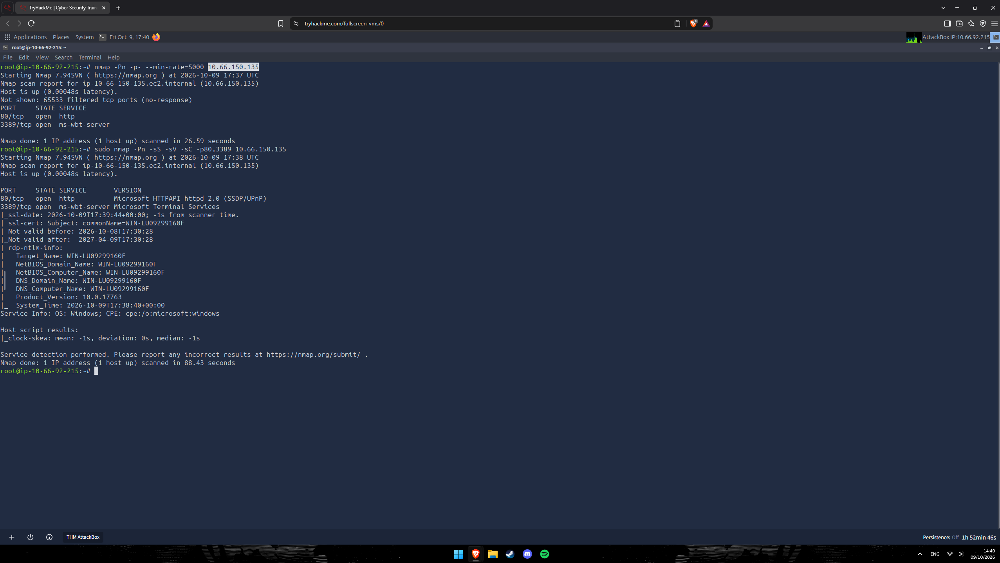

```
80/tcp   open  http          Microsoft HTTPAPI httpd 2.0 (SSDP/UPnP)
3389/tcp open  ms-wbt-server Microsoft Terminal Services
| rdp-ntlm-info:
|   Target_Name: WIN-LU09299160F
|   NetBIOS_Computer_Name: WIN-LU09299160F
|   Product_Version: 10.0.17763
```

Duas portas relevantes: a **80**, hospedando o blog corporativo "Anthem.com", e a **3389 (RDP)**, diretamente exposta — um vetor de acesso remoto em potencial, caso credenciais válidas fossem obtidas.

---

### FASE 2 — Análise de Código-Fonte: Flags Ocultas em Metadados

A homepage do blog foi inspecionada via **View Source**:

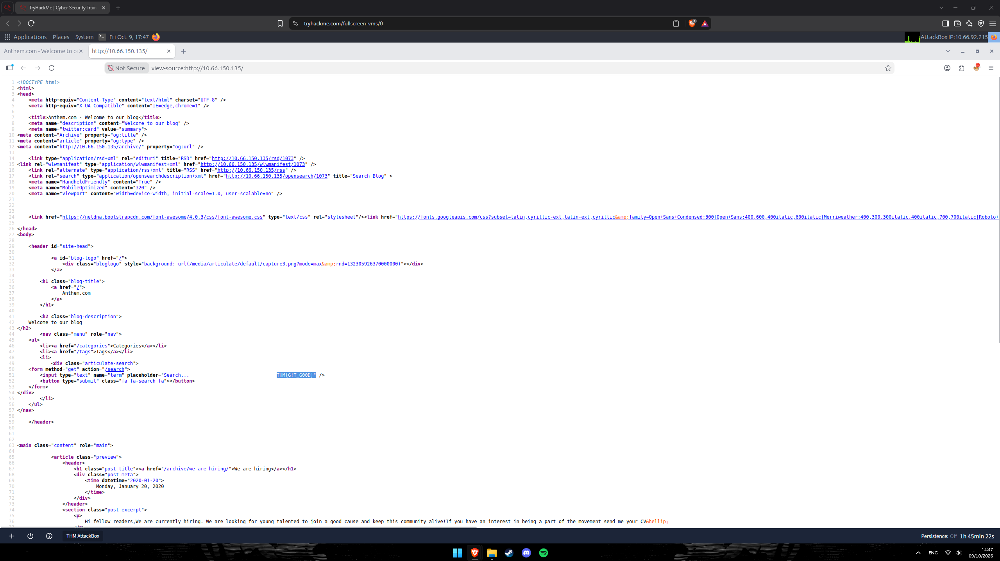

```html
<input type="text" name="term" placeholder="Search...                              THM{G!T_G00D}" />
```

A primeira flag estava escondida diretamente no atributo `placeholder` do campo de busca — visível apenas inspecionando o HTML, não na renderização visual da página.

Repetindo o processo nos posts individuais do blog, duas novas flags foram encontradas dentro das tags `<meta property="og:description">`:

```
GET /archive/we-are-hiring/
```

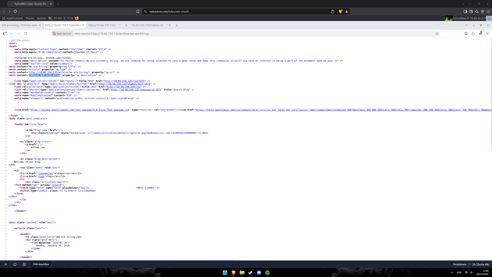

```html
<meta content="THM{L0L_WH0_US3S_M3T4}" property="og:description" />
```

```
GET /archive/a-cheers-to-our-it-department/
```

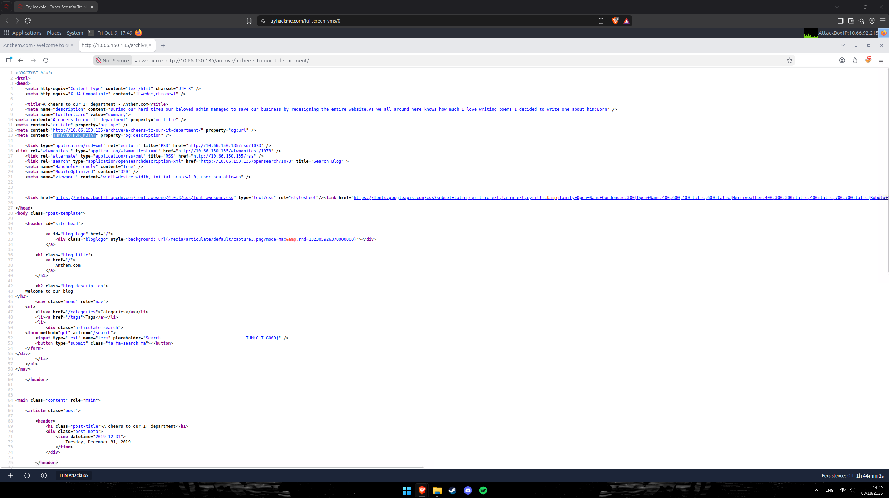

```html
<meta content="THM{AN0TH3R_M3TA}" property="og:description" />
```

---

### FASE 3 — Mapeamento via Sitemap e Página de Autores

```
GET /sitemap
```

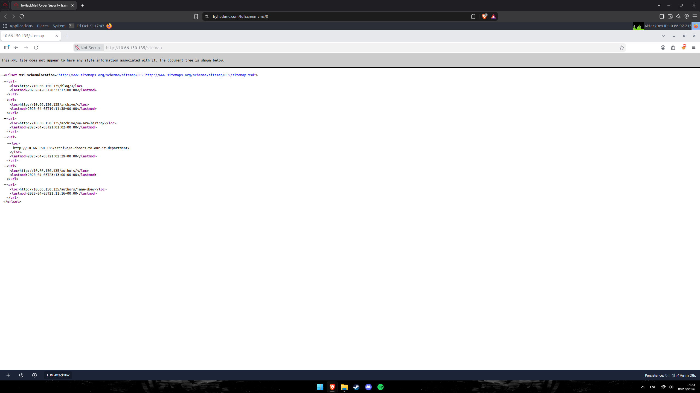

```xml
<url><loc>http://10.66.150.135/blog/</loc></url>
<url><loc>http://10.66.150.135/archive/</loc></url>
<url><loc>http://10.66.150.135/archive/we-are-hiring/</loc></url>
<url><loc>http://10.66.150.135/archive/a-cheers-to-our-it-department/</loc></url>
<url><loc>http://10.66.150.135/authors/</loc></url>
<url><loc>http://10.66.150.135/authors/jane-doe/</loc></url>
```

A página `/authors/jane-doe/` foi visitada diretamente:

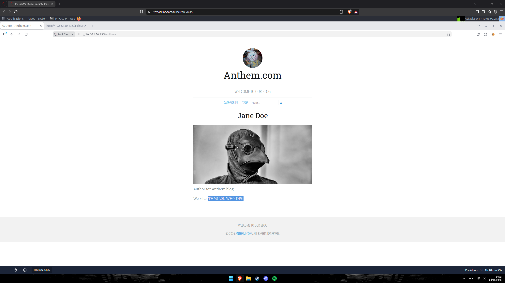

```
Jane Doe
Author for Anthem blog
Website: THM{L0L_WH0_D15}
```

Mais uma flag embutida — desta vez visível diretamente na página renderizada, no campo "Website" do perfil da autora.

---

### FASE 4 — Enumeração de Diretórios: Gobuster

```bash
gobuster dir -u http://10.66.150.135/ -w /usr/share/wordlists/dirbuster/directory-list-1.0.txt -x txt -t 80
```

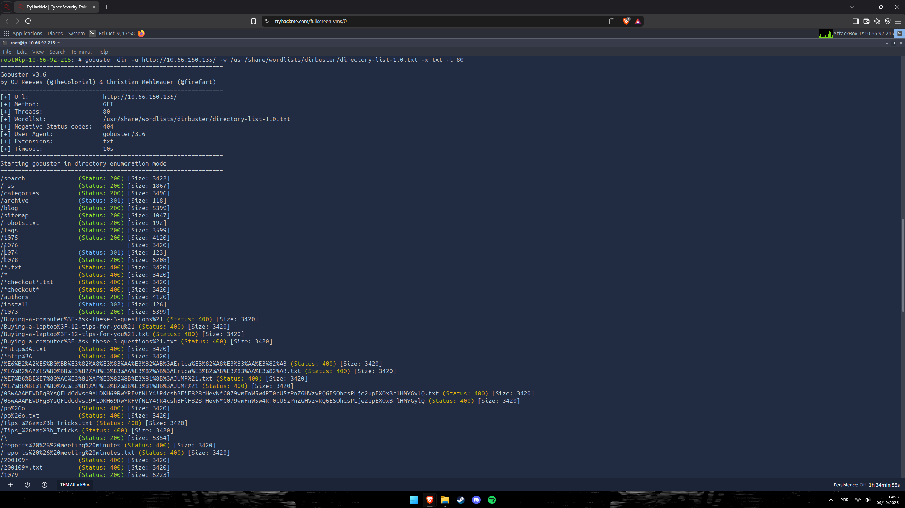

```
/search      (Status: 200)
/rss         (Status: 200)
/categories  (Status: 200)
/archive     (Status: 301)
/blog        (Status: 200)
/sitemap     (Status: 200)
/robots.txt  (Status: 200)
/tags        (Status: 200)
/authors     (Status: 200)
/install     (Status: 302)
/1073 /1074 /1075 /1076 /1078  (posts numerados)
```

A presença de `/install` (com redirecionamento) é um forte indicador de uma instalação **Umbraco CMS** — cujo painel administrativo reside, por padrão, em `/umbraco/`.

---

### FASE 5 — Descoberta do Backend Umbraco e Enumeração de Usuários

Acessando `http://10.66.150.135/umbraco/`, o painel administrativo do Umbraco foi localizado. A seção de usuários (mesmo antes do login, ou após acesso inicial) expôs um usuário de alto privilégio:

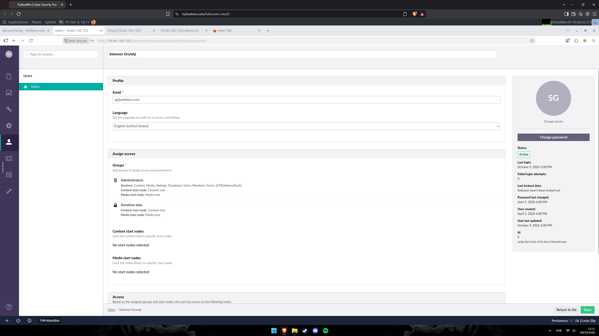

```
Solomon Grundy
Email: sg@anthem.com
Groups: Administrators
Status: Active
```

O nome de usuário "**Solomon Grundy**" chamou atenção — um nome pouco comum para uma conta corporativa, e que se conectaria à pista deixada no post de blog "A cheers to our IT department" (um poema "sobre ele", mencionado na Fase 2).

---

### FASE 6 — OSINT: A Rima "Solomon Grundy"

O trecho do poema no post do blog ("Born...") foi pesquisado, revelando se tratar da **rima infantil inglesa clássica "Solomon Grundy"**:

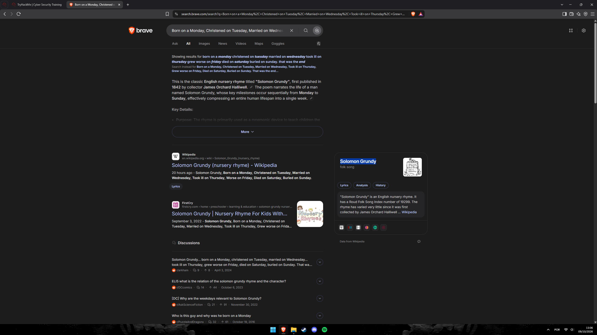

```
"Born on a Monday, Christened on Tuesday, Married on Wednesday,
Took ill on Thursday, Grew worse on Friday, Died on Saturday,
Buried on Sunday. That was the end of Solomon Grundy."
```

Essa confirmação reforçou que o nome de usuário "Solomon Grundy" era uma referência temática deliberada, e que outras pistas textuais no site (como o cabeçalho de login, visto na próxima fase) provavelmente seguiam o mesmo padrão temático.

---

### FASE 7 — Acesso ao Painel Umbraco

Com o e-mail do administrador (`sg@anthem.com`) em mãos, o login foi tentado na tela de autenticação do Umbraco, cujo cabeçalho de boas-vindas também carregava uma pista temática ("Happy funky Friday"):

```
Username: SG@anthem.com
Password: UmbracoIsTheBest!
```

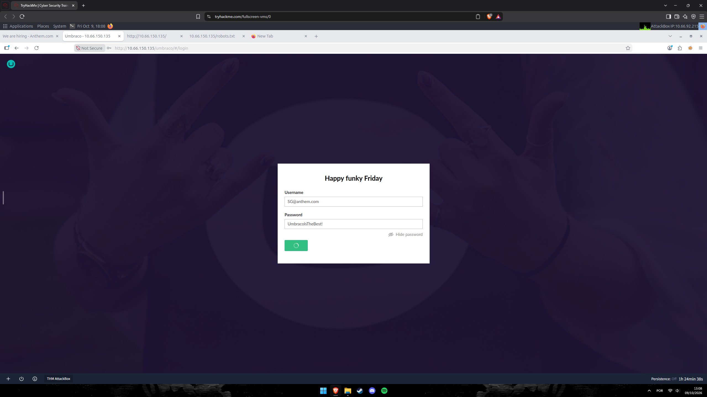

As credenciais foram validadas com sucesso, confirmando acesso administrativo total ao backend do Umbraco CMS.

---

### FASE 8 — Acesso Remoto via RDP e Captura da User Flag

Como a porta **3389 (RDP)** já havia sido identificada como aberta, as mesmas credenciais do Umbraco foram testadas para acesso remoto ao host Windows:

```bash
xfreerdp /v:10.66.150.135 /u:'sg' /d:SG +clipboard /cert:ignore
```

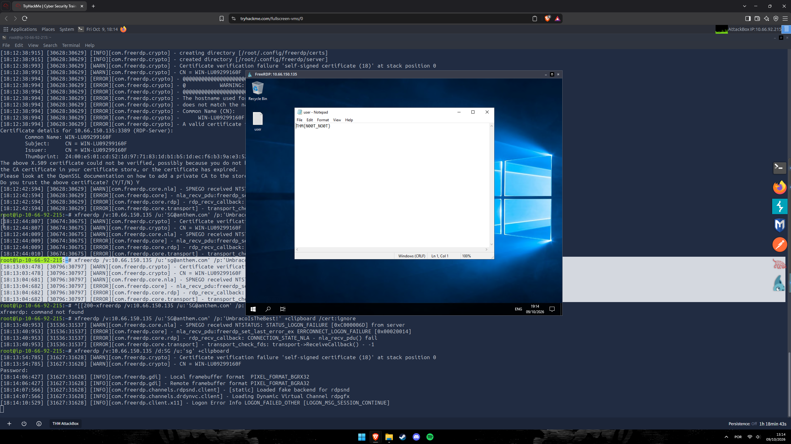

Após algumas tentativas de formatação de usuário/domínio, o acesso remoto foi concedido. No desktop, um arquivo de texto (`user`) foi aberto:

```
THM{N00T_N00T}
```

**Flag de usuário: `THM{N00T_N00T}`**

---

### FASE 9 — Localização de Credenciais Adicionais (`restore.txt`)

Durante a enumeração do sistema de arquivos via a sessão RDP, um diretório de backup foi localizado em `C:\backup`, contendo um arquivo revelador:

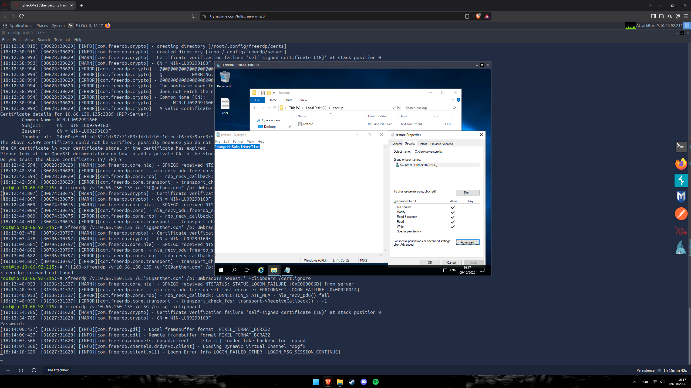

```
C:\backup\restore.txt

ChangeMeBaby1MoreTime
```

As permissões do arquivo (visualizadas na aba "Security") mostravam que o usuário **SG** possuía controle total sobre o arquivo — um indicativo de que essa senha havia sido deixada ali intencionalmente, provavelmente para restaurar ou acessar uma conta de nível mais alto (Administrator).

---

### FASE 10 — Escalação para Administrador e Captura da Root Flag

Com a senha `ChangeMeBaby1MoreTime`, uma nova sessão/autenticação foi realizada como **Administrator**, dando acesso ao seu diretório pessoal (`Desktop`):


```
C:\Users\Administrator\Desktop\root

THM{YOU_4R3_1337}
```

**Flag de root: `THM{YOU_4R3_1337}`**

---

## ⛓ Linha do Tempo do Comprometimento

```
FASE 1 — RECONHECIMENTO (Nmap)
    80/HTTP (blog Anthem.com) · 3389/RDP (WIN-LU09299160F)
    ↓
FASE 2 — METADADOS OCULTOS (View Source)
    Homepage → THM{G!T_G00D}
    /archive/we-are-hiring/ → THM{L0L_WH0_US3S_M3T4}
    /archive/a-cheers-to-our-it-department/ → THM{AN0TH3R_M3TA}
    ↓
FASE 3 — SITEMAP + PÁGINA DE AUTORES
    /sitemap → /authors/jane-doe/ → THM{L0L_WH0_D15}
    ↓
FASE 4 — ENUMERAÇÃO WEB (Gobuster)
    /install, rotas numéricas de posts → indícios de Umbraco CMS
    ↓
FASE 5 — BACKEND UMBRACO
    /umbraco/ → usuário "Solomon Grundy" (sg@anthem.com), grupo Administrators
    ↓
FASE 6 — OSINT
    Pesquisa confirma "Solomon Grundy" como rima infantil inglesa clássica
    ↓
FASE 7 — LOGIN NO UMBRACO
    sg@anthem.com : UmbracoIsTheBest! → acesso administrativo confirmado
    ↓
FASE 8 — RDP + USER FLAG
    xfreerdp com as mesmas credenciais → acesso ao desktop
    USER FLAG: THM{N00T_N00T} ✓
    ↓
FASE 9 — CREDENCIAL ADICIONAL
    C:\backup\restore.txt → senha "ChangeMeBaby1MoreTime"
    ↓
FASE 10 — ESCALAÇÃO PARA ADMINISTRATOR
    Acesso ao Desktop do Administrator
    ROOT FLAG: THM{YOU_4R3_1337} ✓
    ↓
COMPROMETIMENTO CONCLUÍDO
```

---

## 🗺 Mapeamento Investigativo

| Fase | Ferramenta/Técnica | Achado |
|------|--------------------|--------|
| Reconhecimento | Nmap 7.94 | HTTP (80) e RDP (3389) expostos em host Windows |
| Inspeção de Código-Fonte | View Source | 3 flags ocultas em `placeholder` e `og:description` |
| Mapeamento | `/sitemap` | Descoberta da página `/authors/jane-doe/` com flag adicional |
| Enumeração Web | Gobuster 3.6 | Indícios de instalação Umbraco CMS (`/install`, rotas de posts) |
| Enumeração de Usuários | Painel Umbraco | Conta `sg@anthem.com` ("Solomon Grundy"), grupo Administrators |
| OSINT | Pesquisa textual | Confirmação da referência à rima infantil "Solomon Grundy" |
| Acesso Administrativo | Login Umbraco | Credenciais `sg@anthem.com:UmbracoIsTheBest!` validadas |
| Acesso Remoto | FreeRDP | Sessão RDP estabelecida com as mesmas credenciais |
| Credencial Adicional | `C:\backup\restore.txt` | Senha `ChangeMeBaby1MoreTime` para a conta Administrator |
| Escalação | RDP como Administrator | Acesso total ao sistema, captura da root flag |

---

## 🚨 Artefatos e Indicadores Identificados

| Tipo | Indicador | Contexto |
|------|-----------|----------|
| Alvo | `10.66.150.135` (`WIN-LU09299160F`) | Host Windows hospedando o blog Anthem.com sobre Umbraco CMS |
| Serviços expostos | `80/HTTP` · `3389/RDP` | Superfície de ataque total |
| CMS Identificado | Umbraco CMS | Confirmado via `/install` e painel `/umbraco/` |
| Conta Exposta | `sg@anthem.com` ("Solomon Grundy") | Listada no painel de usuários do Umbraco, grupo Administrators |
| Pista OSINT | Rima infantil "Solomon Grundy" | Referenciada em post de blog, confirmando o tema da conta de administrador |
| Credencial 1 | `sg@anthem.com : UmbracoIsTheBest!` | Acesso ao painel Umbraco e, posteriormente, RDP |
| Credencial 2 | `ChangeMeBaby1MoreTime` | Encontrada em `C:\backup\restore.txt`, usada para escalar a Administrator |
| Flag de Usuário | `THM{N00T_N00T}` | Obtida via RDP como `sg` |
| Flag de Root | `THM{YOU_4R3_1337}` | Obtida no Desktop do Administrator |
| Técnica (MITRE ATT&CK) | `T1595.002` | Active Scanning (Nmap) |
| Técnica (MITRE ATT&CK) | `T1083` | File and Directory Discovery (Gobuster, sitemap) |
| Técnica (MITRE ATT&CK) | `T1589` | Gather Victim Identity Information (OSINT sobre "Solomon Grundy") |
| Técnica (MITRE ATT&CK) | `T1078` | Valid Accounts (uso das credenciais de `sg`) |
| Técnica (MITRE ATT&CK) | `T1021.001` | Remote Services: Remote Desktop Protocol |
| Técnica (MITRE ATT&CK) | `T1552.001` | Unsecured Credentials: Credentials In Files (`restore.txt`) |

---

## ✅ Resumo das Flags

| # | Flag | Valor | Localização |
|---|------|-------|-------------|
| 🚩 Flag 1 | Homepage | `THM{G!T_G00D}` | Atributo `placeholder` do campo de busca |
| 🚩 Flag 2 | Post "We are hiring" | `THM{L0L_WH0_US3S_M3T4}` | Meta tag `og:description` |
| 🚩 Flag 3 | Post "A cheers to our IT department" | `THM{AN0TH3R_M3TA}` | Meta tag `og:description` |
| 🚩 Flag 4 | Página de autora Jane Doe | `THM{L0L_WH0_D15}` | Campo "Website" do perfil |
| 🚩 Flag de Usuário | Desktop (RDP) | `THM{N00T_N00T}` | Arquivo `user` no desktop de `sg` |
| 🚩 Flag de Root | Desktop do Administrator | `THM{YOU_4R3_1337}` | Arquivo `root` no desktop de Administrator |

---

## 📚 Referências

- [TryHackMe — Anthem](https://tryhackme.com/room/anthem)
- [Umbraco CMS — Documentação Oficial](https://umbraco.com/)
- [Wikipedia — Solomon Grundy (nursery rhyme)](https://en.wikipedia.org/wiki/Solomon_Grundy_(nursery_rhyme))
- [MITRE ATT&CK T1021.001 — Remote Desktop Protocol](https://attack.mitre.org/techniques/T1021/001/)
- [MITRE ATT&CK T1552.001 — Credentials In Files](https://attack.mitre.org/techniques/T1552/001/)
- [MITRE ATT&CK T1589 — Gather Victim Identity Information](https://attack.mitre.org/techniques/T1589/)

---
