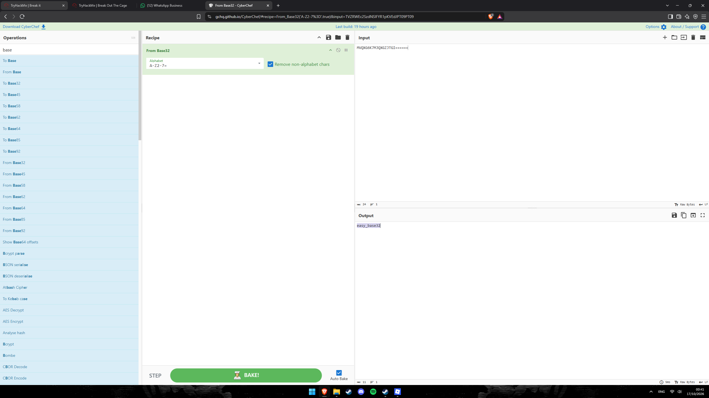
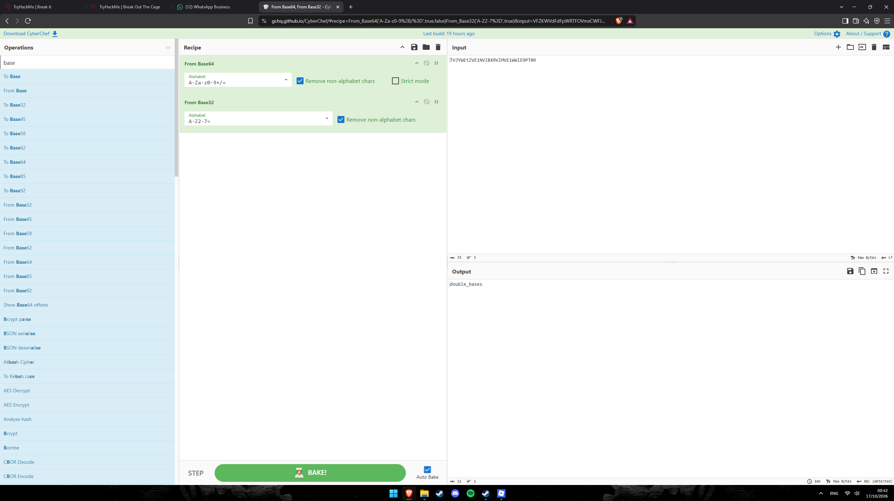
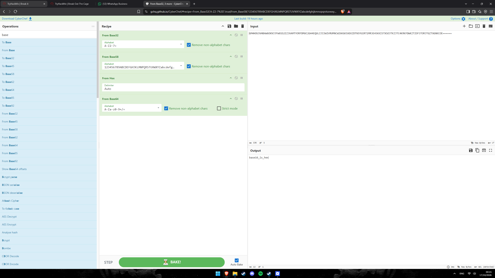
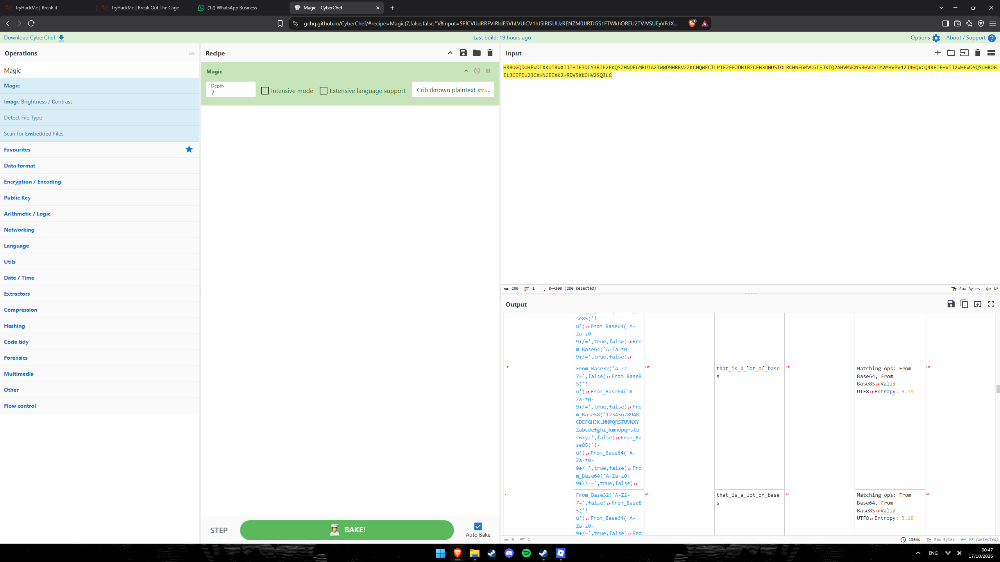

# TryHackMe — Break it

> **Categoria:** Cryptography / Encoding
> **Dificuldade:** Médio
> **Ferramenta principal:** CyberChef & dcode.fr

## Descrição

Sala de desafios de criptografia e codificação multi-camada dividida em três séries de níveis. A cada nível, um texto é ocultado por uma cadeia de encodings e cifras que precisa ser revertida na ordem correta para revelar a flag/resposta.

---

## Série 1 — Cipher Challenges

### Level 1 — Base32 + ROT13

**Pipeline:** `Base32 decode → ROT13`

O texto de entrada estava encodado em Base32 (identificável pelo alfabeto A–Z 2–7 e padding com `=`). Após decodificar o Base32 o resultado ainda não era legível — passando pelo ROT13 (rotação de 13 letras), o texto final foi revelado.

**Receita CyberChef:**
```
From Base32 (A-Z2-7=, remove non-alphabet)
→ ROT13 (lower + upper, amount 13)
```

**Resposta:** `make_13_spin`


*Figura 1 — Receita From Base32 → ROT13 decodificando o nível 1 para `make_13_spin`*

---

### Level 2 — Base64 + Base85 + Vigenère

**Pipeline:** `Base64 decode → Base85 decode → Vigenère Decode (key: tango)`

O texto inicial estava em Base64 (alfabeto A–Za–z0–9+/=). A camada intermediária era Base85 (alfabeto `!–u`), resultando em um texto cifrado com a cifra de Vigenère. A chave `tango` foi fornecida como parte do desafio.

**Receita CyberChef:**
```
From Base64 (A-Za-z0-9%2B%3D, remove non-alphabet)
→ From Base85 (1-u, remove non-alphabet, all-zero group char: z)
→ Vigenère Decode (key: tango)
```

**Resposta:** `I luv vigenere cipher` *(dica adicional entre parênteses: `eqf: tnhsv`)*


*Figura 2 — Três camadas (Base64 → Base85 → Vigenère) decodificadas no CyberChef, revelando a resposta do nível 2*

---

### Level 3 — Base85 + ROT47 + Base64 + Base32 + ROT13

**Pipeline:** `Base85 → ROT47 → Base64 → Base32 → ROT13`

O nível mais complexo da Série 1 — cinco camadas encadeadas. A ordem importa: começar por Base85 (alfabeto `!–u`), rotacionar com ROT47 (que opera sobre os 94 caracteres imprimíveis ASCII, do `!` ao `~`), decodificar Base64, decodificar Base32 e, por fim, aplicar ROT13 para revelar o texto.

**Receita CyberChef:**
```
From Base85 (1-u, remove non-alphabet, all-zero group: z)
→ ROT47 (amount 47)
→ From Base64 (A-Za-z0-9%2B%3D, remove non-alphabet)
→ From Base32 (A-Z2-7=, remove non-alphabet)
→ ROT13 (lower + upper, amount 13)
```

**Resposta:** `decode_and_rot`


*Figura 3 — Cadeia de cinco operações no CyberChef revelando `decode_and_rot` no nível 3*

---

### Level 4 — Base91 → Decimal → Hex → Base64 → Base58 → Vigenère (`TANGODOWN`)

O nível 4 foi o mais elaborado da Série 1, envolvendo seis camadas e a necessidade de reconhecer o encoding **Base91** — que não está diretamente disponível no CyberChef e precisou ser identificado e decodificado via **dcode.fr**.

#### Etapa 4a — Identificação e decodificação do Base91

O texto inicial era composto por caracteres ASCII imprimíveis sem padding, característico do Base91. Usando a ferramenta de decodificação Base91 em [dcode.fr/base-91-encoding](https://www.dcode.fr/base-91-encoding), o resultado foi uma sequência de números decimais separados por espaços.

.png)
*Figura 4 — Texto reconhecido como Base91 decodificado via dcode.fr, produzindo uma sequência decimal*

#### Etapa 4b — Decimal → Hex → Base64

Com a sequência decimal obtida, a decodificação continuou no CyberChef:

```
From Decimal (delimiter: Space)
→ From Hex (delimiter: Auto)
→ From Base64 (A-Za-z0-9%2B%3D, remove non-alphabet)
```

O resultado revelou o ciphertext Vigenère **junto com a dica da chave**:

```
GU4AmGDQNTu5ThmmDaFNq1wt9yD7Q8617C2uu {key: tangodown}
```

.png)
*Figura 5 — Após três camadas (Decimal→Hex→Base64), o texto `GU4AmGDQNTu5ThmmDaFNq1wt9yD7Q8617C2uu` é revelado junto com a dica da chave Vigenère `tangodown`*

#### Etapa 4c — Base58 → Vigenère (TANGODOWN)

O texto `GU4AmGDQNTu5ThmmDaFNq1wt9yD7Q8617C2uu` estava encodado em **Base58** (alfabeto de Bitcoin, sem os caracteres 0/O/I/l ambíguos). Decodificando no CyberChef com `From Base58`, o resultado foi o ciphertext Vigenère `roh gfh o nrtl purh qnnvkrx`. Decriptando com a chave **TANGODOWN** via dcode.fr Vigenère Decoder:

```
From Base58 (123456789ABCDEFGHJKLMNPQRSTUVWXYZ..., remove non-alphabet)
→ Vigenère Decode (key: TANGODOWN)
```

**Resposta:** `you are a real code cracker`

.png)
*Figura 6 — Base58 decodifica para o ciphertext Vigenère; com a chave TANGODOWN a mensagem final é `you are a real code cracker`*

---

## Série 2 — Shift Challenges

Esta série combina **representação hexadecimal**, **rotação de bits (Rotate left)** e codificações de base com **ROT13** final. O padrão é sempre: Hex → rotacionar bits → decodificar base → ROT13.

---

### Level 1 — Hex + Rotate left(1) + Base64 + ROT13

**Pipeline:** `From Hex → Rotate left (1 bit, carry through) → From Base64 → ROT13`

O texto de entrada era hexadecimal sem separador. Após converter, cada byte foi rotacionado 1 bit à esquerda (com "carry through" ativado, que circula o bit que sai de volta para o LSB). O resultado decodificado do Base64 passado pelo ROT13 revelou a resposta.

**Receita CyberChef:**
```
From Hex (delimiter: Auto)
→ Rotate left (amount: 1, carry through: ✓)
→ From Base64 (A-Za-z0-9%2B%3D, remove non-alphabet)
→ ROT13 (lower + upper, amount 13)
```

**Resposta:** `shift logic like a boss`


*Figura 7 — Rotação de bits (1 bit, carry through) após decodificação Hex, seguida de Base64 e ROT13, resultando em `shift logic like a boss`*

---

### Level 2 — Hex + Rotate left(1) + Base58 + ROT13

**Pipeline:** `From Hex (Space) → Rotate left (1 bit) → From Base58 → ROT13`

Similar ao nível 1, mas com dois detalhes distintos: o Hex usa **espaço** como delimitador (em vez de Auto), e a base de decodificação intermediária é **Base58** (em vez de Base64). O Rotate left aqui opera **sem** "carry through".

**Receita CyberChef:**
```
From Hex (delimiter: Space)
→ Rotate left (amount: 1, carry through: ✗)
→ From Base58 (123456789ABCDEFGHJKLMNPQRSTUVWXYZ...)
→ ROT13 (lower + upper, amount 13)
```

**Resposta:** `shift arithmetic like a boss`


*Figura 8 — Variação do nível 1: delimitador Hex por espaço e Base58 no lugar de Base64, resultando em `shift arithmetic like a boss`*

---

### Level 3 — Hex + Rotate left(3) + Base64 + Hex + Rotate left(2) + Base85 + ROT13

**Pipeline:** `From Hex (Space) → Rotate left(3) → From Base64 → From Hex (Auto) → Rotate left(2, carry through) → From Base85 → ROT13`

O nível mais elaborado da Série 2 — sete operações encadeadas com duas rodadas de rotação de bits. O texto hexadecimal inicial (delimitado por espaço) passa por uma rotação de 3 bits, decodificação Base64, nova conversão de hexadecimal (Auto), rotação de 2 bits (com carry through), decodificação Base85 e, por fim, ROT13.

**Receita CyberChef:**
```
From Hex (delimiter: Space)
→ Rotate left (amount: 3, carry through: ✗)
→ From Base64 (A-Za-z0-9%2B%3D, remove non-alphabet)
→ From Hex (delimiter: Auto)
→ Rotate left (amount: 2, carry through: ✓)
→ From Base85 (1-u, remove non-alphabet, all-zero group: z)
→ ROT13 (lower + upper, amount 13)
```

**Resposta:** `God of shifts`


*Figura 9 — Sete operações encadeadas com duas rodadas de rotação de bits culminam em `God of shifts`*

---

## Série 3 — Bases Challenges

Série focada exclusivamente em encodings de diferentes bases numéricas — da mais simples à mais elaborada, com a operação **Magic** do CyberChef como auxiliar poderoso nos níveis de difícil identificação.

---

### Level 1 — Base32

**Pipeline:** `From Base32`

O encoding mais simples da sala: o texto estava diretamente em Base32 (caracteres A–Z e 2–7, padding com `=`).

**Receita CyberChef:**
```
From Base32 (A-Z2-7=, remove non-alphabet)
```

**Resposta:** `easy_base32`


*Figura 10 — Decodificação direta em Base32 revelando `easy_base32`*

---

### Level 2 — Base64 + Base32

**Pipeline:** `From Base64 → From Base32`

Duas camadas de base. O texto externo estava em Base64 e, após decodificar, o resultado intermediário estava em Base32.

**Receita CyberChef:**
```
From Base64 (A-Za-z0-9%2B%3D, remove non-alphabet)
→ From Base32 (A-Z2-7=, remove non-alphabet)
```

**Resposta:** `double_bases`


*Figura 11 — Duas camadas de base encadeadas (Base64 → Base32) revelando `double_bases`*

---

### Level 3 — Base32 + Base58 + Hex + Base64

**Pipeline:** `From Base32 → From Base58 → From Hex → From Base64`

Quatro camadas de base encadeadas. O ponto interessante é a presença de **Hex** (Base16) no meio da cadeia, justificando o nome da resposta: `base16_is_hex`.

**Receita CyberChef:**
```
From Base32 (A-Z2-7=, remove non-alphabet)
→ From Base58 (123456789ABCDEFGHJKLMNPQRSTUVWXYZ..., remove non-alphabet)
→ From Hex (delimiter: Auto)
→ From Base64 (A-Za-z0-9%2B%3D, remove non-alphabet)
```

**Resposta:** `base16_is_hex`


*Figura 12 — Quatro camadas de base (B32→B58→Hex→B64) com o Hex (Base16) no meio, revelando `base16_is_hex`*

---

### Level 4 — Magic (múltiplas camadas desconhecidas)

Neste nível o texto tinha tantas camadas de encoding que identificá-las manualmente seria inviável. A solução foi usar a operação **Magic** do CyberChef com depth 7, que tenta automaticamente detectar e aplicar a sequência de decodificações mais provável.

**Receita CyberChef:**
```
Magic (depth: 7, intensive mode: ✗, extensive language support: ✗)
```

O CyberChef Magic sugeriu a cadeia: `From Base32 → From Base85 → From Base64 → From Base85 → From Base32 → From Base85 → From Base64` (e variantes semelhantes com entropias compatíveis com UTF-8 válido), todas levando à mesma resposta.

**Resposta:** `that_is_a_lot_of_bases`


*Figura 13 — A operação Magic do CyberChef (depth 7) detecta automaticamente as múltiplas camadas de encoding, resultando em `that_is_a_lot_of_bases`*

---

### Level 5 — Base91 → múltiplas bases

O nível 5 exigiu dois passos distintos, ambos com ponto de partida em **Base91** (reconhecido via dcode.fr).

#### Etapa 5a — Primeira variante

A primeira variante do nível 5 foi resolvida com a seguinte cadeia após decodificar o Base91 via dcode.fr:

```
From Base58 (123456789ABCDEFGHJKLMNPQRSTUVWXYZ...)
→ From Hex (delimiter: Auto)
→ From Base64 (A-Za-z0-9%2B%3D, remove non-alphabet)
→ From Decimal (delimiter: Space)
→ From Hex (delimiter: Auto)
```

**Resposta:** `defense_the_base`

.png)
*Figura 14 — Base91 decodificado via dcode.fr como ponto de partida; cadeia CyberChef de 5 operações revela `defense_the_base`*

#### Etapa 5b — Segunda variante

A segunda variante do nível 5 também partia de Base91 (dcode.fr), mas usava uma cadeia diferente no CyberChef após a decodificação inicial, envolvendo Base32, Base85 e números decimais:

```
From Base32 (A-Z2-7=, remove non-alphabet)
→ To Hex
→ From Base85 (1-u, remove non-alphabet, all-zero group: z)
→ From Decimal (delimiter: Space)
→ From Hex (delimiter: Auto)
```

.png)
*Figura 15 — Segunda variante do nível 5 com Base91 como camada externa e encadeamento diferente de bases*

---

## Resumo das Respostas

| Série | Nível | Pipeline principal | Resposta |
|---|---|---|---|
| Cipher | 1 | Base32 → ROT13 | `make_13_spin` |
| Cipher | 2 | Base64 → Base85 → Vigenère(tango) | `I luv vigenere cipher` |
| Cipher | 3 | Base85 → ROT47 → Base64 → Base32 → ROT13 | `decode_and_rot` |
| Cipher | 4 | Base91 → Decimal → Hex → Base64 → Base58 → Vigenère(TANGODOWN) | `you are a real code cracker` |
| Shift | 1 | Hex → RotL(1, carry) → Base64 → ROT13 | `shift logic like a boss` |
| Shift | 2 | Hex(Space) → RotL(1) → Base58 → ROT13 | `shift arithmetic like a boss` |
| Shift | 3 | Hex(Space) → RotL(3) → Base64 → Hex → RotL(2, carry) → Base85 → ROT13 | `God of shifts` |
| Bases | 1 | Base32 | `easy_base32` |
| Bases | 2 | Base64 → Base32 | `double_bases` |
| Bases | 3 | Base32 → Base58 → Hex → Base64 | `base16_is_hex` |
| Bases | 4 | Magic (depth 7) — múltiplas bases | `that_is_a_lot_of_bases` |
| Bases | 5a | Base91 → Base58 → Hex → Base64 → Decimal → Hex | `defense_the_base` |

---

## Ferramentas e Técnicas

| Ferramenta | Uso |
|---|---|
| **[CyberChef](https://gchq.github.io/CyberChef/)** | Pipeline principal de decodificação para todos os níveis; operação Magic para identificação automática |
| **[dcode.fr/base-91-encoding](https://www.dcode.fr/base-91-encoding)** | Decodificação de Base91, não nativo do CyberChef |
| **[dcode.fr/vigenere-cipher](https://www.dcode.fr/vigenere-cipher)** | Decriptação Vigenère com chave conhecida (tango / TANGODOWN) |

---