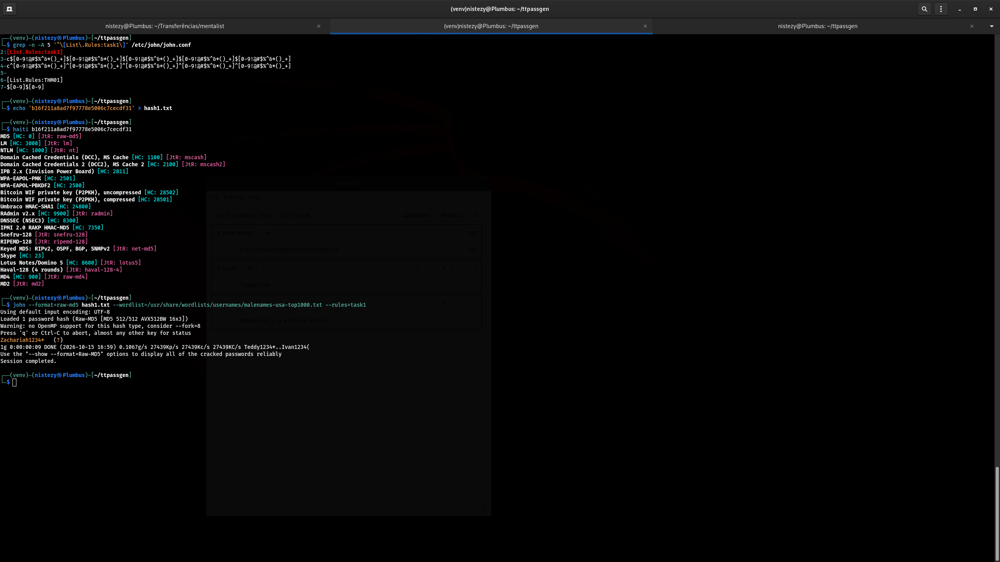
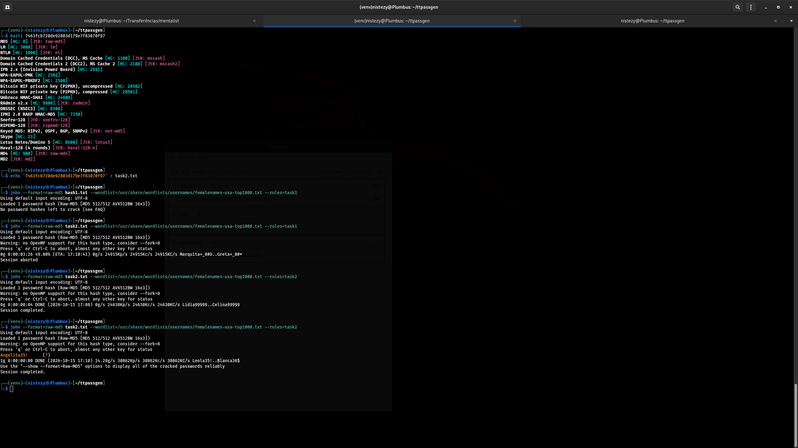
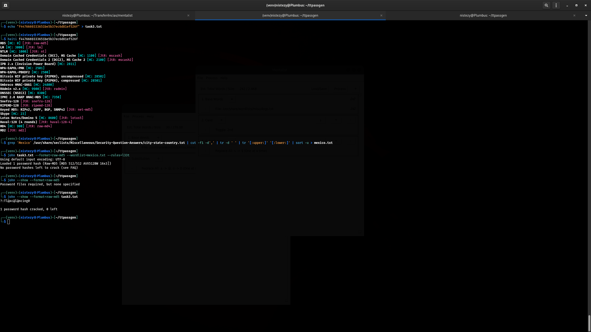
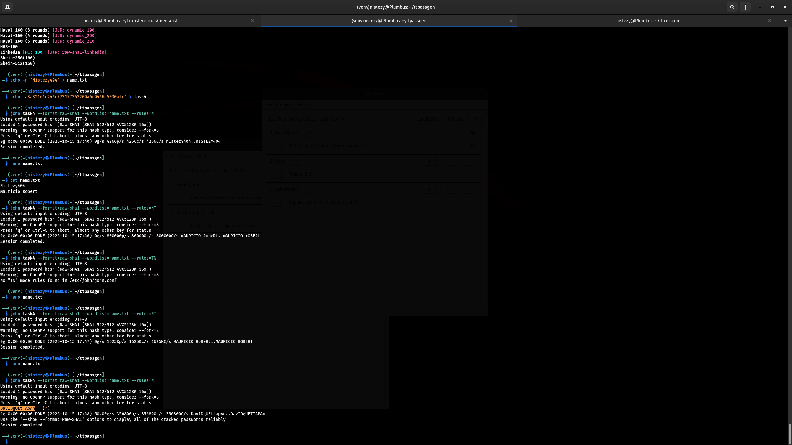
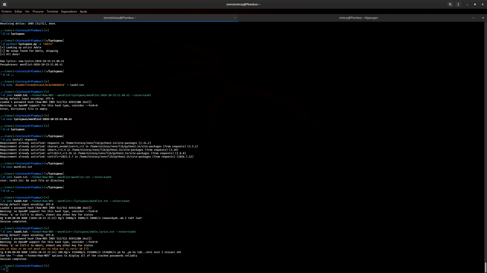
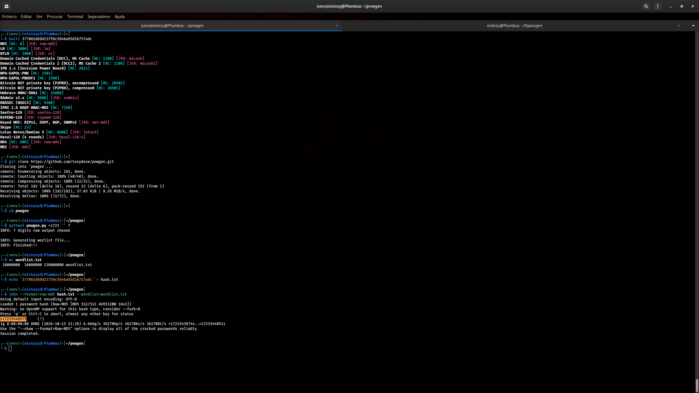
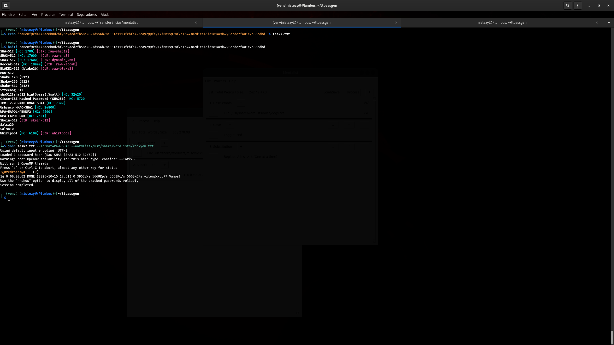
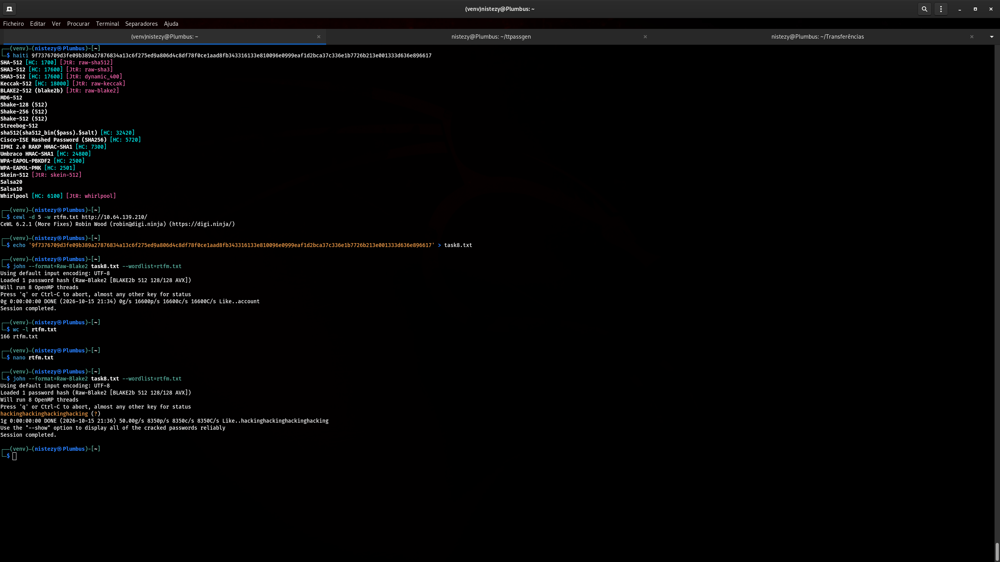
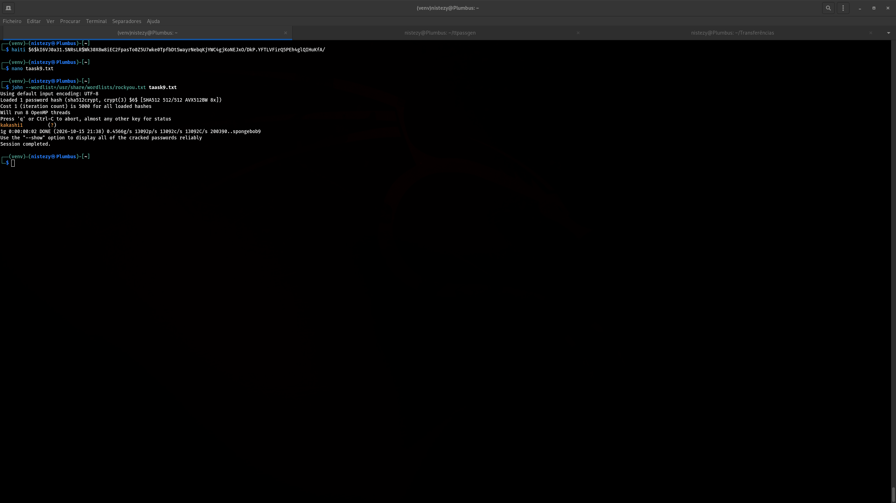

# TryHackMe — Crack The Hash: Level 2

> **Categoria:** Password Cracking / Wordlists
> **Dificuldade:** Médio
> **Ferramentas:** John the Ripper, Haiti, Mentalist, CeWL, wordlistctl, pnwgen, lyricpass, SecLists

## Descrição da Sala

> Password cracking is part of the penetration tester job but is rarely taught on challenges platforms. In this room you will learn how to crack hashes, identify hash types, create custom wordlists, find specific wordlists, create mutations rules, etc.

Esta sala é a continuação de [Crack The Hash](https://tryhackme.com/room/crackthehash) e foca em técnicas avançadas de quebra de hash: identificação de tipos de hash, obtenção/geração de wordlists especializadas e criação de regras de mutação (mangling rules) para o John the Ripper.

---

## Task 1 — Introduction

Introdução teórica da sala, sem perguntas práticas de laboratório — apresenta o objetivo de ensinar identificação de hash, geração de wordlists e regras de mutação.

## Task 2 — Hash Identification

A sala apresenta o **[Haiti](https://noraj.github.io/haiti/)**, uma ferramenta CLI para identificar o tipo de um hash a partir do seu formato/comprimento, e pede a identificação de dois hashes de exemplo, além dos códigos do algoritmo **Keccak-256** no Hashcat e no John the Ripper. Essa etapa é conceitual/instrucional e não envolve o laboratório principal — o Haiti é a mesma ferramenta reutilizada extensivamente no Task 6 (ver abaixo).

## Task 3 — Wordlists

Apresenta fontes de wordlists (**SecLists**, **wordlistctl**, **Rawsec's CyberSecurity Inventory**) e ensina a buscar, baixar e descompactar listas como a **RockYou** via `wordlistctl search` / `wordlistctl fetch`. Também conceitual, preparando o terreno para o uso de wordlists especializadas no desafio final.

---

## Task 4 — Cracking Tools, Modes & Rules

Esta task ensina os três modos de ataque do John the Ripper/Hashcat — **wordlist mode**, **incremental mode** e **rule mode** — e como criar regras de mutação customizadas em `/etc/john/john.conf` (ou `john-local.conf`).

### Criando a regra customizada `THM01`

A sala orienta a criação de uma regra de **border mutation**, que acrescenta todas as combinações de 2 dígitos ao final de cada palavra da wordlist:

```ini
[List.Rules:THM01]
$[0-9]$[0-9]
```

### Quebrando o hash com a wordlist Top 10k + regra THM01

Com a regra criada, o hash SHA-1 `2d5c517a4f7a14dcb38329d228a7d18a3b78ce83` foi quebrado usando a wordlist `10k-most-common.txt` do SecLists:

```bash
echo '2d5c517a4f7a14dcb38329d228a7d18a3b78ce83' > hash.txt
john hash.txt --format=raw-sha1 \
  --wordlist=/usr/share/seclists/Passwords/Common-Credentials/10k-most-common.txt \
  --rules=THM01
```

**Resultado:**

```
moonligh56     (?)
1g 0:00:00:00 DONE
```

**Senha (Task 4):** `moonligh56`

---

## Task 5 — Custom Wordlist Generation

Quando regras de mutação não bastam, é possível gerar wordlists customizadas a partir de temas específicos (ex.: raças de cães, letras de música, nomes de lugares) usando ferramentas como **Mentalist**, **CeWL**, **lyricpass** e **TTPassGen**.

### Gerando mutações com o Mentalist

A sala orienta carregar a wordlist `/usr/share/wordlists/misc/dogs.txt` (lista de raças de cães) no Mentalist e aplicar:

- **Base Words:** `dogs.txt` (242 palavras)
- **Case:** Toggle 2º caractere
- **Substitution:** substituir todos os `s` por `$`

Após processar (`Process`) e exportar a wordlist gerada, o hash MD5 `ed91365105bba79fdab20c376d83d752` foi quebrado:

```bash
john hash.txt --format=raw-md5 --wordlist=/usr/share/wordlists/misc/wordlist.txt
```

**Resultado:**

```
mOlo$$u$      (?)
1g 0:00:00:00 DONE
```


*Figura 2 — Regras de Case/Substitution configuradas no Mentalist (esquerda) e quebra do hash resultando em `mOlo$$u$` (direita)*

**Senha (Task 5):** `mOlo$$u$`

> A sala também demonstra o uso do **CeWL** (geração de wordlist a partir de um site), do **TTPassGen** (geração de PINs, combinações de letras e combinação de múltiplas wordlists) e desafia a quebra de um hash adicional (`e5b47b7e8df2597077e703c76ee86aee`) com a wordlist combinada gerada por essas ferramentas.

---

## Task 6 — Challenge: It's Time to Crack Hashes 🔑

Esta é a etapa principal da sala: a máquina de laboratório expõe um site **"Password Advisor"** (`http://MACHINE_IP`) contendo nove "conselhos" (advices), cada um dando uma dica sobre como a senha correspondente foi gerada/mutada. Os nove hashes devem ser quebrados **na mesma ordem** dos conselhos, aplicando a técnica indicada em cada dica (wordlists temáticas, regras de mutação, geração de números de telefone, letras de música revertidas, etc.).

Para cada hash, o primeiro passo foi identificar o tipo com o **Haiti**, e então aplicar a wordlist/regra apropriada com o **John the Ripper**.

### Advice n°1 — `b16f211a8ad7f97778e5006c7cecdf31`

Identificado como **MD5** pelo Haiti. Quebrado com a wordlist de nomes masculinos do SecLists e a regra `task1` (definida em `/etc/john/john.conf`, seção `[List.Rules:task1]`):

```bash
echo 'b16f211a8ad7f97778e5006c7cecdf31' > hash1.txt
john --format=raw-md5 hash1.txt \
  --wordlist=/usr/share/wordlists/usernames/malenames-usa-top1000.txt \
  --rules=task1
```


*Figura 3 — Identificação via Haiti e quebra do hash do Advice n°1 com wordlist de nomes masculinos + regra `task1`*

**Senha:** `Zachariah1234*`

---

### Advice n°2 — `7463fcb720de92803d179e7f83070f97`

Também **MD5**. Desta vez a wordlist de nomes femininos (`femalenames-usa-top1000.txt`) foi utilizada; a regra `task1` não encontrou correspondência, sendo necessário repetir a tentativa com a regra `task2`:

```bash
echo '7463fcb720de92803d179e7f83070f97' > task2.txt
john --format=raw-md5 task2.txt \
  --wordlist=/usr/share/wordlists/usernames/femalenames-usa-top1000.txt \
  --rules=task2
```


*Figura 4 — Após tentativa sem sucesso com a regra `task1`, a regra `task2` quebra o hash do Advice n°2*

**Senha:** `Angelita35!`

---

### Advice n°3 — `f4476669333651be5b37ec6d81ef526f`

A dica apontava para um tema geográfico (México). Uma wordlist customizada foi extraída da lista de perguntas de segurança do SecLists, filtrando apenas cidades/estados relacionados ao México:

```bash
grep 'Mexico' /usr/share/seclists/Miscellaneous/Security-Question-Answers/city-state-country.txt \
  | cut -f1 -d',' | tr -d ' ' | tr '[:upper:]' '[:lower:]' | sort -u > mexico.txt

john task3.txt --format=raw-md5 --wordlist=mexico.txt --rules=l33t
```

Com a regra `l33t` (mutação de substituição de caracteres por símbolos semelhantes), o hash foi quebrado:


*Figura 5 — Wordlist filtrada de cidades mexicanas + regra `l33t`, revelando a senha do Advice n°3*

**Senha:** `Tl@xc@l@ncing0`

---

### Advice n°4 — `a3a321e1c246c773177363200a6c0466a5030afc`

Hash **SHA-1**. A dica indicava que a senha estava relacionada a um nome próprio submetido a mutação de maiúsculas/minúsculas aleatórias (regra `NT`, de "case toggle"). Após ajustar a wordlist com candidatos de nome, a regra `--rules=NT` quebrou o hash:

```bash
echo 'a3a321e1c246c773177363200a6c0466a5030afc' > task4
john task4 --format=raw-sha1 --wordlist=name.txt --rules=NT
```


*Figura 6 — Regra de mutação de maiúsculas/minúsculas (`NT`) revelando a senha do Advice n°4*

**Senha:** `DavIDgUEtTApAn`

---

### Advice n°5 — `d5e085772469d544a447bc8250890949`

A dica remetia a letras de música. A ferramenta **[lyricpass](https://github.com/Viralmaniar/LyricsPass)** foi usada para tentar baixar letras de músicas de uma artista (Adele), e uma wordlist de letras foi montada manualmente após a busca automática não retornar resultados. A regra `task5` (mutação de **inversão de ordem dos caracteres** — order mutation) foi aplicada:

```bash
echo 'd5e085772469d544a447bc8250890949' > task5.txt
john task5.txt --format=Raw-MD5 --wordlist=~/lyricpass/adele_lyrics.txt --rules=task5
```


*Figura 7 — lyricpass + regra de inversão de caracteres (`task5`) quebrando o hash com uma letra de música invertida*

**Senha:** `uoy ot miws ot em rof peed oot ro ediw oot si revir oN`
*(uma letra de música da Adele com a ordem dos caracteres invertida — "No river is too wide or too deep for me to swim to you", escrita de trás para frente)*

---

### Advice n°6 — `377081d69d23759c5946a95d1b757adc`

A dica indicava um número de telefone. A ferramenta **[pnwgen](https://github.com/toxydose/pnwgen)** foi usada para gerar todas as combinações possíveis de um número com prefixo `+1721` e 7 dígitos adicionais:

```bash
git clone https://github.com/toxydose/pnwgen.git
cd pnwgen
python3 pnwgen.py +1721 '' 7     # gera 10.000.000 de combinações

echo '377081d69d23759c5946a95d1b757adc' > hash.txt
john --format=raw-md5 hash.txt --wordlist=wordlist.txt
```


*Figura 8 — pnwgen gerando 10 milhões de números de telefone e quebrando o hash MD5 do Advice n°6*

**Senha:** `+17215440375`

---

### Advice n°7 — `ba6e8f9cd4140ac8b8d2bf96c9acd2fb58c0827d556b78e331d1113fcbfe425ca9299fe917f6015978f7e1644382d1ea45fd581aed6298acde2fa01e7d83cdbd`

Hash de 128 caracteres hexadecimais, identificado pelo Haiti como possível **SHA3-512** (entre outros candidatos de mesmo comprimento). Quebrado diretamente com a wordlist **RockYou**:

```bash
echo 'ba6e8f9cd4140ac8b8d2bf96c9acd2fb58c0827d556b78e331d1113fcbfe425ca9299fe917f6015978f7e1644382d1ea45fd581aed6298acde2fa01e7d83cdbd' > task7.txt
john task7.txt --format=Raw-SHA3 --wordlist=/usr/share/wordlists/misc/rockyou.txt
```


*Figura 9 — Identificação do algoritmo SHA3-512 via Haiti e quebra direta com a wordlist RockYou*

**Senha:** `!@#redrose!@#`

---

### Advice n°8 — `9f7376709d3fe09b389a27876834a13c6f275ed9a806d4c8df78f0ce1aad8fb343316133e810096e0999eaf1d2bca37c336e1b7726b213e001333d636e896617`

Também um hash de 128 caracteres — desta vez identificado como **BLAKE2b-512**. A dica sugeria usar o conteúdo do próprio site da máquina-alvo como fonte de palavras. O **CeWL** foi usado para raspar o site e gerar uma wordlist (`rtfm.txt`):

```bash
cewl -d 5 -w rtfm.txt http://10.64.139.210/

echo '9f7376709d3fe09b389a27876834a13c6f275ed9a806d4c8df78f0ce1aad8fb343316133e810096e0999eaf1d2bca37c336e1b7726b213e001333d636e896617' > task8.txt
john --format=Raw-Blake2 task8.txt --wordlist=rtfm.txt
```

Como a primeira tentativa (166 palavras raspadas) não quebrou o hash, foi necessário complementar manualmente a wordlist antes de uma nova tentativa bem-sucedida — revelando uma senha com **repetição de palavra** (repetition mutation):


*Figura 10 — CeWL raspando palavras do site-alvo (rtfm.txt) e quebrando o hash BLAKE2b-512 do Advice n°8*

**Senha:** `hackinghackinghackinghacking`

---

### Advice n°9 — `$6$kI6VJ0a31.SNRsLR$Wk30X8w8iEC2FpasTo0Z5U7wke0TpfbDtSwayrNebqKjYWC4gjKoNEJxO/DkP.YFTLVFirQ5PEh4glQIHuKfA/`

Formato de hash **`$6$`**, identificado pelo Haiti como **sha512crypt** (hash de senha do `/etc/shadow` do Linux, com salt embutido). Quebrado diretamente com a wordlist RockYou — sem necessidade de regras especiais:

```bash
john --wordlist=/usr/share/wordlists/rockyou.txt taask9.txt
```

**Resultado:**

```
Loaded 1 password hash (sha512crypt, crypt(3) $6$ [SHA512 512/512 AVX512BW 8x])
Cost 1 (iteration count) is 5000 for all loaded hashes
kakashi1      (?)
1g 0:00:00:02 DONE
```


*Figura 11 — Hash sha512crypt (formato `$6$`) quebrado diretamente com a wordlist RockYou*

**Senha:** `kakashi1`

---

## 🔑 Resumo de Todas as Senhas Quebradas

| # | Hash | Algoritmo | Técnica / Wordlist | Senha Recuperada |
|---|---|---|---|---|
| Task 4 | `2d5c517a4f7a14dcb38329d228a7d18a3b78ce83` | SHA-1 | Top 10k + regra `THM01` (border mutation) | `moonligh56` |
| Task 5 | `ed91365105bba79fdab20c376d83d752` | MD5 | Mentalist (dogs.txt + Case/Substitution) | `mOlo$$u$` |
| Advice 1 | `b16f211a8ad7f97778e5006c7cecdf31` | MD5 | Nomes masculinos + regra `task1` | `Zachariah1234*` |
| Advice 2 | `7463fcb720de92803d179e7f83070f97` | MD5 | Nomes femininos + regra `task2` | `Angelita35!` |
| Advice 3 | `f4476669333651be5b37ec6d81ef526f` | MD5 | Wordlist "México" (SecLists) + regra `l33t` | `Tl@xc@l@ncing0` |
| Advice 4 | `a3a321e1c246c773177363200a6c0466a5030afc` | SHA-1 | Wordlist de nomes + regra `NT` (case mutation) | `DavIDgUEtTApAn` |
| Advice 5 | `d5e085772469d544a447bc8250890949` | MD5 | lyricpass + regra `task5` (order mutation) | `uoy ot miws ot em rof peed oot ro ediw oot si revir oN` |
| Advice 6 | `377081d69d23759c5946a95d1b757adc` | MD5 | pnwgen (geração de telefones) | `+17215440375` |
| Advice 7 | `ba6e8f9cd4140ac8...e7d83cdbd` | SHA3-512 | Wordlist RockYou | `!@#redrose!@#` |
| Advice 8 | `9f7376709d3fe09b...636e896617` | BLAKE2b-512 | CeWL (scraping do site-alvo) | `hackinghackinghackinghacking` |
| Advice 9 | `$6$kI6VJ0a31...` | sha512crypt | Wordlist RockYou | `kakashi1` |

---

## Ferramentas Utilizadas

| Ferramenta | Função |
|---|---|
| **[John the Ripper](https://www.openwall.com/john/)** | Quebra de hashes (wordlist mode, rule mode) |
| **[Haiti](https://noraj.github.io/haiti/)** | Identificação do tipo de hash a partir do formato/tamanho |
| **[Mentalist](https://github.com/sc0tfree/mentalist)** | Geração gráfica de wordlists com regras de Case/Substitution/Append/Prepend |
| **[CeWL](https://github.com/digininja/CeWL)** | Geração de wordlist a partir de palavras extraídas de um site |
| **[lyricpass](https://github.com/Viralmaniar/LyricsPass)** | Geração de wordlist a partir de letras de músicas de um artista |
| **[pnwgen](https://github.com/toxydose/pnwgen)** | Geração de wordlists de números de telefone |
| **[wordlistctl](https://github.com/BlackArch/wordlistctl)** | Busca, download e descompactação de wordlists públicas (ex.: RockYou) |
| **SecLists** | Coleção de wordlists temáticas (nomes, cidades, credenciais comuns) |

---
