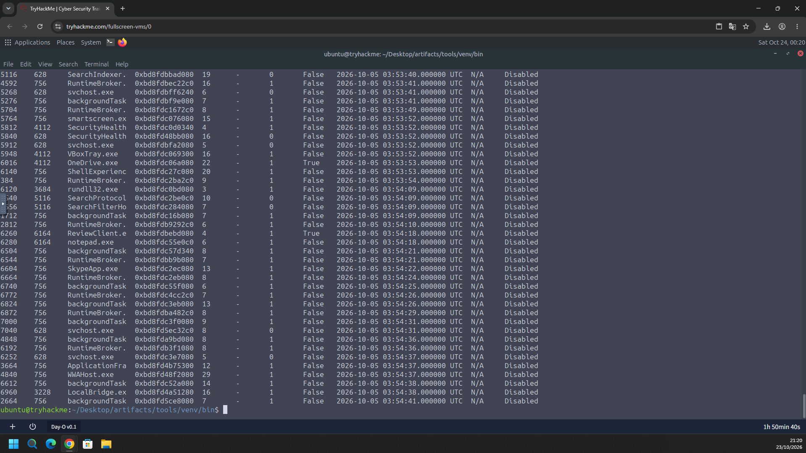
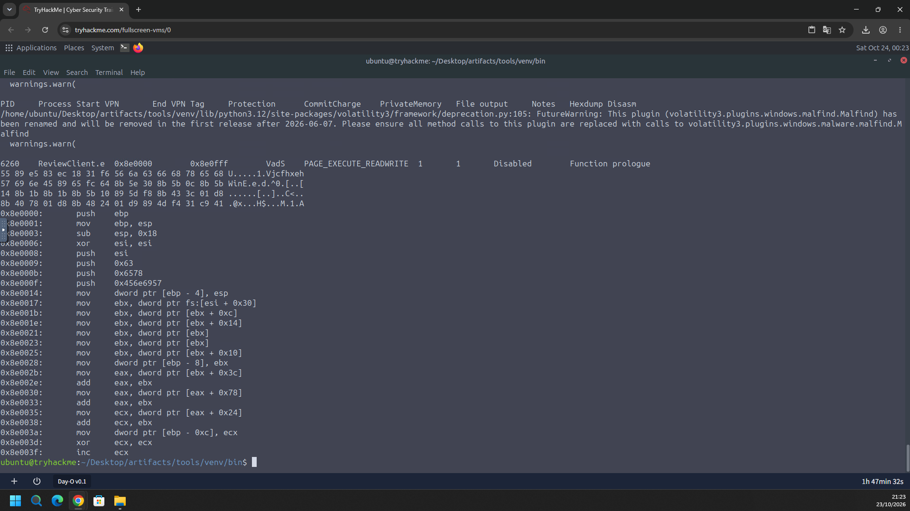
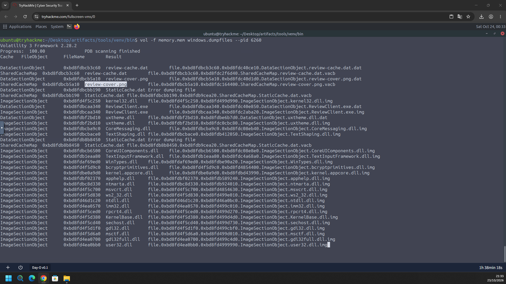
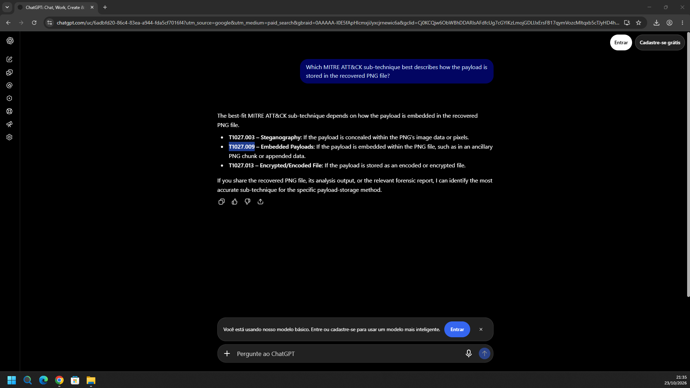
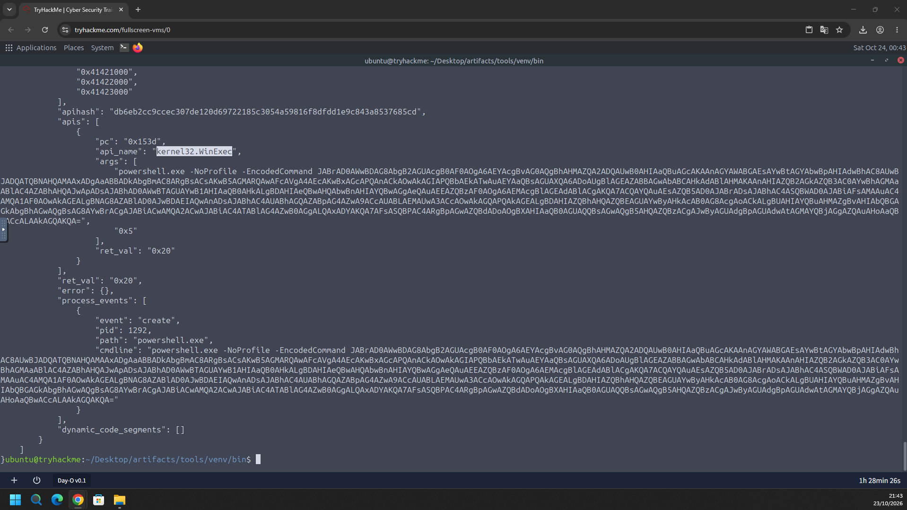
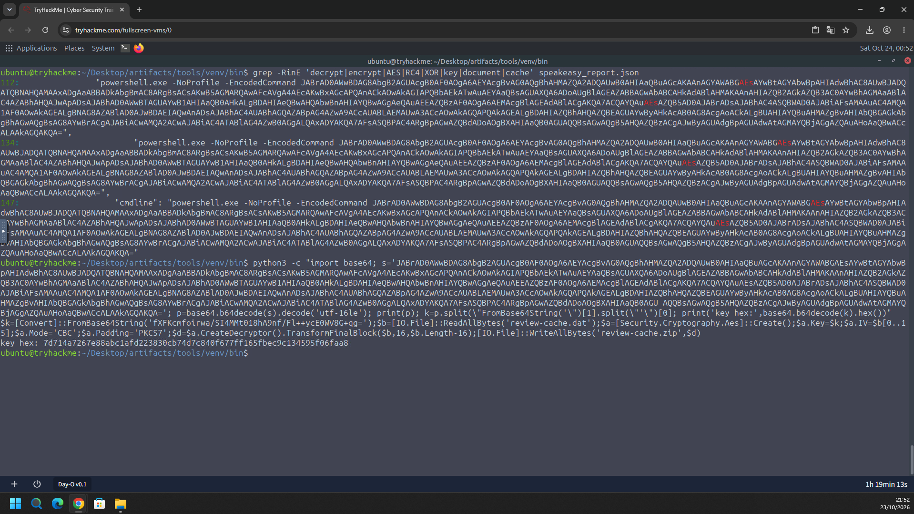
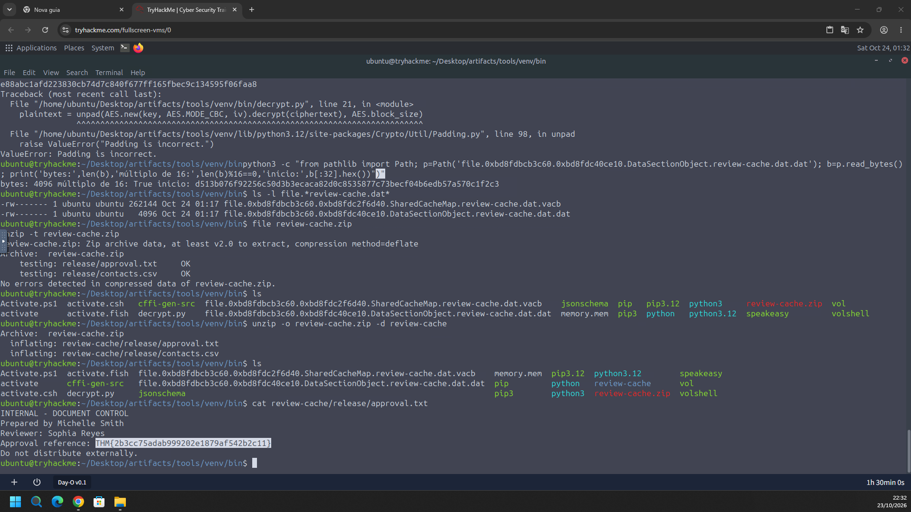

# TryHackMe – Day-O (Writeup)

**Room:** https://tryhackme.com/room/dayo
**Dificuldade:** Medium
**Categoria:** Forense de memória / Análise de malware
**Cenário:** Sophia Reyes abriu um pacote de revisão de documentos. A pré-visualização travou e uma região de memória executável inesperada apareceu no aplicativo. Com a memória da estação preservada, o objetivo é encontrar o payload escondido, entender o que ele fazia e recuperar o que foi deixado para trás.

**Evidência fornecida:** dump de memória (`memory.mem`)
**Ferramentas:** Volatility 3, Speakeasy (emulação de shellcode), Python (ambiente `analysis-python`)
**Diretório de trabalho:** `~/Desktop/artifacts/tools/venv/bin`

---

## Resumo das respostas

| # | Pergunta | Resposta |
|---|----------|----------|
| 1 | Executável que contém o payload suspeito | `ReviewClient.exe` |
| 2 | Endereço virtual inicial da região privada executável | `0x8e0000` |
| 3 | Arquivo associado ao processo que também contém o payload | `review-cover.png` |
| 4 | Sub-técnica MITRE ATT&CK do armazenamento do payload no PNG | `T1027.009` (Embedded Payloads) |
| 5 | API do Windows chamada pelo payload para lançar o próximo estágio | `WinExec` (`kernel32.WinExec`) |
| 6 | Chave de criptografia que o estágio decodificado usa para decifrar o cache de documentos | `7d714a7267e88abc1afd223830cb74d7c840f677ff165fbec9c134595f06faa8` |
| 7 | Flag | `THM{2b3cc75adab999202e1879af542b2c11}` |

---

## Task 1 – Executável com o payload suspeito

### Metodologia

1. Listei os processos do dump com o Volatility 3 (plugin `windows.pslist`). Entre os processos comuns do sistema (`svchost.exe`, `RuntimeBroker.exe`, `OneDrive.exe` etc.), um nome chama atenção:

| PID | PPID | Processo | Threads | Wow64 | Início (UTC) |
|-----|------|----------|---------|-------|--------------|
| **6260** | 6164 | **`ReviewClient.e`** (nome truncado: `ReviewClient.exe`) | 4 | **True** | 2026-10-05 03:54:18 |
| 6280 | 6164 | `notepad.exe` | 6 | False | 2026-10-05 03:54:18 |

2. O `ReviewClient.exe` combina com o cenário (o aplicativo de revisão de documentos), é um processo **32 bits (Wow64)** e foi iniciado ao mesmo tempo que o `notepad.exe`, pelo mesmo processo pai (PID 6164).
3. Como a pergunta pede o executável, não o PID, a resposta é o nome completo do arquivo.



**Resposta:** `ReviewClient.exe`

---

## Task 2 – Endereço virtual inicial da região executável privada

### Metodologia

1. Usei o plugin de detecção de código injetado (`malfind`) sobre o PID 6260. O terminal mostra um aviso de que o plugin foi renomeado (`windows.malfind.Malfind` → `windows.malware.malfind.Malfind`), mas a saída é a mesma.
2. O resultado:

| Campo | Valor |
|-------|-------|
| PID / Processo | 6260 / `ReviewClient.e` |
| **Start VPN** | **`0x8e0000`** |
| End VPN | `0x8e0fff` |
| Tag | `VadS` |
| Proteção | **`PAGE_EXECUTE_READWRITE`** |
| CommitCharge / PrivateMemory | 1 / 1 |
| Notes | `Function prologue` |

3. Uma região **privada** (`PrivateMemory = 1`, sem arquivo mapeado), **executável e gravável** (RWX) é típica de código injetado ou shellcode. O plugin ainda reconheceu um prólogo de função no início da região.
4. O hexdump e o desmontador mostram um shellcode de 32 bits:

```
0x8e0000: push ebp
0x8e0001: mov  ebp, esp
0x8e0003: sub  esp, 0x18
0x8e0006: xor  esi, esi
0x8e0008: push esi
0x8e0009: push 0x63
0x8e000b: push 0x6578
0x8e000f: push 0x456e6957
...
0x8e0017: mov  ebx, dword ptr fs:[esi + 0x30]   ; PEB
0x8e001b: mov  ebx, dword ptr [ebx + 0xc]       ; PEB_LDR_DATA
0x8e001e: mov  ebx, dword ptr [ebx + 0x14]      ; InMemoryOrderModuleList
```

   Pontos importantes:
   - Os três `push` montam na pilha a string **`WinExec`** (`0x456e6957` = `"WinE"`, `0x6578` = `"xe"`, `0x63` = `"c"`), um *stack string* que evita ter o nome da API em texto claro.
   - O acesso a `fs:[0x30]` (PEB) e a navegação pela lista de módulos mostram que o shellcode **resolve as APIs sozinho**, caminhando pela tabela de exportação do `kernel32.dll`, sem depender da IAT.



**Resposta:** `0x8e0000`

---

## Task 3 – Arquivo associado que contém o mesmo payload

### Metodologia

1. Extraí os arquivos mapeados na memória do processo:

```bash
vol -f memory.mem windows.dumpfiles --pid 6260
```

2. Além das DLLs de sistema (`kernel32.dll`, `user32.dll`, `ntdll.dll` e outras), a saída lista três arquivos de dados e o próprio executável:

| Arquivo | Tipo de objeto | Observação |
|---------|----------------|------------|
| `review-cache.dat` | DataSectionObject / SharedCacheMap | Cache de documentos |
| **`review-cover.png`** | DataSectionObject / SharedCacheMap | **Imagem de capa (destacada)** |
| `StaticCache.dat` | DataSectionObject / SharedCacheMap | `Error dumping file` |
| `ReviewClient.exe` | DataSectionObject / ImageSectionObject | O executável |

3. O `review-cover.png` é uma imagem aparentemente inofensiva usada como capa do documento. Foi o arquivo que continha o mesmo payload visto na região `0x8e0000`.



**Resposta:** `review-cover.png`

---

## Task 4 – Sub-técnica MITRE do armazenamento do payload no PNG

### Metodologia

Consultei as sub-técnicas candidatas de **T1027 (Obfuscated Files or Information)**:

| ID | Nome | Quando se aplica |
|----|------|------------------|
| T1027.003 | Steganography | O payload está escondido nos pixels/dados da imagem |
| **T1027.009** | **Embedded Payloads** | O payload está embutido no arquivo, como em um chunk extra do PNG ou dados anexados |
| T1027.013 | Encrypted/Encoded File | O payload está cifrado/codificado |

Como o payload foi **recuperado dentro do PNG** (embutido no arquivo, e não escondido por esteganografia nos pixels), a sub-técnica escolhida foi a **T1027.009**.



**Resposta:** `T1027.009`

> A resposta foi consultada em uma IA e escolhida entre as candidatas acima. Se a sala não a aceitar, a alternativa mais próxima é `T1027.003` (Steganography).

---

## Task 5 – API chamada para lançar o próximo estágio

### Metodologia

1. Emulei o shellcode com o **Speakeasy** (offline, sem executá-lo no sistema). O relatório ficou em `speakeasy_report.json`.
2. No relatório, a chamada de API registrada é:

```json
{
  "pc": "0x153d",
  "api_name": "kernel32.WinExec",
  "args": [
    "powershell.exe -NoProfile -EncodedCommand JABrAD0AWwBDAG8AbgB2AGUAcgB0AF0AOgA6AEYAcgBvAG0AQgBhAHMAZQA2ADQAUwB0AHIAaQBuAGcA...",
    "0x5"
  ],
  "ret_val": "0x20"
}
```

3. Eventos de processo registrados na emulação:

```json
"process_events": [
  {
    "event": "create",
    "pid": 1292,
    "path": "powershell.exe",
    "cmdline": "powershell.exe -NoProfile -EncodedCommand JABrAD0AWwBD..."
  }
]
```

4. A API é a mesma que o shellcode montava como *stack string* na Task 2. O segundo argumento `0x5` é `SW_SHOW` e o retorno `0x20` (maior que 31) indica sucesso. A "próxima etapa" é um **PowerShell codificado**.



**Resposta:** `WinExec` (`kernel32.WinExec`)

---

## Task 6 – Chave de criptografia do estágio decodificado

### Metodologia

1. Procurei no relatório do Speakeasy por termos ligados a criptografia:

```bash
grep -RinE 'decrypt|encrypt|AES|RC4|XOR|key|document|cache' speakeasy_report.json
```

   O comando `-EncodedCommand` aparece nas linhas 112, 134 e 147. Esse parâmetro do PowerShell recebe um script em **Base64 UTF-16LE**.

2. Decodifiquei o comando com Python:

```bash
python3 -c "import base64; s='JABrAD0AWwBDAG8AbgB2AGUA...'; \
p=base64.b64decode(s).decode('utf-16le'); print(p); \
k=p.split(\"FromBase64String('\")[1].split(\"'\")[0]; \
print('key hex:', base64.b64decode(k).hex())"
```

3. O script PowerShell decodificado é:

```powershell
$k=[Convert]::FromBase64String('fXFKcmfoirwa/SI4MMt018hA9nf/Fl++ycE0WV8G+qg=');
$b=[IO.File]::ReadAllBytes('review-cache.dat');
$a=[Security.Cryptography.Aes]::Create();
$a.Key=$k;
$a.IV=$b[0..15];
$a.Mode='CBC';
$a.Padding='PKCS7';
$d=$a.CreateDecryptor().TransformFinalBlock($b,16,$b.Length-16);
[IO.File]::WriteAllBytes('review-cache.zip',$d)
```

4. O que o script faz:
   - Lê o `review-cache.dat` (o cache de documentos).
   - Usa **AES em modo CBC, com padding PKCS7**.
   - Usa como **IV os 16 primeiros bytes do arquivo** e decifra o restante.
   - Grava o resultado como `review-cache.zip`.
5. A chave em Base64 `fXFKcmfoirwa/SI4MMt018hA9nf/Fl++ycE0WV8G+qg=` tem 32 bytes (**AES-256**). Em hexadecimal:

```
7d714a7267e88abc1afd223830cb74d7c840f677ff165fbec9c134595f06faa8
```



**Resposta:** `7d714a7267e88abc1afd223830cb74d7c840f677ff165fbec9c134595f06faa8`

> A chave aparece nos dois formatos acima (Base64 no script e hexadecimal na saída do Python). Eu usei o hexadecimal como resposta, que é o valor que o seu comando imprimiu (`key hex:`).

---

## Task 7 – Flag

### Metodologia

1. Com a chave, usei o script `decrypt.py` para decifrar o `review-cache.dat` extraído pelo `dumpfiles`:

```
file.0xbd8fdbcb3c60.0xbd8fdc40ce10.DataSectionObject.review-cache.dat.dat   (4096 bytes)
```

2. A primeira tentativa falhou com `ValueError: Padding is incorrect`. Conferi o arquivo e vi que o tamanho (4096) é múltiplo de 16 e que ele começa com `d513b076f92256c5...` (o início é o IV). O `.vacb` associado tem 262144 bytes. A causa provável é que o dump em páginas inclui bytes além do fim real do ciphertext. A correção usada não aparece no print.
3. A decifragem acabou funcionando e gerou `review-cache.zip`. A validação:

```bash
file review-cache.zip
unzip -t review-cache.zip
```

```
Archive:  review-cache.zip
    testing: release/approval.txt     OK
    testing: release/contacts.csv     OK
No errors detected in compressed data of review-cache.zip.
```

4. Extraí o ZIP e li o `approval.txt`:

```bash
unzip -o review-cache.zip -d review-cache
cat review-cache/release/approval.txt
```

```
INTERNAL - DOCUMENT CONTROL
Prepared by Michelle Smith
Reviewer: Sophia Reyes
Approval reference: THM{2b3cc75adab999202e1879af542b2c11}
Do not distribute externally.
```



**Flag:** `THM{2b3cc75adab999202e1879af542b2c11}`

---

## Cadeia do ataque

```
Sophia Reyes abre o pacote de revisão
        │
        ▼
ReviewClient.exe (PID 6260, 32 bits)  ── arquivo associado: review-cover.png
        │      (payload embutido no PNG)
        ▼
Região privada RWX 0x8e0000–0x8e0fff (shellcode)
        │   resolve APIs pelo PEB → kernel32 → "WinExec"
        ▼
WinExec("powershell.exe -NoProfile -EncodedCommand ...", SW_SHOW)
        │
        ▼
PowerShell decodifica a chave AES-256 e decifra review-cache.dat
        │   AES-CBC, IV = 16 primeiros bytes
        ▼
review-cache.zip → release/approval.txt (flag) + release/contacts.csv
```

---

## Mapeamento MITRE ATT&CK

| Tática | Técnica | ID | Evidência |
|--------|---------|----|-----------|
| Execução | User Execution: Malicious File | T1204.002 | O pacote de revisão foi aberto pela usuária |
| Defense Evasion | Obfuscated Files or Information: Embedded Payloads | **T1027.009** | Payload embutido em `review-cover.png` |
| Execução | Native API | T1106 | Chamada a `kernel32.WinExec` |
| Execução | Command and Scripting Interpreter: PowerShell | T1059.001 | `powershell.exe -NoProfile -EncodedCommand` |
| Defense Evasion | Obfuscated Files or Information: Command Obfuscation | T1027.010 | Script em Base64 (`-EncodedCommand`) |
| Defense Evasion | Deobfuscate/Decode Files or Information | T1140 | Decifragem AES do `review-cache.dat` |

> As técnicas, exceto a T1027.009 (resposta da sala), são mapeamentos inferidos das evidências.

---

## Indicadores de comprometimento (IOCs)

| Tipo | Valor |
|------|-------|
| Processo | `ReviewClient.exe` (PID 6260, PPID 6164, Wow64) |
| Início do processo | 2026-10-05 03:54:18 UTC |
| Região de memória | `0x8e0000`–`0x8e0fff`, `VadS`, `PAGE_EXECUTE_READWRITE`, privada |
| Arquivo com o payload | `review-cover.png` |
| API usada | `kernel32.WinExec` |
| Comando lançado | `powershell.exe -NoProfile -EncodedCommand JABrAD0AWwBD...` |
| Cache cifrado | `review-cache.dat` (AES-256-CBC, IV nos 16 primeiros bytes) |
| Chave (hex) | `7d714a7267e88abc1afd223830cb74d7c840f677ff165fbec9c134595f06faa8` |
| Chave (Base64) | `fXFKcmfoirwa/SI4MMt018hA9nf/Fl++ycE0WV8G+qg=` |
| Arquivos recuperados | `release/approval.txt`, `release/contacts.csv` |
| Flag | `THM{2b3cc75adab999202e1879af542b2c11}` |

---

## Ferramentas utilizadas

- Volatility 3 (`windows.pslist`, `malfind`, `windows.dumpfiles`)
- Speakeasy (emulação do shellcode, relatório em JSON)
- Python 3 (decodificação Base64/UTF-16LE, `decrypt.py`)
- `grep`, `file`, `unzip`, `cat`

---