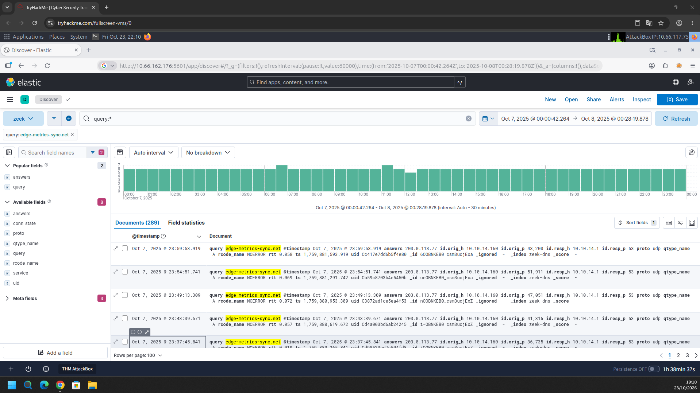
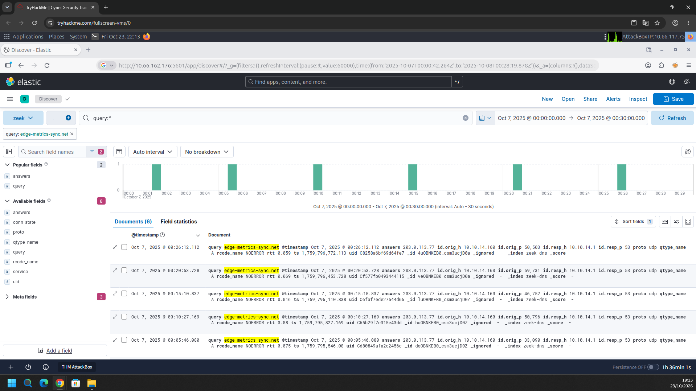
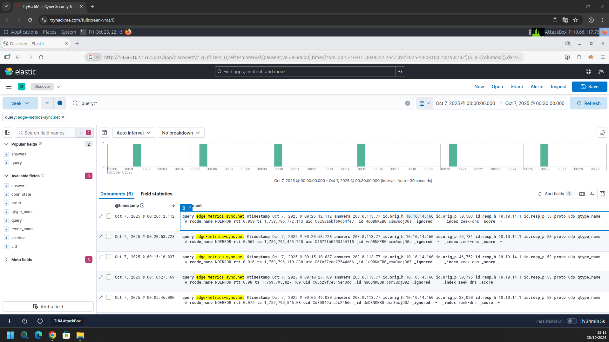
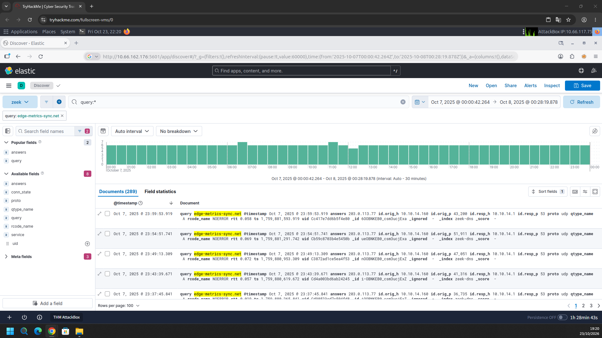
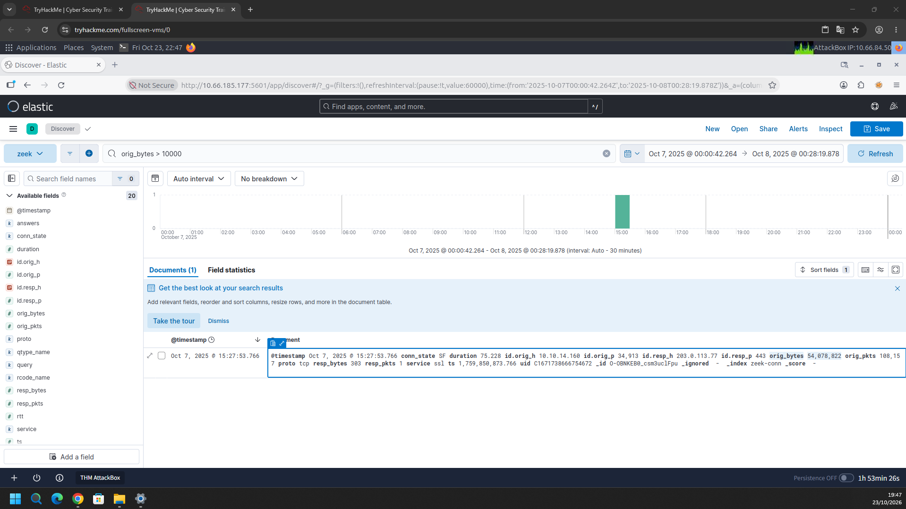

# TryHackMe – Strange & Unusual Activity (Writeup)

**Room:** https://tryhackme.com/room/strangeunusualactivity
**Categoria:** SIEM / Threat Hunting
**Cenário:** Um feed de threat intelligence sinalizou comunicações suspeitas na rede corporativa `10.10.14.0/24`. Nenhum alerta foi disparado e o monitoramento interno não percebeu nada. Com um dia inteiro de logs de rede (07/10/2025, 24 horas), o objetivo é identificar a origem da comunicação suspeita e determinar o que aconteceu.

**Ambiente**

- Kibana (Discover) com o índice/data view `zeek-*`
- Dados do Zeek: `zeek-dns` (consultas DNS) e `zeek-conn` (conexões)
- Janela analisada: **07/10/2025** (00:00 às 23:59)

---

## Resumo das respostas

| # | Pergunta | Resposta |
|---|----------|----------|
| 1 | Domínio usado pelo servidor C2 | `edge-metrics-sync.net` |
| 2 | Intervalo de callback (segundos) | `300` |
| 3 | IP do host comprometido | `10.10.14.160` |
| 4 | Número de check-ins (callbacks) ao domínio C2 | `289` |
| 5 | Bytes exfiltrados na maior transferência de saída para o C2 | `54078822` |

---

## Task 1 – Domínio do servidor C2

### Metodologia

1. No Kibana Discover, com o data view `zeek` e o período do dia 07/10/2025, filtrei os logs de DNS (`zeek-dns`) pelo campo `query`.
2. O domínio **`edge-metrics-sync.net`** foi usado como filtro (`query: edge-metrics-sync.net`). Todos os documentos retornados vêm do mesmo host interno e têm a mesma resposta:

| Campo | Valor |
|-------|-------|
| `query` | `edge-metrics-sync.net` |
| `qtype_name` | `A` |
| `rcode_name` | `NOERROR` |
| `answers` | `203.0.113.77` |
| `id.orig_h` | `10.10.14.160` |
| `id.resp_h` / `id.resp_p` | `10.10.14.1` / `53` (resolvedor DNS interno) |
| `proto` | `udp` |

3. O nome do domínio, parecido com um serviço legítimo de métricas ("edge metrics sync"), é típico de C2 que tenta se misturar ao tráfego normal.



**Resposta:** `edge-metrics-sync.net`

---

## Task 2 – Intervalo de callback

### Metodologia

1. Reduzi a janela de tempo para os primeiros 30 minutos do dia (`00:00:00` a `00:30:00`), mantendo o filtro do domínio. O Kibana mostrou 6 documentos, com barras bem espaçadas no histograma (intervalo de 30 segundos).
2. Os timestamps (campo `ts`, em epoch) dos primeiros callbacks visíveis são:

| Horário | `ts` (epoch) | Diferença para o anterior |
|---------|--------------|---------------------------|
| 00:05:46.080 | 1.759.795.546,08 | n/d |
| 00:10:27.169 | 1.759.795.827,169 | ≈ 281 s |
| 00:15:10.837 | 1.759.796.110,838 | ≈ 284 s |
| 00:20:53.728 | 1.759.796.453,728 | ≈ 343 s |
| 00:26:12.112 | 1.759.796.772,113 | ≈ 318 s |

3. As diferenças variam, o que indica **jitter** aplicado ao beacon. Mesmo assim, a média gira em torno de **5 minutos**. Isso é confirmado pelo total do dia: 289 callbacks em 24 horas equivalem a uma média de aproximadamente 299 s (86.400 / 289).



**Resposta:** `300` (5 minutos, com jitter)

> O valor 300 é a média inferida a partir dos timestamps e do total de callbacks. Confira se a sala o aceitou.

---

## Task 3 – IP do host comprometido

### Metodologia

1. Voltando à janela curta (00:00 a 00:30) com o filtro do C2, abri um dos eventos e selecionei o campo `id.orig_h`, que é a origem da consulta DNS.
2. O valor é o mesmo em todos os eventos: **`10.10.14.160`**, dentro da rede `10.10.14.0/24` sinalizada pelo feed de threat intel.
3. A porta de origem (`id.orig_p`) muda a cada consulta (50503, 59731, 46752, 50796, 33090...), o que é normal para consultas DNS. O que se repete é o par **host + domínio + horário regular**.



**Resposta:** `10.10.14.160`

---

## Task 4 – Quantidade de callbacks

### Metodologia

1. Ampliei o intervalo para o dia inteiro (07/10/2025 00:00:42 até 08/10/2025 00:28:19) e mantive o filtro `query: edge-metrics-sync.net`.
2. O Kibana retornou **289 documentos** (`Documents (289)`).
3. O histograma de 30 minutos mostra barras uniformes ao longo das 24 horas, com cerca de 6 callbacks por barra. Isso é um **padrão de beaconing** contínuo: o host consulta o domínio a cada ~5 minutos, durante o dia inteiro. Os últimos callbacks do dia ocorrem às 23:37:45, 23:43:39, 23:49:13, 23:54:51 e 23:59:53.



**Resposta:** `289`

---

## Task 5 – Bytes exfiltrados

### Metodologia

1. Troquei para os logs de conexão (`zeek-conn`) e usei uma consulta KQL que filtra transferências grandes de saída:

```
orig_bytes > 10000
```

2. Em todo o dia, **apenas 1 documento** passou desse limite, com um pico isolado no histograma, por volta de 15:00. Os detalhes:

| Campo | Valor |
|-------|-------|
| `@timestamp` | 07/10/2025 15:27:53.766 |
| `id.orig_h` : `id.orig_p` | `10.10.14.160` : `34913` |
| `id.resp_h` : `id.resp_p` | `203.0.113.77` : `443` |
| `proto` / `service` | `tcp` / `ssl` |
| `conn_state` | `SF` (conexão estabelecida e encerrada normalmente) |
| `duration` | 75,228 s |
| **`orig_bytes`** | **54.078.822** |
| `orig_pkts` | 108.157 |
| `resp_bytes` / `resp_pkts` | 303 / 1 |

3. **Correlação com o C2:**
   - O destino `203.0.113.77` é o mesmo IP que o domínio `edge-metrics-sync.net` resolve nas consultas DNS (`answers`).
   - A origem é o mesmo host comprometido, `10.10.14.160`.
4. O volume enviado (**54.078.822 bytes**, cerca de **51,6 MiB**) é enorme em comparação com os 303 bytes recebidos, o que indica **exfiltração de dados** por HTTPS. O tráfego vai pela porta 443 e é cifrado, então só os metadados da conexão ficam visíveis.



**Resposta:** `54078822`

---

## Linha do tempo

Horários em UTC, em **07/10/2025**.

| Horário | Fonte | Evento |
|---------|-------|--------|
| 00:05:46 | `zeek-dns` | Primeiro callback visível: `10.10.14.160` consulta `edge-metrics-sync.net` (resposta `203.0.113.77`) |
| 00:10 – 23:59 | `zeek-dns` | Callbacks a cada ~5 min (com jitter), até completar **289** check-ins |
| 15:27:53 | `zeek-conn` | `10.10.14.160` envia **54.078.822 bytes** em 75 s para `203.0.113.77:443` |
| 23:59:53 | `zeek-dns` | Último callback do dia |

```
10.10.14.160 ──DNS (a cada ~300 s)──► 10.10.14.1 ──► edge-metrics-sync.net = 203.0.113.77
      │
      └──TCP/443 (TLS), 15:27:53, 75 s, 54.078.822 bytes ──► 203.0.113.77  (exfiltração)
```

---

## Mapeamento MITRE ATT&CK

| Tática | Técnica | ID | Evidência |
|--------|---------|----|-----------|
| Command and Control | Application Layer Protocol: Web Protocols | T1071.001 | Comunicação HTTPS (porta 443) com `203.0.113.77` |
| Command and Control | Application Layer Protocol: DNS *(possível)* | T1071.004 | Consultas DNS periódicas ao domínio do C2 |
| Exfiltration | Exfiltration Over C2 Channel | T1041 | Envio de 54 MB para o mesmo IP do C2 |
| Exfiltration | Scheduled Transfer *(possível)* | T1029 | Beaconing regular a cada ~5 minutos |

> As técnicas marcadas como "possível" são inferências a partir do padrão observado nos logs.

---

## Indicadores de comprometimento (IOCs)

| Tipo | Valor |
|------|-------|
| Host comprometido | `10.10.14.160` |
| Domínio C2 | `edge-metrics-sync.net` |
| IP do C2 | `203.0.113.77` (porta `443`) |
| Resolvedor DNS interno | `10.10.14.1` (porta `53/udp`) |
| Intervalo de beacon | ~300 s (com jitter) |
| Check-ins no dia | 289 |
| Maior transferência | 54.078.822 bytes (`orig_bytes`), 07/10/2025 15:27:53, duração 75,228 s |

---

## Consultas KQL úteis (Kibana)

```text
# Todas as consultas ao domínio do C2
query: "edge-metrics-sync.net"

# Transferências grandes de saída (candidatas a exfiltração)
orig_bytes > 10000

# Tudo que o host comprometido enviou ao IP do C2
id.orig_h: 10.10.14.160 and id.resp_h: 203.0.113.77
```

---

## Ferramentas utilizadas

- Kibana (Discover) e Elasticsearch
- Logs do Zeek (`zeek-dns` e `zeek-conn`)
- Consultas em KQL

---