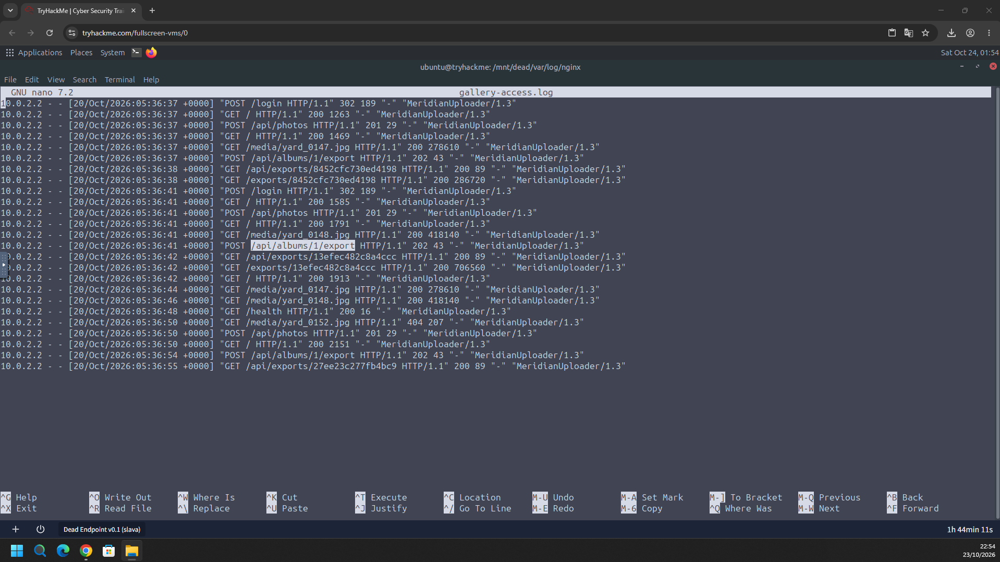
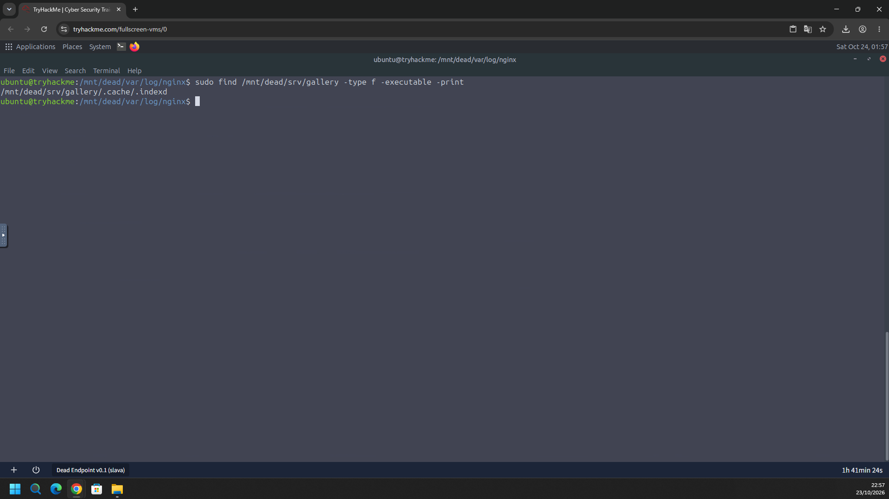
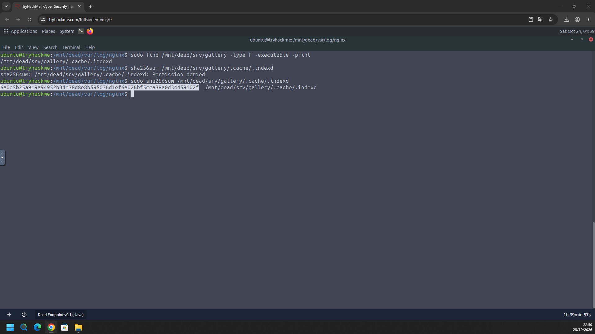
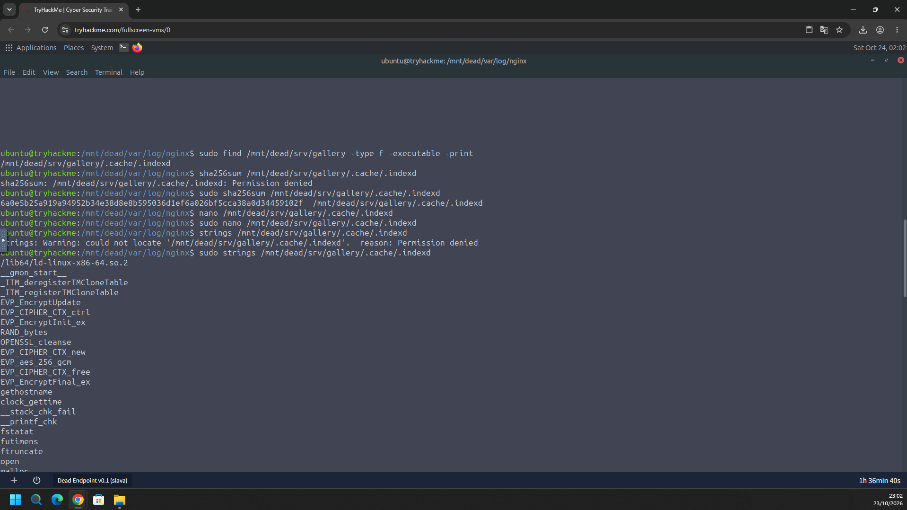
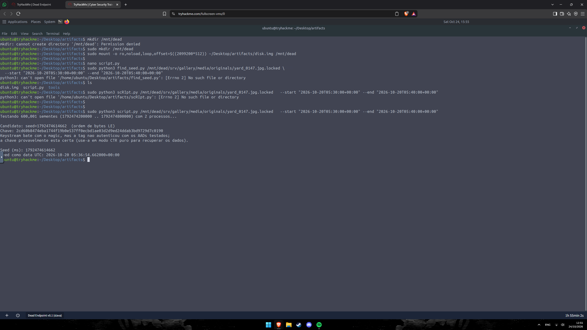
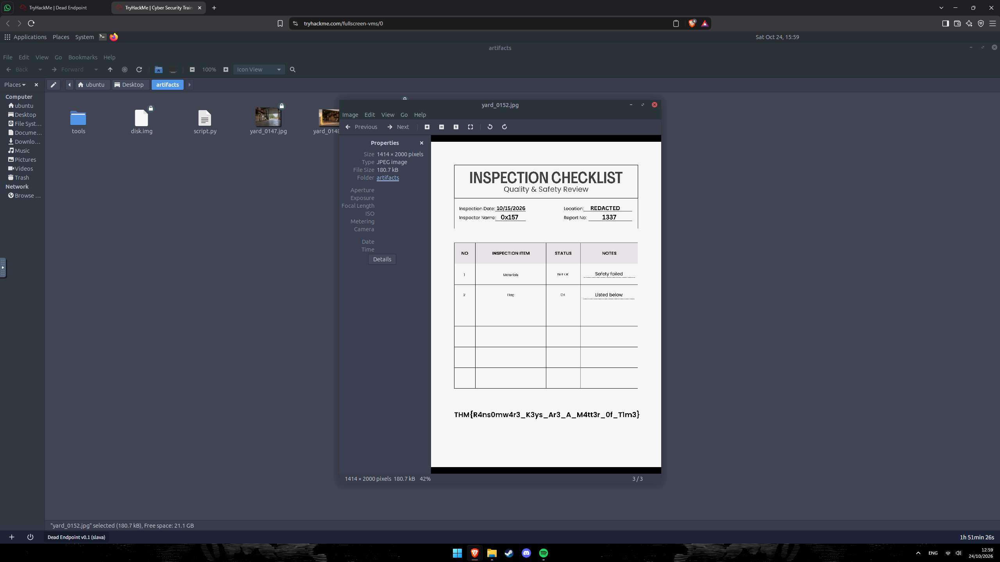

# TryHackMe – Dead Endpoint (Writeup)

**Room:** https://tryhackme.com/room/deadendpoint
**Dificuldade:** Hard
**Categoria:** Forense Linux / Análise de malware / Recuperação de dados
**Cenário:** A equipe encontrou a galeria de fotos interna fora do ar e com as imagens ilegíveis. O disco do servidor Linux foi preservado. A missão é reconstruir como a aplicação foi comprometida, analisar o executável deixado para trás (sem executá-lo) e encontrar uma forma de recuperar as imagens.

**Evidência fornecida:** imagem de disco Linux (`disk.img`)
**Diretório de trabalho:** `~/Desktop/artifacts/` (com `tools/` e `script.py`)
**Ferramentas:** `mount`, `find`, `sha256sum`, `strings`, `nano`, Python 3 (biblioteca `cryptography`)

---

## Resumo das respostas

| # | Pergunta | Resposta |
|---|----------|----------|
| 1 | Endpoint da aplicação abusado para executar comandos no servidor | `/api/albums/1/export` |
| 2 | Caminho completo do executável que criptografou as imagens | `/srv/gallery/.cache/.indexd` |
| 3 | SHA-256 do executável | `6a0e5b25a919a94952b34e38d8e8b595036d1ef6a026bf5cca38a0d34459102f` |
| 4 | Algoritmo e modo de criptografia | `AES-256-GCM` |
| 5 | Seed inicial usada para gerar a chave | `1792474614662` |
| 6 | Flag do checklist de inspeção recuperado | `THM{R4ns0mw4r3_K3ys_Ar3_A_M4tt3r_0f_T1m3}` |

---

## Preparação – Montagem do disco em modo somente leitura

Para não alterar a evidência, montei a partição do `disk.img` com as opções `ro` (somente leitura) e `noload` (não reproduzir o journal do ext4), usando um *offset* de loop:

```bash
sudo mkdir /mnt/dead
sudo mount -o ro,noload,loop,offset=$((2099200*512)) ~/Desktop/artifacts/disk.img /mnt/dead
```

- O offset é o setor inicial da partição (`2099200`) multiplicado por 512 bytes por setor, ou seja, **1.074.790.400 bytes**.
- Sem o `sudo`, o `mkdir /mnt/dead` falhou com `Permission denied`.

A partir daqui, o sistema de arquivos do servidor comprometido fica acessível em `/mnt/dead` (por exemplo, `/mnt/dead/srv/gallery` e `/mnt/dead/var/log/nginx`).

---

## Task 1 – Endpoint abusado para executar comandos

### Metodologia

1. Abri o log de acesso do nginx da galeria (`gallery-access.log`) em `/mnt/dead/var/log/nginx`.
2. Todas as requisições vêm do mesmo cliente, **`10.0.2.2`**, com o User-Agent **`MeridianUploader/1.3`**, em **20/10/2026**, entre **05:36:37 e 05:36:55 (+0000)**.
3. O padrão se repete três vezes:

| Etapa | Requisição | Resposta |
|-------|------------|----------|
| Autenticação | `POST /login` | `302` |
| Upload | `POST /api/photos` | `201` |
| Leitura da imagem | `GET /media/yard_0147.jpg` (e `yard_0148.jpg`) | `200` |
| **Exportação** | **`POST /api/albums/1/export`** | **`202`** (43 bytes) |
| Consulta do job | `GET /api/exports/<id>` | `200` (89 bytes) |
| Download do resultado | `GET /exports/<id>` | `200` |

4. Os IDs de job observados foram `8452cfc730ed4198`, `13efec482c8a4ccc` e `27ee23c277fb4bc9`.
5. O endpoint **`POST /api/albums/1/export`** é o que aceita a requisição (`202 Accepted`) e inicia um job em segundo plano, o ponto onde a execução de comandos foi abusada. O terceiro `POST` a esse endpoint, às **05:36:54**, coincide com o horário da seed encontrada na Task 5.



**Resposta:** `/api/albums/1/export`

> O print mostra apenas as linhas do log (sem o corpo das requisições), então a injeção de comando em si é inferida pelo fluxo de `export` seguido da criptografia. A resposta destacada por você no log é `/api/albums/1/export`.

---

## Task 2 – Caminho completo do executável

### Metodologia

1. Procurei arquivos **executáveis** dentro do diretório da galeria:

```bash
sudo find /mnt/dead/srv/gallery -type f -executable -print
```

2. O comando retornou **um único arquivo**:

```
/mnt/dead/srv/gallery/.cache/.indexd
```

3. Pontos suspeitos:
   - Está em um diretório oculto (`.cache`) e é um arquivo oculto (`.indexd`).
   - O nome imita um serviço legítimo de indexação (`indexd`).
   - É o único binário executável em uma aplicação que só deveria ter imagens e dados.
4. O prefixo `/mnt/dead` é apenas o ponto de montagem da análise. No servidor original, o caminho é **`/srv/gallery/.cache/.indexd`**.



**Resposta:** `/srv/gallery/.cache/.indexd`

> Caso a sala não aceite, tente o caminho com o prefixo da montagem (`/mnt/dead/srv/gallery/.cache/.indexd`), que é como ele aparece no print.

---

## Task 3 – SHA-256 do executável

### Metodologia

1. Sem privilégios, o `sha256sum` falhou com `Permission denied`. O arquivo só é legível pelo root, então repeti com `sudo`:

```bash
sha256sum /mnt/dead/srv/gallery/.cache/.indexd        # Permission denied
sudo sha256sum /mnt/dead/srv/gallery/.cache/.indexd
```

2. Resultado:

```
6a0e5b25a919a94952b34e38d8e8b595036d1ef6a026bf5cca38a0d34459102f  /mnt/dead/srv/gallery/.cache/.indexd
```



**Resposta:** `6a0e5b25a919a94952b34e38d8e8b595036d1ef6a026bf5cca38a0d34459102f`

---

## Task 4 – Algoritmo e modo de criptografia

### Metodologia

1. Analisei o binário **sem executá-lo**, extraindo as strings legíveis:

```bash
sudo strings /mnt/dead/srv/gallery/.cache/.indexd
```

2. Entre as importações da biblioteca OpenSSL e da libc, destacam-se:

| String | Significado |
|--------|-------------|
| `EVP_aes_256_gcm` | **AES com chave de 256 bits no modo GCM** |
| `EVP_EncryptInit_ex`, `EVP_EncryptUpdate`, `EVP_EncryptFinal_ex` | Rotinas de cifragem do OpenSSL |
| `EVP_CIPHER_CTX_ctrl` | Usada em GCM para definir/obter a *tag* de autenticação |
| `RAND_bytes` | Geração de bytes aleatórios (provavelmente para IV/nonce) |
| `clock_gettime` | Leitura do relógio, base da **seed dependente do tempo** (Task 5) |
| `OPENSSL_cleanse` | Limpeza de dados sensíveis da memória |
| `fstatat`, `futimens`, `ftruncate`, `open` | Manipulação dos arquivos das vítimas |

3. A string `EVP_aes_256_gcm` identifica o algoritmo e o modo diretamente.



**Resposta:** `AES-256-GCM`

---

## Task 5 – Seed usada para gerar a chave

### Metodologia

1. O binário usa `clock_gettime`, então a chave depende do **horário de execução**. Isso reduz muito o espaço de busca: bastava testar as seeds (em milissegundos) dentro de uma janela de tempo.
2. O log do nginx mostra que as ações ocorreram por volta de **05:36** do dia **20/10/2026**, então defini uma janela de 10 minutos, de `05:30:00` a `05:40:00` (UTC).
3. Usei um script Python de força bruta (`script.py`, criado com o `nano`) sobre o arquivo cifrado:

```bash
sudo python3 script.py /mnt/dead/srv/gallery/media/originals/yard_0147.jpg.locked \
    --start "2026-10-20T05:30:00+00:00" --end "2026-10-20T05:40:00+00:00"
```

   As primeiras tentativas falharam por nome de arquivo errado (`find_seed.py` e `scRIpt.py`, com `No such file or directory`). O nome correto era `script.py`.

4. Saída:

```
Testando 600,001 sementes (1792474200000 .. 1792474800000) com 2 processos...

Candidato: seed=1792474614662  (ordem de bytes LE)
Chave: 2cd60b8474eba1744f19b0e537ff0ecbd1ae03d2d9ed24ddab3bd9729d7c0190
Keystream bate com o magic, mas a tag nao autenticou com os AADs testados;
a chave provavelmente esta certa (use-a em modo CTR puro para recuperar os dados).

Seed (ms): 1792474614662
Seed como data UTC: 2026-10-20 05:36:54.662000+00:00
```

5. Interpretação:
   - **Seed (ms): `1792474614662`**, que equivale a **20/10/2026 05:36:54.662 UTC**.
   - Esse horário coincide com o último `POST /api/albums/1/export`, registrado no log às **05:36:54** (Task 1). O malware foi executado ali e usou o relógio como seed.
   - A chave derivada (AES-256, 32 bytes) é `2cd60b8474eba1744f19b0e537ff0ecbd1ae03d2d9ed24ddab3bd9729d7c0190`.
   - O *keystream* decifrado bateu com o *magic* esperado do arquivo, o que confirma a chave. A *tag* GCM não foi autenticada porque os dados adicionais (AAD) testados não eram os corretos. Como o GCM usa o modo CTR por baixo, a recuperação pode ser feita em **CTR puro**, sem validar a tag.



**Resposta:** `1792474614662`

---

## Task 6 – Flag do checklist de inspeção

### Metodologia

1. Com a chave obtida, as imagens `*.jpg.locked` foram decifradas em **modo CTR puro** e gravadas como JPEGs normais em `~/Desktop/artifacts/` (`yard_0147.jpg`, `yard_0148.jpg` e `yard_0152.jpg`).
2. A imagem `yard_0152.jpg` (JPEG de 1414 × 2000 px, 180,7 kB) é o **"INSPECTION CHECKLIST – Quality & Safety Review"**:

| Campo | Valor |
|-------|-------|
| Inspection Date | 10/15/2026 |
| Location | REDACTED |
| Inspector Name | 0x157 |
| Report No | 1337 |
| Item 1 | Materials – Not OK – *Safety failed* |
| Item 2 | Flag – OK – *Listed below* |

3. No rodapé do checklist está a flag.



**Flag:** `THM{R4ns0mw4r3_K3ys_Ar3_A_M4tt3r_0f_T1m3}`

---

## Linha do tempo

Horários em UTC, em **20/10/2026** (log do nginx).

| Horário | Evento |
|---------|--------|
| 05:36:37 | Primeira sequência: `login` → `POST /api/photos` → `GET /media/yard_0147.jpg` → **`POST /api/albums/1/export`** (`202`) → job `8452cfc730ed4198` |
| 05:36:41 | Segunda sequência com `yard_0148.jpg` → **`POST /api/albums/1/export`** → job `13efec482c8a4ccc` |
| 05:36:44–48 | Novas leituras de `yard_0147.jpg` e `yard_0148.jpg` e `GET /health` |
| 05:36:50 | `GET /media/yard_0152.jpg` retorna `404` e novo `POST /api/photos` |
| 05:36:54 | Terceiro **`POST /api/albums/1/export`** (`202`); seed do malware: **05:36:54.662** |
| 05:36:55 | `GET /api/exports/27ee23c277fb4bc9` (último evento do log) |

```
10.0.2.2 (MeridianUploader/1.3)
   │  POST /login → POST /api/photos
   ▼
POST /api/albums/1/export  (execução de comandos no servidor)
   │
   ▼
/srv/gallery/.cache/.indexd  (ELF oculto; AES-256-GCM; seed = clock_gettime em ms)
   │
   ▼
/srv/gallery/media/originals/*.jpg.locked  (imagens cifradas)
```

---

## Mapeamento MITRE ATT&CK

| Tática | Técnica | ID | Evidência |
|--------|---------|----|-----------|
| Initial Access | Exploit Public-Facing Application | T1190 | Abuso de `POST /api/albums/1/export` |
| Execução | Command and Scripting Interpreter: Unix Shell | T1059.004 | Comandos executados no servidor pelo endpoint |
| Defense Evasion | Hide Artifacts: Hidden Files and Directories | T1564.001 | `.cache/.indexd` |
| Impact | Data Encrypted for Impact | T1486 | Imagens `*.jpg.locked` cifradas com AES-256-GCM |

> O mapeamento é uma inferência a partir das evidências dos prints.

---

## Indicadores de comprometimento (IOCs)

| Tipo | Valor |
|------|-------|
| IP do cliente | `10.0.2.2` |
| User-Agent | `MeridianUploader/1.3` |
| Endpoint abusado | `POST /api/albums/1/export` |
| IDs de jobs de export | `8452cfc730ed4198`, `13efec482c8a4ccc`, `27ee23c277fb4bc9` |
| Executável | `/srv/gallery/.cache/.indexd` |
| SHA-256 | `6a0e5b25a919a94952b34e38d8e8b595036d1ef6a026bf5cca38a0d34459102f` |
| Algoritmo | AES-256-GCM (OpenSSL EVP) |
| Seed | `1792474614662` ms (2026-10-20 05:36:54.662 UTC) |
| Chave derivada | `2cd60b8474eba1744f19b0e537ff0ecbd1ae03d2d9ed24ddab3bd9729d7c0190` |
| Arquivos afetados | `/srv/gallery/media/originals/*.jpg.locked` |
| Flag | `THM{R4ns0mw4r3_K3ys_Ar3_A_M4tt3r_0f_T1m3}` |

---

## Ferramentas utilizadas

- `mount` (loop, `ro,noload,offset`) para montar a evidência sem alterá-la
- `nano` para ler o `gallery-access.log` e editar o `script.py`
- `find`, `sha256sum` e `strings` para identificar e analisar o executável
- Python 3 (`cryptography`) para a força bruta da seed e a decifragem
- Visualizador de imagens para ler o checklist recuperado

---