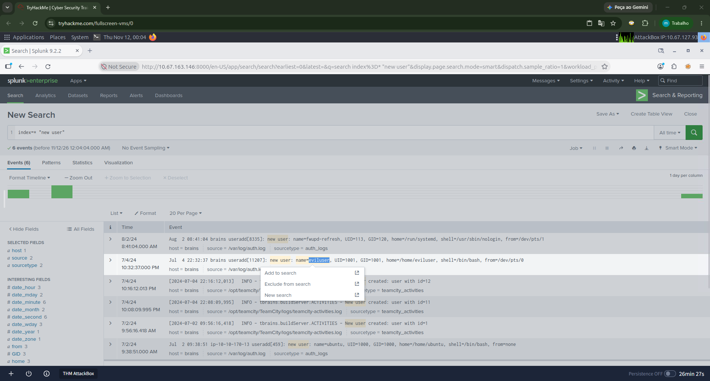
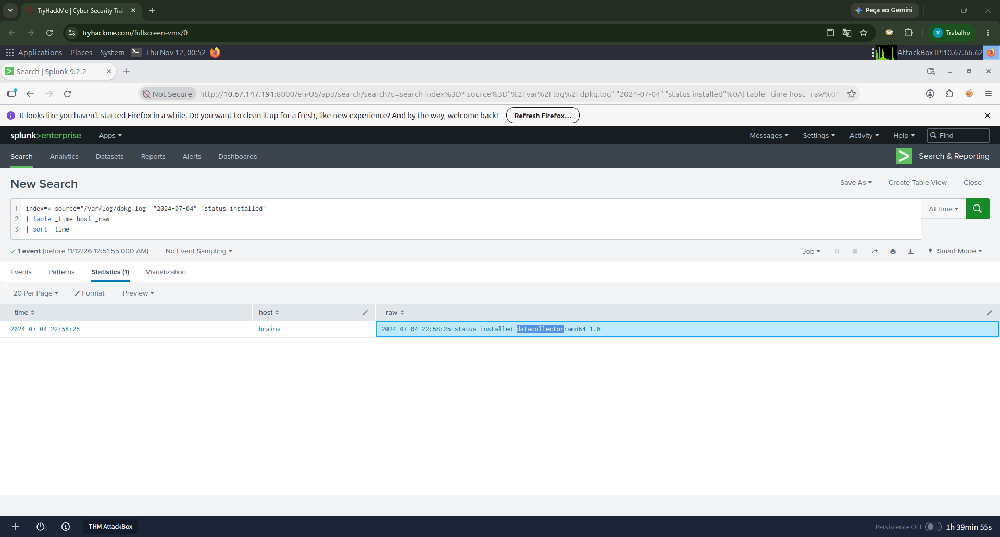
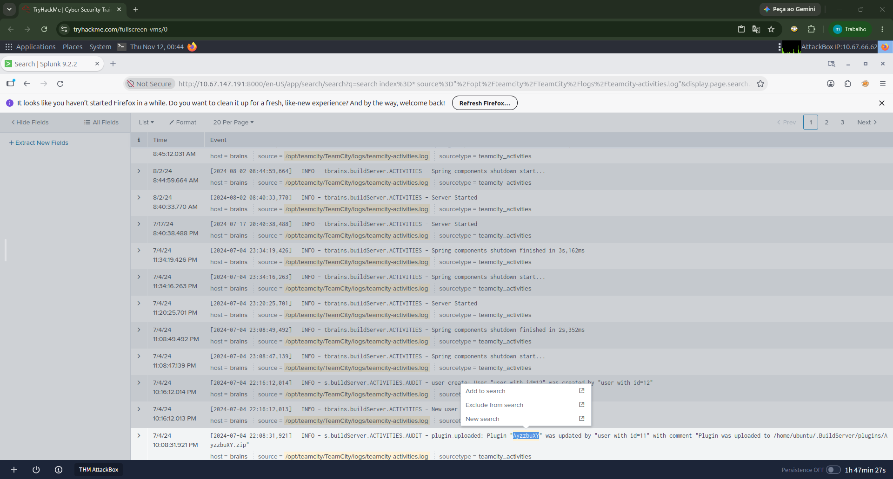

# 🧠🔎 Brains (DFIR) — CTF Writeup
### TryHackMe Room | DFIR · Investigação Forense Pós-Exploração do JetBrains TeamCity via Splunk

---

| **Analista**          | Mauricio Robert                                                                              |
|-----------------------|----------------------------------------------------------------------------------------------|
| **Organização**       | CypherBaron                                                                            |
| **Data do Relatório** | 11/11/2026                                                                                   |
| **Classificação**     | CONFIDENCIAL                                                                                  |
| **Host analisado**    | `brains`                                                                                      |
| **Plataforma de análise** | Splunk Enterprise 9.2.2 (SIEM)                                                           |
| **Fontes de log**     | `auth.log`, `teamcity-activities.log`, `/var/log/dpkg.log`                                    |
| **Link da sala**      | [tryhackme.com/room/brains](https://tryhackme.com/room/brains)                                |

---

## 🔍 Resumo Executivo

Esta é a segunda etapa do desafio **Brains** (TryHackMe): após a exploração do **CVE-2024-27198** (bypass de autenticação) contra o **JetBrains TeamCity 2023.11.3**, documentada no writeup de exploração, esta fase assume o papel de **analista forense (DFIR)**, investigando — via **Splunk** — os artefatos deixados pelo atacante no host comprometido. A investigação cruza três fontes de log (`auth.log`, `teamcity-activities.log` e `/var/log/dpkg.log`) e revela a cadeia completa de persistência do atacante: um **plugin malicioso** carregado no TeamCity, a criação de um **usuário backdoor** no sistema operacional e a instalação de um **pacote `.deb` suspeito**, provavelmente usado para coleta/exfiltração de dados.

---

## 🛠 Ferramentas e Fontes de Dados

| Ferramenta / Fonte | Finalidade |
|---|---|
| **Splunk Enterprise (Search & Reporting)** | Consulta e correlação de logs indexados do host `brains` |
| **`/var/log/auth.log`** | Registro de criação de usuários e autenticação no sistema operacional |
| **`/opt/teamcity/TeamCity/logs/teamcity-activities.log`** | Log de atividades/auditoria do servidor TeamCity (criação de usuários, upload de plugins) |
| **`/var/log/dpkg.log`** | Log de instalação/remoção de pacotes `.deb` no sistema Ubuntu |

---

## 📋 Perguntas e Respostas

### Q1 — Qual é o nome do usuário backdoor criado no servidor após a exploração?

> **Resposta: `eviluser`**

**Solução:** Pesquisando no Splunk por eventos de criação de usuário (`index=* "new user"`), seis eventos são retornados, cruzando o `auth.log` do sistema operacional com os logs de auditoria do TeamCity:

```spl
index=* "new user"
```

> 

| Horário | Evento | Fonte |
|---|---|---|
| 02/08 08:41:04 | `useradd[8335]: new user: name=fwpd-refresh, UID=113` (conta de serviço legítima) | `auth.log` |
| **04/07 22:32:37** | **`useradd[11207]: new user: name=eviluser, UID=1001, GID=1001, home=/home/eviluser, shell=/bin/bash, from=/dev/pts/0`** | `auth.log` |
| 04/07 22:16:12 | `New user created: user with id=12` (TeamCity) | `teamcity-activities.log` |
| 04/07 22:08:09 | `New user created: user with id=11` (TeamCity) | `teamcity-activities.log` |
| 02/07 09:56:16 | `New user created: user with id=1` (TeamCity, usuário administrador legítimo) | `teamcity-activities.log` |
| 02/07 09:38:51 | `useradd[459]: new user: name=ubuntu, UID=1000` (usuário legítimo do sistema) | `auth.log` |

Entre os usuários criados, a conta **`eviluser`** se destaca como anômala: criada diretamente via `useradd` no sistema operacional (não pelo próprio TeamCity), com **shell interativo** (`/bin/bash`), **UID/GID 1001** e originada de um **pseudo-terminal** (`/dev/pts/0`) — indicando que foi criada manualmente por alguém com acesso de shell ao servidor, logo após a janela de exploração do TeamCity. Esse é o **usuário backdoor** deixado pelo atacante para garantir acesso persistente.

---

### Q2 — Qual é o nome do pacote de aparência maliciosa instalado no servidor?

> **Resposta: `datacollector`**

**Solução:** Buscando no Splunk por instalações de pacotes registradas no `dpkg.log` durante a mesma janela temporal do incidente (04/07/2024):

```spl
index=* source="/var/log/dpkg.log" "2024-07-04" "status installed"
| table _time host _raw
| sort _time
```

> 

```
2024-07-04 22:58:25 status installed datacollector:amd64 1.0
```

O pacote **`datacollector`** (versão `1.0`, arquitetura `amd64`) foi instalado às **22:58:25** — pouco depois da criação do usuário `eviluser` — e, apesar do nome genérico que sugere uma ferramenta legítima de telemetria, não corresponde a nenhum pacote oficial conhecido do repositório Ubuntu/Debian nesse contexto. O nome **vago e genérico** ("coletor de dados") é uma técnica clássica de disfarce para ferramentas de **coleta/exfiltração de dados** ou outros utilitários pós-exploração, visando passar despercebido em auditorias superficiais de pacotes instalados.

---

### Q3 — Qual é o nome do plugin instalado no servidor após a exploração bem-sucedida?

> **Resposta: `AyzzbuXY`**

**Solução:** Investigando o log de auditoria do TeamCity (`teamcity-activities.log`) em busca de eventos de upload de plugins:

```spl
index=* source="/opt/teamcity/TeamCity/logs/teamcity-activities.log"
```

> 

```
[2024-07-04 22:08:31,921] INFO - s.buildServer.ACTIVITIES.AUDIT - plugin-uploaded:
Plugin "AyzzbuXY" was updated by "user with id=11" with comment
"Plugin was uploaded to /home/ubuntu/.BuildServer/plugins/AyzzbuXY.zip"
```

O registro de auditoria confirma o momento exato da exploração: às **22:08:31**, o plugin **`AyzzbuXY`** foi carregado no TeamCity pelo **"user with id=11"** — o token de autenticação administrativo forjado através do bypass CVE-2024-27198 — e salvo em `/home/ubuntu/.BuildServer/plugins/AyzzbuXY.zip`. Esse é exatamente o mecanismo nativo de plugins do TeamCity abusado pelo módulo do Metasploit (`jetbrains_teamcity_rce_cve_2024_27198`) para obter execução remota de código, consistente com os artefatos (`TC_147512_Yc2VphEj`, `plugins.unpacked/Yc2VphEj`) observados na fase de exploração.

---

## ⛓ Linha do Tempo Forense — Reconstrução do Incidente

```
[02/07/2024, 09:38:51]  useradd: usuário legítimo "ubuntu" criado (UID 1000) — provisionamento inicial do host
[02/07/2024, 09:56:16]  TeamCity: usuário administrador legítimo criado (id=1)
        │
        ▼  (janela de exploração do CVE-2024-27198)
[04/07/2024, 22:08:09]  TeamCity: novo usuário criado (id=11) — token/conta forjada via bypass de autenticação
[04/07/2024, 22:08:31]  TeamCity: plugin malicioso "AyzzbuXY" carregado
                         → /home/ubuntu/.BuildServer/plugins/AyzzbuXY.zip
                         → EXECUÇÃO REMOTA DE CÓDIGO (RCE)
[04/07/2024, 22:16:12]  TeamCity: segundo usuário criado (id=12) — possível conta adicional de limpeza/teste
        │
        ▼  (pós-exploração / estabelecimento de persistência)
[04/07/2024, 22:32:37]  useradd: USUÁRIO BACKDOOR "eviluser" criado no SO
                         UID=1001, shell=/bin/bash, via sessão de terminal (/dev/pts/0)
[04/07/2024, 22:58:25]  dpkg: pacote suspeito "datacollector" (1.0, amd64) instalado
                         → possível ferramenta de coleta/exfiltração de dados
```

---

## 🗺 Mapeamento Investigativo

| Pergunta | Fonte de Evidência | Resposta |
|---|---|---|
| Usuário backdoor criado após a exploração | `auth.log` (evento `useradd`) | `eviluser` |
| Pacote de aparência maliciosa instalado | `/var/log/dpkg.log` | `datacollector` |
| Plugin instalado após exploração bem-sucedida | `teamcity-activities.log` (evento `plugin-uploaded`) | `AyzzbuXY` |

---

## 🚨 Artefatos e Indicadores Identificados (IOCs)

| Tipo | Indicador | Contexto |
|---|---|---|
| Usuário backdoor | `eviluser` (UID 1001, GID 1001, `/bin/bash`) | Criado via `useradd` a partir de sessão de terminal, pós-RCE |
| Plugin malicioso | `AyzzbuXY` (`AyzzbuXY.zip`) | Carregado em `/home/ubuntu/.BuildServer/plugins/` via bypass de autenticação |
| Pacote suspeito | `datacollector:amd64 1.0` | Instalado via `dpkg` logo após a criação da backdoor |
| Conta TeamCity forjada | `user with id=11` | Criada através do token administrativo obtido pelo CVE-2024-27198 |
| Timestamp da exploração RCE | `2024-07-04 22:08:31` | Upload do plugin `AyzzbuXY` |
| Timestamp da criação da backdoor | `2024-07-04 22:32:37` | Criação do usuário `eviluser` |
| Timestamp da instalação do pacote suspeito | `2024-07-04 22:58:25` | Instalação de `datacollector` |
| Técnica (MITRE ATT&CK) | `T1190` | Exploit Public-Facing Application |
| Técnica (MITRE ATT&CK) | `T1505.003` | Server Software Component: Web Shell/Plugin malicioso |
| Técnica (MITRE ATT&CK) | `T1136.001` | Create Account: Local Account (persistência via `eviluser`) |
| Técnica (MITRE ATT&CK) | `T1072` / `T1560` | Software Deployment Tools / Archive Collected Data (pacote `datacollector`) |

---

## ✅ Resumo das Respostas

| # | Pergunta | Resposta |
|---|---|---|
| Q1 | Usuário backdoor criado após a exploração | `eviluser` |
| Q2 | Pacote de aparência maliciosa instalado | `datacollector` |
| Q3 | Plugin instalado após exploração bem-sucedida | `AyzzbuXY` |

---

## 📚 Referências

- [TryHackMe — Brains](https://tryhackme.com/room/brains)
- [CVE-2024-27198 — NVD](https://nvd.nist.gov/vuln/detail/CVE-2024-27198)
- [Splunk — Search & Reporting Documentation](https://docs.splunk.com/Documentation/Splunk/latest/Search/GetstartedwithSearch)
- [MITRE ATT&CK — T1136.001 Create Account: Local Account](https://attack.mitre.org/techniques/T1136/001/)
- [MITRE ATT&CK — T1505.003 Server Software Component: Web Shell](https://attack.mitre.org/techniques/T1505/003/)

---