# TryHackMe – Conti (Writeup)

**Room:** [Conti](https://tryhackme.com/room/contiransomwarehgh)  
**Categoria:** Forense digital / Resposta a incidentes / Análise de logs  
**Cenário:** Um servidor Exchange foi comprometido por ransomware. Funcionários não conseguem acessar o Outlook, o administrador perdeu acesso ao Exchange Admin Center e arquivos de resgate apareceram no servidor. O objetivo é investigar os registros no Splunk e reconstruir as ações do atacante.  
**Evidências:** Logs do Sysmon e do IIS apresentados nas capturas do laboratório.  
**Host comprometido:** `WIN-AOQKG2AS2Q7.bellybear.local`  
**Ferramentas:** Splunk Enterprise 8.2.2, consultas SPL e documentação técnica de apoio.

Os registros relacionam uma web shell no OWA, a criação de uma conta local, atividade de injeção em processos e a execução de um arquivo chamado `cmd.exe` fora do diretório habitual do Windows.

## Resumo das respostas

| # | Pergunta | Resposta |
|---|---|---|
| 1 | Localização do ransomware | `C:\Users\Administrator\Documents\cmd.exe` |
| 2 | Event ID do Sysmon para criação de arquivo | `11` |
| 3 | MD5 do ransomware | `290c7dfb01e50cea9e19da81a781af2c` |
| 4 | Arquivo salvo em vários diretórios | `readme.txt` |
| 5 | Comando para criar o usuário | `net user /add securityninja hardToHack123$` |
| 6 | Processo de destino da migração | `C:\Windows\System32\wbem\unsecapp.exe` |
| 7 | Processo alvo para obter hashes | `C:\Windows\System32\lsass.exe` |
| 8 | Nome da web shell | `i3gfPctK1c2x.aspx` |
| 9 | Linha de comando relacionada à web shell | Ver transcrição na Task 9 |
| 10 | CVEs em ordem crescente | `CVE-2018-13374,CVE-2018-13379,CVE-2020-0796` |

## Preparação da análise

No Splunk, selecionar **All time** para alcançar os eventos históricos do desafio. As consultas abaixo reproduzem as buscas visíveis ou apresentam filtros complementares para localizar os mesmos campos. Os filtros complementares são sugestões de reprodução, sem execução adicional no laboratório.

O campo `_time` exibido pelo Splunk pode usar um fuso diferente de `UtcTime`. Os horários da interface não devem ser comparados diretamente com horários UTC sem normalização.

## Task 1 – Localização do ransomware

**Pergunta:** Can you identify the location of the ransomware?

### Metodologia

1. Buscar eventos de criação de processos (`EventCode=1`) com a imagem `cmd.exe`.
2. Excluir o caminho habitual `C:\Windows\System32\cmd.exe` para destacar execuções em outros diretórios.
3. Exibir o executável, a linha de comando e o processo pai.

Consulta apresentada na captura:

```spl
index=* EventCode=1 Image="*\\cmd.exe"
| where NOT like(lower(Image), "%\\windows\\system32\\cmd.exe")
| table _time host Image CommandLine ParentImage
```

O resultado mostra:

| Campo | Valor |
|---|---|
| `Image` | `C:\Users\Administrator\Documents\cmd.exe` |
| `CommandLine` | `cmd.exe` |
| `ParentImage` | `C:\Windows\System32\cmd.exe` |

O executável no diretório `Documents` usa o mesmo nome de um componente legítimo. Esse caminho é suspeito no contexto do incidente; a correlação com a criação dos arquivos `readme.txt` reforça sua identificação como ransomware.

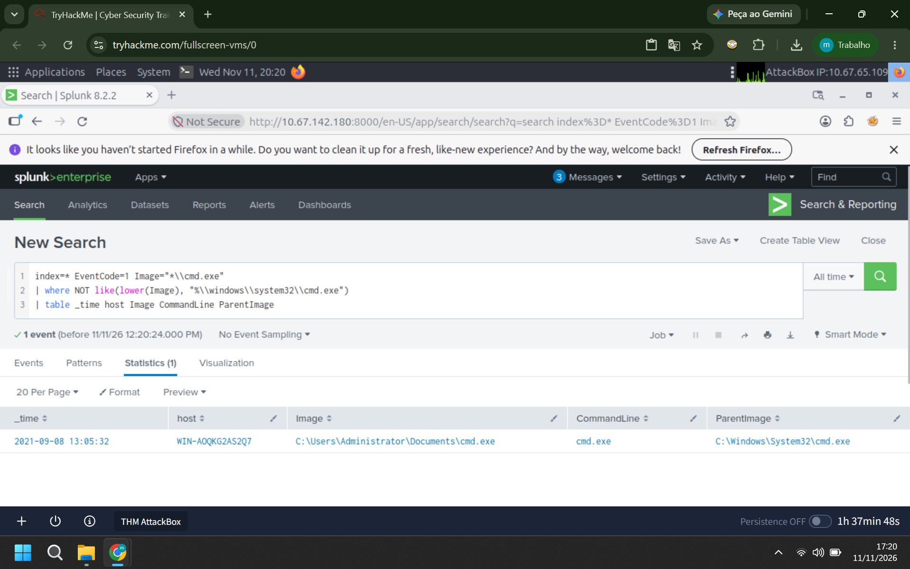

**Resposta:** `C:\Users\Administrator\Documents\cmd.exe`

## Task 2 – Event ID de criação de arquivo

**Pergunta:** What is the Sysmon event ID for the related file creation event?

### Metodologia

1. Localizar os eventos relacionados ao executável identificado.
2. Inspecionar o campo `EventCode` nos registros de criação de arquivos.
3. Confirmar a correspondência entre o código e a categoria do evento.

Filtro complementar:

```spl
index=* EventCode=11 Image="C:\\Users\\Administrator\\Documents\\cmd.exe"
| table _time host EventCode Image TargetFilename
```

A captura destaca `EventCode=11`. Na documentação do [Sysmon](https://learn.microsoft.com/en-us/sysinternals/downloads/sysmon), esse código corresponde a **FileCreate**, registrado quando um arquivo é criado ou sobrescrito. Neste conjunto de evidências, os eventos incluem arquivos gerados pelo ransomware; isso é diferente de afirmar que a captura mostra a criação do próprio executável malicioso.

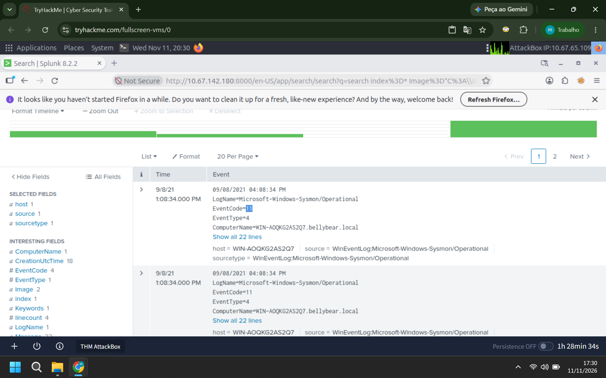

**Resposta:** `11`

## Task 3 – Hash MD5 do ransomware

**Pergunta:** Can you find the MD5 hash of the ransomware?

### Metodologia

1. Filtrar a criação do processo pelo caminho completo do ransomware.
2. Exibir o campo `Hashes`.
3. Extrair o valor identificado pelo prefixo `MD5=`.

```spl
index=* EventCode=1 Image="C:\\Users\\Administrator\\Documents\\cmd.exe"
| table _time host Image Hashes CommandLine
```

O campo contém o MD5 em letras maiúsculas. A resposta abaixo usa letras minúsculas, mantendo o mesmo valor hexadecimal. O hash já está presente na telemetria; não é necessário executar o arquivo para obtê-lo.

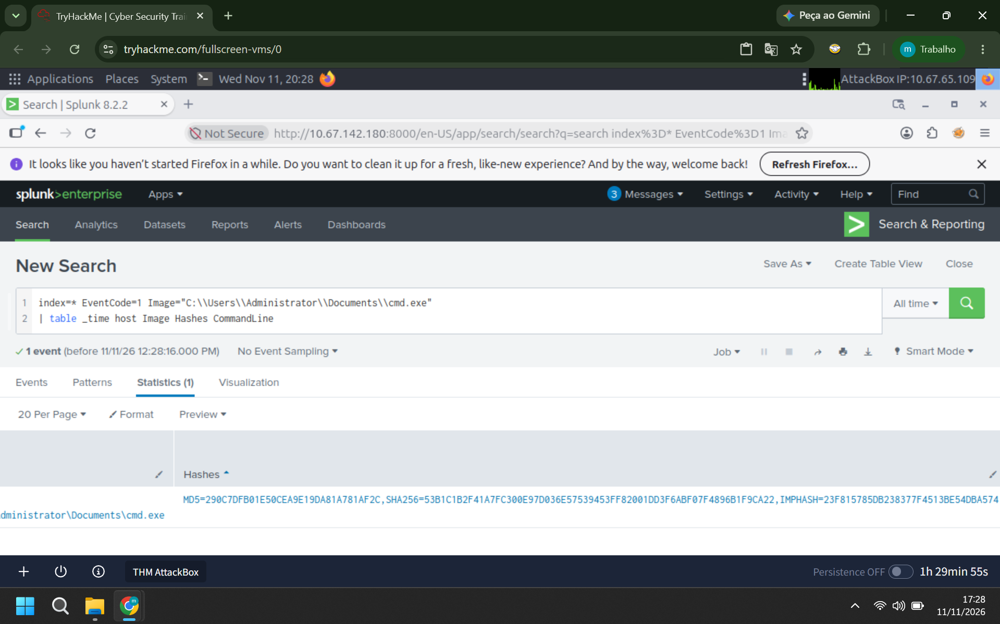

**Resposta:** `290c7dfb01e50cea9e19da81a781af2c`

## Task 4 – Arquivo salvo em múltiplos diretórios

**Pergunta:** What file was saved to multiple folder locations?

### Metodologia

1. Inspecionar os eventos `FileCreate` associados ao ransomware.
2. Comparar os valores de `TargetFilename` para identificar o nome recorrente.

Consulta complementar para agrupar os destinos:

```spl
index=* EventCode=11 Image="C:\\Users\\Administrator\\Documents\\cmd.exe"
| stats count by TargetFilename
```

A captura mostra o processo criando `C:\Users\Default\AppData\Local\readme.txt`. A repetição desse nome em diretórios diferentes, conforme a resposta validada do desafio, é compatível com a distribuição de notas de resgate.

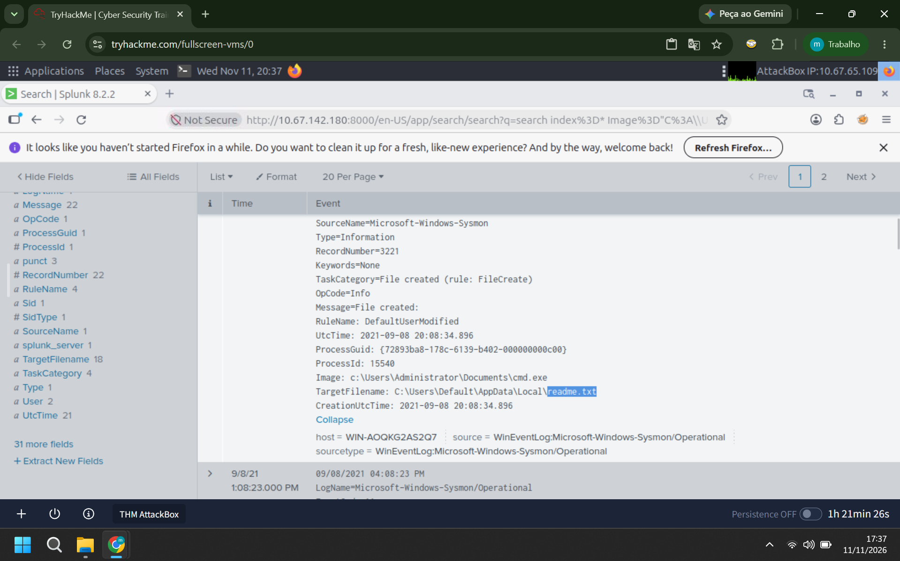

**Resposta:** `readme.txt`

## Task 5 – Criação de um novo usuário

**Pergunta:** What was the command the attacker used to add a new user to the compromised system?

### Metodologia

1. Buscar eventos de criação de processos que contenham `net user` ou o nome da conta identificada.
2. Inspecionar `CommandLine` para recuperar o comando completo.
3. Correlacionar os comandos próximos envolvendo a mesma conta.

Filtro complementar:

```spl
index=* EventCode=1 CommandLine="*securityninja*"
| table _time host Image CommandLine ParentImage
```

A captura registra a criação da conta `securityninja` com a senha `hardToHack123$`. Também aparecem comandos para adicioná-la aos grupos locais `administrators` e `Remote Desktop Users`. Os registros mostram a execução dessas ações; a confirmação do estado final da conta exigiria eventos de auditoria ou inspeção do sistema.

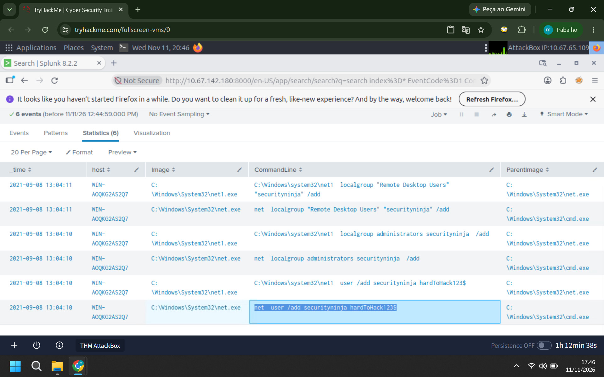

**Resposta:**

```text
net user /add securityninja hardToHack123$
```

## Task 6 – Processo de destino da migração

**Pergunta:** The attacker migrated the process for better persistence. What is the migration target (full image path)?

### Metodologia

1. Investigar eventos `EventCode=8`, correspondentes a `CreateRemoteThread` no [Sysmon](https://learn.microsoft.com/en-us/sysinternals/downloads/sysmon).
2. Comparar os campos `SourceImage` e `TargetImage` para acompanhar a atividade entre processos.

Consulta complementar:

```spl
index=* EventCode=8
| table _time host SourceImage SourceProcessId TargetImage TargetProcessId
```

O processo indicado pela resposta validada é `unsecapp.exe`. Na captura, ele já aparece como **origem** de uma thread remota direcionada ao LSASS:

| Campo | Valor |
|---|---|
| `SourceImage` | `C:\Windows\System32\wbem\unsecapp.exe` |
| `SourceProcessId` | `5016` |
| `TargetImage` | `C:\Windows\System32\lsass.exe` |
| `TargetProcessId` | `672` |

Esse registro evidencia a atividade posterior do processo migrado. A imagem, isoladamente, não mostra a etapa anterior em que `unsecapp.exe` teria sido o destino da migração. Além disso, migração entre processos não comprova persistência após reinicialização.

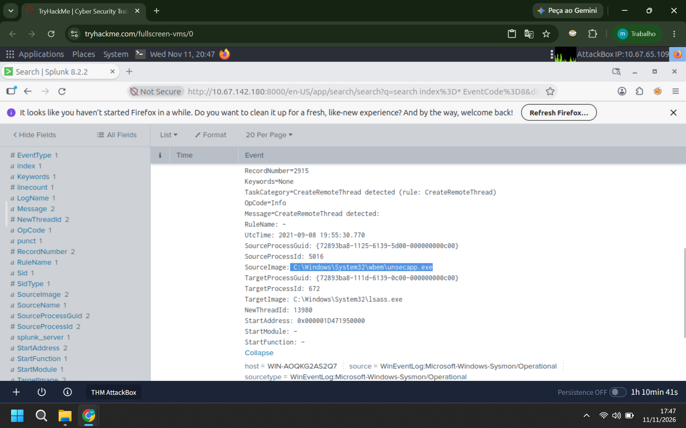

**Resposta:** `C:\Windows\System32\wbem\unsecapp.exe`

## Task 7 – Processo alvo para obtenção de hashes

**Pergunta:** The attacker also injected into a system process to retrieve the hashes. What is the target process image used for getting the system hashes?

### Metodologia

1. No evento `CreateRemoteThread`, verificar o campo `TargetImage`.
2. Correlacionar o processo alvo com a finalidade descrita na pergunta.

A captura destaca `C:\Windows\System32\lsass.exe` como destino da thread criada por `unsecapp.exe`. O [LSASS mantém material de credenciais em memória](https://attack.mitre.org/techniques/T1003/001/), tornando esse comportamento relevante para investigação de roubo de credenciais.

O evento sustenta a identificação do processo alvo. Ele não contém, por si só, o resultado da extração dos hashes nem identifica a ferramenta utilizada.

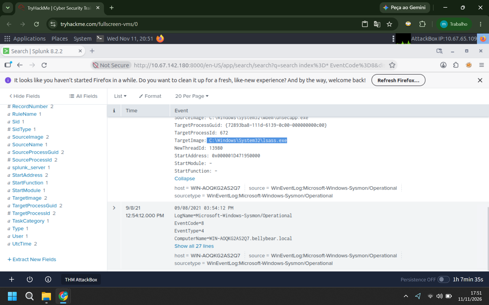

**Resposta:** `C:\Windows\System32\lsass.exe`

## Task 8 – Identificação da web shell

**Pergunta:** What is the web shell the exploit deployed to the system?

### Metodologia

1. Buscar requisições `POST` nos logs do IIS.
2. Filtrar extensões de scripts que podem receber comandos em um servidor web.
3. Inspecionar a URI e correlacioná-la com os eventos do host.

Consulta apresentada na captura:

```spl
index=* cs_method="POST"
| search cs_uri_stem="*.aspx" OR cs_uri_stem="*.ashx" OR cs_uri_stem="*.php"
| table _time c_ip cs_uri_stem cs_uri_query sc_status
```

O resultado destaca:

| Campo | Valor |
|---|---|
| `c_ip` | `10.10.10.2` |
| `cs_uri_stem` | `/owa/auth/i3gfPctK1c2x.aspx` |

O nome do arquivo coincide com o caminho observado na linha de comando da Task 9. Uma requisição `POST` a um arquivo ASPX não é suficiente, isoladamente, para classificar uma web shell; aqui, a identificação combina a resposta do desafio e os registros relacionados.

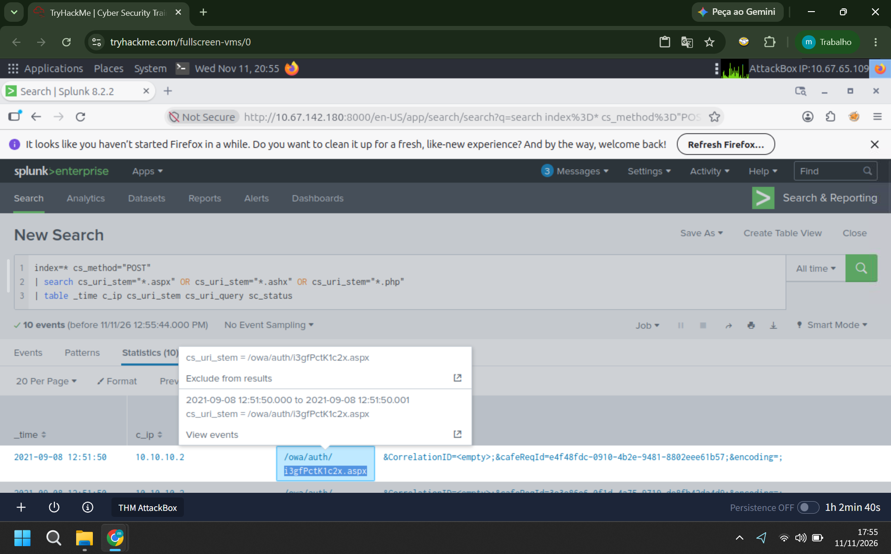

**Resposta:** `i3gfPctK1c2x.aspx`

## Task 9 – Linha de comando relacionada à web shell

**Pergunta:** What is the command line that executed this web shell?

### Metodologia

1. Buscar o nome do arquivo identificado na Task 8 em todos os registros.
2. Inspecionar os eventos de processo que contêm a web shell no campo `CommandLine`.

```spl
index=* "i3gfPctK1c2x.aspx"
```

O evento mostra `OriginalFileName: ATTRIB.EXE` e o diretório atual `c:\windows\system32\inetsrv\`. A linha de comando aponta para o arquivo na árvore do Exchange, por meio do compartilhamento administrativo `C$`.

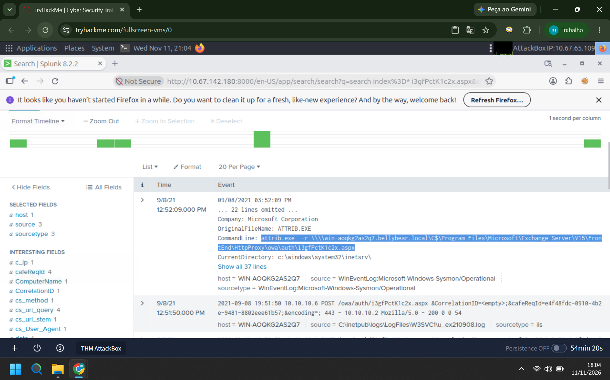

**Resposta — transcrição do registro, preservando as quatro barras iniciais exibidas na captura:**

```text
attrib.exe  -r \\\\win-aoqkg2as2q7.bellybear.local\C$\Program Files\Microsoft\Exchange Server\V15\FrontEnd\HttpProxy\owa\auth\i3gfPctK1c2x.aspx
```

**Interpretação técnica:** embora a pergunta use “executed”, `attrib.exe -r` remove o atributo de somente leitura; ele não executa o código ASPX. Essa é a linha de comando relacionada à web shell e informada como aceita no desafio. As requisições HTTP da Task 8 documentam o acesso ao arquivo pelo servidor web. A função de `-r` está descrita na [documentação da Microsoft](https://learn.microsoft.com/en-us/windows-server/administration/windows-commands/attrib).

## Task 10 – CVEs associadas ao desafio

**Pergunta:** What three CVEs did this exploit leverage? Provide the answer in ascending order.

### Metodologia

1. Reunir os identificadores informados como resposta validada.
2. Conferir o significado de cada vulnerabilidade e ordenar os identificadores por ano e número.

| CVE | Contexto técnico |
|---|---|
| [CVE-2018-13374](https://nvd.nist.gov/vuln/detail/cve-2018-13374) | Controle de acesso impróprio em FortiOS e FortiADC, permitindo obter credenciais LDAP ao redirecionar um teste de conectividade para um servidor controlado pelo atacante. |
| [CVE-2018-13379](https://www.fortinet.com/blog/psirt-blogs/fortios-ssl-vulnerability) | Path traversal no portal SSL VPN do FortiOS, permitindo que um atacante não autenticado baixe arquivos por requisições HTTP manipuladas. |
| [CVE-2020-0796](https://nvd.nist.gov/vuln/detail/cve-2020-0796) | Vulnerabilidade de execução remota de código no protocolo SMBv3.1.1 do Windows, conhecida como SMBGhost. |

As três capturas abaixo registram a pesquisa de contexto. A lista é mantida conforme a resposta validada fornecida para a sala. Como envolve Fortinet e SMB, ela não deve ser apresentada como uma cadeia de exploração do Exchange comprovada pelos eventos da web shell: os prints não demonstram a exploração individual dessas três falhas no host.

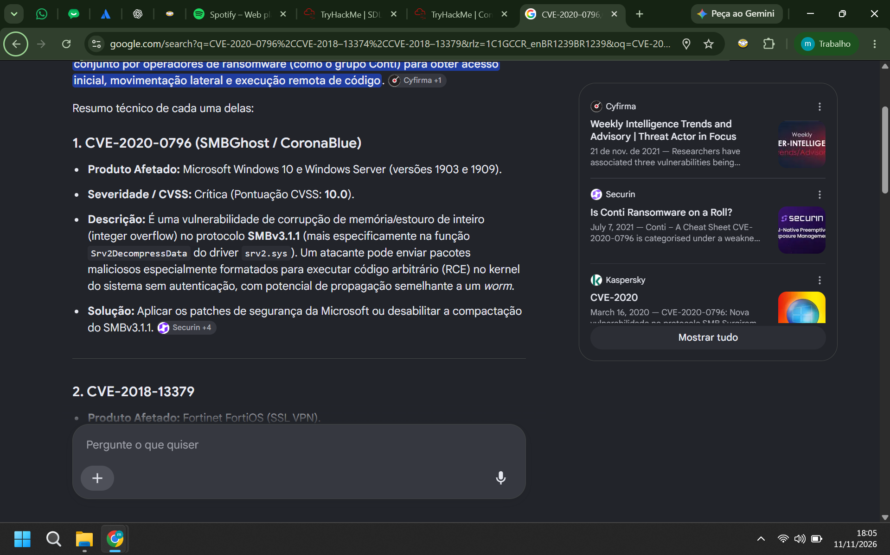

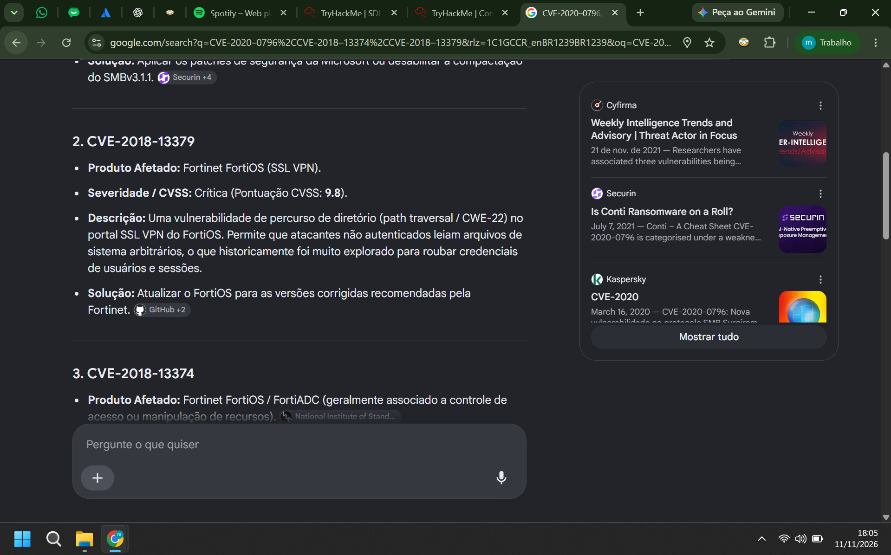

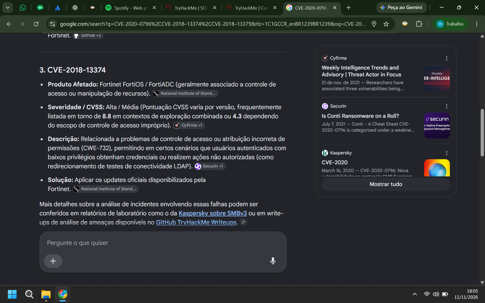

**Resposta:**

```text
CVE-2018-13374,CVE-2018-13379,CVE-2020-0796
```

## Linha do tempo

Eventos de **08/09/2021**, organizados pelos horários visíveis nas capturas. A coluna de tempo identifica a origem do horário para evitar misturar `_time`, timestamps brutos e `UtcTime`.

| Horário | Referência temporal | Evento |
|---|---|---|
| 19:51:50 | Timestamp bruto do IIS | Requisição `POST` à URI `/owa/auth/i3gfPctK1c2x.aspx`; a interface apresenta `_time` como `12:51:50`. |
| 12:52:09 | `_time` exibido pelo Splunk | Registro de `attrib.exe -r` apontando para a web shell. |
| 19:55:30.770 | `UtcTime` explícito do Sysmon | `unsecapp.exe` cria uma thread remota em `lsass.exe`. |
| 13:04:10–13:04:11 | `_time` exibido pelo Splunk | Comandos para criar `securityninja` e adicioná-la aos grupos locais. |
| 13:05:32 | `_time` exibido pelo Splunk | Execução de `C:\Users\Administrator\Documents\cmd.exe`. |
| 20:08:34.896 | `UtcTime` explícito do Sysmon | O executável suspeito cria `C:\Users\Default\AppData\Local\readme.txt`; a interface apresenta `_time` como `13:08:34`. |

Os pares de horários visíveis no IIS e no evento de criação de `readme.txt` apresentam diferença de sete horas. Essa relação ajuda a ordenar os eventos, mas os horários sem `UtcTime` explícito foram mantidos conforme a interface.

```text
Web shell em /owa/auth/
    |
    +--> comando attrib relacionado ao arquivo ASPX
    +--> atividade de unsecapp.exe direcionada ao LSASS
    +--> criação da conta securityninja e comandos de associação a grupos
    +--> execução de Documents\cmd.exe
             |
             +--> criação de readme.txt em diretórios do sistema
```

O esquema resume a sequência investigada; as setas não representam uma árvore de processos comprovada para todas as etapas.

## Mapeamento MITRE ATT&CK

Mapeamento analítico dos comportamentos observados. As técnicas descrevem as ações; não atribuem automaticamente cada evento ao mesmo processo ou comprovam o êxito de todas as etapas.

| Tática | Técnica | ID | Evidência e interpretação |
|---|---|---|---|
| Persistence | Server Software Component: Web Shell | [T1505.003](https://attack.mitre.org/techniques/T1505/003/) | Arquivo `i3gfPctK1c2x.aspx` identificado no OWA pelo desafio, com requisições POST correlacionadas. |
| Persistence | Create Account: Local Account | [T1136.001](https://attack.mitre.org/techniques/T1136/001/) | Comando `net user /add` para `securityninja`. |
| Defense Evasion / Privilege Escalation | Process Injection | [T1055](https://attack.mitre.org/techniques/T1055/) | Evento `CreateRemoteThread` de `unsecapp.exe` para `lsass.exe`. |
| Credential Access | OS Credential Dumping: LSASS Memory | [T1003.001](https://attack.mitre.org/techniques/T1003/001/) | LSASS como alvo, consistente com a finalidade de extração de hashes descrita pela sala; o resultado da extração não aparece no print. |
| Defense Evasion | Masquerading: Match Legitimate Resource Name or Location | [T1036.005](https://attack.mitre.org/techniques/T1036/005/) | Ransomware chamado `cmd.exe` no diretório `Documents`, imitando o nome de uma ferramenta legítima. |
| Impact | Data Encrypted for Impact | [T1486](https://attack.mitre.org/techniques/T1486/) | Contexto de ransomware e indisponibilidade descrito pela sala, com distribuição de `readme.txt`; as capturas não exibem diretamente a criptografia dos arquivos. |

## Indicadores de comprometimento

Indicadores específicos deste laboratório. Caminhos de componentes legítimos, como `lsass.exe` e `unsecapp.exe`, precisam ser avaliados pelo comportamento e pela correlação com outros eventos.

| Tipo | Valor |
|---|---|
| Host comprometido | `WIN-AOQKG2AS2Q7.bellybear.local` |
| Executável do ransomware | `C:\Users\Administrator\Documents\cmd.exe` |
| MD5 | `290c7dfb01e50cea9e19da81a781af2c` |
| Arquivo recorrente | `readme.txt` |
| Exemplo de caminho da nota | `C:\Users\Default\AppData\Local\readme.txt` |
| Conta criada por comando | `securityninja` |
| Web shell | `i3gfPctK1c2x.aspx` |
| URI | `/owa/auth/i3gfPctK1c2x.aspx` |
| Caminho local correspondente ao compartilhamento observado | `C:\Program Files\Microsoft\Exchange Server\V15\FrontEnd\HttpProxy\owa\auth\i3gfPctK1c2x.aspx` |
| IP cliente observado no IIS | `10.10.10.2` — endereço interno do laboratório |
| Processo associado à migração | `C:\Windows\System32\wbem\unsecapp.exe` |
| Processo alvo da injeção | `C:\Windows\System32\lsass.exe` |

## Ferramentas utilizadas

- **Splunk Enterprise 8.2.2:** pesquisa e correlação dos eventos apresentados nas capturas.
- **Sysmon:** telemetria de criação de processos, criação de arquivos e threads remotas.
- **Logs do IIS:** identificação de requisições ao arquivo ASPX no OWA.
- **Documentação da Microsoft, Fortinet, NVD e MITRE ATT&CK:** interpretação dos eventos, comandos, vulnerabilidades e comportamentos.

## Referências

- [TryHackMe – Conti](https://tryhackme.com/room/contiransomwarehgh)
- [Modelo de organização – Warzone 2](https://github.com/Nistezy404/CTF-Writeups/blob/main/Forensic/Warzone%202/Warzone_2.md)
- [Microsoft – Sysmon e tipos de eventos](https://learn.microsoft.com/en-us/sysinternals/downloads/sysmon)
- [Microsoft – Comando attrib](https://learn.microsoft.com/en-us/windows-server/administration/windows-commands/attrib)
- [NVD – CVE-2018-13374](https://nvd.nist.gov/vuln/detail/cve-2018-13374)
- [Fortinet – FortiOS and SSL Vulnerabilities](https://www.fortinet.com/blog/psirt-blogs/fortios-ssl-vulnerability)
- [NVD – CVE-2020-0796](https://nvd.nist.gov/vuln/detail/cve-2020-0796)

---