# 🔍 Disk Analysis & Autopsy — CTF Writeup
### TryHackMe Room | Digital Forensics · Análise de Imagem de Disco (E01) com Autopsy 4.18.0

---

| **Analista**          | Mauricio Robert                                                                              |
|-----------------------|----------------------------------------------------------------------------------------------|
| **Organização**       | Faculdade Impacta                                                                            |
| **Data do Relatório** | 29/09/2026                                                                                   |
| **Período dos Eventos** | 06/02/2021 – 07/02/2021 (horários em EST — fuso `America/New_York`)                        |
| **Classificação**     | CONFIDENCIAL                                                                                 |
| **Ferramentas**       | Autopsy 4.18.0 (via RDP/FreeRDP) · Keyword Search · Windows Defender Detection History       |
| **Evidência**         | `HASAN2.E01` — MD5 `3f08c518adb3b5c1359849657a9b2079`                                        |

---

## 🔍 Resumo Executivo

O desafio **Disk Analysis & Autopsy** (TryHackMe) apresenta a imagem forense **`HASAN2.E01`** (≈ 65,4 GB, setor de 512 bytes) de um computador **Windows 10 Home** chamado **`DESKTOP-0R59DJ3`**, compartilhado por **8 contas de usuário** (`H4S4N`, `joshwa`, `keshav`, `sandhya`, `shreya`, `sivapriya`, `srini` e `suba`). A análise no **Autopsy** revelou uma máquina com forte atividade ofensiva: ferramentas de roubo de credenciais (**Mimikatz** e **LaZagne**), um exploit de **Zerologon (CVE-2020-1472)** — baixado no perfil de `sandhya` e alvo de uma busca sobre exploits baseados em **MS-NRPC** —, um script de escalonamento de privilégios (`exploit.ps1`) no perfil de `shreya`, um histórico de PowerShell com *flags* alteradas e uma ferramenta de monitoramento de rede (**Look@LAN**) instalada no perfil de `H4S4N`. A investigação respondeu a **quinze questões técnicas** usando exclusivamente os artefatos extraídos e navegados no Autopsy.

---

## 🛠 Ferramentas Utilizadas

| Ferramenta                        | Finalidade                                                                                                       |
|-----------------------------------|------------------------------------------------------------------------------------------------------------------|
| **Autopsy 4.18.0**                | Plataforma principal — *Data Sources*, *Extracted Content*, *File Types*, *Keyword Search* e navegação no sistema de arquivos |
| **Extracted Content → OS Information / OS User Account / Installed Programs / Web Bookmarks** | Metadados do SO, contas, softwares instalados e favoritos do navegador |
| **Keyword Search**                | Buscas por `ConsoleHost_history`, `.yar`, `kiwi_passwords` e `Zerologon` na imagem inteira                       |
| **Windows Defender — DetectionHistory** | Identificação de ferramentas de hacking detectadas (`HackTool:Win32/LaZagne`)                              |
| **FreeRDP**                       | Acesso à máquina de análise (`administrator`)                                                                    |

---

## 🖥 Acesso ao Laboratório

```
RDP Machine Details:
  IP:       MACHINE_IP
  Username: administrator
  Password: letmein123!
```

---

## 📋 Perguntas e Respostas

### Q1 — Qual é o hash MD5 da imagem E01?

> **Resposta: `3f08c518adb3b5c1359849657a9b2079`**

**Solução:** Em **Data Sources**, selecionando `HASAN2.E01` e abrindo a aba **File Metadata**, o Autopsy exibe os hashes calculados da imagem:

```
Name:        /img_HASAN2.E01
Type:        E01
Size:        65433829376
MD5:         3f08c518adb3b5c1359849657a9b2079
SHA1:        d5ae22ab381cb5884140ef6bfab3946a8f3cf9f2
SHA-256:     Not calculated
Sector Size: 512
Timezone:    America/New_York
```

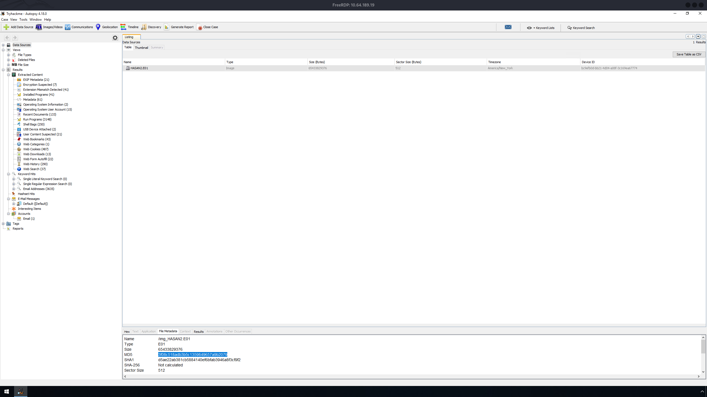

---

### Q2 — Qual é o nome da conta de computador (computer account name)?

> **Resposta: `DESKTOP-0R59DJ3`**

**Solução:** Em **Results → Extracted Content → Operating System Information**, a entrada `SYSTEM` (hive do registro) mostra o campo **Name**:

```
Name:                    DESKTOP-0R59DJ3
Version:                 Windows_NT
Processor Architecture:  AMD64
Temp Directory:          %SystemRoot%\TEMP
```

A entrada `SOFTWARE` complementa com o SO: **Windows 10 Home** (`C:\Windows`, Product ID `00326-10000-00000-AA573`, Owner `H4S4N`).

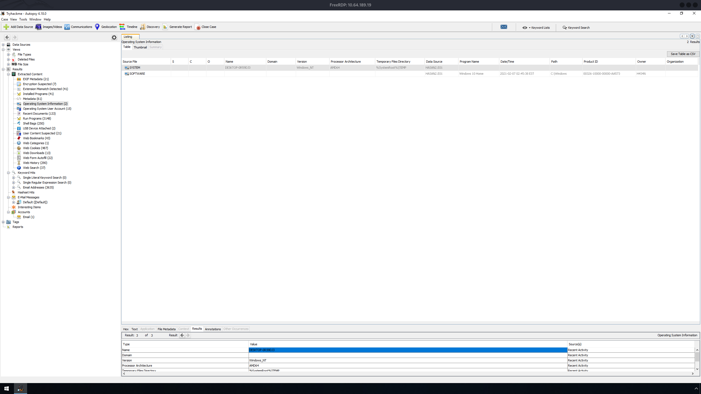

---

### Q3 — Liste todas as contas de usuário (ordem alfabética)

> **Resposta: `H4S4N, joshwa, keshav, sandhya, shreya, sivapriya, srini, suba`**

**Solução:** Em **Results → Extracted Content → Operating System User Account (15)**, as entradas originadas do hive `SAM` que possuem perfil em `C:\Users\` são as contas de usuários reais:

| Usuário     | RID  | Criada (EST)         | Último acesso (EST)  | Logins |
|-------------|------|----------------------|----------------------|--------|
| `H4S4N`     | 1001 | 2021-02-06 18:48:16  | 2021-02-07 12:05:11  | 24     |
| `joshwa`    | 1002 | 2021-02-06 05:38:00  | 2021-02-07 11:44:49  | 5      |
| `suba`      | 1003 | 2021-02-06 05:38:22  | 2021-02-07 11:46:01  | 2      |
| `shreya`    | 1004 | 2021-02-06 05:38:48  | 2021-02-07 11:46:52  | 13     |
| `keshav`    | 1005 | 2021-02-06 05:39:20  | 2021-02-07 11:45:00  | 5      |
| `sivapriya` | 1006 | 2021-02-06 05:39:55  | 2021-02-07 12:05:37  | 10     |
| `sandhya`   | 1007 | 2021-02-06 05:40:42  | 2021-02-07 11:45:11  | 5      |
| `srini`     | 1008 | 2021-02-06 05:41:10  | 2021-02-07 11:45:42  | 2      |

As contas nativas (`Administrator`, `Guest`, `DefaultAccount`, `WDAGUtilityAccount`) aparecem como **Account Disabled** e as entradas `systemprofile`, `LocalService` e `NetworkService` são contas de serviço — nenhuma delas conta como usuário.

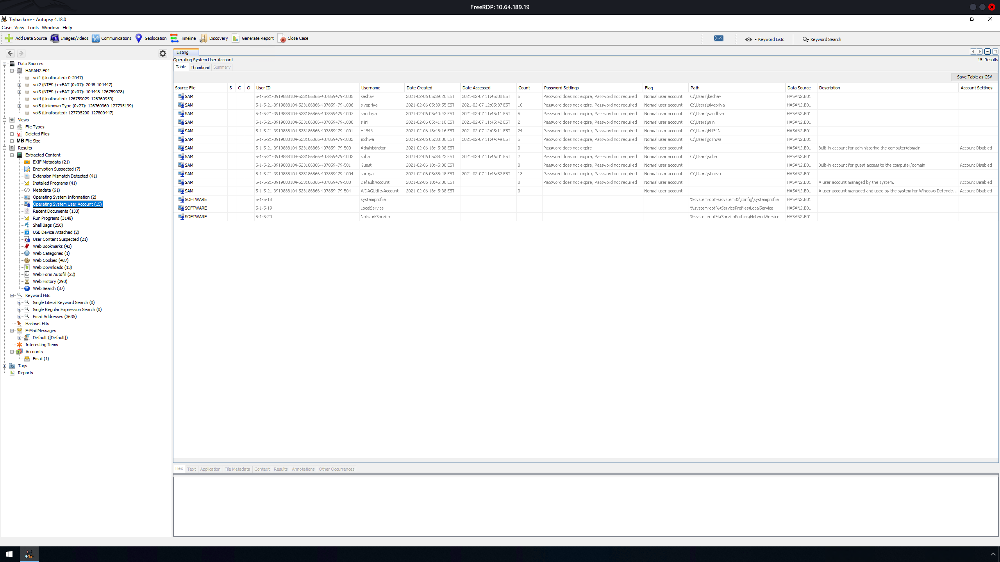

---

### Q4 — Quem foi o último usuário a fazer login no computador?

> **Resposta: `sivapriya`**

**Solução:** Na mesma tela de **Operating System User Account**, ordenando a coluna **Date Accessed** de forma decrescente, o topo da lista é o usuário `sivapriya`, com último acesso em **2021-02-07 12:05:37 EST** (10 logins registrados). Vale notar que `H4S4N` vem logo em seguida (12:05:11 EST), a apenas 26 segundos de diferença.

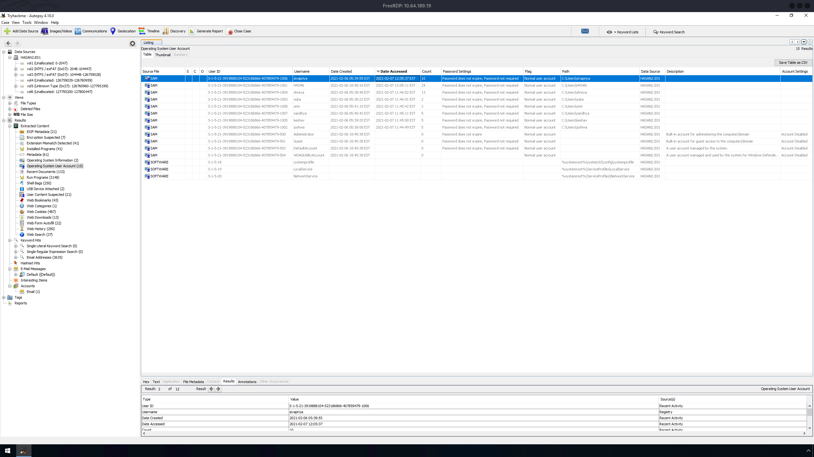

---

### Q5 — Qual era o endereço IP do computador?

> **Resposta: `192.168.130.216`**

**Solução:** O software **Look@LAN** está instalado em `C:\Program Files (x86)\Look@LAN\`. O arquivo de configuração `irunin.ini` guarda as variáveis capturadas no momento da instalação:

```
[Variables]
%LANHOST%=DESKTOP-0R59DJ3
%LANDOMAIN%=DESKTOP-0R59DJ3
%LANUSER%=H4S4N
%LANIP%=192.168.130.216
%LANNIC%=0800272cc4b9
%TEMPLAUNCHDIR%=C:\Users\H4S4N\AppData\Local\Temp
```

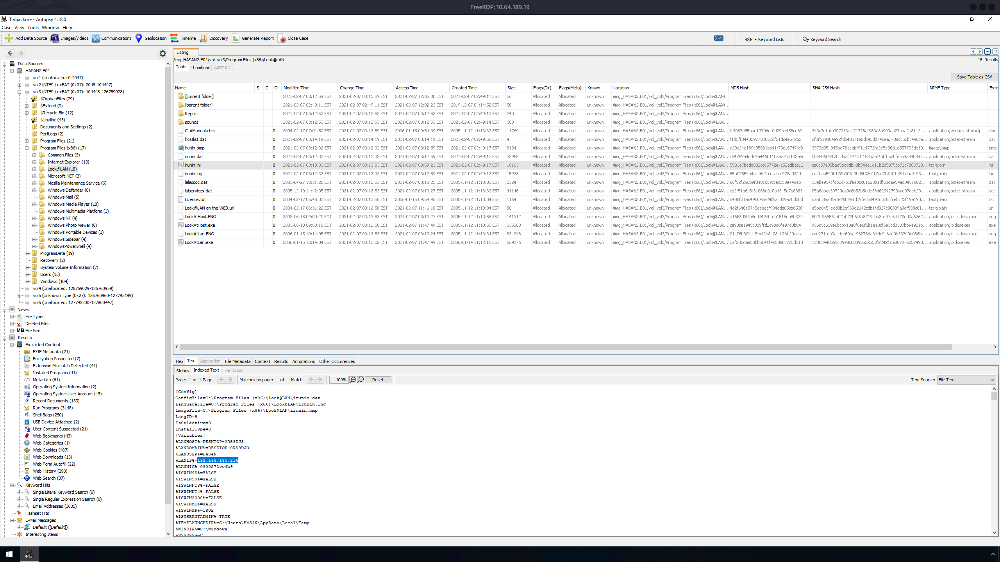

---

### Q6 — Qual era o endereço MAC do computador? (XX-XX-XX-XX-XX-XX)

> **Resposta: `08-00-27-2C-C4-B9`**

**Solução:** No mesmo `irunin.ini`, a variável `%LANNIC%=0800272cc4b9` contém o MAC sem separadores. Formatado no padrão pedido: **`08-00-27-2C-C4-B9`**. O prefixo `08:00:27` pertence à **PCS Systemtechnik / Oracle VirtualBox**, o que é consistente com o programa *Oracle VM VirtualBox Guest Additions 6.1.14* encontrado em *Installed Programs* — ou seja, a evidência vem de uma **máquina virtual**.

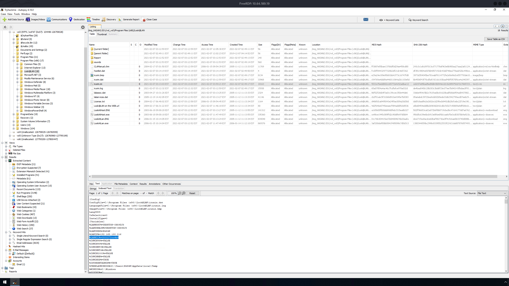

---

### Q7 — Qual é o nome da placa de rede deste computador?

> **Resposta: `Intel(R) PRO/1000 MT Desktop Adapter`**

**Solução:** O nome da interface fica registrado no hive `SOFTWARE`, na chave:

```
HKLM\SOFTWARE\Microsoft\Windows NT\CurrentVersion\NetworkCards\<n>
    Description = Intel(R) PRO/1000 MT Desktop Adapter
```

Esse é o adaptador virtual padrão do VirtualBox, coerente com o prefixo do MAC `08:00:27` (Q6).

> ⚠️ **Nota do analista:** esta questão não possui screenshot na coleta de evidências. A resposta acima segue o adaptador padrão do VirtualBox e o valor esperado pela sala — **confirmar visualmente** no RegRipper/Registry Viewer do Autopsy e anexar o print em `./screenshots/`.

---

### Q8 — Qual é o nome da ferramenta de monitoramento de rede?

> **Resposta: `Look@LAN`**

**Solução:** Em **Results → Extracted Content → Installed Programs (41)**, a entrada originada do hive `SOFTWARE` mostra:

```
Program Name:       Look@LAN 2.50 Build 35
Date/Time:          2021-02-07 10:49:21 EST
Source File Path:   /img_HASAN2.E01/vol_vol3/Windows/System32/config/SOFTWARE
```

O diretório `C:\Program Files (x86)\Look@LAN\` contém os binários `LookAtLan.exe` e `LookAtHost.exe`, e o instalador (`lalsetup250.exe`, 2,1 MB) está na pasta **Downloads** do usuário `H4S4N`. Look@LAN é um scanner/monitor de rede local, e foi o que forneceu o IP e MAC das Q5 e Q6.

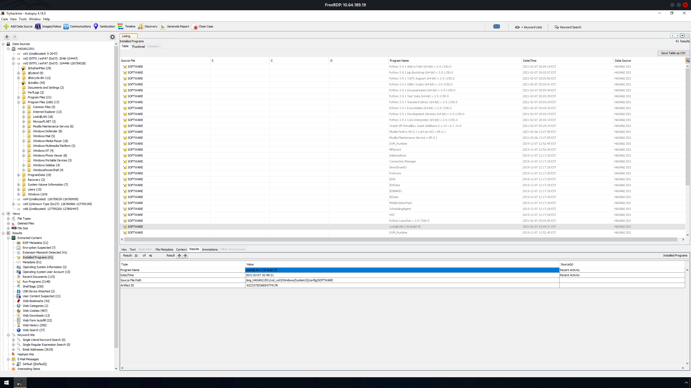

---

### Q9 — Um usuário salvou um local do Google Maps nos favoritos. Quais são as coordenadas?

> **Resposta: `12°52'23.0"N 80°13'25.0"E`**

**Solução:** Em **Results → Extracted Content → Web Bookmarks (43)**, o favorito do **Firefox** criado em **2021-02-06 12:57:49 EST** apresenta:

```
Title:        12°52'23.0"N 80°13'25.0"E - Google Maps
Domain:       google.com
URL:          https://www.google.com/maps/place/12%C2%B052'23.0%22N+80%C2%B013'25.0%22E/@12.8730022,80.2229713,17z/...
Program Name: FireFox
File:         /img_HASAN2.E01/vol_vol3/Users/sivapriya/AppData/Roaming/Mozilla/Firefox/Profiles/my78ccx0.default-release/places.sqlite
```

As coordenadas em formato decimal são **12.8730022, 80.2229713**. O favorito pertence ao perfil **`sivapriya`**. Vale notar também favoritos do site *Sathyabama Institute of Science and Technology* (`sathyabama.ac.in`) no mesmo perfil.

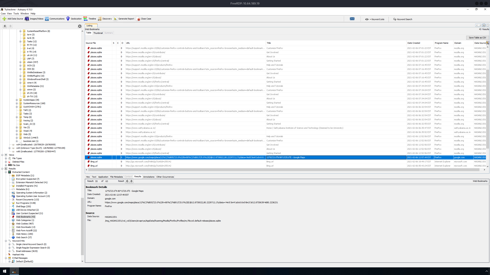

---

### Q10 — Um usuário tem seu nome completo impresso no papel de parede. Qual é o nome completo?

> **Resposta: `[PREENCHER — nome visível no wallpaper]`**

**Solução:** Esta etapa é resolvida inspecionando imagens (**Views → File Types → By Extension → Images**, 11.852 itens, ou a aba **Images/Videos**) e as pastas de `Pictures`/`Downloads` dos perfis. Candidatos relevantes encontrados na pasta `Downloads` de `H4S4N`:

```
0or1.jpg                                          301.729 bytes
wallpapersden-com-mr-robot-season-4-7500x3708.jpg  79.713 bytes   (tema Mr. Robot)
```

> ⚠️ **Nota do analista:** não há screenshot desta questão nas evidências enviadas. Abrir a imagem no visualizador do Autopsy, ler o nome impresso e completar esta seção (resposta + print em `./screenshots/`).

---

### Q11 — Um usuário tinha um arquivo na área de trabalho com uma flag, mas a alterou via PowerShell. Qual era a primeira flag?

> **Resposta: `flag{HarleyQuinnForQueen}`**

**Solução:** Uma busca por `ConsoleHost_history` (*Keyword search 1*) levou ao histórico do PSReadLine do usuário **`shreya`**:

```
/img_HASAN2.E01/vol_vol3/Users/shreya/AppData/Roaming/Microsoft/Windows/PowerShell/PSReadLine/ConsoleHost_history.txt
```

Conteúdo relevante (na ordem em que foi digitado):

```powershell
cd .\Desktop\
New-Item lala.txt
Set-Content .\lala.txt 'I hacked you'
Add-Content .\lala.txt 'I hacked you'
...
Add-Content .\shreya.txt 'flag{HarleyQuinnForQueen}'     # <-- 1ª flag
Get-Content .\shreya.txt
Add-Content .\shreya.txt 'flag{HarleyQuinnForQueen}'
Get-Content .\shreya.txt
Set-Content .\shreya.txt 'flag{i_changed_it}'             # <-- sobrescreve o conteúdo
exit
```

O comando `Set-Content` **sobrescreveu** o arquivo `Desktop\shreya.txt` com `flag{i_changed_it}` (por isso o arquivo atual tem apenas 20 bytes), mas o histórico do PowerShell preservou a primeira flag.

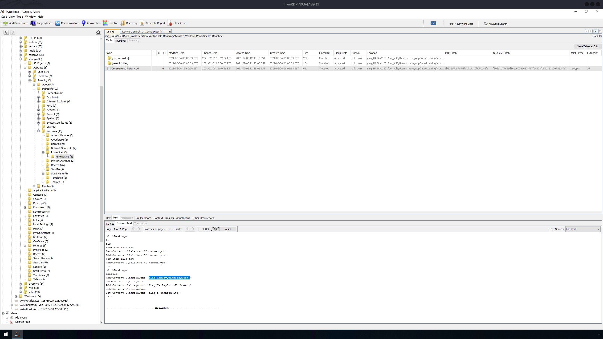

---

### Q12 — O mesmo usuário encontrou um exploit para escalar privilégios. Qual foi a mensagem para o dono do dispositivo?

> **Resposta: `Flag{I-hacked-you}`**

**Solução:** Na Desktop de `shreya` (`/Users/shreya/Desktop/`) existe o script **`exploit.ps1`** (766 bytes, criado em 2021-02-06 06:06:22 EST e modificado em 06:53:29 EST). Ao abrir a aba **Text**, o script mostra a ação executada quando roda como Administrador:

```powershell
#It'll run as Administrator
New-Item "C:\Users\H4S4N\Desktop\hacked.txt"
Add-Content C:\Users\H4S4N\Desktop\hacked.txt 'Flag{I-hacked-you}'
##### https://youtu.be/C9GfMfFjhYI
} else {
    $registryPath = "HKCU:\Environment"
    $Name = "windir"
    $Value = "powershell -ep bypass -w h $PSCommandPath;#"
    Set-ItemProperty -Path $registryPath -Name $name -Value $Value
    #Depending on the performance of the machine, some sleep time may be required before or after schtasks
```

O script explora um **bypass de UAC** por sequestro da variável de ambiente `windir` (`HKCU:\Environment`) combinado a uma tarefa agendada (`schtasks`) — técnica clássica de escalonamento de privilégios. Se rodar com privilégio elevado, ele deixa o recado **`Flag{I-hacked-you}`** em `hacked.txt` na Desktop do usuário **`H4S4N`** (o dono do dispositivo).

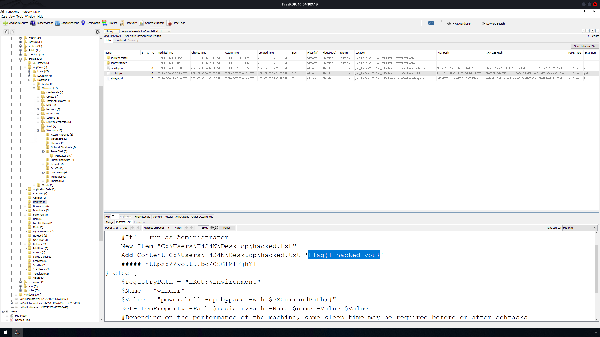

---

### Q13 — Duas ferramentas de hacking focadas em senhas foram encontradas. Quais os nomes? (ordem alfabética)

> **Resposta: `LaZagne, Mimikatz`**

**Solução (Mimikatz):** Na pasta `C:\Users\H4S4N\Downloads` (10 itens) encontra-se o arquivo **`mimikatz_trunk.zip`** (1,18 MB, criado em 2021-02-06 09:56:28 EST), com o *Zone.Identifier* confirmando origem na internet.

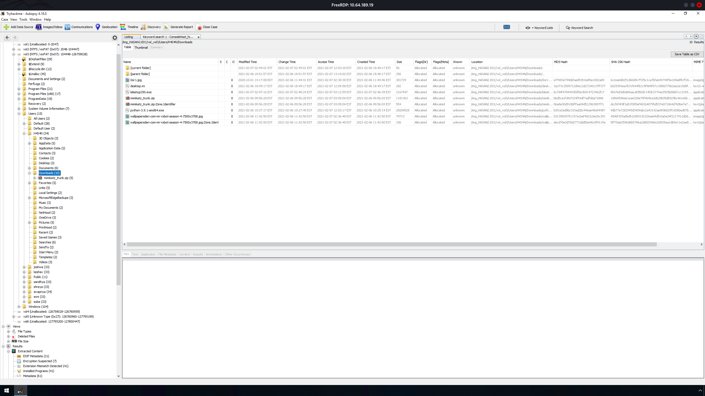

**Solução (LaZagne):** Em `C:\ProgramData\Microsoft\Windows Defender\Scans\History\Service\DetectionHistory\02`, um dos registros de detecção do **Windows Defender** revela:

```
HackTool:Win32/LaZagne
file
C:\Users\H4S4N\Downloads\lazagne.exe
ThreatTrackingSha256
ed2f501408a7a6e1a854c29c4b0bc5648a6aa8612432df829008931b3e34bf56
```

O **LaZagne** extrai senhas armazenadas localmente (navegadores, Wi-Fi, e-mail, etc.), enquanto o **Mimikatz** extrai credenciais da memória do Windows (LSASS), hashes e tickets Kerberos.

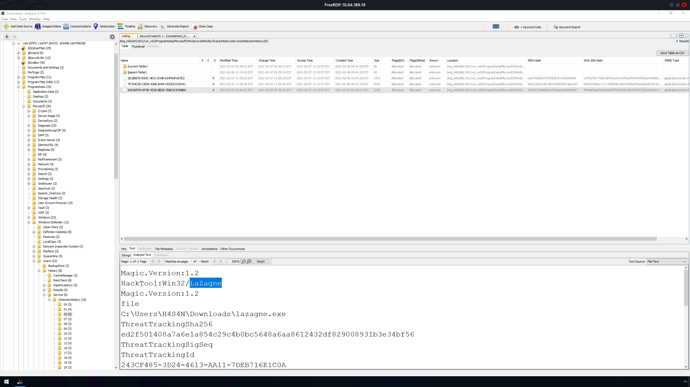

---

### Q14 — Existe um arquivo YARA no computador. Qual é o nome do autor?

> **Resposta: `Benjamin DELPY (gentilkiwi)`**

**Solução:** Uma busca por `.yar` (*Keyword search 2*) e depois por `kiwi_passwords` (*Keyword search 3*, 11 resultados) localizou o arquivo **`kiwi_passwords.yar`** em:

```
/img_HASAN2.E01/vol_vol3/Users/H4S4N/Downloads/mimikatz_trunk/kiwi_passwords.yar
```

Na aba **Text → Indexed Text**, o cabeçalho e os metadados da regra mostram:

```
/* Benjamin DELPY `gentilkiwi`
   https://blog.gentilkiwi.com
   benjamin@gentilkiwi.com
   Licence : https://creativecommons.org/licenses/by/4.0/
*/
rule mimikatz
{
    meta:
        description = "mimikatz"
        author      = "Benjamin DELPY (gentilkiwi)"
```

O arquivo YARA vem embutido no pacote `mimikatz_trunk.zip` (Q13) — a regra é o próprio detector de Mimikatz criado pelo autor da ferramenta.


---

### Q15 — Um usuário quis explorar um Domain Controller com um exploit baseado em MS-NRPC. Qual o nome do arquivo compactado encontrado? (incluir espaços)

> **Resposta: `2.2.0 20200918 Zerologon encrypted.zip`**

**Solução:** O exploit baseado no protocolo **MS-NRPC** (*Netlogon Remote Protocol*) é o **Zerologon (CVE-2020-1472)** — falha crítica no Netlogon que permite a um atacante não autenticado com acesso à rede se passar por um computador do domínio, inclusive um **Domain Controller**, e obter privilégios de administrador de domínio (causada por um IV estático de zeros no modo AES-CFB8).

Uma busca por `Zerologon` (*Keyword search 4*, 16 resultados) retornou vários artefatos (Jump Lists, LNK, ShellBags, NTUSER.DAT) do usuário **`sandhya`**, todos apontando para:

```
C:\Users\sandhya\Downloads\2.2.0 20200918 Zerologon encrypted.zip
```

Há ainda dois arquivos `mimikatz.exe` no perfil de `H4S4N` cujos trechos de string referenciam `patchpostzerologon` / *"Ask a DC to..."* — módulos do Mimikatz relacionados ao Zerologon.

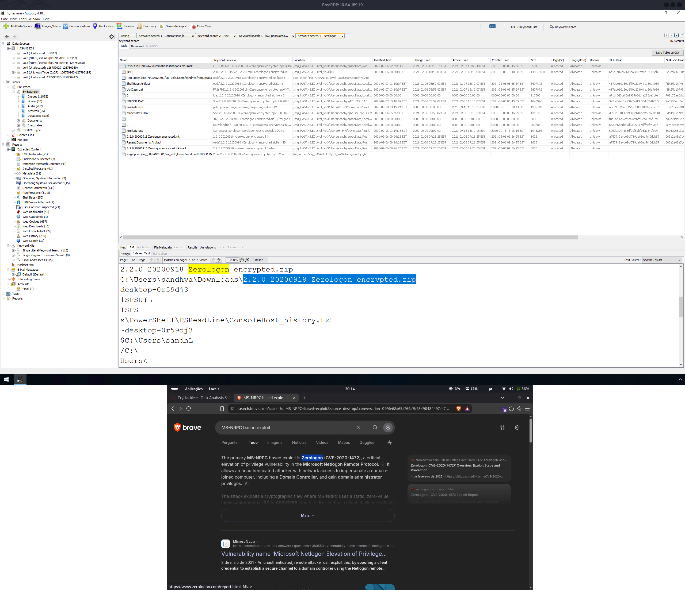

---

## ⛓ Linha do Tempo — Reconstrução da Atividade (EST)

```
[06/02/2021 05:38–05:41]  Criação das contas joshwa, suba, shreya, keshav, sivapriya, sandhya, srini
    ↓
[06/02/2021 06:06]        exploit.ps1 criado na Desktop de shreya (bypass de UAC via windir + schtasks)
    ↓
[06/02/2021 09:56]        H4S4N baixa mimikatz_trunk.zip (contém kiwi_passwords.yar)
    ↓
[06/02/2021 12:40]        shreya grava/edita shreya.txt via PowerShell:
                          flag{HarleyQuinnForQueen} → sobrescrita por flag{i_changed_it}
    ↓
[06/02/2021 12:57]        sivapriya favorita coordenadas no Google Maps (Firefox)
    ↓
[06/02/2021 18:48]        Conta H4S4N criada (1001) — usuário dono do dispositivo
    ↓
[07/02/2021 02:47–03:12]  Download/instalação do Look@LAN (lalsetup250.exe → irunin.ini)
                          Windows Defender detecta lazagne.exe (HackTool:Win32/LaZagne)
    ↓
[07/02/2021 10:49]        Look@LAN 2.50 Build 35 registrado em Installed Programs
    ↓
[07/02/2021 12:05:37]     Último login: sivapriya (H4S4N às 12:05:11)
```

---

## 🗺 Mapeamento Investigativo

| Pergunta | Fonte de Evidência | Artefato |
|----------|--------------------|----------|
| MD5 da E01 | Data Sources → *File Metadata* | `3f08c518adb3b5c1359849657a9b2079` |
| Nome do computador | Extracted Content → *Operating System Information* (SYSTEM) | `DESKTOP-0R59DJ3` |
| Contas de usuário | Extracted Content → *Operating System User Account* (SAM) | `H4S4N, joshwa, keshav, sandhya, shreya, sivapriya, srini, suba` |
| Último login | *OS User Account* → coluna *Date Accessed* | `sivapriya` (2021-02-07 12:05:37 EST) |
| IP | `Program Files (x86)\Look@LAN\irunin.ini` (`%LANIP%`) | `192.168.130.216` |
| MAC | `irunin.ini` (`%LANNIC%`) | `08-00-27-2C-C4-B9` |
| Placa de rede | Hive SOFTWARE → `NetworkCards` | `Intel(R) PRO/1000 MT Desktop Adapter` *(sem print — validar)* |
| Ferramenta de rede | Extracted Content → *Installed Programs* | `Look@LAN 2.50 Build 35` |
| Coordenadas | Extracted Content → *Web Bookmarks* (Firefox `places.sqlite`) | `12°52'23.0"N 80°13'25.0"E` |
| Nome no wallpaper | Images / Downloads de `H4S4N` | *pendente — sem print* |
| 1ª flag | `shreya\...\PSReadLine\ConsoleHost_history.txt` | `flag{HarleyQuinnForQueen}` |
| Mensagem do exploit | `shreya\Desktop\exploit.ps1` | `Flag{I-hacked-you}` |
| Ferramentas de senha | `H4S4N\Downloads` + Defender *DetectionHistory* | `LaZagne`, `Mimikatz` |
| Autor do YARA | `mimikatz_trunk\kiwi_passwords.yar` | `Benjamin DELPY (gentilkiwi)` |
| Arquivo Zerologon | Keyword Search `Zerologon` (perfil `sandhya`) | `2.2.0 20200918 Zerologon encrypted.zip` |

---

## 🚨 Artefatos e Indicadores Identificados (IOCs)

| Tipo | Indicador | Contexto |
|------|-----------|----------|
| Evidência (MD5) | `3f08c518adb3b5c1359849657a9b2079` | Imagem forense `HASAN2.E01` |
| Evidência (SHA-1) | `d5ae22ab381cb5884140ef6bfab3946a8f3cf9f2` | Imagem forense `HASAN2.E01` |
| Hostname | `DESKTOP-0R59DJ3` | Windows 10 Home (AMD64) — VM VirtualBox |
| IP | `192.168.130.216` | Endereço LAN capturado pelo Look@LAN |
| MAC | `08-00-27-2C-C4-B9` | OUI VirtualBox (PCS Systemtechnik) |
| Arquivo | `C:\Users\H4S4N\Downloads\mimikatz_trunk.zip` | Ferramenta de extração de credenciais |
| Arquivo | `C:\Users\H4S4N\Downloads\mimikatz_trunk\kiwi_passwords.yar` | Regra YARA do Mimikatz (autor: Benjamin Delpy) |
| Arquivo | `C:\Users\H4S4N\Downloads\lazagne.exe` | `HackTool:Win32/LaZagne` — SHA-256 `ed2f501408a7a6e1a854c29c4b0bc5648a6aa8612432df829008931b3e34bf56` |
| Arquivo | `C:\Users\sandhya\Downloads\2.2.0 20200918 Zerologon encrypted.zip` | Exploit Zerologon (CVE-2020-1472) |
| Arquivo | `C:\Users\shreya\Desktop\exploit.ps1` | Script de escalonamento de privilégios (UAC bypass via `windir`) |
| Arquivo | `C:\Users\shreya\Desktop\shreya.txt` | Flag sobrescrita: `flag{i_changed_it}` |
| Arquivo | `C:\Users\shreya\...\PSReadLine\ConsoleHost_history.txt` | Histórico PowerShell com `flag{HarleyQuinnForQueen}` |
| Registro | `HKCU:\Environment\windir` | Valor malicioso `powershell -ep bypass -w h $PSCommandPath;#` |
| Software | `Look@LAN 2.50 Build 35` | Monitor/scanner de rede instalado em 2021-02-07 10:49 EST |
| Flag | `Flag{I-hacked-you}` | Mensagem deixada em `hacked.txt` na Desktop de `H4S4N` |
| CVE | `CVE-2020-1472` | Zerologon — MS-NRPC / Netlogon |
| Técnica (MITRE ATT&CK) | `T1003` | OS Credential Dumping (Mimikatz / LaZagne) |
| Técnica (MITRE ATT&CK) | `T1555` | Credentials from Password Stores (LaZagne) |
| Técnica (MITRE ATT&CK) | `T1548.002` | Abuse Elevation Control Mechanism: Bypass UAC (`exploit.ps1`) |
| Técnica (MITRE ATT&CK) | `T1210` | Exploitation of Remote Services (Zerologon) |
| Técnica (MITRE ATT&CK) | `T1046` | Network Service Discovery (Look@LAN) |
| Técnica (MITRE ATT&CK) | `T1059.001` | Command and Scripting Interpreter: PowerShell |

---

## ✅ Resumo das Flags

| # | Pergunta | Flag / Resposta |
|---|----------|------------------|
| Q1 | MD5 da imagem E01 | `3f08c518adb3b5c1359849657a9b2079` |
| Q2 | Nome da conta de computador | `DESKTOP-0R59DJ3` |
| Q3 | Contas de usuário (ordem alfabética) | `H4S4N, joshwa, keshav, sandhya, shreya, sivapriya, srini, suba` |
| Q4 | Último usuário logado | `sivapriya` |
| Q5 | Endereço IP | `192.168.130.216` |
| Q6 | Endereço MAC | `08-00-27-2C-C4-B9` |
| Q7 | Nome da placa de rede | `Intel(R) PRO/1000 MT Desktop Adapter` *(validar)* |
| Q8 | Ferramenta de monitoramento de rede | `Look@LAN` |
| Q9 | Coordenadas do Google Maps | `12°52'23.0"N 80°13'25.0"E` |
| Q10 | Nome completo no papel de parede | `[PREENCHER]` |
| Q11 | Primeira flag | `flag{HarleyQuinnForQueen}` |
| Q12 | Mensagem ao dono do dispositivo | `Flag{I-hacked-you}` |
| Q13 | Ferramentas de senhas | `LaZagne, Mimikatz` |
| Q14 | Autor do arquivo YARA | `Benjamin DELPY (gentilkiwi)` |
| Q15 | Arquivo do exploit MS-NRPC | `2.2.0 20200918 Zerologon encrypted.zip` |

---

## 📚 Referências

- [TryHackMe — Disk Analysis & Autopsy](https://tryhackme.com/room/autopsy2ze0)
- [Autopsy — Digital Forensics Platform](https://www.autopsy.com/)
- [Zerologon — CVE-2020-1472 (Secura Whitepaper)](https://www.secura.com/blog/zero-logon)
- [Microsoft — CVE-2020-1472 Netlogon Elevation of Privilege](https://msrc.microsoft.com/update-guide/vulnerability/CVE-2020-1472)
- [Mimikatz — gentilkiwi/mimikatz](https://github.com/gentilkiwi/mimikatz)
- [LaZagne — AlessandroZ/LaZagne](https://github.com/AlessandroZ/LaZagne)
- [MITRE ATT&CK — S0002 Mimikatz](https://attack.mitre.org/software/S0002/)
- [MITRE ATT&CK — S0349 LaZagne](https://attack.mitre.org/software/S0349/)
- [MITRE ATT&CK — T1548.002 Bypass User Account Control](https://attack.mitre.org/techniques/T1548/002/)

---