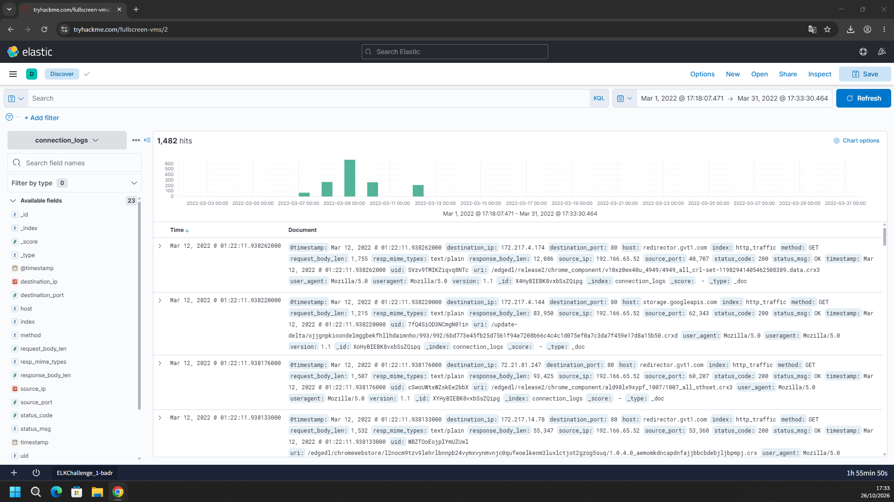
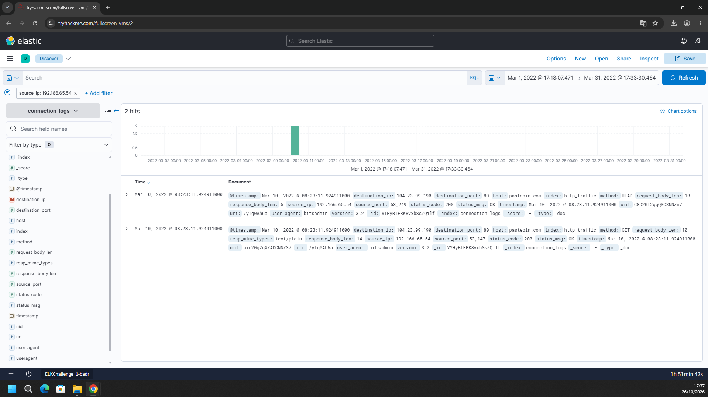
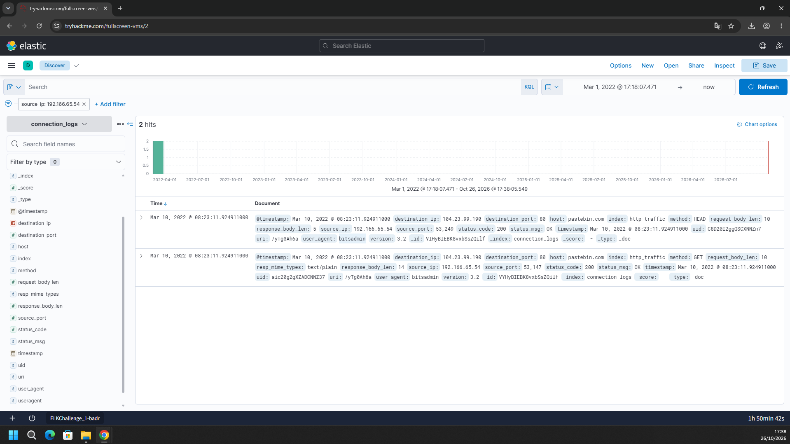
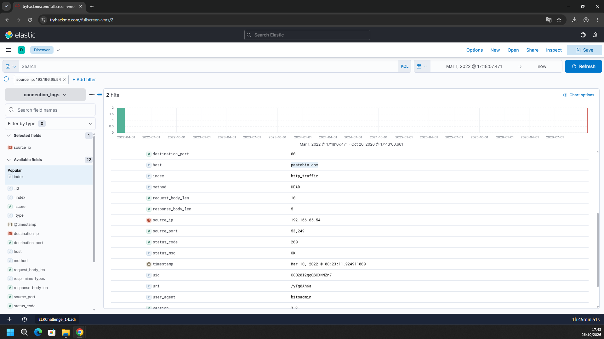
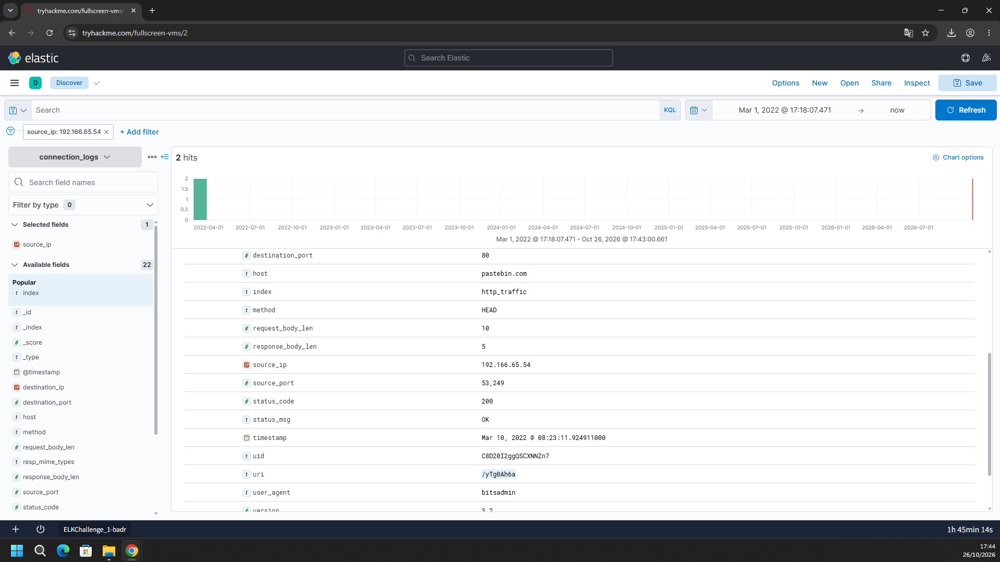

# TryHackMe – ItsyBitsy (Writeup)

**Room:** https://tryhackme.com/room/itsybitsy
**Categoria:** SIEM / Análise de logs (ELK / Kibana)
**Cenário:** Durante o monitoramento do SOC, o analista John viu um alerta de IDS indicando uma possível comunicação de C2 vinda de um usuário chamado **Browne**, do RH. Um arquivo suspeito foi acessado, contendo um padrão malicioso no formato `THM:{ ________ }`. Foram extraídos **logs de conexão HTTP de uma semana** e indexados no índice `connection_logs` do Kibana. A tarefa é examinar as conexões do usuário, achar o link e o conteúdo do arquivo e responder às perguntas.

**Ambiente:** Kibana (Discover) com o índice `connection_logs`
**Campos principais:** `@timestamp`, `source_ip`, `source_port`, `destination_ip`, `destination_port`, `host`, `method`, `uri`, `user_agent`, `status_code`, `request_body_len`, `response_body_len`, `resp_mime_types`, `uid`, `version`

---

## Resumo das respostas

| # | Pergunta | Resposta |
|---|----------|----------|
| 1 | Quantos eventos foram retornados em março de 2022? | `1482` |
| 2 | IP associado ao usuário suspeito | `192.166.65.54` |
| 3 | Binário legítimo do Windows usado para baixar o arquivo do C2 | `bitsadmin` |
| 4 | Site de compartilhamento de arquivos usado como C2 | `pastebin.com` |
| 5 | URL completa do C2 | `pastebin.com/yTg0Ah6a` |
| 6 | Nome do arquivo acessado | `secret.txt` |
| 7 | Código secreto no formato `THM{_____}` | `THM{SECRET__CODE}` |

---

## Task 1 – Eventos de março de 2022

### Metodologia

1. No Kibana Discover, selecionei o índice **`connection_logs`**.
2. Ajustei o intervalo de tempo para cobrir o mês inteiro, de **01/03/2022 a 31/03/2022**.
3. O Kibana retornou **1.482 hits**. O histograma mostra que a atividade se concentra entre os dias **7 e 13 de março**, com o pico por volta do dia 9.
4. Os eventos mais recentes da lista são de tráfego comum do navegador (`user_agent: Mozilla/5.0`), partindo do IP `192.166.65.52` para hosts como `redirector.gvt1.com` e `storage.googleapis.com` (atualizações de componentes do Chrome). Esse é o tráfego de fundo normal da rede.



**Resposta:** `1482`

---

## Task 2 – IP do usuário suspeito

### Metodologia

1. Apliquei um filtro por origem: **`source_ip: 192.166.65.54`**.
2. O resultado são apenas **2 hits**, ambos em **10/03/2022**, o que contrasta com o volume de tráfego dos demais IPs.
3. Os dois eventos têm características incomuns: a requisição é para um site de compartilhamento de texto (`pastebin.com`) e o User-Agent é `bitsadmin` (Task 3). Já o restante da rede usa `Mozilla/5.0`.
4. Repeti o filtro com o intervalo até o presente (`now`), e os mesmos 2 hits aparecem. Ou seja, toda a atividade desse IP está concentrada nesse momento.



**Resposta:** `192.166.65.54`

> Os prints não mostram como o IP foi associado ao usuário Browne nem como o filtro `192.166.65.54` foi escolhido. O que eles evidenciam é que esse IP gerou o tráfego anômalo.

---

## Task 3 – Binário legítimo do Windows usado no download

### Metodologia

1. Abri os detalhes dos dois eventos do IP `192.166.65.54`. O campo `user_agent` é:

```
bitsadmin
```

2. O campo `version` é `3.2` (versão do cliente HTTP).
3. O **`bitsadmin.exe`** é uma ferramenta legítima do Windows para gerenciar jobs do BITS (Background Intelligent Transfer Service). Atacantes a usam para **baixar arquivos** de forma discreta (*living-off-the-land*).



**Resposta:** `bitsadmin`

---

## Task 4 – Site de compartilhamento de arquivos

### Metodologia

1. Nos detalhes dos eventos, o campo `host` é **`pastebin.com`**.
2. Dados da conexão:

| Campo | Valor |
|-------|-------|
| `host` | **pastebin.com** |
| `destination_ip` | `104.23.99.190` |
| `destination_port` | `80` |
| `source_ip` : `source_port` | `192.166.65.54` : `53249` (HEAD) e `53147` (GET) |
| `index` | `http_traffic` |

3. O Pastebin é um site público de compartilhamento de texto, usado aqui como servidor de C2 (os autores do malware publicam instruções ou dados nele).



**Resposta:** `pastebin.com`

---

## Task 5 – URL completa do C2

### Metodologia

1. Nos dois eventos, a combinação de `host` e `uri` é:

```
host: pastebin.com
uri:  /yTg0Ah6a
```

2. Os eventos registrados, ambos em **10/03/2022 às 08:23:11.924911**:

| Método | `uid` | Resposta | Detalhes |
|--------|-------|----------|----------|
| `HEAD` | `C8D20I2ggQSCXNNZn7` | `200 OK` | `request_body_len` 10, `response_body_len` 5 |
| `GET` | `aic20g2gXZADCNNZ37` | `200 OK` | `resp_mime_types` `text/plain`, `response_body_len` 14 |

3. O padrão `HEAD` seguido de `GET` é típico do BITS: primeiro ele consulta os cabeçalhos do recurso e depois baixa o conteúdo.
4. A URL completa fica:

```
pastebin.com/yTg0Ah6a
```


**Resposta:** `pastebin.com/yTg0Ah6a`

---

## Task 6 – Nome do arquivo acessado

### Metodologia

1. Abri a URL `pastebin.com/yTg0Ah6a` em um navegador.
2. A página mostra um *paste* com o título **`secret.txt`**, publicado por "A Guest" em **6 de abril de 2022**, com 0,02 KB e a opção de visibilidade pública/sem expiração (*NEVER*).


**Resposta:** `secret.txt`

---

## Task 7 – Código secreto

### Metodologia

1. O conteúdo do `secret.txt`, que ocupa uma única linha, é:

```
THM{SECRET__CODE}
```

2. Nos comentários do paste há mensagens de outros usuários (por exemplo, um perguntando qual é o código secreto), mas o conteúdo relevante é o texto do próprio paste.


**Flag:** `THM{SECRET__CODE}`

> Atenção ao formato: há **dois sublinhados** entre `SECRET` e `CODE`.

---

## Linha do tempo

| Horário | Evento |
|---------|--------|
| 07–13/03/2022 | Maior volume de tráfego no `connection_logs` (1.482 eventos no mês) |
| 10/03/2022 08:23:11.924911 | `192.166.65.54` faz `HEAD` em `pastebin.com/yTg0Ah6a` com User-Agent `bitsadmin` |
| 10/03/2022 08:23:11.924911 | O mesmo IP faz `GET` na mesma URL (`200 OK`, `text/plain`) e baixa o conteúdo |

```
192.166.65.54 (estação do usuário Browne)
     │  bitsadmin (BITS Job)
     │  HEAD / GET  http://pastebin.com/yTg0Ah6a  (104.23.99.190:80)
     ▼
Pastebin: secret.txt  →  THM{SECRET__CODE}
```

---

## Mapeamento MITRE ATT&CK

| Tática | Técnica | ID | Evidência |
|--------|---------|----|-----------|
| Defense Evasion / Persistence | BITS Jobs | T1197 | User-Agent `bitsadmin` |
| Command and Control | Ingress Tool Transfer | T1105 | Download do conteúdo do paste |
| Command and Control | Web Service | T1102 | Uso do Pastebin como canal de C2 |
| Command and Control | Application Layer Protocol: Web Protocols | T1071.001 | HTTP (`HEAD`/`GET`) na porta 80 |

> O mapeamento é uma inferência a partir das evidências dos prints.

---

## Indicadores de comprometimento (IOCs)

| Tipo | Valor |
|------|-------|
| IP da estação | `192.166.65.54` |
| IP de destino | `104.23.99.190` (porta `80`) |
| Domínio | `pastebin.com` |
| URL | `pastebin.com/yTg0Ah6a` (URI `/yTg0Ah6a`) |
| User-Agent | `bitsadmin` (versão `3.2`) |
| UIDs das conexões | `C8D20I2ggQSCXNNZn7` (HEAD), `aic20g2gXZADCNNZ37` (GET) |
| Arquivo / paste | `secret.txt` |
| Conteúdo | `THM{SECRET__CODE}` |

---

## Ferramentas utilizadas

- Kibana (Discover) com consultas e filtros sobre o índice `connection_logs`
- Navegador, para visualizar o paste público
- Análise de campos HTTP (`user_agent`, `host`, `uri`, `method`)

---