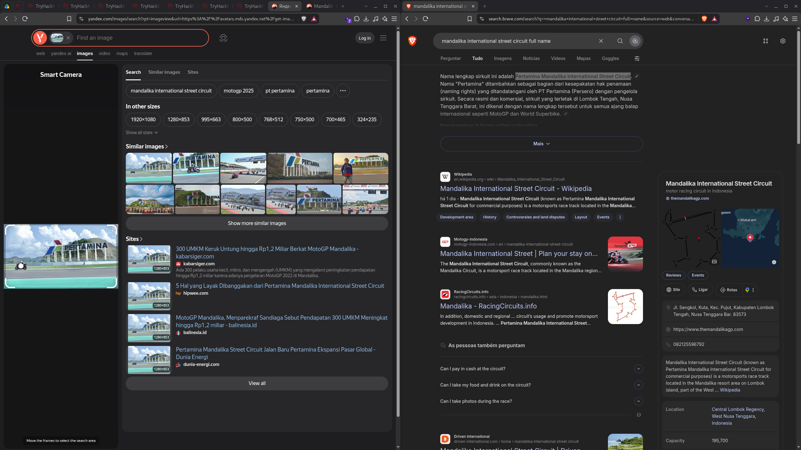
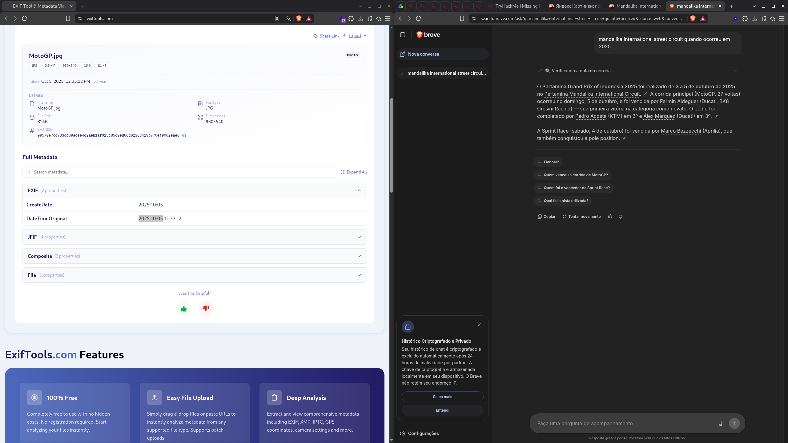
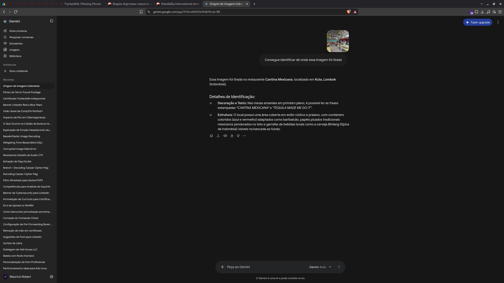
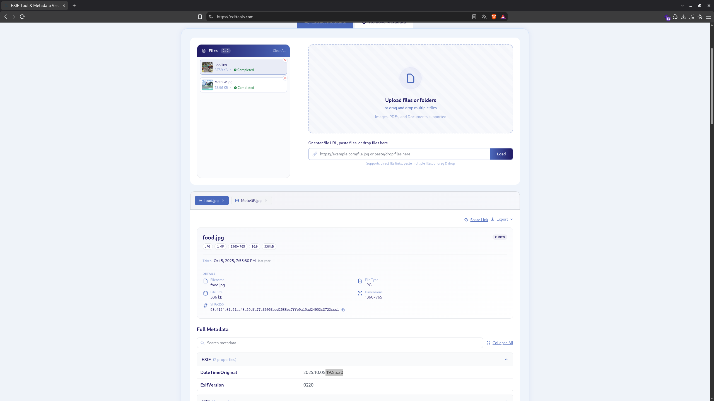
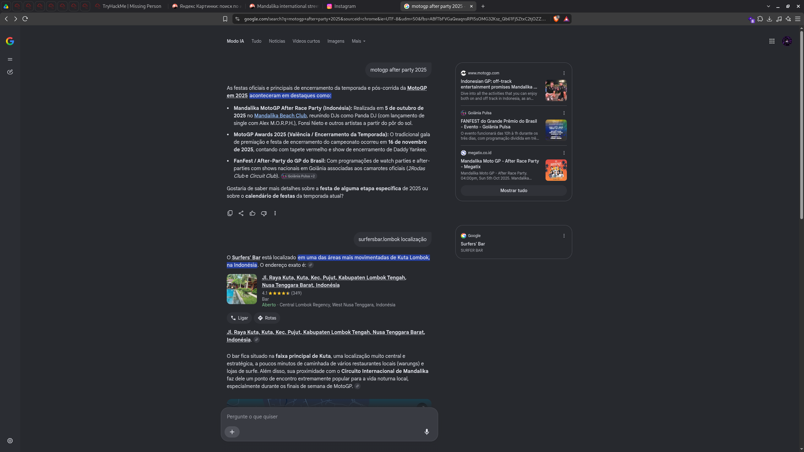
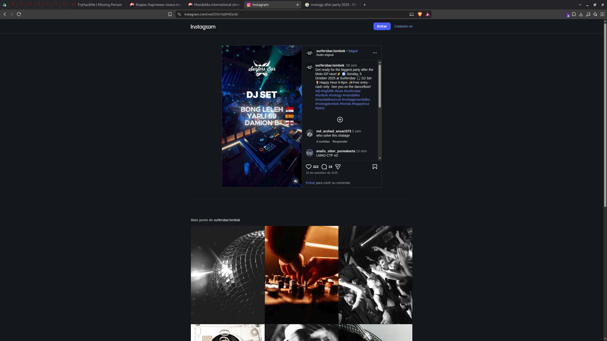
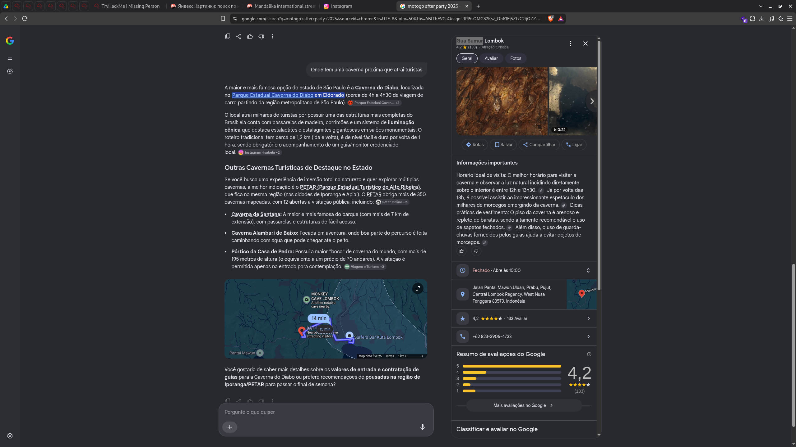
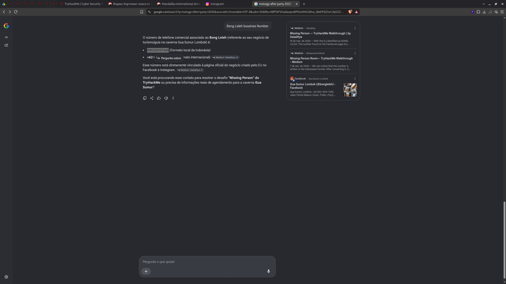

# TryHackMe – Missing Person (Writeup)

**Categoria:** OSINT
**Cenário:** Um amigo viajou em 2025, enviou algumas fotos e sumiu. A missão é rastreá-lo para o boletim de ocorrência, usando apenas as imagens do ZIP e informações públicas.

---

## Resumo das respostas

| # | Pergunta | Resposta |
|---|----------|----------|
| 1 | Nome comercial do circuito | `Pertamina Mandalika International Street Circuit` |
| 2 | Data do evento (DD-DD/MM/YYYY) | `03-05/10/2025` |
| 3 | Restaurante mexicano | `Cantina Mexicana` |
| 4 | Horário da foto (HH:MM:SS) | `19:55:30` |
| 5 | Endereço completo do bar | `Jl. Raya Kuta, Kuta, Kec. Pujut, Kabupaten Lombok Tengah, Nusa Tenggara Barat, Indonesia` |
| 6 | Nome artístico do DJ | `Bong Leleh` |
| 7 | Caverna que ele leva turistas | `Gua Sumur Lombok` |
| 8 | Número do negócio de tours (sem código do país) | `085333137345` |

---

## Task 1 – Nome comercial do circuito

**Pergunta:** *What is the commercial name of this circuit?*

### Metodologia

1. A foto do arquivo `MotoGP.jpg` mostra uma moto em uma pista com um grande letreiro **"PERTAMINA"** ao fundo.
2. Fiz uma busca reversa de imagem no **Yandex Images** (Smart Camera). Os resultados e as sugestões de busca apontaram para `mandalika international street circuit`, `motogp 2025` e `pertamina`.
3. Para confirmar o nome completo, pesquisei `mandalika international street circuit full name` no Brave Search. A resposta indica que o nome completo é **Pertamina Mandalika International Street Circuit**: "Pertamina" foi adicionado por um acordo de *naming rights* com a PT Pertamina (Persero). A Wikipedia também confirma que o circuito é conhecido por esse nome para fins comerciais.

**Resposta:** `Pertamina Mandalika International Street Circuit`

---

## Task 2 – Data do evento

**Pergunta:** *When did the event take place?* (formato `DD-DD/MM/YYYY`)

### Metodologia

1. Extraí os metadados de `MotoGP.jpg` no **exiftools.com**:
   - `DateTimeOriginal`: `2025:10:05 12:33:12`
   - `CreateDate`: `2025:10:05`
2. Para confirmar o fim de semana inteiro da corrida, pesquisei `mandalika international street circuit quando ocorreu em 2025`. O **Pertamina Grand Prix of Indonesia 2025** foi realizado de **3 a 5 de outubro de 2025**. A Sprint foi no sábado (4/10) e a corrida principal no domingo (5/10), coincidindo com a data da foto.

**Resposta:** `03-05/10/2025`

---

## Task 3 – Restaurante mexicano

**Pergunta:** *He told me he ate delicious Mexican food. What is the name of the restaurant?*

### Metodologia

1. Enviei `food.jpg` para uma ferramenta de IA com visão e pedi para identificar o local.
2. Nas mesas amarelas em primeiro plano dá para ler as frases **"CANTINA MEXICANA"** e **"TEQUILA MADE ME DO IT"**.
3. Outros indícios que combinam com a região: estrutura coberta de estilo rústico/praiano, contêineres coloridos adaptados como bar, *papel picado* mexicano no teto e garrafas de cerveja **Bintang** (típica da Indonésia).
4. O local foi identificado em **Kuta, Lombok**.

**Resposta:** `Cantina Mexicana`

---

## Task 4 – Horário em que a foto foi tirada

**Pergunta:** *At what time was this photo taken?* (formato `HH:MM:SS`)

### Metodologia

1. Carreguei `food.jpg` (e `MotoGP.jpg`) no **exiftools.com**.
2. Na seção **EXIF**, o campo `DateTimeOriginal` de `food.jpg` mostra `2025:10:05 19:55:30`.

| Arquivo | DateTimeOriginal |
|---------|------------------|
| `MotoGP.jpg` | 2025:10:05 12:33:12 |
| `food.jpg` | 2025:10:05 **19:55:30** |

> A foto da comida foi tirada na noite do dia da corrida, o que é consistente com a história da "after party".

**Resposta:** `19:55:30`

---

## Task 5 – Endereço do bar

**Pergunta:** *What is the full address of the bar's location?*

> Contexto da mensagem do amigo: *"Went to this cool MotoGP after party, and became friends with one of the local DJs who played that night."*

### Metodologia

1. Pesquisei `motogp after party 2025`. Entre as festas pós-corrida do GP da Indonésia, a mais relevante para o dia 5/10/2025 foi a de Mandalika.
2. Um post de Instagram do bar **Surfers Bar (`surfersbar.lombok`)** anuncia: *"the biggest party after the Moto GP race"*, no **domingo, 5 de outubro de 2025**, com DJ Set, Happy Hour das 18h às 20h e entrada gratuita (somente dinheiro).
3. Pesquisando `surfersbar.lombok localização`, o Google retorna o endereço do bar, em uma das áreas mais movimentadas de Kuta Lombok e próximo ao circuito.

**Resposta:** `Jl. Raya Kuta, Kuta, Kec. Pujut, Kabupaten Lombok Tengah, Nusa Tenggara Barat, Indonesia`

---

## Task 6 – Nome artístico do DJ

**Pergunta:** *What is the DJ's stage name?*

### Metodologia

1. O flyer do post (`instagram.com/reel/DOcVqWAEznb/`) lista o line-up do **DJ SET**:
   - **BONG LELEH** 🇮🇩 (Indonésia)
   - **YARLI 69** 🇪🇸 (Espanha)
   - **DAMION B** 🏴󠁧󠁢󠁥󠁮󠁧󠁿 (Inglaterra)
2. O amigo disse que conheceu um **DJ local**. Dos três, apenas Bong Leleh é indonésio (a bandeira ao lado do nome indica a origem).

**Resposta:** `Bong Leleh`

---

## Task 7 – Caverna que o DJ leva turistas

**Pergunta:** *After digging into the DJ's other online accounts, what cave does he take tourists to?*

### Metodologia

1. Procurei por outras contas online de "Bong Leleh". Encontrei a página no Facebook **"Gua Sumur Lombok (@bongleleh)"**, que lista fotos de uma caverna e um endereço em *Jalan Pantai Mawun Uluan, Prabu, Pujut*.
2. Pesquisei por uma caverna próxima que atraia turistas. O painel do Google mostra **Gua Sumur Lombok** (4,2 ★, atração turística), em `Jalan Pantai Mawun Uluan, Prabu, Pujut, Central Lombok Regency`. O mapa também mostra que fica a poucos minutos do Surfers Bar.
3. Informações úteis do painel: melhor horário para ver a luz natural entre 12h e 13h30, e por volta das 18h dá para ver o espetáculo de morcegos saindo da caverna.

> Atenção: a resposta de IA do Google sugeriu primeiro cavernas do estado de São Paulo (Caverna do Diabo, PETAR), porque a busca foi feita em português a partir do Brasil, sem o contexto de Lombok. O resultado correto aparece só no painel lateral, o que mostra a importância de validar as respostas de IA com fontes primárias.

**Resposta:** `Gua Sumur Lombok`

---

## Task 8 – Número de negócios do DJ

**Pergunta:** *What number did the DJ list for his tour business?* (número completo, sem código do país)

**Evidência:** `Number_Bussines_DJ.png`

### Metodologia

1. Pesquisei `Bong Leleh bussines Number`.
2. A página do Facebook **Gua Sumur Lombok (@bongleleh)** exibe o telefone no formato internacional: **+62 853-3313-7345**.
3. Removendo o código do país (`+62`) e usando o formato local indonésio (com o `0` inicial), o número fica **085333137345**. Writeups públicos da sala (Medium) também citam que o número aparece no formato indonésio.

**Resposta:** `085333137345`

---

## Conclusão

O "amigo desaparecido" pode ser rastreado com a seguinte cadeia de pistas:

1. **Foto da pista** → busca reversa de imagem → *Pertamina Mandalika International Street Circuit*
2. **Metadados EXIF** → 5 de outubro de 2025 (fim de semana de 3 a 5/10/2025)
3. **Foto da comida** → *Cantina Mexicana*, Kuta, Lombok (EXIF às 19:55:30)
4. **After party do MotoGP** → *Surfers Bar*, Kuta
5. **Line-up do flyer** → DJ local **Bong Leleh**
6. **Redes sociais do DJ** → negócio de tours na caverna **Gua Sumur Lombok**, telefone **085333137345**

---

### Ferramentas utilizadas

- Yandex Images (busca reversa de imagem)
- ExifTools.com (metadados EXIF)
- Brave Search / Google (pesquisa e confirmação)
- Instagram e Facebook (OSINT em redes sociais)
- IA com visão (identificação do restaurante), sempre confirmada com outras fontes

---