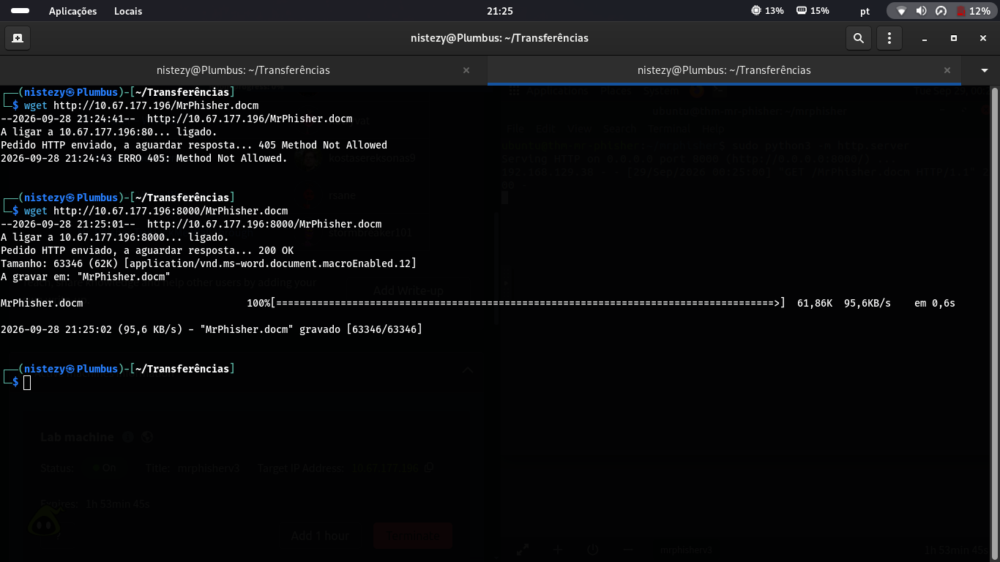
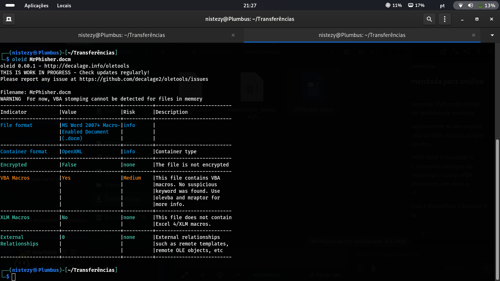
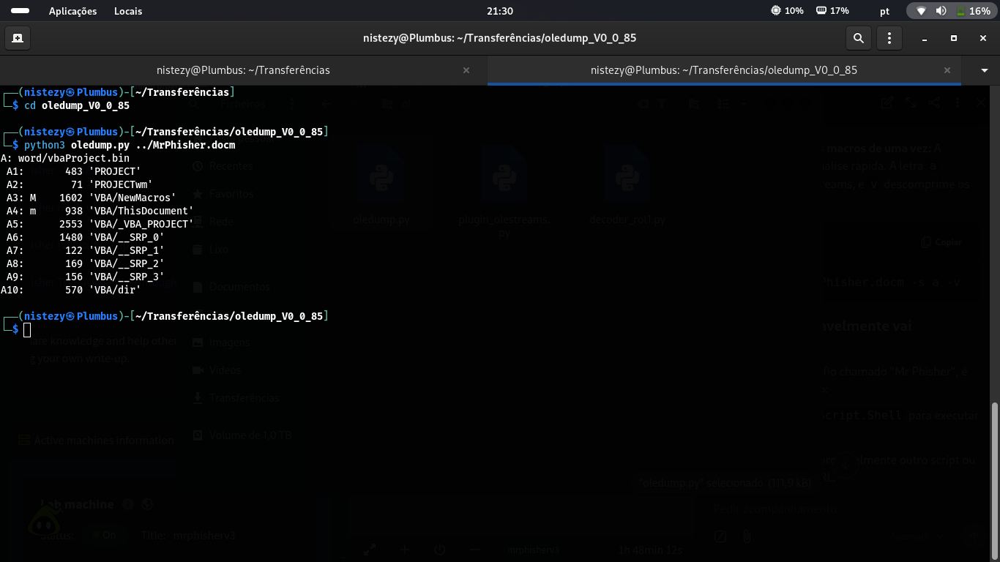
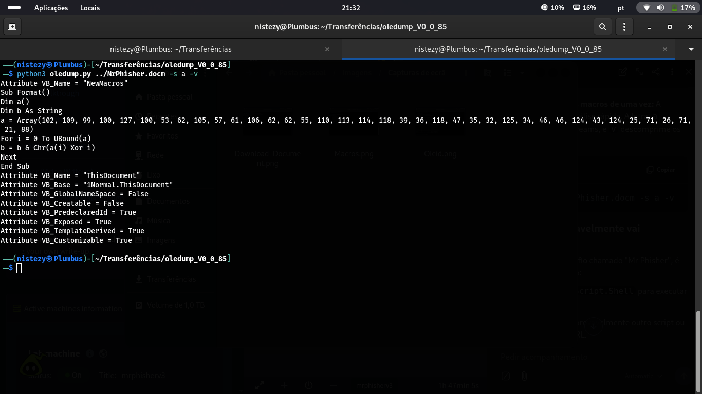
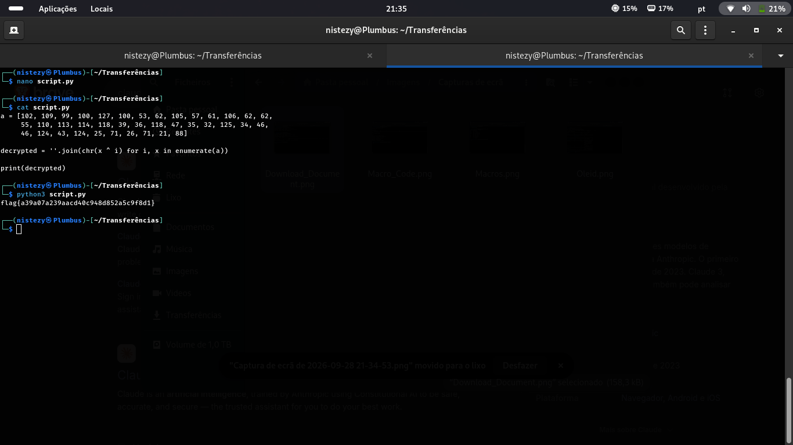

# 🧭 Mr. Phisher — CTF Writeup
### TryHackMe | Análise de Malware | Documento Office Malicioso · Macro VBA Ofuscada (XOR)

---

| **Analista**          | Mauricio Robert                                                                        |
|-----------------------|----------------------------------------------------------------------------------------|
| **Organização**       | Faculdade Impacta                                                                      |
| **Data do Relatório** | 28/09/2026                                                                             |
| **Data da Análise**   | 28/09/2026 · 21:24 – 21:35 (GMT-0300)                                                  |
| **Alvo**              | `10.67.177.196` (`mrphisherv3`) — TryHackMe · Mr. Phisher                               |
| **Classificação**     | CONFIDENCIAL                                                                           |
| **Ferramentas**       | wget · oletools (`oleid`, `oledump.py`) · Python 3                                      |
| **Plataforma**        | TryHackMe — Análise Estática de Malware / Documento Ofensivo                            |

---

## 🔍 Resumo Executivo

Este relatório documenta a análise estática de um documento do Microsoft Word habilitado para macros (**`MrPhisher.docm`**), disponibilizado por um servidor HTTP no host `10.67.177.196`, no contexto do desafio **Mr. Phisher** (TryHackMe). O documento foi obtido via download direto, triado com **oleid** para confirmar a presença de macros VBA, e teve sua estrutura interna (streams OLE) enumerada com **oledump.py**. A macro maliciosa (`NewMacros`) foi extraída e revelou um **payload ofuscado por XOR**, armazenado como um array de bytes dentro do próprio código VBA. Reproduzindo a lógica de decodificação em **Python 3**, o array foi processado e revelou a flag em texto claro, demonstrando como um documento aparentemente inofensivo pode ocultar cargas maliciosas através de ofuscação simples, porém eficaz contra inspeção superficial.

---

## 🛠 Ferramentas Utilizadas

| Ferramenta                     | Versão   | Finalidade                                                                             |
|---------------------------------|----------|-----------------------------------------------------------------------------------------|
| **wget**                        | -        | Download do documento malicioso hospedado no servidor do alvo                          |
| **oleid**                       | 0.60.1   | Triagem inicial do documento OLE/OOXML, identificando indicadores de risco (macros VBA) |
| **oledump.py**                  | v0.0.85  | Enumeração dos streams internos do documento e extração do código-fonte VBA das macros  |
| **Python 3**                    | -        | Reprodução da lógica de decodificação XOR presente na macro, revelando a flag           |

---

## 📋 Fases de Análise

### FASE 1 — Obtenção do Documento Malicioso

> **21:24 – 21:25 GMT-0300**

```bash
wget http://10.67.177.196/MrPhisher.docm
```

```
A ligar a 10.67.177.196:80... ligado.
Pedido HTTP enviado, a aguardar resposta... 405 Method Not Allowed
ERRO 405: Method Not Allowed.
```

A primeira tentativa, na porta 80 padrão, foi recusada pelo servidor. Uma nova tentativa foi realizada na porta **8000**, onde o arquivo estava de fato hospedado:

```bash
wget http://10.67.177.196:8000/MrPhisher.docm
```



```
A ligar a 10.67.177.196:8000... ligado.
Pedido HTTP enviado, a aguardar resposta... 200 OK
Tamanho: 63346 (62K) [application/vnd.ms-word.document.macroEnabled.12]
A gravar em: "MrPhisher.docm"

MrPhisher.docm  100%[===================>]  61,86K  95,6KB/s   em 0,6s
```

O arquivo **`MrPhisher.docm`** (Word habilitado para macros) foi obtido com sucesso, com **63.346 bytes**, pronto para análise estática.

---

### FASE 2 — Triagem Inicial: OleID

> **21:27 GMT-0300**

```bash
oleid MrPhisher.docm
```



```
Indicator                | Value                                    | Risk   | Description
--------------------------+------------------------------------------+--------+---------------------------------
File format               | MS Word 2007+ Macro-Enabled Document (.docm) | info |
Container format          | OpenXML                                  | info   | Container type
Encrypted                 | False                                    | none   | The file is not encrypted
VBA Macros                | Yes                                      | Medium | This file contains VBA macros.
                          |                                           |        | No suspicious keyword was found.
                          |                                           |        | Use olevba and mraptor for more info.
XLM Macros                | No                                       | none   | This file does not contain
                          |                                           |        | Excel 4/XLM macros.
External Relationships    | 0                                         | none   | External relationships such as
                          |                                           |        | remote templates, remote OLE objects, etc.
```

A triagem confirmou o essencial: o documento **não está criptografado**, **não possui relacionamentos externos** (descartando templates remotos como vetor adicional), mas **contém macros VBA** — classificadas com risco **médio**, já que a ferramenta não identificou palavras-chave suspeitas automaticamente. Isso reforçou a necessidade de uma inspeção manual mais profunda do código da macro.

---

### FASE 3 — Enumeração de Streams OLE: oledump.py

> **21:30 GMT-0300**

```bash
cd oledump_v0_0_85
python3 oledump.py ../MrPhisher.docm
```



```
A: word/vbaProject.bin
 A1:       483 'PROJECT'
 A2:        71 'PROJECTwm'
 A3: M    1602 'VBA/NewMacros'
 A4: m     938 'VBA/ThisDocument'
 A5:      2553 'VBA/_VBA_PROJECT'
 A6:      1480 'VBA/__SRP_0'
 A7:       122 'VBA/__SRP_1'
 A8:       169 'VBA/__SRP_2'
 A9:       156 'VBA/__SRP_3'
A10:       570 'VBA/dir'
```

O indicador **`M`** ao lado do stream `A3` (`VBA/NewMacros`) sinaliza que esse stream contém **código macro** — o alvo natural da próxima etapa de extração.

---

### FASE 4 — Extração do Código VBA Malicioso

> **21:32 GMT-0300**

```bash
python3 oledump.py ../MrPhisher.docm -s a -v
```



```vb
Attribute VB_Name = "NewMacros"
Sub Format()
Dim a()
Dim b As String
a = Array(102, 109, 99, 100, 127, 100, 53, 62, 105, 57, 61, 106, 62, 62,
          55, 110, 113, 114, 118, 39, 36, 118, 47, 35, 32, 125, 34, 46,
          46, 124, 43, 124, 25, 71, 26, 71, 21, 88)
For i = 0 To UBound(a)
    b = b & Chr(a(i) Xor i)
Next
End Sub
```

A macro `Format()` (nome deliberadamente inofensivo, típico de documentos de phishing) monta uma string byte a byte, aplicando um **XOR entre cada valor do array `a` e seu próprio índice (`i`)** — uma técnica clássica de ofuscação para esconder strings (comandos, URLs ou, neste caso, a flag) da inspeção estática direta e de ferramentas de detecção baseadas em assinatura.

---

### FASE 5 — Decodificação do Payload Ofuscado (XOR) e Captura da Flag

> **21:35 GMT-0300**

A mesma lógica de decodificação (`Chr(a(i) Xor i)`) foi reproduzida em **Python 3**, reutilizando o array de bytes extraído da macro:

```python
a = [102, 109, 99, 100, 127, 100, 53, 62, 105, 57, 61, 106, 62, 62,
     55, 110, 113, 114, 118, 39, 36, 118, 47, 35, 32, 125, 34, 46,
     46, 124, 43, 124, 25, 71, 26, 71, 21, 88]

decrypted = ''.join(chr(x ^ i) for i, x in enumerate(a))

print(decrypted)
```

```bash
python3 script.py
```



```
flag{a39a07a239aacd40c948d852a5c9f8d1}
```

**Flag: `flag{a39a07a239aacd40c948d852a5c9f8d1}`**

A reprodução da rotina de decodificação confirmou que o array de bytes embutido na macro não era um comando malicioso a ser executado no sistema da vítima, mas sim o mecanismo de entrega da flag do desafio — validando o entendimento completo da lógica de ofuscação utilizada pelo autor do documento.

---

## ⛓ Linha do Tempo da Análise

```
[21:24-21:25 GMT-0300] FASE 1 — OBTENÇÃO DO DOCUMENTO
    wget :80 → 405 Method Not Allowed
    wget :8000 → 200 OK → MrPhisher.docm (63.346 bytes)
    ↓
[21:27 GMT-0300] FASE 2 — TRIAGEM (oleid)
    MS Word 2007+ Macro-Enabled Document · VBA Macros: Yes (Medium risk)
    ↓
[21:30 GMT-0300] FASE 3 — ENUMERAÇÃO DE STREAMS (oledump.py)
    A3: M 1602 'VBA/NewMacros' → stream com código macro identificado
    ↓
[21:32 GMT-0300] FASE 4 — EXTRAÇÃO DO CÓDIGO VBA (oledump.py -s a -v)
    Sub Format() → array de 38 bytes ofuscados via XOR com o índice (i)
    ↓
[21:35 GMT-0300] FASE 5 — DECODIFICAÇÃO (Python 3) + FLAG
    python3 script.py
    FLAG: flag{a39a07a239aacd40c948d852a5c9f8d1} ✓
    ↓
ANÁLISE CONCLUÍDA — macro VBA ofuscada decodificada com sucesso
```

---

## 🗺 Mapeamento Investigativo

| Fase | Ferramenta/Técnica | Achado |
|------|--------------------|--------|
| Obtenção do Artefato | `wget` | `MrPhisher.docm` hospedado em `10.67.177.196:8000` (porta 80 recusava com 405) |
| Triagem | `oleid` | Documento `.docm` não criptografado, contendo macros VBA (risco médio) |
| Enumeração de Streams | `oledump.py` | Stream `A3: VBA/NewMacros` identificado como contendo código macro (`M`) |
| Extração de Código | `oledump.py -s a -v` | Macro `Format()` com array de 38 bytes ofuscados via XOR pelo índice |
| Decodificação | Python 3 (`script.py`) | Reprodução da lógica `Chr(a(i) Xor i)`, revelando a flag em texto claro |

---

## 🚨 Artefatos e Indicadores Identificados

| Tipo | Indicador | Contexto |
|------|-----------|----------|
| Alvo | `10.67.177.196` (`mrphisherv3`) | Servidor hospedando o documento malicioso (TryHackMe — Mr. Phisher) |
| Artefato malicioso | `MrPhisher.docm` | Documento Word habilitado para macros, 63.346 bytes |
| Stream malicioso | `VBA/NewMacros` (stream A3) | Contém a sub-rotina `Format()` com o payload ofuscado |
| Técnica de ofuscação | XOR com o índice do array (`Chr(a(i) Xor i)`) | Oculta a string codificada de ferramentas de detecção por assinatura |
| Flag | `flag{a39a07a239aacd40c948d852a5c9f8d1}` | Extraída ao decodificar o array XOR da macro `NewMacros` |
| Técnica (MITRE ATT&CK) | `T1566.001` | Phishing: Spearphishing Attachment (vetor de entrega — documento Office) |
| Técnica (MITRE ATT&CK) | `T1059.005` | Command and Scripting Interpreter: Visual Basic (macro VBA) |
| Técnica (MITRE ATT&CK) | `T1027` | Obfuscated Files or Information (ofuscação via XOR) |

---

## ✅ Resumo das Flags

| # | Flag | Valor | Localização |
|---|------|-------|-------------|
| 🚩 Flag Final | Macro `NewMacros` (ofuscada) | `flag{a39a07a239aacd40c948d852a5c9f8d1}` | Decodificada via XOR a partir do array embutido na macro do `MrPhisher.docm` |

---

## 📚 Referências

- [TryHackMe — Mr. Phisher](https://tryhackme.com/room/mrphisher)
- [oletools — oleid & oledump documentation](https://github.com/decalage2/oletools)
- [MITRE ATT&CK T1566.001 — Spearphishing Attachment](https://attack.mitre.org/techniques/T1566/001/)
- [MITRE ATT&CK T1059.005 — Visual Basic](https://attack.mitre.org/techniques/T1059/005/)
- [MITRE ATT&CK T1027 — Obfuscated Files or Information](https://attack.mitre.org/techniques/T1027/)

---
