# Writeup — New Hire Old Artifacts (TryHackMe)

| Campo | Informação |
|---|---|
| **Sala** | [New Hire Old Artifacts](https://tryhackme.com/room/newhireoldartifacts) |
| **Categoria** | DFIR / Threat Hunting / Windows Forensics |
| **Ferramenta principal** | Splunk (Sysmon via Universal Forwarder) |
| **Host comprometido** | `DESKTOP-H1ATIJC.WidgetLLC.Internal` |
| **Usuário afetado** | `Finance01` |
| **Autor** | Mauricio Robert — CypherBaron |
| **Data do laboratório** | 29/12/2021 (eventos) |

---

## 1. Contexto do incidente

Um novo colaborador do setor financeiro (`Finance01`) da empresa fictícia *WidgetLLC* teve sua estação de trabalho comprometida. A investigação, conduzida inteiramente via **Splunk** (índice com telemetria **Sysmon**), teve como objetivo reconstruir a linha do tempo do ataque: desde a execução de uma ferramenta de roubo de credenciais, passando por binários adicionais "mascarados" em pastas do `AppData`, até a desativação do Windows Defender via PowerShell e a limpeza de artefatos (auto-exclusão) pelo próprio malware.

O nome da sala — *"New Hire Old Artifacts"* — resume bem o cenário: um **novo contratado** (new hire) executa, sem saber, **binários antigos/reaproveitados** (old artifacts) de uma campanha de malware que combina um *info-stealer*, um *downloader/dropper* e técnicas de evasão de AV.

---

## 2. Ferramentas utilizadas

| Ferramenta | Finalidade |
|---|---|
| Splunk Search & Reporting | Consulta de logs Sysmon (Image, Network Connection, Registry, Process Create) |
| SPL (`search`, `table`, `sort`, `dedup`) | Filtragem e correlação de eventos |
| Sysmon Event IDs | `EventCode=1` (Process Create), `EventCode=3` (Network Connection), `EventCode=7` (Image Load), `EventCode=12/13/14` (Registry Create/Set/Rename) |

---

## 3. Linha do tempo resumida

```
[AppData\Roaming\EasyCalc]            [AppData\Local\Temp]                 [Pictures\Adobe Films]
EasyCalc.exe (app legítima,     →     11111.exe (NirSoft WBPV)      →      WvmIOrcfsuILdX6SNwIRmGOJ.exe
carrega ffmpeg.dll/nw.dll/            IonicLarge.exe (PalitExplorer)        phcIAmLJMAIMSa9j9MpgJo1m.exe
nw_elf.dll — Electron/NW.js)          ├─ contata 2.56.59.42 (C2)            (processos finalizados via
                                       ├─ desativa Defender via               taskkill e apagados do disco,
                                       │  registro (DisableAntiSpyware...)     junto com DLLs residuais em
                                       └─ WMIC MpPreference ThreatID...        C:\ProgramData\*.dll)
                                          (4 IDs de exclusão de ameaça)
```

---

## 4. Respostas das perguntas

### Pergunta 1 — Binário do Web Browser Password Viewer (caminho completo)

Buscando por `ProcessGuid` associado ao processo que gravou credenciais de navegador em um arquivo `.txt`, o Splunk retorna um único evento (`EventCode=1`) com `Company=NirSoft` e `Description=Web Browser Password Viewer`:

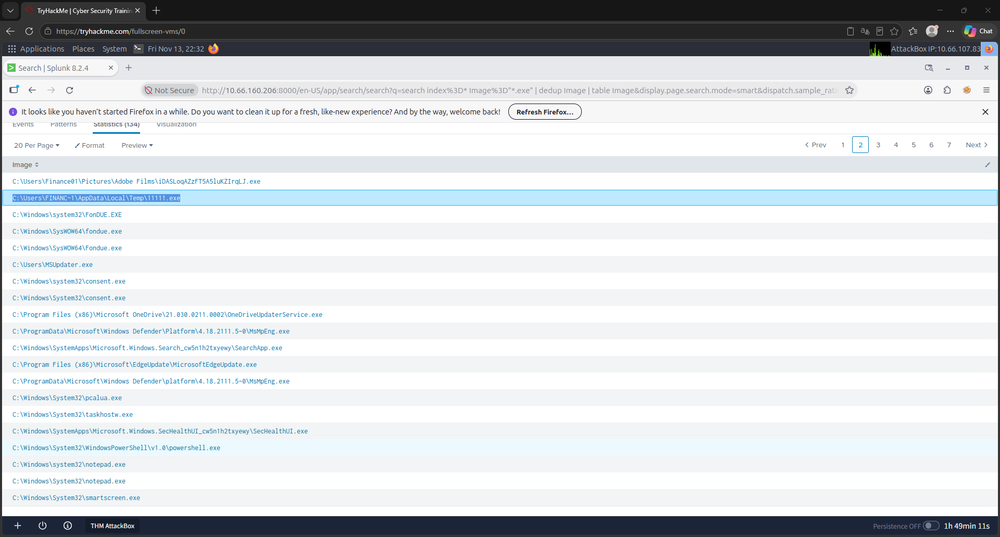

```spl
search index=* EventCode=1 ProcessGuid="{3e72283a-c36e-61cb-c511-000000000a00}"
| table _time Image Company Description OriginalFileName CommandLine
```

```
Image:        C:\Users\Finance01\AppData\Local\Temp\11111.exe
Company:      NirSoft
Description:  Web Browser Password Viewer
CommandLine:  C:\Users\FINANC~1\AppData\Local\Temp\11111.exe /stab C:\Users\FINANC~1\AppData\Local\Temp\fj4ghga23_fsa.txt
```

A ferramenta `WebBrowserPassView` (NirSoft) foi executada com o parâmetro `/stab`, que exporta as credenciais salvas nos navegadores para um arquivo de texto (`fj4ghga23_fsa.txt`), caracterizando roubo de credenciais (T1555.003).

> **Resposta:** `C:\Users\Finance01\AppData\Local\Temp\11111.exe`

---

### Pergunta 2 — Nome da empresa listado no binário

No mesmo evento acima, o campo `Company` do binário `11111.exe` aponta para o fabricante legítimo da ferramenta (reaproveitada de forma maliciosa):

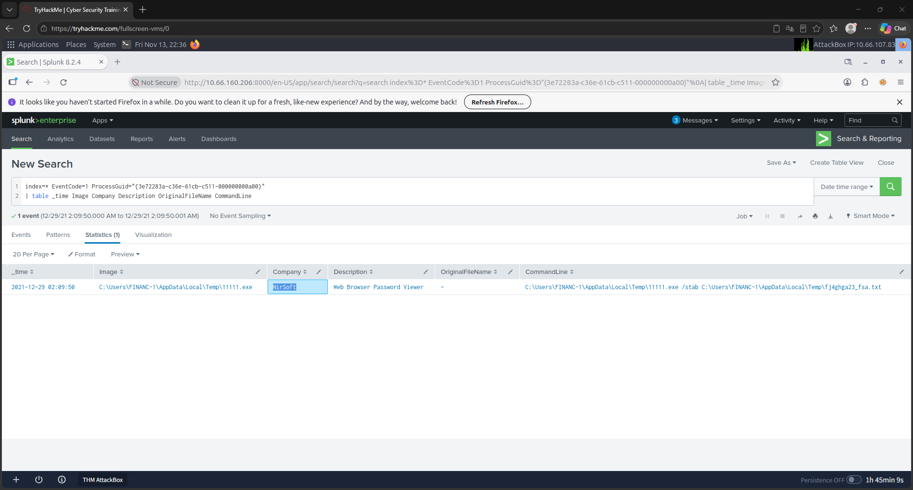

> **Resposta:** `NirSoft`

---

### Pergunta 3 — Outro binário suspeito executado na mesma pasta

Filtrando todos os executáveis distintos dentro de `C:\Users\Finance01\AppData\Local\Temp\`, apenas **um** outro binário suspeito aparece junto ao `11111.exe`:

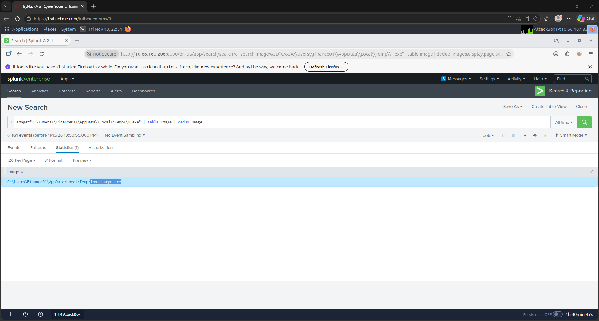

```spl
search index=* Image="C:\\Users\\Finance01\\AppData\\Local\\Temp\\*.exe"
| table Image
| dedup Image
```

```
Image: C:\Users\Finance01\AppData\Local\Temp\IonicLarge.exe
```

Analisando o evento de *Image Load* (Sysmon `EventCode=7`) gerado por esse processo, o `OriginalFileName` embutido no cabeçalho PE revela que o binário finge ser um utilitário gráfico da fabricante de placas de vídeo **Palit**:

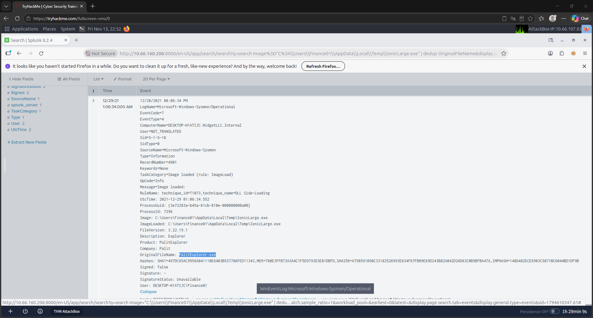

```
Image:            C:\Users\Finance01\AppData\Local\Temp\IonicLarge.exe
Description:      Explorer
Product:          PalitExplorer
Company:          Palit
OriginalFileName: PalitExplorer.exe
```

Ou seja, o arquivo foi salvo em disco com o nome `IonicLarge.exe`, mas seus metadados internos (PE Version Info) indicam o nome original `PalitExplorer.exe` — uma técnica clássica de *masquerading* (T1036.005).

> **Resposta:** `IonicLarge.exe,PalitExplorer.exe`

---

### Pergunta 4 — IP malicioso contatado (duas conexões de saída), em formato *defanged*

Rastreando as conexões de rede (`EventCode=3`) geradas pelo processo `IonicLarge.exe`:

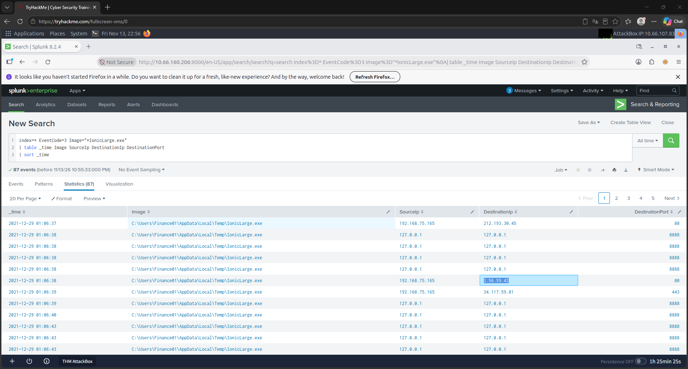

```spl
search index=* EventCode=3 Image="*IonicLarge.exe"
| table _time Image SourceIp DestinationIp DestinationPort
| sort _time
```

Entre as 87 conexões retornadas (a maioria em `127.0.0.1:8888`, tráfego de *loopback* de um proxy/serviço local), destaca-se o endereço externo **2.56.59.42** na porta 80 — repetido mais de uma vez na sequência de eventos, consistente com *beaconing* do C2.

> **Resposta:** `2[.]56[.]59[.]42`

---

### Pergunta 5 — Chave de registro alterada pelo mesmo binário

O `IonicLarge.exe` também grava e altera chaves de registro (`EventCode=12`/`13`/`14` — RegistryEvent) sob a política de Real-Time Protection do Windows Defender, desativando individualmente cada subcomponente de proteção (`DisableIOAVProtection`, `DisableRealtimeMonitoring`, `DisableOnAccessProtection`, `DisableBehaviorMonitoring`, etc.) até, por fim, desligar a proteção antispyware por completo:

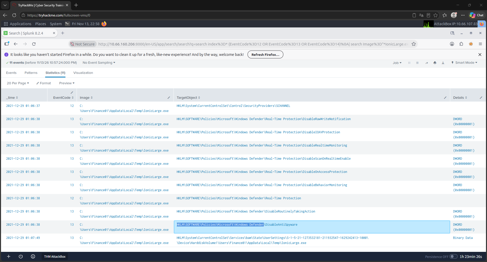

```spl
search index=* (EventCode=12 OR EventCode=13 OR EventCode=14) Image="*IonicLarge.exe"
| table _time EventCode Image TargetObject Details
```

```
TargetObject: HKLM\SOFTWARE\Policies\Microsoft\Windows Defender\DisableAntiSpyware
Details:      DWORD (0x00000001)
```

> **Resposta:** `HKLM\SOFTWARE\Policies\Microsoft\Windows Defender\DisableAntiSpyware`

---

### Pergunta 6 — Binários cujos processos foram finalizados e apagados do disco

Buscando pela presença do comando `taskkill` nas linhas de comando capturadas, aparecem dois encadeamentos (`cmd.exe /c taskkill /im <binário> /f & ... & exit`) que finalizam e removem dois executáveis localizados em `C:\Users\Finance01\Pictures\Adobe Films\`:

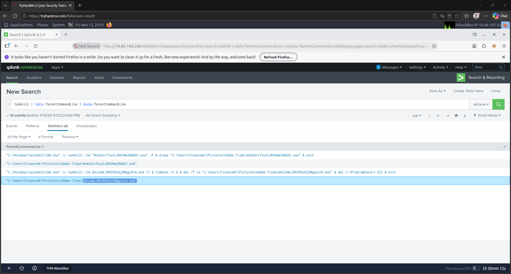

```spl
search index=* taskkill
| table ParentCommandLine
| dedup ParentCommandLine
```

```
"C:\Windows\System32\cmd.exe" /c taskkill /im "WvmIOrcfsuILdX6SNwIRmGOJ.exe" /f & erase "C:\Users\Finance01\Pictures\Adobe Films\WvmIOrcfsuILdX6SNwIRmGOJ.exe" & exit

"C:\Windows\System32\cmd.exe" /c taskkill /im phcIAmLJMAIMSa9j9MpgJo1m.exe /f & timeout /t 6 & del /f /q "C:\Users\Finance01\Pictures\Adobe Films\phcIAmLJMAIMSa9j9MpgJo1m.exe" & del C:\ProgramData\*.dll & exit
```

Os dois binários — com nomes de arquivo aleatórios/ofuscados (hash-like), armazenados na pasta de fotos "Adobe Films" — foram encerrados via `taskkill /f` e, em seguida, apagados do disco (`erase`/`del`), inclusive removendo DLLs residuais em `C:\ProgramData\`, numa clara tentativa de **anti-forense/auto-limpeza** (T1070.004).

> **Resposta:** `WvmIOrcfsuILdX6SNwIRmGOJ.exe,phcIAmLJMAIMSa9j9MpgJo1m.exe`

---

### Pergunta 7 — Último comando executado na série de comandos PowerShell que alteram o comportamento do Windows Defender

O atacante executa, dentro de uma sessão PowerShell, uma série de comandos em cadeia (`forfiles` → `cmd /C` → `powershell` → `WMIC.exe`) que chamam a classe WMI `MSFT_MpPreference` do namespace do Windows Defender para adicionar exceções de ameaça (`ThreatIDDefaultAction`). Ordenando os eventos do mais recente para o mais antigo (`sort -_time`):

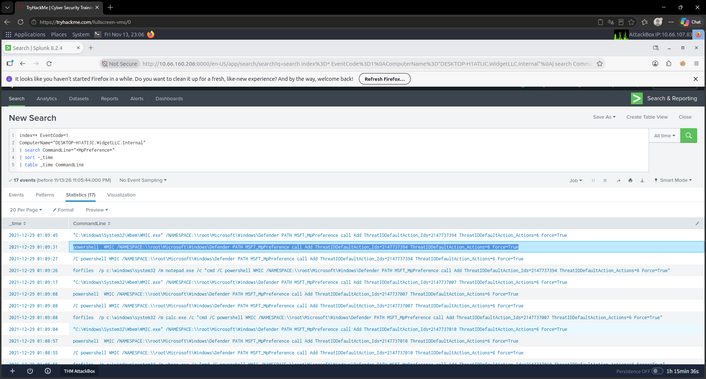

```spl
search index=* EventCode=1 ComputerName="DESKTOP-H1ATIJC.WidgetLLC.Internal"
| search CommandLine="*MpPreference*"
| sort -_time
| table _time CommandLine
```

O evento mais recente (último executado) dentro da série, correspondente ao processo PowerShell pai, é:

```
powershell  WMIC /NAMESPACE:\\root\Microsoft\Windows\Defender PATH MSFT_MpPreference call Add ThreatIDDefaultAction_Ids=2147737394 ThreatIDDefaultAction_Actions=6 Force=True
```

> **Resposta:**
> `powershell  WMIC /NAMESPACE:\\root\Microsoft\Windows\Defender PATH MSFT_MpPreference call Add ThreatIDDefaultAction_Ids=2147737394 ThreatIDDefaultAction_Actions=6 Force=True`

---

### Pergunta 8 — Os quatro IDs definidos pelo atacante, em ordem de execução

Analisando a tabela completa de eventos (ordenada cronologicamente, do mais antigo para o mais recente), observam-se **quatro grupos distintos** de comandos `forfiles → cmd → powershell → WMIC.exe`, cada um definindo um `ThreatIDDefaultAction_Ids` diferente, nesta sequência de execução (pelos timestamps `01:07:52` → `01:09:45`):

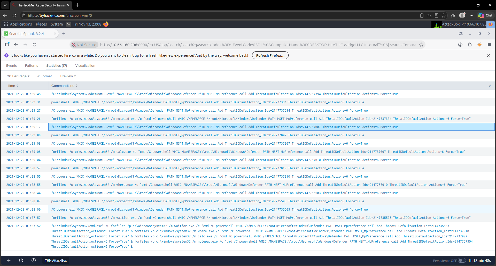

| Ordem | Horário (aprox.) | `ThreatIDDefaultAction_Ids` |
|---|---|---|
| 1º | 01:07:52 – 01:08:44 | `2147735503` |
| 2º | 01:08:55 – 01:09:04 | `2147737010` |
| 3º | 01:09:08 – 01:09:17 | `2147737007` |
| 4º | 01:09:26 – 01:09:45 | `2147737394` |

Cada ID corresponde à assinatura de detecção de um *Threat ID* específico do Microsoft Defender, que o atacante força a marcar com ação `6` (Allow/Ignorar), neutralizando a detecção daquela ameaça.

> **Resposta:** `2147735503,2147737010,2147737007,2147737394`

---

### Pergunta 9 — Outro binário malicioso executado a partir de outra localização do AppData

Buscando por todos os executáveis distintos já vistos no host, um deles chama atenção por estar fora da pasta `Temp`, residindo em `AppData\Roaming` — local comum para persistência de aplicações "legítimas" reempacotadas (neste caso, um app baseado em Electron/NW.js):

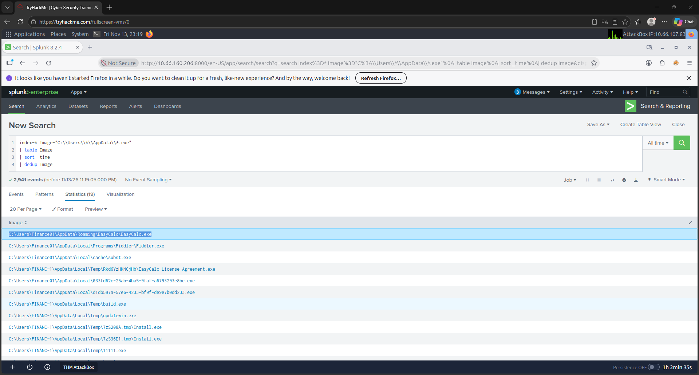

```spl
search index=* Image="C:\\Users\\*\\AppData\\*\\*.exe"
| table Image
| sort _time
| dedup Image
```

```
Image: C:\Users\Finance01\AppData\Roaming\EasyCalc\EasyCalc.exe
```

> **Resposta:** `C:\Users\Finance01\AppData\Roaming\EasyCalc\EasyCalc.exe`

---

### Pergunta 10 — DLLs carregadas pelo binário anterior (ordem alfabética)

Rastreando os eventos de carregamento de imagem (`EventCode=7`) gerados pelo processo `EasyCalc.exe`:

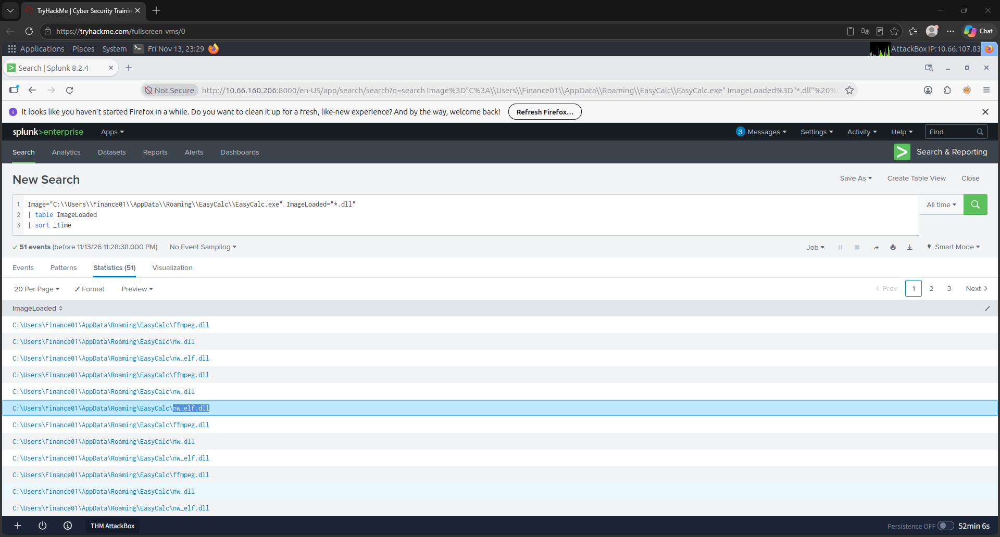

```spl
search index=* Image="C:\\Users\\Finance01\\AppData\\Roaming\\EasyCalc\\EasyCalc.exe" ImageLoaded="*.dll"
| table ImageLoaded
| sort _time
```

As DLLs carregadas repetidamente ao longo da execução (51 eventos) são, de forma única:

```
C:\Users\Finance01\AppData\Roaming\EasyCalc\ffmpeg.dll
C:\Users\Finance01\AppData\Roaming\EasyCalc\nw.dll
C:\Users\Finance01\AppData\Roaming\EasyCalc\nw_elf.dll
```

Essas três bibliotecas (`ffmpeg.dll`, `nw.dll`, `nw_elf.dll`) são típicas de aplicações empacotadas com o framework **NW.js** (antigo node-webkit), usado legitimamente por diversos apps desktop, mas também abusado por *droppers* para camuflar binários maliciosos como aplicativos comuns (neste caso, uma falsa calculadora "EasyCalc").

> **Resposta:** `ffmpeg.dll,nw.dll,nw_elf.dll`

---

## 5. Cadeia de ataque (Kill Chain)

```
┌──────────────────────────────────────────────────────────────────────────────────┐
│ 1. EXECUÇÃO INICIAL / MASQUERADING                                                │
│    EasyCalc.exe (AppData\Roaming) — app NW.js aparentemente legítimo              │
│    carrega ffmpeg.dll, nw.dll, nw_elf.dll                                         │
└──────────────────────────────────────────────────────────────────────────────────┘
                                   │
                                   ▼
┌──────────────────────────────────────────────────────────────────────────────────┐
│ 2. ROUBO DE CREDENCIAIS (T1555.003)                                                │
│    11111.exe (NirSoft WebBrowserPassView) → AppData\Local\Temp                    │
│    Exporta senhas de navegadores para fj4ghga23_fsa.txt                           │
└──────────────────────────────────────────────────────────────────────────────────┘
                                   │
                                   ▼
┌──────────────────────────────────────────────────────────────────────────────────┐
│ 3. MASQUERADING + C2 + DEFENSE EVASION (T1036.005 / T1071 / T1562.001)            │
│    IonicLarge.exe (metadado original: PalitExplorer.exe)                          │
│    ├─ Conecta-se a 2.56.59.42 (C2 externo)                                        │
│    └─ Desativa Real-Time Protection via registro                                  │
│       (...\Real-Time Protection\DisableAntiSpyware = 1)                          │
└──────────────────────────────────────────────────────────────────────────────────┘
                                   │
                                   ▼
┌──────────────────────────────────────────────────────────────────────────────────┐
│ 4. IMPAIR DEFENSES via WMI/PowerShell (T1562.001 / T1047)                         │
│    forfiles → cmd /C → powershell → WMIC.exe MSFT_MpPreference                    │
│    4 exceções de ThreatID adicionadas em sequência:                               │
│    2147735503 → 2147737010 → 2147737007 → 2147737394                             │
└──────────────────────────────────────────────────────────────────────────────────┘
                                   │
                                   ▼
┌──────────────────────────────────────────────────────────────────────────────────┐
│ 5. ANTI-FORENSE / LIMPEZA (T1070.004)                                             │
│    Pictures\Adobe Films\WvmIOrcfsuILdX6SNwIRmGOJ.exe  → taskkill + erase           │
│    Pictures\Adobe Films\phcIAmLJMAIMSa9j9MpgJo1m.exe  → taskkill + del (+DLLs)     │
└──────────────────────────────────────────────────────────────────────────────────┘
```

---

## 6. Tabela de IOCs (Indicadores de Comprometimento)

| Tipo | Valor | Observação |
|---|---|---|
| Arquivo | `C:\Users\Finance01\AppData\Roaming\EasyCalc\EasyCalc.exe` | Dropper disfarçado (NW.js) |
| Arquivo | `ffmpeg.dll`, `nw.dll`, `nw_elf.dll` | DLLs do runtime NW.js carregadas pelo EasyCalc |
| Arquivo | `C:\Users\Finance01\AppData\Local\Temp\11111.exe` | NirSoft WebBrowserPassView (info-stealer) |
| Arquivo | `C:\Users\Finance01\AppData\Local\Temp\fj4ghga23_fsa.txt` | Saída com credenciais exfiltradas |
| Arquivo | `C:\Users\Finance01\AppData\Local\Temp\IonicLarge.exe` | Nome original: `PalitExplorer.exe` |
| Arquivo | `C:\Users\Finance01\Pictures\Adobe Films\WvmIOrcfsuILdX6SNwIRmGOJ.exe` | Apagado após uso |
| Arquivo | `C:\Users\Finance01\Pictures\Adobe Films\phcIAmLJMAIMSa9j9MpgJo1m.exe` | Apagado após uso |
| Rede | `2[.]56[.]59[.]42` | IP de C2/malicioso contatado pelo IonicLarge.exe |
| Registro | `HKLM\SOFTWARE\Policies\Microsoft\Windows Defender\DisableAntiSpyware` | Desativação do Defender |
| Comando | `WMIC ... MSFT_MpPreference ... ThreatIDDefaultAction_Ids=...` | Adição de exceções (allowlist) de ameaças |

---

## 7. Mapeamento MITRE ATT&CK

| Técnica | ID | Evidência |
|---|---|---|
| Masquerading (Match Legitimate Name or Location) | T1036.005 | `IonicLarge.exe` com `OriginalFileName=PalitExplorer.exe` |
| Credentials from Password Stores | T1555.003 | NirSoft WebBrowserPassView (`11111.exe`) |
| Impair Defenses: Disable or Modify Tools | T1562.001 | Chaves `Disable*` em Windows Defender via registro e WMIC |
| Windows Management Instrumentation | T1047 | Uso de `WMIC.exe` para chamar `MSFT_MpPreference` |
| Indicator Removal: File Deletion | T1070.004 | `taskkill` + `erase`/`del` dos binários em "Adobe Films" |
| Application Layer Protocol | T1071 | Tráfego de saída do `IonicLarge.exe` para `2.56.59.42` |
| Ingress Tool Transfer / Masquerading as legit App | T1036 / T1105 | `EasyCalc.exe` (NW.js) como vetor inicial |

---

## 8. Quadro-resumo de respostas

| # | Pergunta | Resposta |
|---|---|---|
| 1 | Caminho completo do WebBrowserPassView | `C:\Users\Finance01\AppData\Local\Temp\11111.exe` |
| 2 | Nome da empresa | `NirSoft` |
| 3 | Outro binário + nome original | `IonicLarge.exe,PalitExplorer.exe` |
| 4 | IP malicioso (defanged) | `2[.]56[.]59[.]42` |
| 5 | Chave de registro alterada | `HKLM\SOFTWARE\Policies\Microsoft\Windows Defender\DisableAntiSpyware` |
| 6 | Binários finalizados e apagados | `WvmIOrcfsuILdX6SNwIRmGOJ.exe,phcIAmLJMAIMSa9j9MpgJo1m.exe` |
| 7 | Último comando PowerShell/WMIC | `powershell  WMIC /NAMESPACE:\\root\Microsoft\Windows\Defender PATH MSFT_MpPreference call Add ThreatIDDefaultAction_Ids=2147737394 ThreatIDDefaultAction_Actions=6 Force=True` |
| 8 | Quatro IDs, em ordem | `2147735503,2147737010,2147737007,2147737394` |
| 9 | Outro binário malicioso (outro AppData) | `C:\Users\Finance01\AppData\Roaming\EasyCalc\EasyCalc.exe` |
| 10 | DLLs carregadas (ordem alfabética) | `ffmpeg.dll,nw.dll,nw_elf.dll` |
| 11 | Sala recomendada | [Ollie](https://tryhackme.com/room/ollie) |

---

## 9. Referências

- [TryHackMe — New Hire Old Artifacts](https://tryhackme.com/room/newhireoldartifacts)
- [TryHackMe — Ollie](https://tryhackme.com/room/ollie)
- [MITRE ATT&CK — T1036.005 Masquerading: Match Legitimate Name or Location](https://attack.mitre.org/techniques/T1036/005/)
- [MITRE ATT&CK — T1555.003 Credentials from Password Stores: Credentials from Web Browsers](https://attack.mitre.org/techniques/T1555/003/)
- [MITRE ATT&CK — T1562.001 Impair Defenses: Disable or Modify Tools](https://attack.mitre.org/techniques/T1562/001/)
- [MITRE ATT&CK — T1047 Windows Management Instrumentation](https://attack.mitre.org/techniques/T1047/)
- [MITRE ATT&CK — T1070.004 Indicator Removal: File Deletion](https://attack.mitre.org/techniques/T1070/004/)
- [NirSoft — WebBrowserPassView](https://www.nirsoft.net/utils/web_browser_password.html)

---