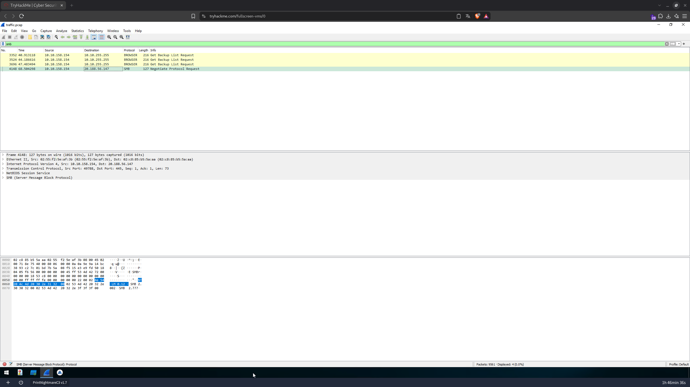
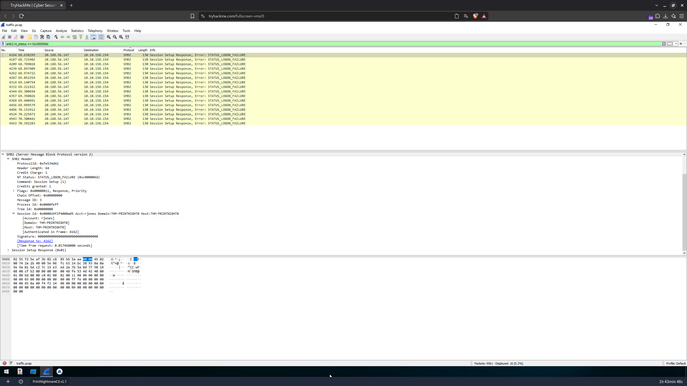
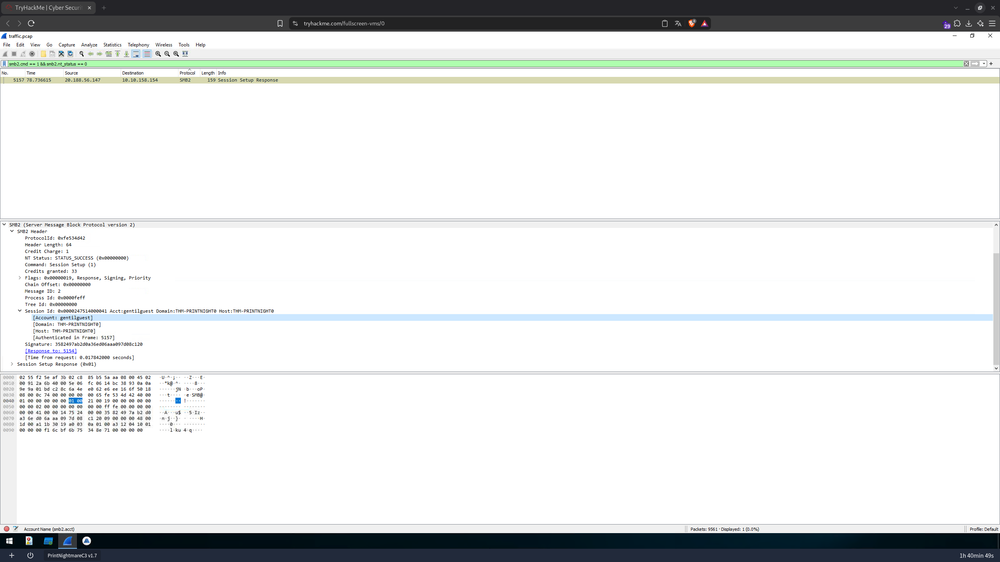
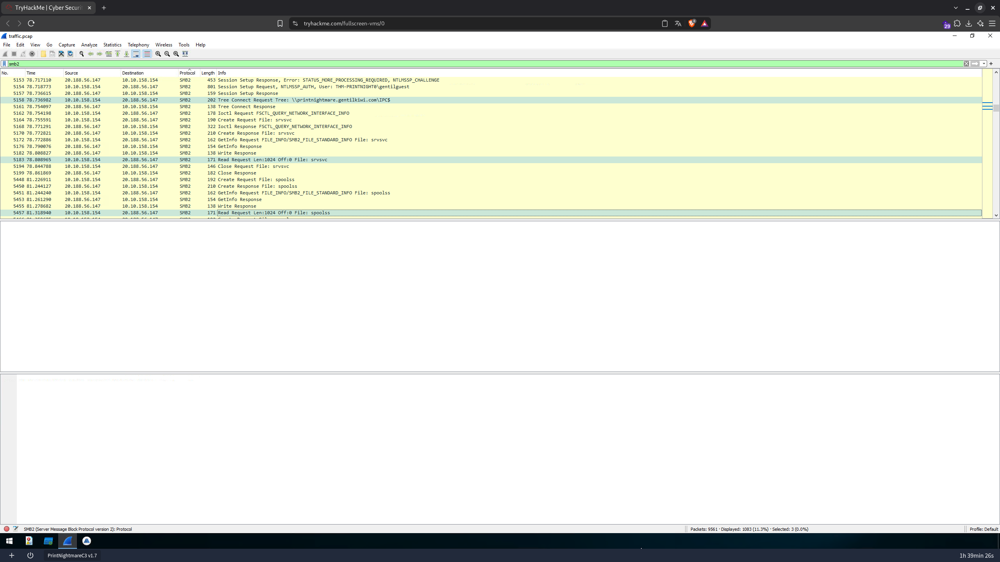
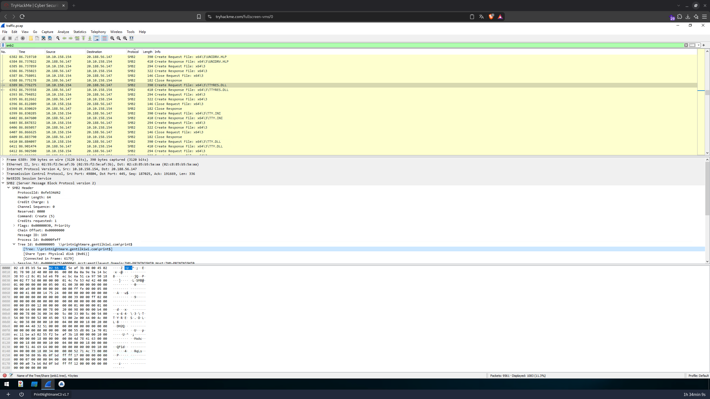
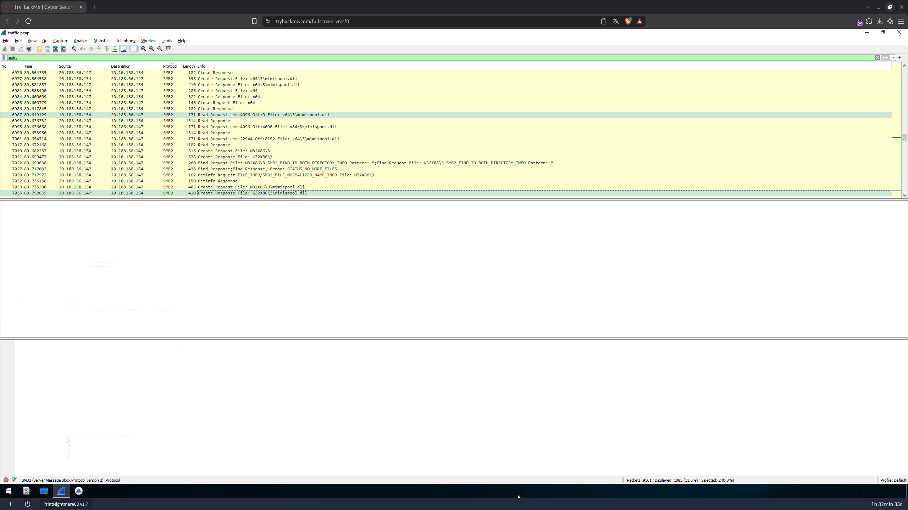
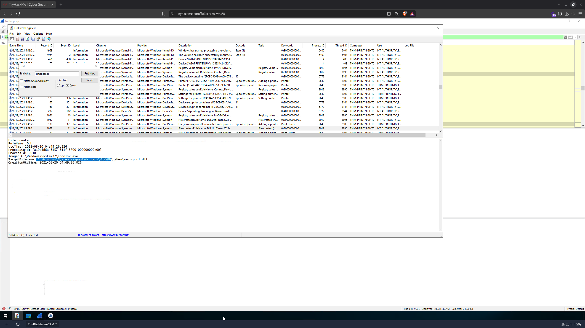
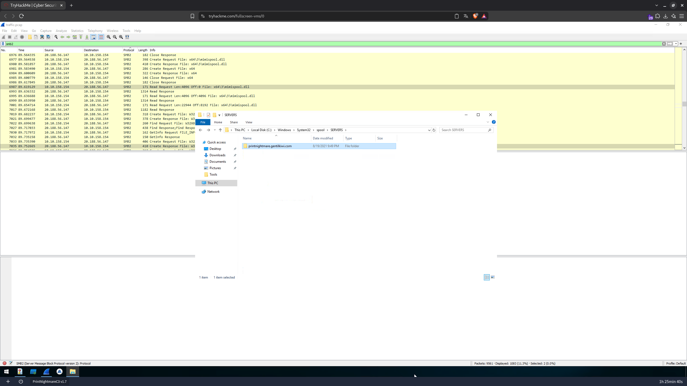
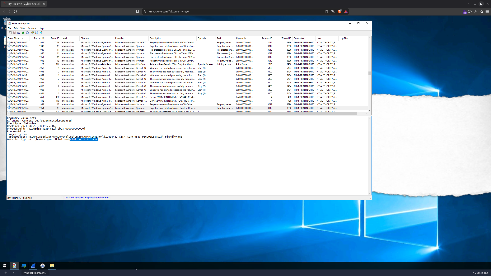

# 🔍 PrintNightmare, thrice! — CTF Writeup
### TryHackMe Room | Blue Team · Análise de Tráfego SMB (Wireshark) + Logs de Eventos Windows (Sysmon · PrintService) — CVE-2021-1675 / PrintNightmare (Point and Print remoto)

---

| **Analista**          | Mauricio Robert                                                                              |
|-----------------------|----------------------------------------------------------------------------------------------|
| **Organização**       | Faculdade Impacta                                                                            |
| **Data do Relatório** | 01/10/2026                                                                                   |
| **Data do Incidente** | 19/08/2021 21:49 (hora local do host) = 20/08/2021 04:49 UTC                                 |
| **Classificação**     | CONFIDENCIAL                                                                                 |
| **Ferramentas**       | Wireshark (`traffic.pcap`) · FullEventLogView (NirSoft) · Windows Explorer · Process Monitor *(indisponível)* |
| **Host Analisado**    | `THM-PRINTNIGHT0` — IP `10.10.158.154` — VM `PrintNightmareC3 v1.7`                          |

---

## 🔍 Resumo Executivo

O desafio **PrintNightmare, thrice!** (TryHackMe) é a variante **remota** do PrintNightmare: em vez de rodar um exploit local, o funcionário foi levado a se conectar a um **servidor de impressão controlado pelo atacante** — **`\\printnightmare.gentilkiwi.com`** (IP **`20.188.56.147`**), por meio do recurso *Point and Print*. A captura de rede (`traffic.pcap`, 9.561 pacotes) mostra primeiro **16 falhas de logon (`STATUS_LOGON_FAILURE`) do usuário `rjones`** e, em seguida, uma conexão **bem-sucedida com a conta de convidado `gentilguest`**. Pela sessão autenticada, o endpoint acessou `IPC$` (pipes `srvsvc` e `spoolss`) e depois o compartilhamento **`print$`**, de onde baixou a DLL maliciosa **`mimispool.dll`** (versões **x64** e **W32X86**). O `spoolsv.exe` gravou a DLL em `C:\Windows\System32\spool\drivers\x64\3\New\` e `...\W32X86\3\New\` e registrou a impressora **`Kiwi Legit Printer`**. O resultado foi a execução de código como **SYSTEM**: um **`cmd.exe` elevado (PID 5408)**, filho do **`spoolsv.exe`**, usado para adicionar `rjones` ao grupo de administradores locais (`net localgroup administrators rjones /add`). A investigação respondeu a **dez questões técnicas** correlacionando o tráfego **SMB/SMB2** com eventos **Sysmon** (IDs 11 e 13) e **Microsoft-Windows-PrintService**.

---

## 🛠 Ferramentas Utilizadas

| Ferramenta                                  | Finalidade                                                                                                      |
|---------------------------------------------|-----------------------------------------------------------------------------------------------------------------|
| **Wireshark** (`traffic.pcap`)              | Análise do tráfego SMB/SMB2 entre `10.10.158.154` (endpoint) e `20.188.56.147` (servidor remoto)                |
| **Filtros de exibição**                     | `smb`, `smb2`, `smb2.nt_status == 0xc000006d` (falhas de logon), `smb2.cmd == 1 && smb2.nt_status == 0` (sessões bem-sucedidas) |
| **FullEventLogView (NirSoft)**              | Consolidação de ≈ 76.664 eventos; busca (*Find*) por `mimispool.dll`                                            |
| **Sysmon/Operational**                      | Evento 11 (*File Created*) e Evento 13 (*Registry Value Set*)                                                    |
| **Microsoft-Windows-PrintService/Admin e Operational** | Eventos 316, 321 e 306 — adição de driver/impressora e arquivos associados                         |
| **Windows Explorer**                        | Verificação da pasta `C:\Windows\System32\spool\SERVERS\`                                                        |
| **Process Monitor**                         | Previsto para Q9/Q10, mas **não funcionou no laboratório** (ver notas nas questões)                              |

---

## 📋 Perguntas e Respostas

### Q1 — Para qual endereço remoto o funcionário navegou?

> **Resposta: `printnightmare.gentilkiwi.com`** (IP `20.188.56.147`)

**Solução:** No Wireshark, filtrando por `smb`, o primeiro tráfego SMB (não-broadcast) do endpoint `10.10.158.154` vai para **`20.188.56.147`** na **porta TCP 445**:

```
No.   Time        Source           Destination      Protocol  Info
3352  40.913118   10.10.158.154    10.10.255.255    BROWSER   Get Backup List Request     (broadcast NetBIOS)
3524  44.186616   10.10.158.154    10.10.255.255    BROWSER   Get Backup List Request
3696  47.483494   10.10.158.154    10.10.255.255    BROWSER   Get Backup List Request
4148  68.504298   10.10.158.154    20.188.56.147    SMB       Negotiate Protocol Request  (TCP 49788 → 445)
```

O hostname aparece depois, no `Tree Connect Request` do SMB2: **`\\printnightmare.gentilkiwi.com\IPC$`** (frame 5158). O domínio faz referência a **gentilkiwi** (Benjamin Delpy, autor do Mimikatz), que publicou a PoC remota do PrintNightmare.



---

### Q2 — Segundo o PCAP, qual usuário retorna o erro STATUS_LOGON_FAILURE?

> **Resposta: `rjones`**

**Solução:** Com o filtro `smb2.nt_status == 0xc000006d` (código de `STATUS_LOGON_FAILURE`), o Wireshark mostra **16 pacotes** (0,2% do total) — todos `Session Setup Response` vindos de `20.188.56.147`, entre **68,63 s e 70,39 s** da captura (frames 4164 a 4563):

```
NT Status: STATUS_LOGON_FAILURE (0xc000006d)
Command:   Session Setup (1)
Session Id: 0x000024f2f4000a85  Acct:rjones  Domain:THM-PRINTNIGHT0  Host:THM-PRINTNIGHT0
  [Account: rjones]
  [Domain:  THM-PRINTNIGHT0]
  [Host:    THM-PRINTNIGHT0]
```

O padrão (16 falhas em ≈ 2 segundos) indica tentativas **automáticas** do Windows de autenticar o usuário `rjones` (com as credenciais do logon atual) no servidor remoto, que as rejeitou.



---

### Q3 — Qual usuário se conecta com sucesso a um compartilhamento SMB?

> **Resposta: `gentilguest`**

**Solução:** Filtrando `smb2.cmd == 1 && smb2.nt_status == 0` (Session Setup concluído com sucesso), o resultado é **um único pacote**:

```
No. 5157  78.736615  20.188.56.147 → 10.10.158.154  SMB2  Session Setup Response
NT Status: STATUS_SUCCESS (0x00000000)
Session Id: 0x0000247514000041  Acct:gentilguest  Domain:THM-PRINTNIGHT0  Host:THM-PRINTNIGHT0
  [Account: gentilguest]
  [Authenticated in Frame: 5157]
```

O pacote anterior (frame 5154) é o `Session Setup Request, NTLMSSP_AUTH, User: THM-PRINTNIGHT0\gentilguest`. Depois das falhas de `rjones`, o Windows **caiu para a conta de convidado**, e o servidor do atacante aceitou — comportamento típico do PrintNightmare remoto, que não exige credenciais válidas.



---

### Q4 — Qual é o primeiro compartilhamento SMB remoto ao qual o endpoint se conectou? Qual foi o primeiro nome de arquivo? E o segundo? (formato: resposta,resposta,resposta)

> **Resposta: `IPC$,srvsvc,spoolss`**

**Solução:** Com o filtro `smb2`, a sequência logo após a autenticação de `gentilguest` mostra:

```
5157  78.736615  Session Setup Response
5158  78.736982  Tree Connect Request Tree: \\printnightmare.gentilkiwi.com\IPC$     <-- 1º compartilhamento
5161  78.754097  Tree Connect Response
5162  78.754198  Ioctl Request FSCTL_QUERY_NETWORK_INTERFACE_INFO
5164  78.755591  Create Request File: srvsvc                                          <-- 1º arquivo
5183  78.808965  Read Request Len:1024 Off:0 File: srvsvc
5194  78.844788  Close Request File: srvsvc
5448  81.226911  Create Request File: spoolss                                         <-- 2º arquivo
5457  81.318940  Read Request Len:1024 Off:0 File: spoolss
```

O share **`IPC$`** é o *named pipe share*; os "arquivos" `srvsvc` (Server Service) e `spoolss` (Print Spooler) são **named pipes** usados para chamadas RPC. O `spoolss` é exatamente a interface MS-RPRN/MS-PAR explorada pelo PrintNightmare.



---

### Q5 — De qual compartilhamento SMB remoto a DLL maliciosa foi obtida? Qual o caminho da pasta remota da primeira DLL? E da segunda? (formato: resposta,resposta,resposta)

> **Resposta: `print$,x64\3\mimispool.dll,W32X86\3\mimispool.dll`**

**Solução (compartilhamento):** Ao selecionar um pacote `Create Request` do período seguinte (frame 6389, `x64\3\TTYRES.DLL`) e expandir o SMB2 Header, a árvore (*Tree Id `0x00000005`*) é:

```
Tree: \\printnightmare.gentilkiwi.com\print$
Share Type: Physical disk (0x01)
Session: Acct:gentilguest  Domain:THM-PRINTNIGHT0  Host:THM-PRINTNIGHT0
```

O `print$` é o compartilhamento administrativo de **drivers de impressora**. Antes da DLL, o endpoint baixou os arquivos do driver genérico (`UNIDRV.HLP`, `TTYRES.DLL`, `TTY.INI`, `TTY.DLL`, em `x64\3\`).



**Solução (caminhos remotos das DLLs):** Ainda no `smb2`, entre 89,56 s e 89,75 s, aparecem as leituras da `mimispool.dll` em duas arquiteturas:

```
6977  89.564538  Create Request File: x64\3\mimispool.dll
6987  89.619129  Read Request Len:4096 Off:0     File: x64\3\mimispool.dll     <-- 1ª DLL
6995  89.636688  Read Request Len:4096 Off:4096  File: x64\3\mimispool.dll
7001  89.654714  Read Request Len:22944 Off:8192 File: x64\3\mimispool.dll
7019  89.682237  Create Request File: W32X86\3
7033  89.735390  Create Request File: W32X86\3\mimispool.dll                  <-- 2ª DLL
7035  89.752665  Create Response File: W32X86\3\mimispool.dll
```

A 1ª DLL é a versão **64 bits (`x64\3\mimispool.dll`)** e a 2ª é a **32 bits (`W32X86\3\mimispool.dll`)** — o atacante serve as duas para funcionar em qualquer arquitetura.



---

### Q6 — Qual foi o primeiro local no endpoint para onde a DLL maliciosa foi baixada? E o segundo?

> **Resposta: `C:\Windows\System32\spool\drivers\x64\3,C:\Windows\System32\spool\drivers\W32X86\3`**
> (arquivos completos: `...\x64\3\New\mimispool.dll` e `...\W32X86\3\New\mimispool.dll`)

**Solução:** No **FullEventLogView**, uma busca por `mimispool.dll` encontra dois eventos Sysmon **ID 11 (File Created)**, regra `DLL`, ambos gerados pelo **`spoolsv.exe` (PID 2640)**:

```
File created:                                   File created:
RuleName: DLL                                   RuleName: DLL
UtcTime: 2021-08-20 04:49:26.623                UtcTime: 2021-08-20 04:49:26.826
ProcessId: 2640                                 ProcessId: 2640
Image: C:\Windows\System32\spoolsv.exe          Image: C:\Windows\System32\spoolsv.exe
TargetFilename:                                 TargetFilename:
 C:\Windows\System32\spool\drivers\x64\3\New\    C:\Windows\System32\spool\drivers\W32X86\3\New\
 mimispool.dll                                   mimispool.dll
```

O horário de **04:49:26 UTC** (≈ 9:49 PM local do dia 19/08) bate com o tráfego SMB (89 s da captura) e com os eventos do **PrintService** logo ao lado (**Evento 130/131 – 321**: *"File(s) mimispool.dll associated with printer driver…"*, e **Eventos 128/129 – 306**: *"Settings for printer {1C493442-...}"*).




---

### Q7 — Qual é a pasta que leva o nome do servidor de impressão remoto ao qual o usuário se conectou? (forneça o caminho completo)

> **Resposta: `C:\Windows\System32\spool\SERVERS\printnightmare.gentilkiwi.com`**

**Solução:** No **Windows Explorer**, navegando por `This PC > Local Disk (C:) > Windows > System32 > spool > SERVERS`, existe **uma única pasta**, cujo nome é o do servidor de impressão remoto:

```
Name:           printnightmare.gentilkiwi.com
Date modified:  8/19/2021 9:49 PM
Type:           File folder
```

O horário (**9:49 PM local**) coincide com a gravação das DLLs. Quando uma impressora de um servidor remoto é instalada, o spooler cria em `spool\SERVERS\<servidor>` um cache local — evidência persistente da conexão.



---

### Q8 — Qual é o nome da impressora que a DLL adicionou?

> **Resposta: `Kiwi Legit Printer`**

**Solução:** No FullEventLogView, o evento Sysmon **ID 13 (Registry Value Set)**, regra `Context,DeviceConnectedOrUpdated`, executado pelo processo `System` (PID 4), mostra o `FriendlyName` da impressora recém-instalada:

```
Registry value set:
RuleName: Context,DeviceConnectedOrUpdated
EventType: SetValue
UtcTime: 2021-08-20 04:49:25.169
ProcessId: 4
Image: System
TargetObject: HKLM\System\CurrentControlSet\Enum\SWD\PRINTENUM\{1C493442-C15A-41F9-9533-986C91E88FD1}\FriendlyName
Details: \\printnightmare.gentilkiwi.com\Kiwi Legit Printer
```

A impressora é **`Kiwi Legit Printer`** (o nome "legítima" é a ironia do autor da PoC), identificada pelo GUID **`{1C493442-C15A-41F9-9533-986C91E88FD1}`** — o mesmo GUID que aparece nos eventos do PrintService (316, 306, 321) ao lado, onde o driver instalado é o **"Generic / Text Only"**.



---

### Q9 — Qual foi o ID do processo do prompt de comando elevado? E qual era seu processo pai? (formato: resposta,resposta)

> **Resposta: `5408,spoolsv.exe`**

**Solução:** Pelo **Process Monitor** (Process Tree), o `cmd.exe` com privilégio **SYSTEM** aparece com **PID 5408**, tendo como processo pai o **`spoolsv.exe`** — o Print Spooler que carregou a `mimispool.dll`. Um `cmd.exe` filho do spooler é o indicador clássico de exploração do PrintNightmare: a DLL, executada dentro do `spoolsv.exe` como SYSTEM, abre o prompt elevado.

---

### Q10 — Qual comando o usuário executou para elevar privilégios?

> **Resposta: `net localgroup administrators rjones /add`**

**Solução:** No prompt elevado (`cmd.exe`, PID 5408), o usuário adicionou a si mesmo ao grupo local de administradores:

```cmd
net localgroup administrators rjones /add
```

O comando adiciona **`rjones`** — o mesmo usuário que gerou as 16 falhas de logon (Q2) — ao grupo **Administrators**, concluindo a escalada de privilégios (de usuário comum para administrador local persistente).

---

## ⛓ Kill Chain — Fluxo do Ataque PrintNightmare Remoto

```
[FASE 1 — CONEXÃO AO SERVIDOR DO ATACANTE]  (68,5 s no PCAP)
    Endpoint 10.10.158.154 (THM-PRINTNIGHT0) → 20.188.56.147:445
    SMB Negotiate Protocol Request   (\\printnightmare.gentilkiwi.com)
    ↓
[FASE 2 — AUTENTICAÇÃO]  (68,6 – 78,7 s)
    rjones → 16× STATUS_LOGON_FAILURE (0xc000006d)
    gentilguest → STATUS_SUCCESS (frame 5157)  ← fallback de convidado
    ↓
[FASE 3 — ENUMERAÇÃO RPC]  (78,7 – 81,3 s)
    Tree Connect \\printnightmare.gentilkiwi.com\IPC$
    Named pipes: srvsvc → spoolss        (interface do Print Spooler)
    ↓
[FASE 4 — DOWNLOAD DO "DRIVER" MALICIOSO]  (86,7 – 89,8 s)
    Tree Connect \\printnightmare.gentilkiwi.com\print$
    Arquivos do driver genérico: UNIDRV.HLP, TTYRES.DLL, TTY.INI, TTY.DLL
    x64\3\mimispool.dll   +   W32X86\3\mimispool.dll
    ↓
[FASE 5 — INSTALAÇÃO LOCAL]  (04:49:25 – 04:49:26 UTC)
    Sysmon 13: impressora "Kiwi Legit Printer" {1C493442-C15A-41F9-9533-986C91E88FD1}
    Sysmon 11 (spoolsv.exe PID 2640):
      C:\Windows\System32\spool\drivers\x64\3\New\mimispool.dll
      C:\Windows\System32\spool\drivers\W32X86\3\New\mimispool.dll
    Pasta criada: C:\Windows\System32\spool\SERVERS\printnightmare.gentilkiwi.com
    ↓
[FASE 6 — EXECUÇÃO COMO SYSTEM / ESCALONAMENTO]
    spoolsv.exe carrega mimispool.dll  →  cmd.exe elevado (PID 5408, pai: spoolsv.exe)
    net localgroup administrators rjones /add
```

---

## 🗺 Mapeamento Investigativo

| Pergunta | Fonte de Evidência | Artefato |
|----------|--------------------|----------|
| Endereço remoto | Wireshark `smb` / `Tree Connect` | `printnightmare.gentilkiwi.com` (`20.188.56.147`) |
| Usuário com falha de logon | Wireshark `smb2.nt_status == 0xc000006d` | `rjones` (16 ocorrências) |
| Usuário conectado com sucesso | Wireshark `smb2.cmd == 1 && smb2.nt_status == 0` | `gentilguest` (frame 5157) |
| 1º share / 1º e 2º arquivo | Wireshark `smb2` (frames 5158, 5164, 5448) | `IPC$`, `srvsvc`, `spoolss` |
| Share das DLLs / caminhos remotos | Wireshark `smb2` (Tree Id 0x5; frames 6977–7035) | `print$`, `x64\3\mimispool.dll`, `W32X86\3\mimispool.dll` |
| Locais de gravação das DLLs | Sysmon Evento 11 (`spoolsv.exe`) | `...\spool\drivers\x64\3` e `...\spool\drivers\W32X86\3` |
| Pasta do servidor remoto | Windows Explorer (`spool\SERVERS`) | `C:\Windows\System32\spool\SERVERS\printnightmare.gentilkiwi.com` |
| Nome da impressora | Sysmon Evento 13 (`PRINTENUM\{GUID}\FriendlyName`) | `Kiwi Legit Printer` |
| PID do cmd elevado / pai | Process Monitor *(sem print)* | `5408`, `spoolsv.exe` |
| Comando de elevação | Prompt elevado *(sem print)* | `net localgroup administrators rjones /add` |

---

## 🚨 Artefatos e Indicadores Identificados (IOCs)

| Tipo | Indicador | Contexto |
|------|-----------|----------|
| Host (vítima) | `THM-PRINTNIGHT0` — `10.10.158.154` | Endpoint comprometido |
| IP (atacante) | `20.188.56.147` (TCP/445) | Servidor SMB/impressão malicioso |
| Domínio | `printnightmare.gentilkiwi.com` | Servidor de impressão remoto (Point and Print) |
| Compartilhamento | `\\printnightmare.gentilkiwi.com\IPC$` | Named pipes `srvsvc` e `spoolss` |
| Compartilhamento | `\\printnightmare.gentilkiwi.com\print$` | Origem dos drivers e da `mimispool.dll` |
| Arquivo remoto | `print$\x64\3\mimispool.dll` | DLL maliciosa (64 bits) |
| Arquivo remoto | `print$\W32X86\3\mimispool.dll` | DLL maliciosa (32 bits) |
| Arquivo (host) | `C:\Windows\System32\spool\drivers\x64\3\New\mimispool.dll` | DLL gravada pelo `spoolsv.exe` (04:49:26.623 UTC) |
| Arquivo (host) | `C:\Windows\System32\spool\drivers\W32X86\3\New\mimispool.dll` | DLL gravada pelo `spoolsv.exe` (04:49:26.826 UTC) |
| Pasta | `C:\Windows\System32\spool\SERVERS\printnightmare.gentilkiwi.com` | Cache do servidor de impressão remoto |
| Impressora | `Kiwi Legit Printer` — `{1C493442-C15A-41F9-9533-986C91E88FD1}` | Impressora/driver instalado ("Generic / Text Only") |
| Registro | `HKLM\System\CurrentControlSet\Enum\SWD\PRINTENUM\{1C493442-C15A-41F9-9533-986C91E88FD1}\FriendlyName` | `\\printnightmare.gentilkiwi.com\Kiwi Legit Printer` |
| Conta (alvo) | `rjones` | 16× `STATUS_LOGON_FAILURE`; adicionado ao grupo Administrators |
| Conta (convidado) | `gentilguest` | Sessão SMB bem-sucedida (`STATUS_SUCCESS`) |
| Processo | `spoolsv.exe` (PID 2640 no Sysmon) | Print Spooler explorado |
| Processo | `cmd.exe` — PID `5408` (pai: `spoolsv.exe`) | Prompt elevado como SYSTEM |
| Comando | `net localgroup administrators rjones /add` | Escalada de privilégios |
| Event ID (Sysmon) | `11` e `13` | Criação das DLLs e registro da impressora |
| Event ID (PrintService) | `306`, `316`, `321` | Configuração da impressora, driver e arquivos associados |
| CVE | `CVE-2021-1675` / `CVE-2021-34527` | PrintNightmare (Windows Print Spooler) |
| Técnica (MITRE ATT&CK) | `T1068` | Exploitation for Privilege Escalation |
| Técnica (MITRE ATT&CK) | `T1021.002` | Remote Services: SMB/Windows Admin Shares |
| Técnica (MITRE ATT&CK) | `T1105` | Ingress Tool Transfer (DLL via `print$`) |
| Técnica (MITRE ATT&CK) | `T1078.001` | Valid Accounts: Default Accounts (`gentilguest` — convidado) |
| Técnica (MITRE ATT&CK) | `T1098` | Account Manipulation (inclusão em Administrators) |
| Técnica (MITRE ATT&CK) | `T1547.012` | Boot or Logon Autostart: Print Processors (abuso de driver/DLL do spooler) |

---

## ✅ Resumo das Flags

| # | Pergunta | Flag / Resposta |
|---|----------|------------------|
| Q1 | Endereço remoto acessado | `printnightmare.gentilkiwi.com` (`20.188.56.147`) |
| Q2 | Usuário com `STATUS_LOGON_FAILURE` | `rjones` |
| Q3 | Usuário conectado com sucesso a um share SMB | `gentilguest` |
| Q4 | 1º share, 1º e 2º arquivo | `IPC$,srvsvc,spoolss` |
| Q5 | Share da DLL e caminhos remotos | `print$,x64\3\mimispool.dll,W32X86\3\mimispool.dll` |
| Q6 | 1º e 2º locais de download da DLL | `C:\Windows\System32\spool\drivers\x64\3,C:\Windows\System32\spool\drivers\W32X86\3` |
| Q7 | Pasta com o nome do servidor de impressão | `C:\Windows\System32\spool\SERVERS\printnightmare.gentilkiwi.com` |
| Q8 | Nome da impressora adicionada | `Kiwi Legit Printer` |
| Q9 | PID do cmd elevado e processo pai | `5408,spoolsv.exe` *(sem print)* |
| Q10 | Comando de elevação de privilégios | `net localgroup administrators rjones /add` *(sem print)* |

---

## 📚 Referências

- [TryHackMe — PrintNightmare, thrice!](https://tryhackme.com/room/printnightmarethrice)
- [NVD — CVE-2021-1675](https://nvd.nist.gov/vuln/detail/CVE-2021-1675)
- [Microsoft MSRC — CVE-2021-34527 (PrintNightmare)](https://msrc.microsoft.com/update-guide/vulnerability/CVE-2021-34527)
- [Microsoft — KB5005010: Restricting installation of new printer drivers](https://support.microsoft.com/kb/5005010)
- [gentilkiwi/mimikatz — mimispool](https://github.com/gentilkiwi/mimikatz)
- [Wireshark — SMB2 Display Filter Reference](https://www.wireshark.org/docs/dfref/s/smb2.html)
- [NirSoft — FullEventLogView](https://www.nirsoft.net/utils/full_event_log_view.html)
- [MITRE ATT&CK — T1068 Exploitation for Privilege Escalation](https://attack.mitre.org/techniques/T1068/)
- [MITRE ATT&CK — T1021.002 SMB/Windows Admin Shares](https://attack.mitre.org/techniques/T1021/002/)

---