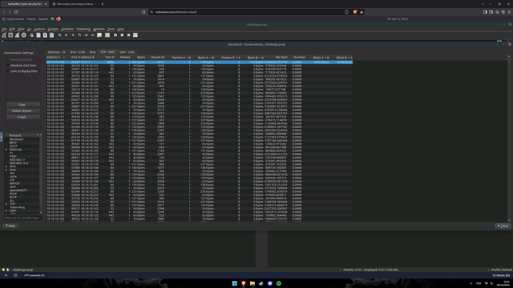
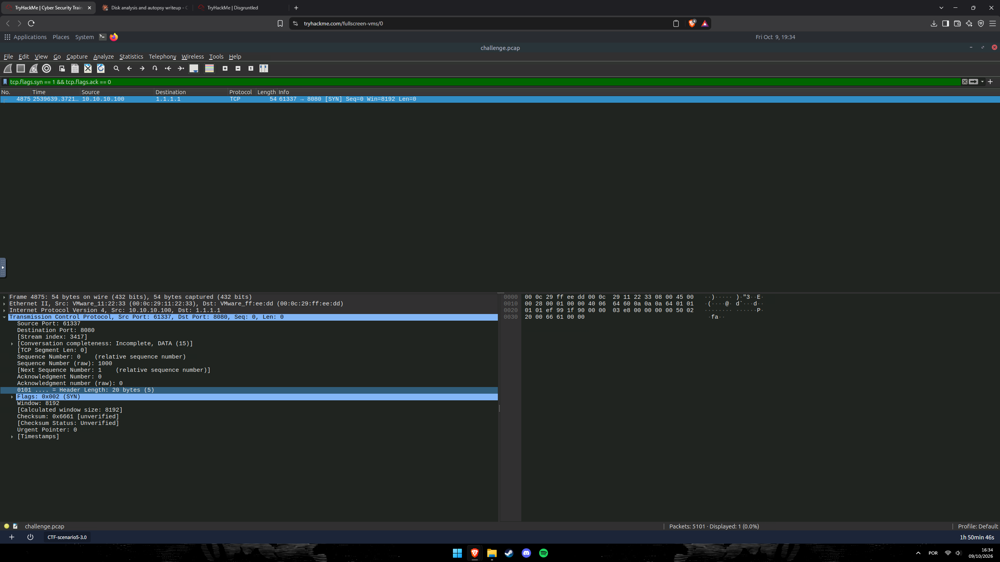
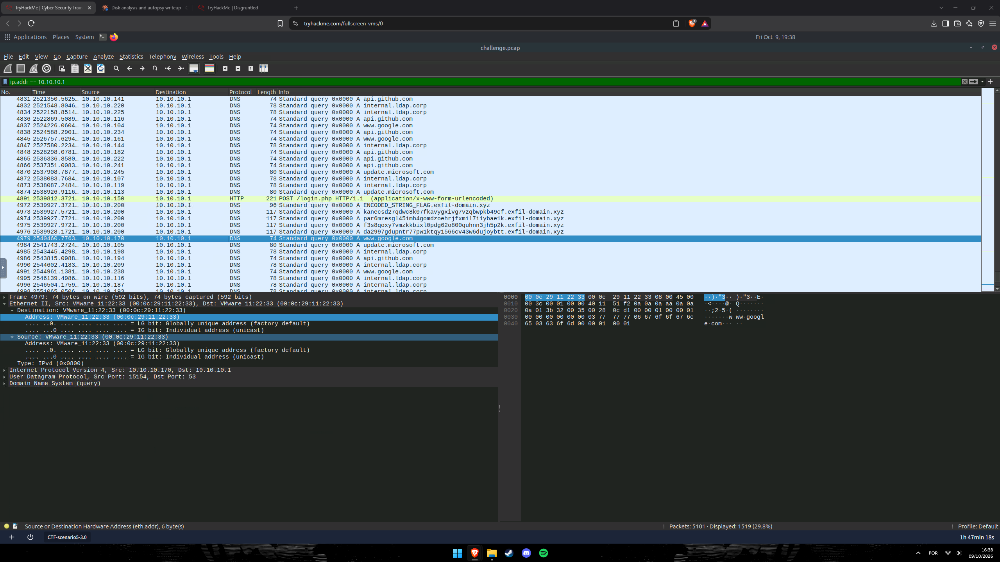
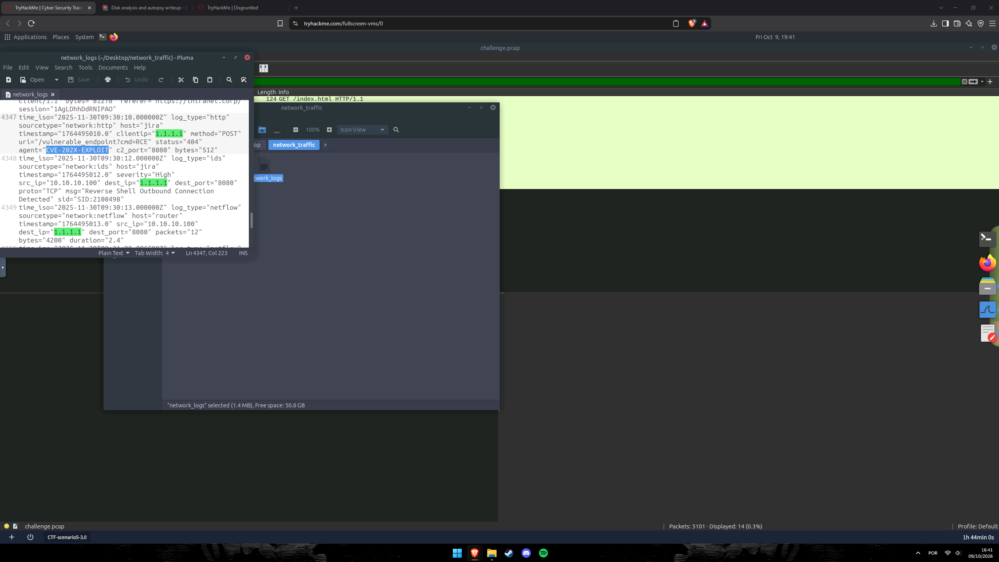
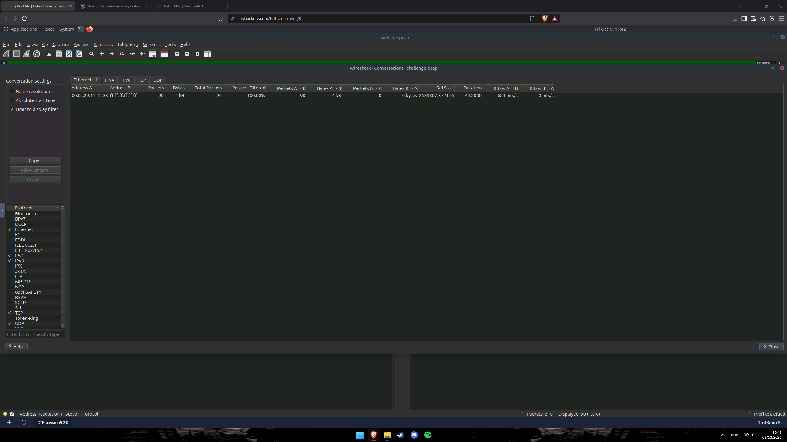
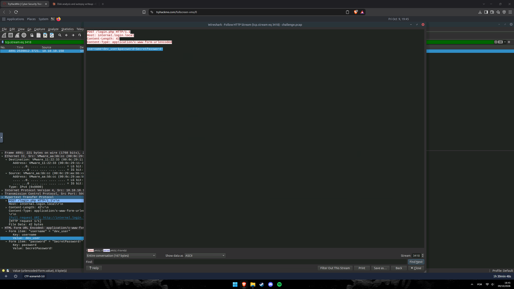
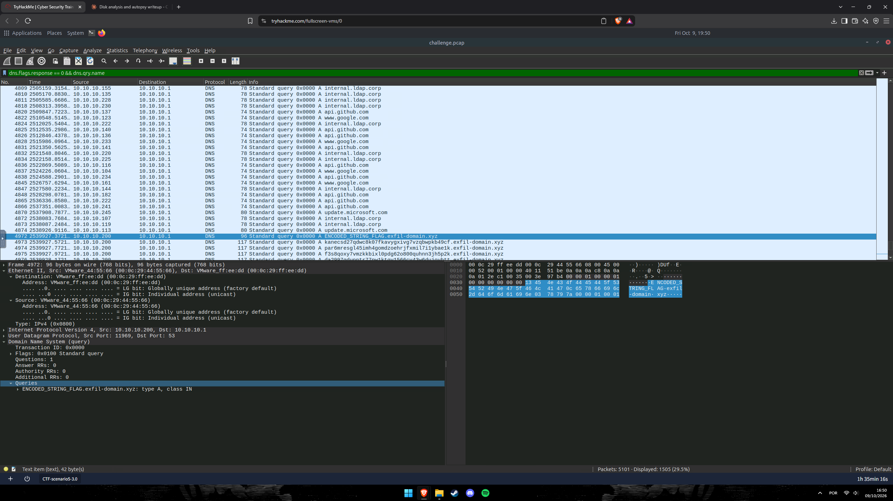

# 🔍 The Crown Jewel — CTF Writeup
### TryHackMe Room | Network Forensics · Análise de PCAP (Wireshark) + Logs de Rede (Splunk-style `network_logs`) — Exploração de Jira, ARP Spoofing, Roubo de Credenciais e Exfiltração via DNS

---

| **Analista**          | Mauricio Robert                                                                              |
|-----------------------|----------------------------------------------------------------------------------------------|
| **Organização**       | Faculdade Impacta                                                                            |
| **Data do Relatório** | 10/10/2026                                                                                   |
| **Data do Incidente** | 30/11/2025 09:30 UTC (exploração do Jira → reverse shell em 2 segundos)                      |
| **Classificação**     | CONFIDENCIAL                                                                                 |
| **Ferramentas**       | Wireshark (`challenge.pcap`, 5.101 pacotes) · Pluma (`network_logs`, 1,4 MB) · Statistics → Conversations · Follow HTTP Stream |
| **Ambiente**          | VM `CTF-scenario5-3.0` — rede interna `10.10.10.0/24`, gateway `10.10.10.1`                  |

---

## 🔍 Resumo Executivo

O desafio **The Crown Jewel** (TryHackMe) pede a investigação de um incidente em uma rede interna `10.10.10.0/24`, com um arquivo de captura (`challenge.pcap`, **5.101 pacotes**) e um arquivo de logs agregados (`network_logs`, ≈ 1,4 MB). A análise reconstruiu uma intrusão em quatro frentes: **(1)** um atacante externo (**`1.1.1.1`**) explorou o **Jira** (`10.10.10.100`) com um *user-agent* anômalo, **`CVE-202X-EXPLOIT`**, em uma requisição `POST /vulnerable_endpoint?cmd=RCE` (RCE); dois segundos depois o IDS gerou o alerta **"Reverse Shell Outbound Connection"** e o PCAP mostra a conexão do Jira para **`1.1.1.1:8080`** (canal **C2**); **(2)** o host comprometido passou a fazer **ARP spoofing** — **90 pacotes ARP** em broadcast vindos do MAC **`00:0c:29:11:22:33`**, que se passa pelo gateway `10.10.10.1`; **(3)** o tráfego desviado permitiu capturar, em texto claro, um `POST /login.php` com **`username=dev_user&password=SecretPassword!`**; e **(4)** o host `10.10.10.200` **exfiltrou dados via DNS** para o domínio do atacante **`exfil-domain.xyz`**, usando consultas com subdomínios codificados. A investigação respondeu a **oito questões técnicas** correlacionando o PCAP com os logs de rede.

---

## 🛠 Ferramentas Utilizadas

| Ferramenta                              | Finalidade                                                                                                         |
|-----------------------------------------|--------------------------------------------------------------------------------------------------------------------|
| **Wireshark** (`challenge.pcap`)        | Análise de pacotes: ARP, TCP, DNS e HTTP                                                                           |
| **Statistics → Conversations**          | Tabelas por Ethernet (10), IPv4 (3.140), TCP (3.502) e UDP (1.505) — localizar a conversa `10.10.10.100:61337 → 1.1.1.1:8080` e o MAC que fala em broadcast |
| **Filtros de exibição**                 | `tcp.flags.syn == 1 && tcp.flags.ack == 0` · `ip.addr == 10.10.10.1` · `dns.flags.response == 0 && dns.qry.name` · `tcp.stream eq 3418` |
| **Follow → HTTP Stream**                | Ler o corpo do `POST /login.php` (stream 3418) em texto claro                                                      |
| **Pluma** (`~/Desktop/network_traffic/network_logs`) | Busca por `CVE-202X-EXPLOIT` e leitura dos eventos `http`, `ids` e `netflow` do host `jira` / `router`   |

---

## 📋 Perguntas e Respostas

### Q1 — De qual IP interno originou a conexão suspeita?

> **Resposta: `10.10.10.100`**

**Solução:** O Wireshark tem 5.101 pacotes, e quase todos os fluxos TCP têm **um único pacote** (ruído). Aplicando o filtro de *handshake* **`tcp.flags.syn == 1 && tcp.flags.ack == 0`**, sobra **apenas 1 pacote** (1 de 5.101, 0,0%) — o único *SYN* real da captura:

```
No.   Time          Source          Destination   Protocol  Info
4875  2539639.372…  10.10.10.100    1.1.1.1       TCP       54  61337 → 8080 [SYN] Seq=0 Win=8192 Len=0
```

O detalhe do pacote confirma: IP origem **`10.10.10.100`**, porta de origem **61337**, destino **`1.1.1.1:8080`**, `Stream index: 3417` e `Conversation completeness: Incomplete`. No `network_logs`, o evento do IDS repete o mesmo par: `src_ip="10.10.10.100" dest_ip="1.1.1.1" dest_port="8080"`, e esse host (`host="jira"`) é o servidor Jira.



---

### Q2 — Qual conexão de saída foi detectada como canal de C2? (exemplo de resposta: 1.2.3.4:9996)

> **Resposta: `1.1.1.1:8080`**

**Solução:** Em **Statistics → Conversations → TCP (3.502)**, ordenando por `Address A`, a primeira linha — única com tráfego nos dois sentidos e com taxa de bits calculada — é:

```
Address A     Port A   Address B   Port B   Packets   Bytes     Stream ID   Packets A→B   Bytes A→B   Packets B→A   Bytes B→A   Duration
10.10.10.100  61337    1.1.1.1     8080     5         293 bytes 3417        3             178 bytes   2             115 bytes   0,26 s
```

São 5 pacotes e 293 bytes em 0,26 s, com o servidor respondendo (2 pacotes) — um canal de comando interativo. O log do IDS (`log_type="ids"`, `severity="High"`) confirma o que a captura mostra:

```
time_iso="2025-11-30T09:30:12.000000Z" log_type="ids" sourcetype="network:ids" host="jira"
severity="High" src_ip="10.10.10.100" dest_ip="1.1.1.1" dest_port="8080" proto="TCP"
msg="Reverse Shell Outbound Connection" sid="SID:2100498"

time_iso="2025-11-30T09:30:13.000000Z" log_type="netflow" sourcetype="network:netflow" host="router"
src_ip="10.10.10.100" dest_ip="1.1.1.1" dest_port="8080" packets="12" bytes="4200" duration="2.4"
```

O IDS descreve **"Reverse Shell Outbound Connection"** e o NetFlow do roteador registra 12 pacotes / 4.200 bytes em 2,4 s — **`1.1.1.1:8080`** é o C2.



---

### Q3 — Qual endereço MAC está se passando pelo gateway 10.10.10.1?

> **Resposta: `00:0c:29:11:22:33`**

**Solução:** Filtrando **`ip.addr == 10.10.10.1`**, os pacotes enviados aos IPs `10.10.10.x` com destino ao gateway têm o *Ethernet Destination* **`VMware_11:22:33 (00:0c:29:11:22:33)`**, e não o MAC legítimo do roteador. Exemplo — o quadro **4979** (`10.10.10.170 → 10.10.10.1`, consulta DNS):

```
Frame 4979: 74 bytes on wire
Ethernet II, Src: VMware_11:22:33 (00:0c:29:11:22:33), Dst: VMware_11:22:33 (00:0c:29:11:22:33)
Internet Protocol Version 4, Src: 10.10.10.170, Dst: 10.10.10.1
User Datagram Protocol, Src Port: 15154, Dst Port: 53
Domain Name System (query)  → www.google.com
```

Os mesmos pacotes vão para o MAC `00:0c:29:11:22:33` em vez do gateway real — comportamento de **envenenamento do cache ARP (ARP spoofing / MITM)**.

Pontos de apoio:
- No SYN do C2 (quadro 4875), o **MAC de origem é `00:0c:29:11:22:33`** (`10.10.10.100`, o Jira comprometido) e o **MAC de destino é `00:0c:29:ff:ee:dd`**, o próximo salto para a Internet. Ou seja, **`00:0c:29:ff:ee:dd` parece ser o gateway real** e **`00:0c:29:11:22:33` é o MAC do host invasor — o próprio Jira**.
- O `POST /login.php` (quadro 4891, Q6) sai de `00:0c:29:aa:bb:cc` com destino **`VMware_11:22:33`**, ainda que o IP de destino seja o `10.10.10.1`.

> ⚠️ **Nota do analista:** o MAC real do gateway (`00:0c:29:ff:ee:dd`) é uma **inferência** a partir do destino ethernet dos quadros 4875 e 4972–4976; vale conferir com o filtro `arp` / `arp.src.proto_ipv4 == 10.10.10.1`.



---

### Q4 — Qual é o User-Agent não padrão que atinge a instância Jira?

> **Resposta: `CVE-202X-EXPLOIT`**

**Solução:** Abrindo o `network_logs` no Pluma e buscando por requisições HTTP ao host `jira`, a linha **4347** mostra o ataque:

```
time_iso="2025-11-30T09:30:10.000000Z" log_type="http" sourcetype="network:http" host="jira"
timestamp="1764495010.0" clientip="1.1.1.1" method="POST"
uri="/vulnerable_endpoint?cmd=RCE" status="404"
agent="CVE-202X-EXPLOIT" c2_port="8080" bytes="512"
```

O *user-agent* **`CVE-202X-EXPLOIT`** não é de nenhum navegador: é a assinatura de uma ferramenta/script de exploração. A requisição `POST /vulnerable_endpoint?cmd=RCE` parte de **`1.1.1.1`**, que é o mesmo IP do C2 (`c2_port="8080"`). Em seguida (09:30:12), o IDS alerta **reverse shell** do Jira para `1.1.1.1:8080` — **2 segundos** depois do exploit.

> O `status="404"` não impede o ataque: a execução remota ocorreu apesar da resposta (o reverse shell aparece 2 s depois).



---

### Q5 — Quantos ataques de ARP spoofing foram observados no PCAP?

> **Resposta: `90`**

**Solução:** Em **Statistics → Conversations → Ethernet** com **"Limit to display filter"** ativo, a única conversa Ethernet filtrada (a do filtro de ARP) é:

```
Address A           Address B           Packets   Bytes   Packets A→B   Packets B→A   Rel Start      Duration   Bits/s A→B
00:0c:29:11:22:33   ff:ff:ff:ff:ff:ff   90        4 kB    90            0             2539807.37…    44,2 s     684 bits/s
```

São **90 pacotes** (1,8% dos 5.101) saindo de **`00:0c:29:11:22:33`** para o **broadcast `ff:ff:ff:ff:ff:ff`**, **todos num único sentido** (`B→A = 0`) e ao longo de **44,2 s** (≈ 2 por segundo) — o padrão de **ARP replies gratuitos** do envenenamento de cache. A barra de status também mostra *Displayed: 90 (1,8%)*, e o campo selecionado é *Address Resolution Protocol*.

> ⚠️ **Nota do analista:** o filtro de exibição usado nesta tela não aparece no print (a barra do filtro está oculta pela janela *Conversations*). O resultado `90` bate com o filtro **`arp`** e com o tráfego do MAC `00:0c:29:11:22:33`; confirme a contagem com `arp` ou `arp.opcode == 2` na barra do Wireshark.



---

### Q6 — Qual é o payload que contém as credenciais em texto claro encontrado na requisição POST?

> **Resposta: `username=dev_user&password=SecretPassword!`**

**Solução:** Na lista filtrada por `ip.addr == 10.10.10.1`, o único tráfego **HTTP** (em destaque amarelo) é o **quadro 4891**:

```
4891  2539812.3721…  10.10.10.150  →  10.10.10.1  HTTP  221  POST /login.php HTTP/1.1  (application/x-www-form-urlencoded)
```

Usando **Follow → HTTP Stream** (`tcp.stream eq 3418`, 167 bytes, 1 pacote do cliente e 0 do servidor):

```
POST /login.php HTTP/1.1
Host: internal.login.local
Content-Length: 42
Content-Type: application/x-www-form-urlencoded

username=dev_user&password=SecretPassword!
```

O painel de detalhes (*HTML Form URL Encoded*) confirma os campos: `username = dev_user` e `password = SecretPassword!` (42 bytes). O quadro é **HTTP puro** (sem TLS) — e foi entregue ao MAC `00:0c:29:11:22:33` (Q3), o que prova que o invasor estava no meio do caminho (MITM) e tinha acesso ao conteúdo.



---

### Q7 — Qual domínio, de propriedade do atacante, foi usado para exfiltração de dados?

> **Resposta: `exfil-domain.xyz`**

**Solução:** Com o filtro **`dns.flags.response == 0 && dns.qry.name`** (somente consultas DNS), 1.505 pacotes (29,5%) aparecem. Quase todos são ruído legítimo (`internal.ldap.corp`, `api.github.com`, `www.google.com`, `update.microsoft.com`), mas **os quadros 4972–4976** — todos de **`10.10.10.200`** para **`10.10.10.1`** — são anômalos:

```
4972  10.10.10.200 → 10.10.10.1  DNS  96   Standard query A  ENCODED_STRING_FLAG.exfil-domain.xyz
4973  10.10.10.200 → 10.10.10.1  DNS  117  Standard query A  kanecsd27qdwc8k07fkavygxivg7vzqbwpkb49cf.exfil-domain.xyz
4974  10.10.10.200 → 10.10.10.1  DNS  117  Standard query A  par6mresgl45imh4gomdzoehrjfxmil7i1ybae1k.exfil-domain.xyz
4975  10.10.10.200 → 10.10.10.1  DNS  117  Standard query A  f3s8qoxy7vmzkkbixl0pdg62o800quhnn3jh5p2k.exfil-domain.xyz
4976  10.10.10.200 → 10.10.10.1  DNS  117  Standard query A  da2997gduptr77pw1ktqy1566cv43w6dujoybtt.exfil-domain.xyz
```

O domínio é **`exfil-domain.xyz`**. O primeiro quadro (**4972**) é um marcador (`ENCODED_STRING_FLAG`) e os 4 seguintes carregam, em cada subdomínio de **40 caracteres**, os **dados codificados**. Os pacotes foram enviados em rajada, em ≈ 0,2 s, de **2539927.37 a 2539928.17**. O domínio `*.xyz` com nome "exfil" não pertence à empresa — é a infraestrutura do atacante.

> ⚠️ **Nota do analista:** os 4 subdomínios foram **transcritos do print** e podem ter erros de leitura de caracteres; para uso em IOC, copie-os direto do Wireshark (`dns.qry.name`).



---

### Q8 — Após examinar os logs, qual protocolo foi usado para a exfiltração de dados?

> **Resposta: `DNS`**

**Solução:** Os dados foram enviados dentro de **consultas DNS (UDP/53)** — **DNS tunneling / exfiltração via DNS**. O quadro 4972 mostra o *stack*:

```
Ethernet II  Src: VMware_44:55:66 (00:0c:29:44:55:66)  Dst: VMware_ff:ee:dd (00:0c:29:ff:ee:dd)
IPv4         Src: 10.10.10.200   Dst: 10.10.10.1
UDP          Src Port: 11969     Dst Port: 53
DNS (query)  Questions: 1  Answer RRs: 0  Queries: ENCODED_STRING_FLAG.exfil-domain.xyz: type A, class IN
```

Nenhuma resposta é necessária: o **dado vai no nome consultado**, então basta a consulta chegar ao servidor DNS autoritativo do atacante. É uma técnica clássica para driblar firewalls, já que **DNS (porta 53) quase nunca é bloqueado**. O quadro 4972 também mostra o MAC de destino **`00:0c:29:ff:ee:dd`** — esse host (`10.10.10.200`) **não estava sendo desviado pelo ARP spoofing**, falando direto com o gateway real.


---

## ⛓ Kill Chain — Fluxo do Ataque

```
[FASE 1 — EXPLORAÇÃO DO JIRA (RCE)]  (30/11/2025 09:30:10 UTC)
    1.1.1.1 → Jira (10.10.10.100): POST /vulnerable_endpoint?cmd=RCE
    User-Agent: CVE-202X-EXPLOIT   (status 404, 512 bytes, c2_port=8080)
    ↓
[FASE 2 — REVERSE SHELL / C2]  (09:30:12 – 09:30:13)
    IDS (High): "Reverse Shell Outbound Connection"  SID:2100498
    10.10.10.100:61337 → 1.1.1.1:8080  (5 pacotes, 293 bytes; NetFlow: 12 pkts / 4.200 B / 2,4 s)
    ↓
[FASE 3 — ARP SPOOFING (MITM)]  (≈ 44 s; início 2539807 s no PCAP)
    00:0c:29:11:22:33 → ff:ff:ff:ff:ff:ff  — 90 pacotes ARP, só um sentido
    Passa-se pelo gateway 10.10.10.1 — tráfego dos clientes é entregue ao invasor
    ↓
[FASE 4 — CAPTURA DE CREDENCIAIS]  (quadro 4891, 2539812 s)
    10.10.10.150 → 10.10.10.1: POST /login.php (HTTP em texto claro)
    username=dev_user&password=SecretPassword!   (Host: internal.login.local)
    ↓
[FASE 5 — EXFILTRAÇÃO VIA DNS]  (quadros 4972–4976, ≈ 2539927 s)
    10.10.10.200 → 10.10.10.1:53
    ENCODED_STRING_FLAG.exfil-domain.xyz  +  4 subdomínios de 40 caracteres codificados
```

---

## 🗺 Mapeamento Investigativo

| Pergunta | Fonte de Evidência | Artefato |
|----------|--------------------|----------|
| IP interno da conexão suspeita | Wireshark `tcp.flags.syn == 1 && tcp.flags.ack == 0` (quadro 4875) | `10.10.10.100` |
| Conexão C2 | Statistics → Conversations → TCP (stream 3417) + IDS em `network_logs` | `1.1.1.1:8080` |
| MAC que imita o gateway | Wireshark `ip.addr == 10.10.10.1` (Ethernet Dst do quadro 4979) | `00:0c:29:11:22:33` |
| User-Agent anômalo no Jira | `network_logs` (linha 4347, `log_type="http"`) | `CVE-202X-EXPLOIT` |
| Quantidade de ARP spoofing | Statistics → Conversations → Ethernet (limitado ao filtro) | `90` |
| Payload com credenciais | Follow HTTP Stream (stream 3418, quadro 4891) | `username=dev_user&password=SecretPassword!` |
| Domínio de exfiltração | Wireshark `dns.flags.response == 0` (quadros 4972–4976) | `exfil-domain.xyz` |
| Protocolo de exfiltração | Pilha UDP/53 do quadro 4972 | `DNS` |

---

## 🚨 Artefatos e Indicadores Identificados (IOCs)

| Tipo | Indicador | Contexto |
|------|-----------|----------|
| IP (atacante / C2) | `1.1.1.1:8080` | Origem do exploit e destino do reverse shell |
| IP (vítima) | `10.10.10.100` (host `jira`) | Servidor Jira comprometido; origem do C2 |
| Conexão | `10.10.10.100:61337 → 1.1.1.1:8080` (stream 3417) | SYN no quadro 4875; 5 pacotes / 293 bytes |
| User-Agent | `CVE-202X-EXPLOIT` | Cliente de exploração (não é navegador) |
| URI | `/vulnerable_endpoint?cmd=RCE` | Endpoint explorado (POST, 09:30:10 UTC) |
| Alerta IDS | `SID:2100498` — "Reverse Shell Outbound Connection" | Severidade *High*, 09:30:12 UTC |
| MAC (invasor) | `00:0c:29:11:22:33` | Faz ARP spoofing do gateway; também é o MAC do Jira (`10.10.10.100`) |
| MAC (gateway real) | `00:0c:29:ff:ee:dd` *(inferido)* | Destino ethernet dos pacotes para fora da rede |
| Gateway alvo | `10.10.10.1` | IP personificado no ARP spoofing |
| ARP | 90 pacotes → `ff:ff:ff:ff:ff:ff`, 44,2 s | Envenenamento de cache ARP (MITM) |
| Credenciais | `dev_user` / `SecretPassword!` | Capturadas em `POST /login.php` (`internal.login.local`), quadro 4891, origem `10.10.10.150` |
| Domínio (exfil) | `exfil-domain.xyz` | Domínio do atacante para DNS tunneling |
| Host (exfil) | `10.10.10.200` (MAC `00:0c:29:44:55:66`) | Origem das consultas DNS anômalas |
| DNS | `ENCODED_STRING_FLAG.exfil-domain.xyz` | Marcador de início da exfiltração (quadro 4972) |
| DNS | `kanecsd27qdwc8k07fkavygxivg7vzqbwpkb49cf.exfil-domain.xyz` e outros 3 subdomínios (quadros 4973–4976) | Dados exfiltrados codificados |
| Técnica (MITRE ATT&CK) | `T1190` | Exploit Public-Facing Application (Jira RCE) |
| Técnica (MITRE ATT&CK) | `T1059` | Command and Scripting Interpreter (reverse shell) |
| Técnica (MITRE ATT&CK) | `T1557.002` | Adversary-in-the-Middle: ARP Cache Poisoning |
| Técnica (MITRE ATT&CK) | `T1040` | Network Sniffing (credenciais em HTTP) |
| Técnica (MITRE ATT&CK) | `T1071.004` | Application Layer Protocol: DNS |
| Técnica (MITRE ATT&CK) | `T1048.003` | Exfiltration Over Unencrypted Non-C2 Protocol (DNS) |

---

## ✅ Resumo das Flags

| # | Pergunta | Flag / Resposta |
|---|----------|------------------|
| Q1 | IP interno da conexão suspeita | `10.10.10.100` |
| Q2 | Conexão de saída detectada como C2 | `1.1.1.1:8080` |
| Q3 | MAC que se passa pelo gateway `10.10.10.1` | `00:0c:29:11:22:33` |
| Q4 | User-Agent não padrão no Jira | `CVE-202X-EXPLOIT` |
| Q5 | Quantidade de ataques de ARP spoofing | `90` |
| Q6 | Payload com credenciais em texto claro | `username=dev_user&password=SecretPassword!` |
| Q7 | Domínio do atacante usado na exfiltração | `exfil-domain.xyz` |
| Q8 | Protocolo usado na exfiltração | `DNS` |

---

## 📚 Referências

- TryHackMe — sala *The Crown Jewel* (Network Forensics)
- [Wireshark — Display Filter Reference (`tcp.flags`, `dns`, `arp`)](https://www.wireshark.org/docs/dfref/)
- [Wireshark — Statistics → Conversations](https://www.wireshark.org/docs/wsug_html_chunked/ChStatConversations.html)
- [MITRE ATT&CK — T1557.002 ARP Cache Poisoning](https://attack.mitre.org/techniques/T1557/002/)
- [MITRE ATT&CK — T1048.003 Exfiltration Over Unencrypted Non-C2 Protocol](https://attack.mitre.org/techniques/T1048/003/)
- [MITRE ATT&CK — T1071.004 Application Layer Protocol: DNS](https://attack.mitre.org/techniques/T1071/004/)
- [MITRE ATT&CK — T1190 Exploit Public-Facing Application](https://attack.mitre.org/techniques/T1190/)
- [MITRE ATT&CK — T1040 Network Sniffing](https://attack.mitre.org/techniques/T1040/)

---