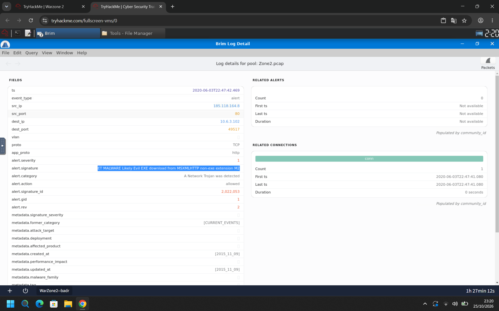
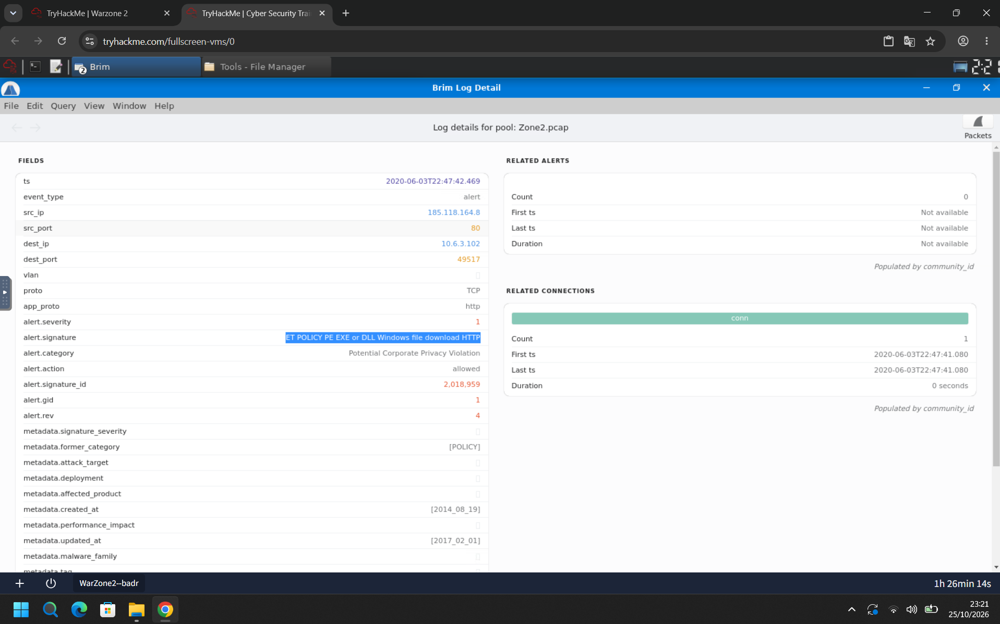
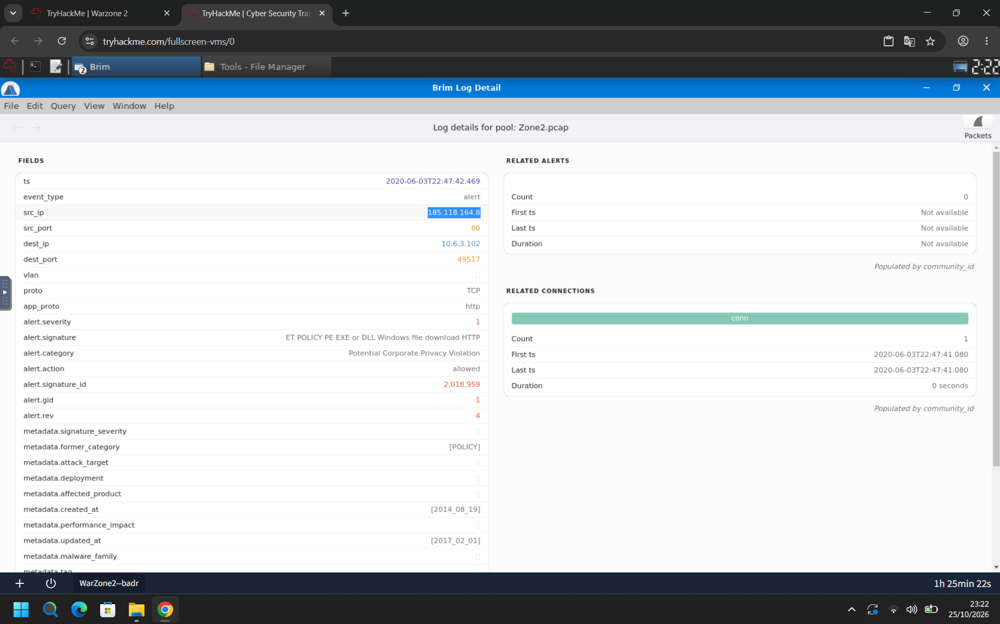
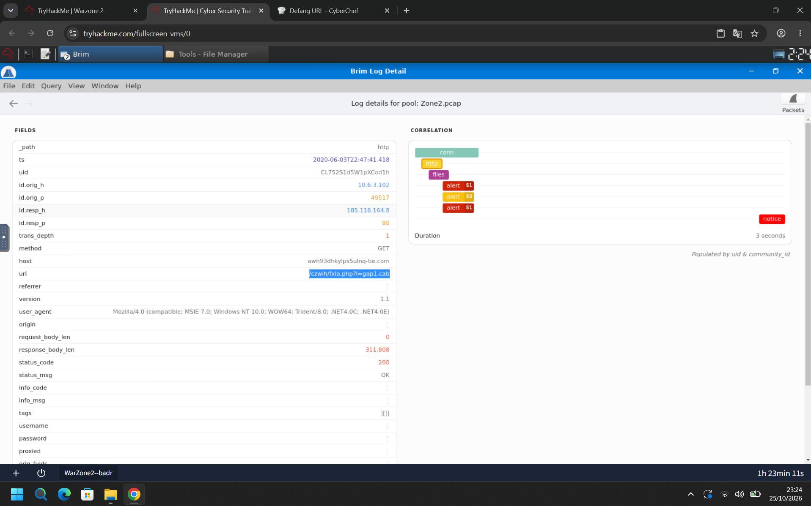
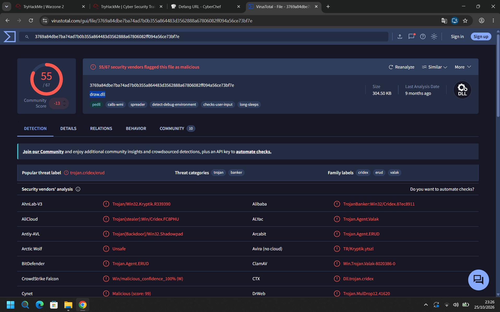
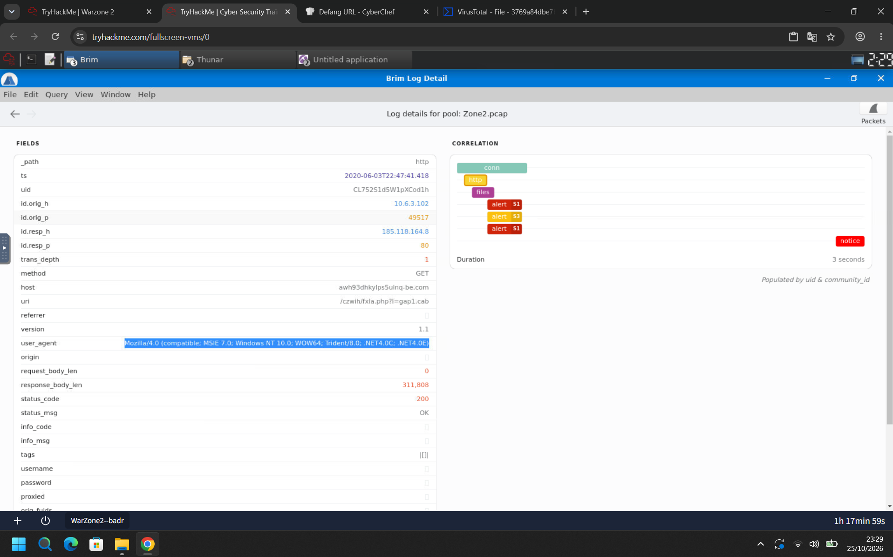
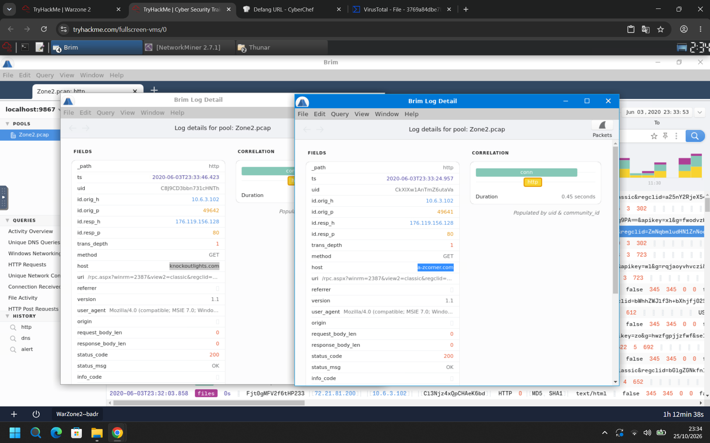
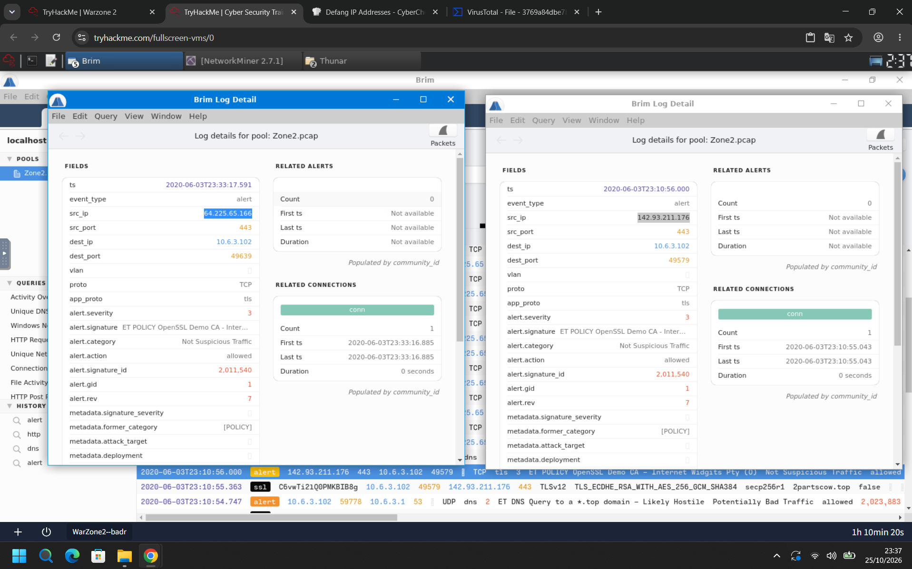
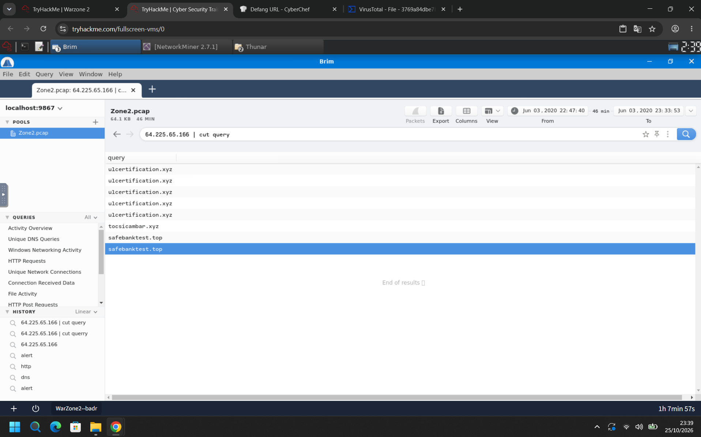
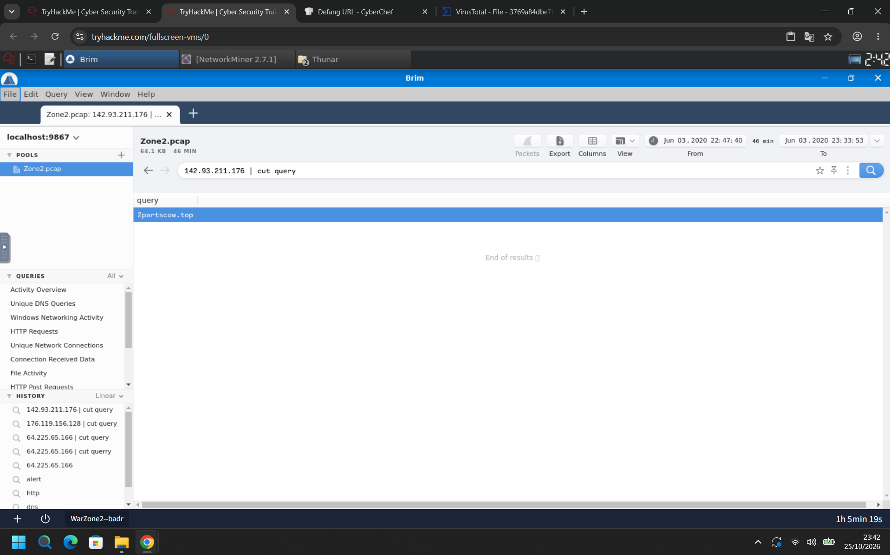

# TryHackMe – Warzone 2 (Writeup)

**Room:** https://tryhackme.com/room/warzonetwo
**Categoria:** Análise de tráfego de rede / Detecção de alertas (Suricata + Zeek)
**Cenário:** Como analista SOC, o objetivo é investigar um arquivo de captura (`Zone2.pcap`) com o **Brim** (Zui), correlacionar os alertas do Suricata com os logs do Zeek, identificar o download malicioso e checar os indicadores no **VirusTotal**.

**Evidência:** `Zone2.pcap` (64,1 KB, 46 minutos, de 03/06/2020 22:47:40 até 23:33:53)
**Host da vítima:** `10.6.3.102`
**Ferramentas:** Brim (consultas `alert`, `http`, `dns`), NetworkMiner 2.7.1, Thunar, CyberChef (Defang URL / IP Addresses) e VirusTotal

---

## Resumo das respostas

| # | Pergunta | Resposta |
|---|----------|----------|
| 1 | Assinatura do alerta "A Network Trojan was Detected" | `ET MALWARE Likely Evil EXE download from MSXMLHTTP non-exe extension M2` |
| 2 | Assinatura do alerta "Potential Corporate Privacy Violation" | `ET POLICY PE EXE or DLL Windows file download HTTP` |
| 3 | IP que disparou os alertas (defanged) | `185[.]118[.]164[.]8` |
| 4 | URI completa do arquivo malicioso (defanged) | `awh93dhkylps5ulnq-be[.]com/czwih/fxla[.]php?l=gap1[.]cab` |
| 5 | Payload dentro do arquivo `.cab` | `draw.dll` |
| 6 | User-Agent do tráfego | `Mozilla/4.0 (compatible; MSIE 7.0; Windows NT 10.0; WOW64; Trident/8.0; .NET4.0C; .NET4.0E)` |
| 7 | Outros domínios maliciosos no tráfego (defanged, em ordem alfabética) | `a-zcorner[.]com,knockoutlights[.]com` |
| 8 | IPs marcados como "Not Suspicious Traffic" (defanged, em ordem numérica) | `64[.]225[.]65[.]166,142[.]93[.]211[.]176` |
| 9 | Domínios associados ao primeiro IP (defanged, em ordem alfabética) | `safebanktest[.]top,tocsicambar[.]xyz,ulcertification[.]xyz` |
| 10 | Domínio associado ao segundo IP (defanged) | `2partscow[.]top` |

---

## Task 1 – Assinatura do alerta "A Network Trojan was Detected"

### Metodologia

1. Importei o `Zone2.pcap` no Brim e consultei os alertas do Suricata com a query `alert`.
2. Abri o evento cuja categoria é **`A Network Trojan was detected`**. Detalhes do alerta (`ts` 2020-06-03T22:47:42.469):

| Campo | Valor |
|-------|-------|
| `alert.signature` | **ET MALWARE Likely Evil EXE download from MSXMLHTTP non-exe extension M2** |
| `alert.category` | A Network Trojan was detected |
| `alert.severity` | 1 |
| `alert.signature_id` | 2,022,053 |
| `alert.action` | allowed |
| `metadata.former_category` | CURRENT_EVENTS |
| `src_ip` : `src_port` | `185.118.164.8` : `80` |
| `dest_ip` : `dest_port` | `10.6.3.102` : `49517` |
| `app_proto` | http |

3. A assinatura descreve um **executável (EXE/DLL) baixado por MSXMLHTTP com uma extensão que não é de executável**. Isso combina com o `.cab` que será analisado nas Tasks 4 e 5.



**Resposta:** `ET MALWARE Likely Evil EXE download from MSXMLHTTP non-exe extension M2`

---

## Task 2 – Assinatura do alerta "Potential Corporate Privacy Violation"

### Metodologia

1. No mesmo conjunto de alertas, abri o evento da categoria **`Potential Corporate Privacy Violation`** (mesmo `ts` 2020-06-03T22:47:42.469 e mesma conexão):

| Campo | Valor |
|-------|-------|
| `alert.signature` | **ET POLICY PE EXE or DLL Windows file download HTTP** |
| `alert.category` | Potential Corporate Privacy Violation |
| `alert.severity` | 1 |
| `alert.signature_id` | 2,018,959 |
| `alert.action` | allowed |
| `metadata.former_category` | POLICY |
| `src_ip` / `dest_ip` | `185.118.164.8` / `10.6.3.102` |

2. A conexão relacionada (`conn`) começa em **22:47:41.080**, sem outros alertas relacionados. Os dois alertas apontam para o **mesmo download**.



**Resposta:** `ET POLICY PE EXE or DLL Windows file download HTTP`

---

## Task 3 – IP que disparou os alertas

**Pergunta:** *What was the IP to trigger either alert?* (defanged)
**Evidência:** `IP_Target_Alarm.png`

### Metodologia

1. Nos dois alertas, o `src_ip` é o servidor remoto **`185.118.164.8`** (porta 80), e o destino é a máquina interna `10.6.3.102`.
2. Com o **CyberChef** (receita *Defang IP Addresses*), o IP fica com os pontos entre colchetes.



**Resposta:** `185[.]118[.]164[.]8`

---

## Task 4 – URI completa do arquivo malicioso

### Metodologia

1. Na query `http` do Brim, abri a requisição HTTP da conexão suspeita (`ts` 2020-06-03T22:47:41.418):

| Campo | Valor |
|-------|-------|
| `id.orig_h` : `id.orig_p` | `10.6.3.102` : `49517` |
| `id.resp_h` : `id.resp_p` | `185.118.164.8` : `80` |
| `method` | GET |
| **`host`** | **`awh93dhkylps5ulnq-be.com`** |
| **`uri`** | **`/czwih/fxla.php?l=gap1.cab`** |
| `response_body_len` | 311.808 bytes |
| `status_code` | 200 OK |

2. A aba de correlação mostra a cadeia `conn → http → files → alert (S1) → alert (S3) → alert (S1) → notice`, com duração de 3 segundos. Ela confirma que os alertas e o aviso (`notice`) pertencem a essa mesma requisição.
3. Juntei `host` + `uri` e apliquei a receita **Defang URL** do CyberChef:

```
awh93dhkylps5ulnq-be[.]com/czwih/fxla[.]php?l=gap1[.]cab
```



**Resposta:** `awh93dhkylps5ulnq-be[.]com/czwih/fxla[.]php?l=gap1[.]cab`

> Se a sala exigir o esquema na URL, a forma completa com defang é `hxxp[://]awh93dhkylps5ulnq-be[.]com/czwih/fxla[.]php?l=gap1[.]cab`.

---

## Task 5 – Payload dentro do arquivo `.cab`

### Metodologia

1. Extraí o arquivo baixado do pcap (o ambiente tem o **NetworkMiner** e o **Thunar** abertos) e calculei o hash. O hash foi pesquisado no **VirusTotal**:

```
3769a84dbe7ba74ad7b0b355a864483d3562888a67806082ff094a56ce73bf7e
```

2. Resultado no VirusTotal:

| Campo | Valor |
|-------|-------|
| **Nome do arquivo** | **`draw.dll`** |
| Detecção | **55/67** fornecedores marcaram como malicioso |
| Tipo / tamanho | DLL / 304,50 KB |
| Threat label | `trojan.cridex/erud` |
| Categorias | trojan, banker |
| Famílias | cridex, erud, valak |
| Tags | pedll, calls-wmi, spreader, detect-debug-environment, checks-user-input, long-sleeps |

3. O tamanho confere com o download: o `response_body_len` do HTTP é 311.808 bytes, que correspondem a 304,5 KiB (311.808 / 1024). Ou seja, o arquivo `gap1.cab` na verdade é uma **DLL do Windows com extensão trocada**, exatamente o que as assinaturas da Task 1 e da Task 2 apontam.



**Resposta:** `draw.dll`

---

## Task 6 – User-Agent do tráfego

### Metodologia

1. No mesmo evento HTTP da Task 4, o campo `user_agent` é:

```
Mozilla/4.0 (compatible; MSIE 7.0; Windows NT 10.0; WOW64; Trident/8.0; .NET4.0C; .NET4.0E)
```

2. Esse User-Agent de "MSIE 7.0" em um Windows 10 é típico de componentes como **MSXMLHTTP/WinINet** usados por malware, e não de um navegador moderno. Ele combina com o texto da assinatura da Task 1 ("download from MSXMLHTTP").



**Resposta:** `Mozilla/4.0 (compatible; MSIE 7.0; Windows NT 10.0; WOW64; Trident/8.0; .NET4.0C; .NET4.0E)`

---

## Task 7 – Outros domínios maliciosos no tráfego

### Metodologia

1. Voltei à query `http` e procurei por outras requisições HTTP do host `10.6.3.102`. Duas se destacam, ambas para o IP `176.119.156.128`, porta 80, no fim da captura:

| `ts` | Host | Porta de origem | URI | Status |
|------|------|-----------------|-----|--------|
| 2020-06-03T23:33:24.957 | **`a-zcorner.com`** | 49641 | `/rpc.aspx?winrm=2387&view2=classic&regclid=...` | 200 |
| 2020-06-03T23:33:46.423 | **`knockoutlights.com`** | 49642 | `/rpc.aspx?winrm=2387&view2=classic&regclid=...` | 200 |

2. As duas requisições usam o mesmo padrão de URI (`/rpc.aspx?winrm=...&regclid=...`), o mesmo IP de destino e o User-Agent `MSIE 7.0`. Isso indica comunicação de C2 (comando e controle) do mesmo malware.
3. Em ordem alfabética e com defang: `a-zcorner[.]com` vem antes de `knockoutlights[.]com`.



**Resposta:** `a-zcorner[.]com,knockoutlights[.]com`

> Os prints não mostram a consulta desses dois domínios no VirusTotal. A classificação como maliciosos vem do enunciado da sala e do padrão de C2 acima.

---

## Task 8 – IPs marcados como "Not Suspicious Traffic"

### Metodologia

1. Na query `alert`, filtrei os alertas com categoria **`Not Suspicious Traffic`**. Há dois, com a mesma assinatura:

| Campo | Alerta 1 | Alerta 2 |
|-------|----------|----------|
| `ts` | 2020-06-03T23:33:17.591 | 2020-06-03T23:10:56.000 |
| **`src_ip`** | **`64.225.65.166`** | **`142.93.211.176`** |
| `src_port` → `dest_port` | 443 → 49639 | 443 → 49579 |
| `dest_ip` | `10.6.3.102` | `10.6.3.102` |
| `app_proto` | tls | tls |
| `alert.signature` | ET POLICY OpenSSL Demo CA - Internet Widgits Pty (Ltd) | (igual) |
| `alert.severity` | 3 | 3 |
| `alert.signature_id` | 2,011,540 | 2,011,540 |

2. A assinatura indica um certificado TLS **autoassinado de demonstração do OpenSSL** ("Internet Widgits Pty Ltd"), comum em infraestrutura improvisada de malware.
3. Em ordem numérica (pelo primeiro octeto): `64.225.65.166` vem antes de `142.93.211.176`.



**Resposta:** `64[.]225[.]65[.]166,142[.]93[.]211[.]176`

---

## Task 9 – Domínios associados ao primeiro IP

### Metodologia

1. No Brim, usei a query:

```
64.225.65.166 | cut query
```

2. O retorno lista as consultas DNS cujas respostas apontam para esse IP:

| `query` | Ocorrências |
|---------|-------------|
| `ulcertification.xyz` | 5 |
| `tocsicambar.xyz` | 1 |
| `safebanktest.top` | 2 |

3. Em ordem alfabética e com defang: `safebanktest[.]top`, `tocsicambar[.]xyz`, `ulcertification[.]xyz`.



**Resposta:** `safebanktest[.]top,tocsicambar[.]xyz,ulcertification[.]xyz`

> O nome do arquivo de evidência diz "IP_172", mas o print mostra a consulta feita com o IP `64.225.65.166`.

---

## Task 10 – Domínio associado ao segundo IP

### Metodologia

1. Repeti a consulta com o segundo IP:

```
142.93.211.176 | cut query
```

2. O retorno é um único domínio: **`2partscow.top`**.
3. Isso é corroborado por outros registros da captura:
   - **23:10:54.747**: alerta de DNS (`10.6.3.102` → `10.6.3.1:53`) com a assinatura *ET DNS Query to a \*.top domain - Likely Hostile*.
   - **23:10:55.363**: registro `ssl` de `10.6.3.102:49579` para `142.93.211.176:443`, com o `server_name` `2partscow.top` (TLSv1.2, `TLS_ECDHE_RSA_WITH_AES_256_GCM_SHA384`).



**Resposta:** `2partscow[.]top`

> O nome do arquivo de evidência diz "IP_172", mas o print mostra a consulta feita com o IP `142.93.211.176`.

---

## Linha do tempo

Horários em UTC, em **03/06/2020**, com a vítima `10.6.3.102`.

| Horário | Evento |
|---------|--------|
| 22:47:41.080 | Conexão TCP `10.6.3.102:49517` → `185.118.164.8:80` |
| 22:47:41.418 | `GET awh93dhkylps5ulnq-be.com/czwih/fxla.php?l=gap1.cab` (200 OK, 311.808 bytes, User-Agent MSIE 7.0) |
| 22:47:42.469 | Alertas Suricata: *ET MALWARE Likely Evil EXE download...* e *ET POLICY PE EXE or DLL...* |
| 23:10:54.747 | Consulta DNS a um domínio `*.top` (alerta *Likely Hostile*) |
| 23:10:55–56 | Conexão TLS com `142.93.211.176:443` (`2partscow.top`), alerta *OpenSSL Demo CA* |
| 23:33:17.591 | Alerta *OpenSSL Demo CA* com `64.225.65.166:443` |
| 23:33:24.957 | `GET a-zcorner.com/rpc.aspx?winrm=2387&...` para `176.119.156.128` |
| 23:33:46.423 | `GET knockoutlights.com/rpc.aspx?winrm=2387&...` para `176.119.156.128` |

```
10.6.3.102 ──HTTP GET gap1.cab──► awh93dhkylps5ulnq-be[.]com (185[.]118[.]164[.]8)
     │                                 (DLL disfarçada: draw.dll, Cridex/Valak)
     ├──TLS (cert. OpenSSL Demo CA)──► 2partscow[.]top (142[.]93[.]211[.]176)
     ├──TLS (cert. OpenSSL Demo CA)──► safebanktest[.]top / tocsicambar[.]xyz / ulcertification[.]xyz (64[.]225[.]65[.]166)
     └──HTTP /rpc.aspx ─────────────► a-zcorner[.]com / knockoutlights[.]com (176[.]119[.]156[.]128)
```

---

## Mapeamento MITRE ATT&CK

| Tática | Técnica | ID | Evidência |
|--------|---------|----|-----------|
| Command and Control | Ingress Tool Transfer | T1105 | Download da DLL `draw.dll` via `gap1.cab` |
| Defense Evasion | Masquerading: Masquerade File Type | T1036.008 | DLL com extensão `.cab` |
| Command and Control | Application Layer Protocol: Web Protocols | T1071.001 | HTTP com User-Agent MSIE 7.0 e `/rpc.aspx` |
| Command and Control | Encrypted Channel | T1573 | TLS com certificados autoassinados (OpenSSL Demo CA) |

---

## Indicadores de comprometimento (IOCs)

| Tipo | Valor |
|------|-------|
| Host da vítima | `10.6.3.102` |
| IP do download | `185[.]118[.]164[.]8` |
| Domínio do download | `awh93dhkylps5ulnq-be[.]com` |
| URI | `/czwih/fxla[.]php?l=gap1[.]cab` |
| Payload | `draw.dll` (SHA-256 `3769a84dbe7ba74ad7b0b355a864483d3562888a67806082ff094a56ce73bf7e`) |
| VirusTotal | 55/67; `trojan.cridex/erud`; famílias cridex, erud, valak |
| User-Agent | `Mozilla/4.0 (compatible; MSIE 7.0; Windows NT 10.0; WOW64; Trident/8.0; .NET4.0C; .NET4.0E)` |
| IPs TLS (OpenSSL Demo CA) | `64[.]225[.]65[.]166`, `142[.]93[.]211[.]176` |
| Domínios (64[.]225[.]65[.]166) | `safebanktest[.]top`, `tocsicambar[.]xyz`, `ulcertification[.]xyz` |
| Domínio (142[.]93[.]211[.]176) | `2partscow[.]top` |
| IP e domínios de C2 | `176[.]119[.]156[.]128`: `a-zcorner[.]com`, `knockoutlights[.]com` |

---

## Ferramentas utilizadas

- Brim (Zui) com Zeek + Suricata para os logs e alertas do `Zone2.pcap`
- NetworkMiner e Thunar para extrair e inspecionar o arquivo baixado
- CyberChef (Defang URL / Defang IP Addresses)
- VirusTotal para a reputação do arquivo (`draw.dll`)

---