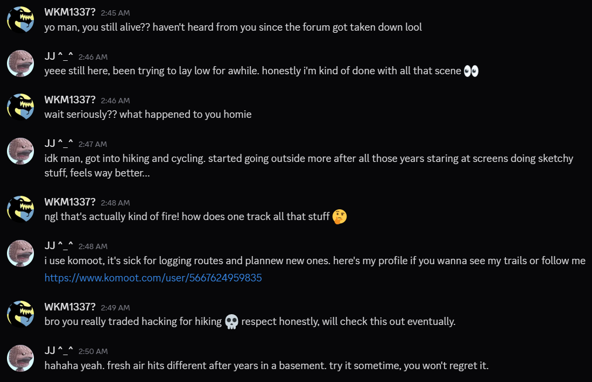
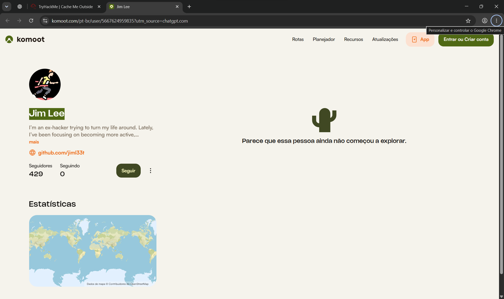
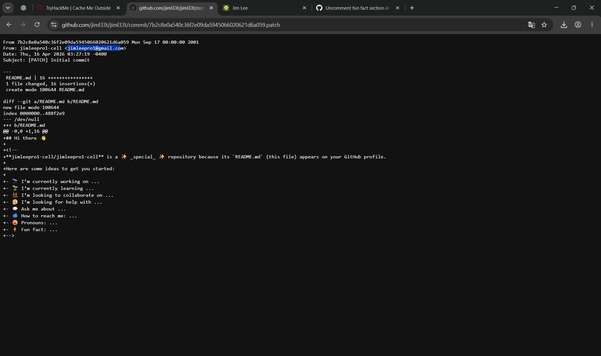
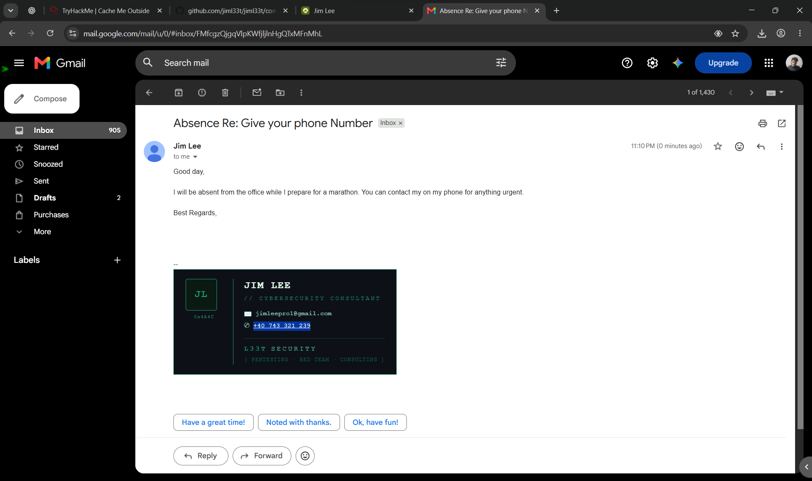
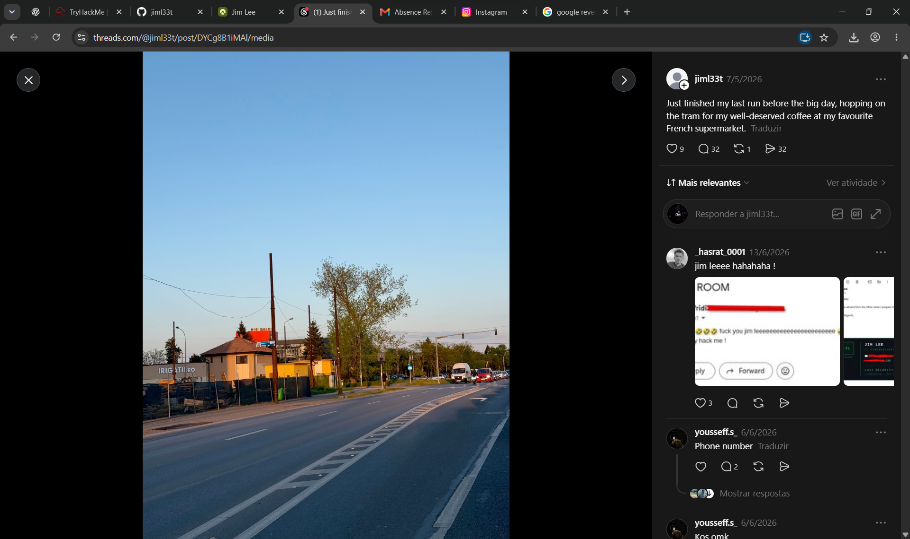
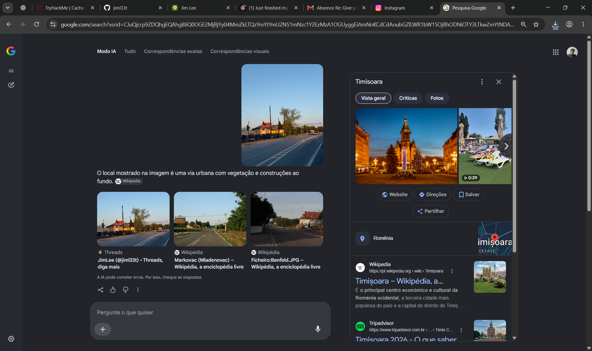
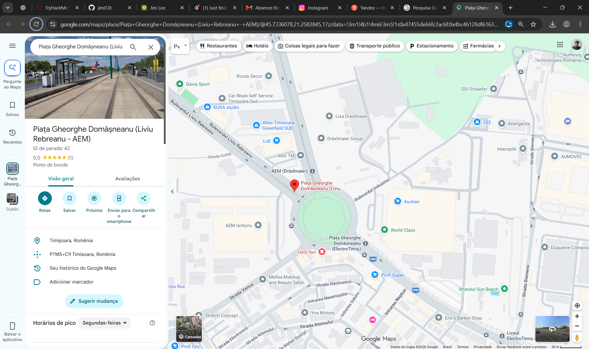

# Writeup — Cache me Outside (TryHackMe)

| Campo | Informação |
|---|---|
| **Sala** | [Cache me Outside](https://tryhackme.com/room/cachemeoutside) |
| **Categoria** | OSINT |
| **Alvo** | "JJ ^_^" / "WKM1337?" — ex-hacker tentando desaparecer da cena |
| **Autor** | Mauricio Robert — CypherBaron |
| **Data da investigação** | Novembro/2026 |

---

## 1. Contexto da investigação

O ponto de partida é uma conversa de Discord entre dois usuários, **WKM1337?** e **JJ ^_^**, na qual WKM1337 pergunta se JJ ainda está vivo, já que não tinha notícias dele desde que o fórum (hacker) em que participavam saiu do ar. JJ responde que está "meio de boa", mas que largou a cena, passou a praticar *hiking* e *cycling*, e compartilha seu perfil no **Komoot** (aplicativo de rastreamento de rotas) para provar que mudou de vida:



```
WKM1337?: yo man, you still alive?? haven't heard from you since the forum got taken down lool
JJ ^_^:   yeee still here, been trying to lay low for awhile. Honestly i'm kind of done with all that scene 👀
JJ ^_^:   idk man, got into hiking and cycling. started going outside more after all those years staring
          at screens doing sketchy stuff, feels way better...
JJ ^_^:   i use komoot, it's sick for logging routes and planning new ones. here's my profile if you wanna
          see my trails or follow me
          https://www.komoot.com/user/5667624959835
```

A partir desse único link, foi possível puxar o fio e reconstruir a identidade completa de "JJ", incluindo e-mail, telefone, cidade e, por fim, a estação de bonde exata onde ele foi fotografado em uma de suas rotas.

---

## 2. Ferramentas utilizadas

| Ferramenta | Finalidade |
|---|---|
| Komoot (perfil público) | Ponto de pivô inicial — nome de exibição e link para o GitHub |
| GitHub (histórico de commits / `.patch`) | Exposição do e-mail real do autor em metadado de commit |
| Gmail (busca por nome) | E-mail de "ausência automática" contendo telefone e assinatura profissional |
| Threads (@jiml33t) | Post com foto de rua/trilho de bonde usada como trilha de pistas visuais |
| Google Pesquisa / Lens (busca reversa de imagem) | Identificação da cidade (Timișoara, Romênia) a partir da foto |
| Google Maps / Street View | Geolocalização exata da parada de bonde reproduzindo o ângulo da foto |

---

## 3. Respostas das perguntas

### Pergunta 1 — Nome completo do hacker aposentado

O perfil do Komoot, acessado pelo link compartilhado no Discord, exibe publicamente o nome de exibição do usuário e, na biografia, a confissão de que é um "ex-hacker" em processo de mudança de vida, além do link para seu GitHub (`github.com/jiml33t`):



```
Nome:   Jim Lee
Bio:    "I'm an ex-hacker trying to turn my life around. Lately, I've been focusing on becoming more active,..."
GitHub: github.com/jiml33t
Seguidores: 429 · Seguindo: 0
```

> **Resposta:** `Jim Lee`

---

### Pergunta 2 — Endereço de e-mail exposto acidentalmente

Seguindo o link do GitHub (`github.com/jiml33t`) presente na bio do Komoot, foi localizado o repositório especial de perfil `jiml33t/jiml33t`. Ao inspecionar o histórico do primeiro commit em formato `.patch` (`.../commit/<hash>.patch`), o cabeçalho Git expõe o nome e e-mail reais configurados localmente pelo autor no momento do commit — informação que normalmente não aparece na interface web do GitHub, mas que fica gravada permanentemente nos metadados do commit:



```
From 7b2c8e0a540c36f2e09da5945066020621d6a059 Mon Sep 17 00:00:00 2001
From: jimleepro1-cell <jimleepro1@gmail.com>
Date: Thu, 16 Apr 2026 03:27:19 -0400
Subject: [PATCH] Initial commit
```

> **Resposta:** `jimleepro1@gmail.com`

---

### Pergunta 3 — Número de telefone

Com o e-mail em mãos, uma busca pelo nome "Jim Lee" na caixa de entrada do Gmail (sessão já autenticada do investigador) localiza um e-mail de resposta automática de ausência ("Absence Re: Give your phone Number"), enviado pelo próprio Jim Lee, avisando que estaria ausente do escritório para se preparar para uma maratona. A assinatura do e-mail — um cartão de visita digital de "L33T SECURITY" — expõe seu e-mail profissional e número de telefone:



```
JIM LEE
// CYBERSECURITY CONSULTANT
✉ jimleepro1@gmail.com
☎ +40 743 321 239

L33T SECURITY
[ PENTESTING · RED TEAM · CONSULTING ]
```

> **Resposta:** `+40 743 321 239`

---

### Pergunta 4 — Cidade onde ele está localizado

O mesmo e-mail menciona que Jim está se preparando para uma maratona, e o DDI do telefone (`+40`) já aponta para a **Romênia**. Para confirmar a cidade exata, foi localizado o perfil do Threads vinculado (`@jiml33t`), onde um post datado de 5 de julho de 2026 relata: *"Just finished my last run before the big day, hopping on the tram for my well-deserved coffee at my favourite French supermarket"*, acompanhado de uma foto de uma via com trilhos de bonde:



Submetendo essa foto a uma busca reversa de imagem (Google Pesquisa / Lens), o resultado aponta correspondências visuais e de contexto para **Timișoara**, na Romênia — cidade compatível com o DDI `+40` e com a presença de linhas de bonde (tram), meio de transporte citado no post:



> **Resposta:** `Timișoara, Romênia`

---

### Pergunta 5 — Nome da estação de bonde onde ele desceu em 7 de maio de 2026

Usando a foto do post do Threads como referência visual (trilhos de bonde, poste e fiação característicos, vegetação rasteira e prédio ao fundo) e cruzando com a menção a um **"French supermarket"** nas proximidades — pista que aponta para a rede francesa **Auchan**, presente em Timișoara — a busca no Google Maps pela região da zona de bondes próxima a um Auchan localizou a parada que reproduz exatamente o ângulo e os elementos da fotografia:



```
Nome:        Piața Gheorghe Domășneanu (Liviu Rebreanu - AEM)
ID de parada: 42
Localização: Timișoara, Romênia
Pontos próximos: Auchan, Lidl, AEM (Drăxlmaier) — compatível com a rota de bicicleta/corrida
                 mencionada no Komoot e com o "French supermarket" (Auchan) citado no post
```

A imagem da Street View do Google Maps para esse ponto bate com a foto original do Threads: mesma via asfaltada com trilhos ao centro, mesmo ângulo de poste/fiação à esquerda e vegetação baixa à beira da pista.

> **Resposta:** `Piața Gheorghe Domășneanu (Liviu Rebreanu - AEM)`

---

## 4. Cadeia de investigação (fio da meada OSINT)

```
┌────────────────────────────────────────────────────────────────────────────┐
│ 1. Discord — conversa JJ ^_^ / WKM1337?                                     │
│    → link público do perfil Komoot                                         │
└────────────────────────────────────────────────────────────────────────────┘
                                   │
                                   ▼
┌────────────────────────────────────────────────────────────────────────────┐
│ 2. Komoot — nome de exibição "Jim Lee" + bio "ex-hacker"                     │
│    → link para github.com/jiml33t                                           │
└────────────────────────────────────────────────────────────────────────────┘
                                   │
                                   ▼
┌────────────────────────────────────────────────────────────────────────────┐
│ 3. GitHub (jiml33t/jiml33t) — commit .patch                                 │
│    → e-mail real exposto no metadado Git: jimleepro1@gmail.com              │
└────────────────────────────────────────────────────────────────────────────┘
                                   │
                                   ▼
┌────────────────────────────────────────────────────────────────────────────┐
│ 4. Gmail — busca por "Jim Lee" / e-mail de ausência automática              │
│    → assinatura profissional "L33T SECURITY": telefone +40 743 321 239     │
└────────────────────────────────────────────────────────────────────────────┘
                                   │
                                   ▼
┌────────────────────────────────────────────────────────────────────────────┐
│ 5. Threads (@jiml33t) — post com foto de via/trilho de bonde                │
│    → busca reversa de imagem: cidade = Timișoara, Romênia                   │
└────────────────────────────────────────────────────────────────────────────┘
                                   │
                                   ▼
┌────────────────────────────────────────────────────────────────────────────┐
│ 6. Google Maps / Street View — correlação visual + "French supermarket"     │
│    → Parada de bonde: Piața Gheorghe Domășneanu (Liviu Rebreanu - AEM)      │
└────────────────────────────────────────────────────────────────────────────┘
```

---

## 5. Quadro-resumo de respostas

| # | Pergunta | Resposta |
|---|---|---|
| 1 | Nome completo do hacker aposentado | `Jim Lee` |
| 2 | E-mail exposto acidentalmente | `jimleepro1@gmail.com` |
| 3 | Número de telefone | `+40 743 321 239` |
| 4 | Cidade onde está localizado | `Timișoara, Romênia` |
| 5 | Estação de bonde (7/05/2026) | `Piața Gheorghe Domășneanu (Liviu Rebreanu - AEM)` |

---

## 6. Referências

- [TryHackMe — Cache me Outside](https://tryhackme.com/room/cachemeoutside)
- [Komoot](https://www.komoot.com/)
- [GitHub — Special README Profile Repositories](https://docs.github.com/en/account-and-profile/setting-up-and-managing-your-github-profile/customizing-your-profile/managing-your-profile-readme)
- [Google Imagens — Pesquisa reversa de imagem](https://images.google.com/)

---