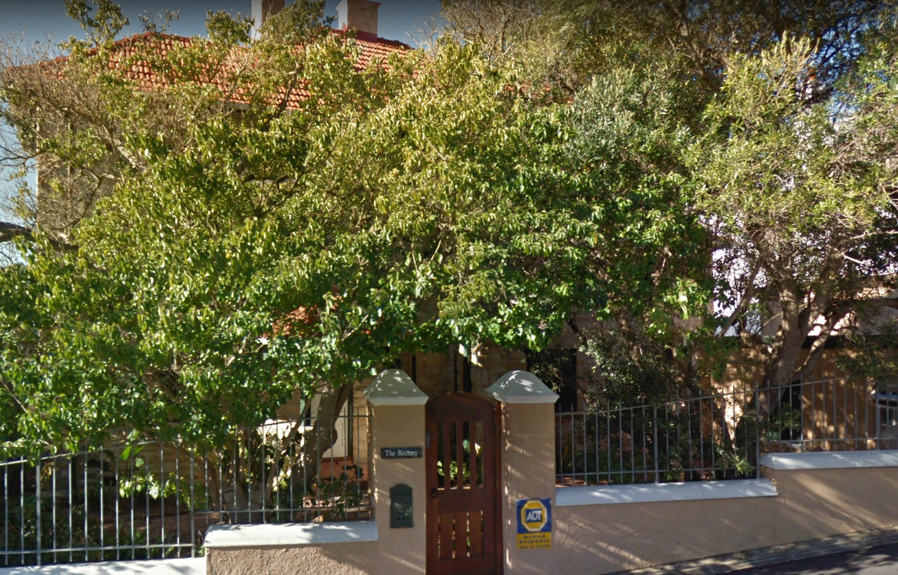
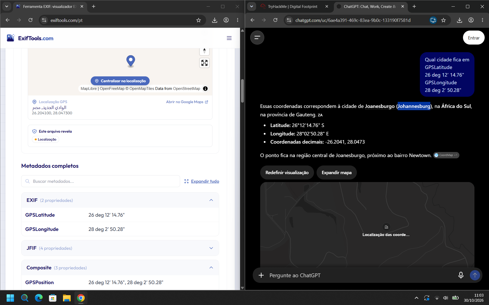
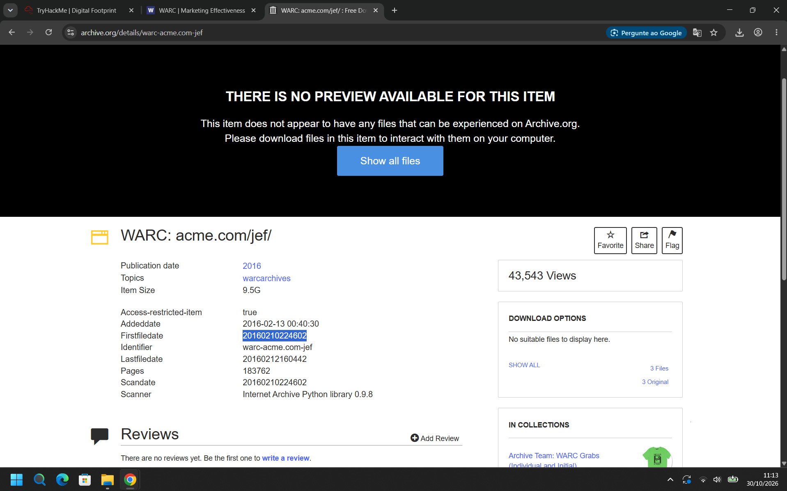
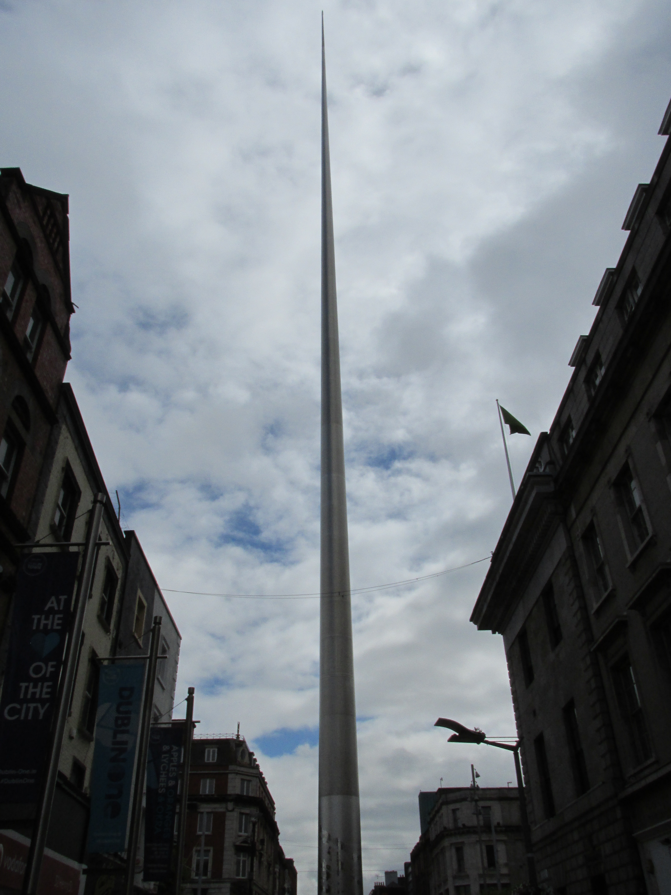
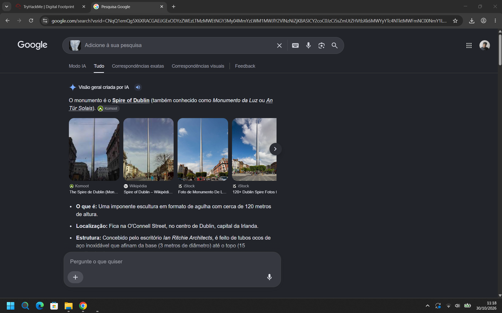
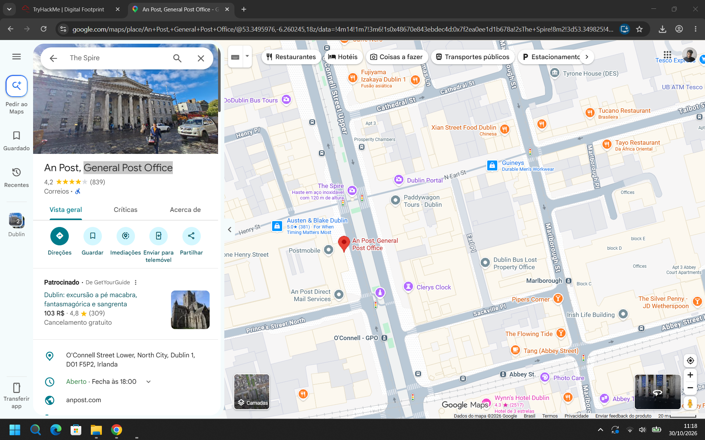
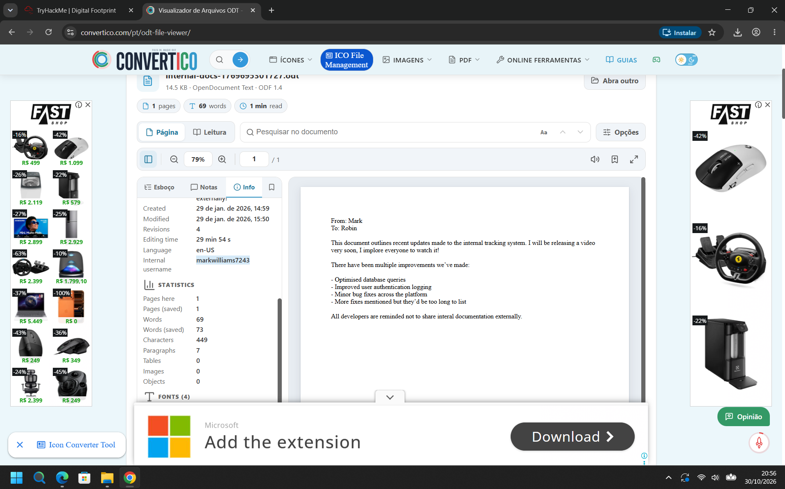
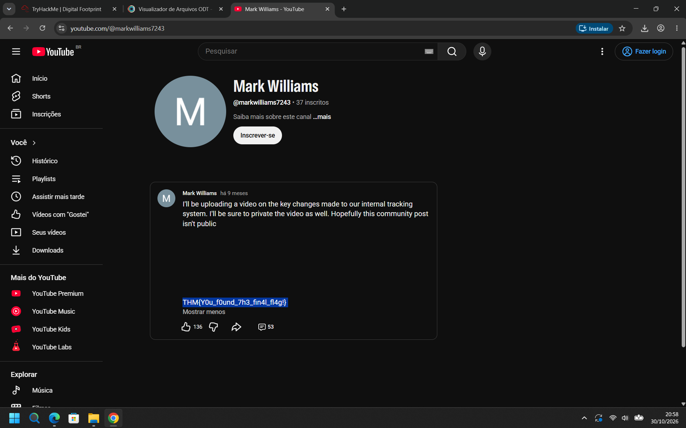

# TryHackMe – Digital Footprint (Writeup)

**Room:** https://tryhackme.com/room/osintchallengeiv
**Categoria:** OSINT (Open Source Intelligence)
**Cenário:** Um desafio OSINT em quatro tarefas que parte de imagens e documentos e segue as pegadas digitais deixadas por uma pessoa: metadados de foto, arquivos web arquivados, busca reversa de imagem e metadados de documento até chegar a um perfil público e à flag final.

---

## Nota sobre as perguntas

Nesta conversa não chegaram os enunciados das tasks, só o link da sala e os prints, que são nomeados por task (`Task_1_*`, `Task_2_*`, e assim por diante). Por isso:

- As perguntas abaixo estão marcadas como **(inferida)** e foram deduzidas do que cada print mostra.
- As respostas são o que aparece **destacado ou selecionado** nos prints.
- Confira cada resposta contra o enunciado original antes de enviar na sala.

---

## Resumo das respostas

| Task | Pergunta (inferida) | Resposta |
|------|---------------------|----------|
| 1 | Em que cidade a foto foi tirada? | `Johannesburg` (África do Sul) |
| 2 | Qual a data/hora do primeiro arquivo do WARC `acme.com/jef/` no Archive.org? | `20160210224602` |
| 3 | Qual é o edifício (correios) perto do monumento da foto? | `General Post Office` (Dublin, Irlanda) |
| 4 | Nome de usuário interno que aparece no documento | `markwilliams7243` |
| 4 | Flag final | `THM{Y0u_f0und_7h3_fin4l_fl4g!}` |

---

## Task 1 – Localização da foto (EXIF)

### A imagem

A foto mostra uma casa com telhado de telhas vermelhas escondida por árvores, com um muro baixo e um portão de madeira. Na coluna do portão há uma placa escrita **"The Rectory"** e, na parede, um adesivo **"ADT Armed Response"** (empresa de segurança de resposta armada, comum na África do Sul). As pistas visuais sozinhas não bastam, então o caminho é pelos **metadados**.



### Metodologia

1. Enviei o arquivo para o **ExifTools.com**. Na seção **EXIF (2 propriedades)** há só os dados de GPS:

| Propriedade | Valor |
|-------------|-------|
| `GPSLatitude` | 26 deg 12' 14.76" |
| `GPSLongitude` | 28 deg 2' 50.28" |
| `GPSPosition` (Composite) | 26 deg 12' 14.76", 28 deg 2' 50.28" |

2. Convertendo para graus decimais:
   - Latitude: 26 + 12/60 + 14,76/3600 = **26,2041**
   - Longitude: 28 + 2/60 + 50,28/3600 = **28,0473**
3. Perguntei a um assistente de IA qual cidade fica nessas coordenadas. A resposta: **Joanesburgo (Johannesburg)**, província de Gauteng, África do Sul (`-26.2041, 28.0473`), na região central, perto do bairro Newtown.

### Atenção ao hemisfério

Os metadados **não trazem a referência de hemisfério** (`GPSLatitudeRef` e `GPSLongitudeRef`). Por isso o ExifTools, que assume Norte/Leste, mostrou a "Localização GPS" como **Egito (região de Al Wadi Al Jadid)**, no ponto `26.2041, 28.0473`. Com o hemisfério **Sul** (latitude negativa), as coordenadas caem em Joanesburgo. O adesivo da empresa de segurança, comum na África do Sul, reforça essa leitura. Vale confirmar a posição em um mapa, e não só na IA.



**Resposta:** `Johannesburg`

---

## Task 2 – Arquivo WARC no Internet Archive

### Metodologia

1. No **Archive.org**, abri o item **"WARC: acme.com/jef/"** (`archive.org/details/warc-acme.com-jef`), um arquivo WARC (captura de site) de 2016.
2. Metadados do item:

| Campo | Valor |
|-------|-------|
| Publication date | 2016 |
| Topics | warcarchives |
| Item Size | 9,5 GB |
| Access-restricted-item | true |
| Addeddate | 2016-02-13 00:40:30 |
| **Firstfiledate** | **`20160210224602`** (destacado) |
| Identifier | `warc-acme.com-jef` |
| Lastfiledate | 20160212160442 |
| Pages | 183762 |
| Scandate | 20160210224602 |
| Scanner | Internet Archive Python library 0.9.8 |
| Visualizações | 43.543 |

3. O valor destacado foi o **`Firstfiledate`**, no formato `AAAAMMDDhhmmss`, ou seja, **10/02/2016 às 22:46:02**. Ele coincide com o `Scandate`.
4. O item não tem prévia disponível ("There is no preview available for this item"), então o conteúdo do WARC não pôde ser visto no navegador. Só os metadados estão acessíveis.



**Resposta:** `20160210224602`

---

## Task 3 – Geolocalização por busca reversa de imagem

### A imagem



### Metodologia


1. A imagem da tarefa é uma foto, tirada de baixo para cima, de uma **agulha de aço muito alta e fina** no meio de uma rua entre prédios históricos, com uma bandeira ao fundo e um banner com o texto "Dublin One".
2. Fiz uma **busca reversa de imagem** no Google. O resultado identifica o monumento como **The Spire of Dublin** (também chamado *Monument of Light* ou *An Túr Solais*): uma escultura em aço inoxidável de cerca de **120 metros**, na **O'Connell Street**, no centro de Dublin, Irlanda.



3. No **Google Maps**, pesquisei **"The Spire"**. Ao lado do marcador do monumento está o prédio dos correios:

| Campo | Valor |
|-------|-------|
| Nome | **An Post, General Post Office** |
| Tipo | Correios |
| Endereço | O'Connell Street Lower, North City, Dublin 1, D01 F5P2, Irlanda |
| Coordenadas (URL do Maps) | `53.3495976, -6.260245` |
| Avaliação | 4,2 (839) |
| Site | anpost.com |

4. O texto "General Post Office" foi o trecho destacado no print.



**Resposta:** `General Post Office`

---

## Task 4 – Documento ODT e flag

### 4.1 Nome de usuário interno

1. Abri o documento `internal-docs-1769695301727.odt` (14,5 KB, OpenDocument Text, ODF 1.4) em um visualizador de ODT online (Convertico).
2. O conteúdo é um memorando curto:

```
From: Mark
To: Robin

This document outlines recent updates made to the internal tracking system.
I will be releasing a video very soon, I implore everyone to watch it!

There have been multiple improvements we've made:
- Optimised database queries
- Improved user authentication logging
- Minor bug fixes across the platform
- More fixes mentioned but they'd be too long to list

All developers are reminded not to share internal documentation externally.
```

3. Na aba **Info** (metadados do documento):

| Campo | Valor |
|-------|-------|
| Created | 29 de jan. de 2026, 14:59 |
| Modified | 29 de jan. de 2026, 15:50 |
| Revisions | 4 |
| Editing time | 29 min 54 s |
| Language | en-US |
| **Internal username** | **`markwilliams7243`** (destacado) |
| Páginas / palavras | 1 / 69 |



4. O campo **"Internal username"** é uma propriedade personalizada do documento e revela o identificador do autor, ao contrário do texto, que só diz "Mark".



**Resposta:** `markwilliams7243`

### 4.2 Flag

1. Com o identificador, procurei o mesmo nome no **YouTube** e encontrei o canal **`youtube.com/@markwilliams7243`** ("Mark Williams", 37 inscritos).
2. Na aba de **postagens da comunidade** há uma publicação de "9 meses atrás" que diz:

> *"I'll be uploading a video on the key changes made to our internal tracking system. I'll be sure to private the video as well. Hopefully this community post isn't public"*

   O texto continua mais abaixo, após várias linhas em branco (a publicação aparece como expandida, com "Mostrar menos"). Ali está a flag.

**Flag:** `THM{Y0u_f0und_7h3_fin4l_fl4g!}`

---

## Cadeia de investigação

```
Foto (casa "The Rectory")
   │  ExifTools → GPSLatitude/GPSLongitude (sem referência de hemisfério)
   ▼
26,2041 / 28,0473  →  Johannesburg, África do Sul (hemisfério Sul)

Archive.org: "WARC: acme.com/jef/"
   │  metadados do item
   ▼
Firstfiledate 20160210224602

Foto de monumento (agulha de aço)
   │  busca reversa (Google)  →  The Spire of Dublin
   │  Google Maps
   ▼
An Post, General Post Office (O'Connell Street, Dublin)

Documento internal-docs-…odt
   │  aba Info → "Internal username"
   ▼
markwilliams7243  →  YouTube @markwilliams7243  →  post da comunidade  →  THM{Y0u_f0und_7h3_fin4l_fl4g!}
```

---

## Técnicas e ferramentas de OSINT

| Técnica | Ferramenta |
|---------|-----------|
| Extração de metadados EXIF (GPS) | ExifTools.com |
| Conversão e verificação de coordenadas | Assistente de IA, Google Maps (com confirmação manual) |
| Consulta de arquivos web (WARC) | Archive.org |
| Busca reversa de imagem | Google Lens / Pesquisa de imagens do Google |
| Geolocalização e pontos de interesse | Google Maps |
| Metadados de documento (propriedades personalizadas) | Visualizador de ODT (Convertico) |
| Pivô por nome de usuário em plataformas sociais | YouTube (postagens da comunidade) |

---