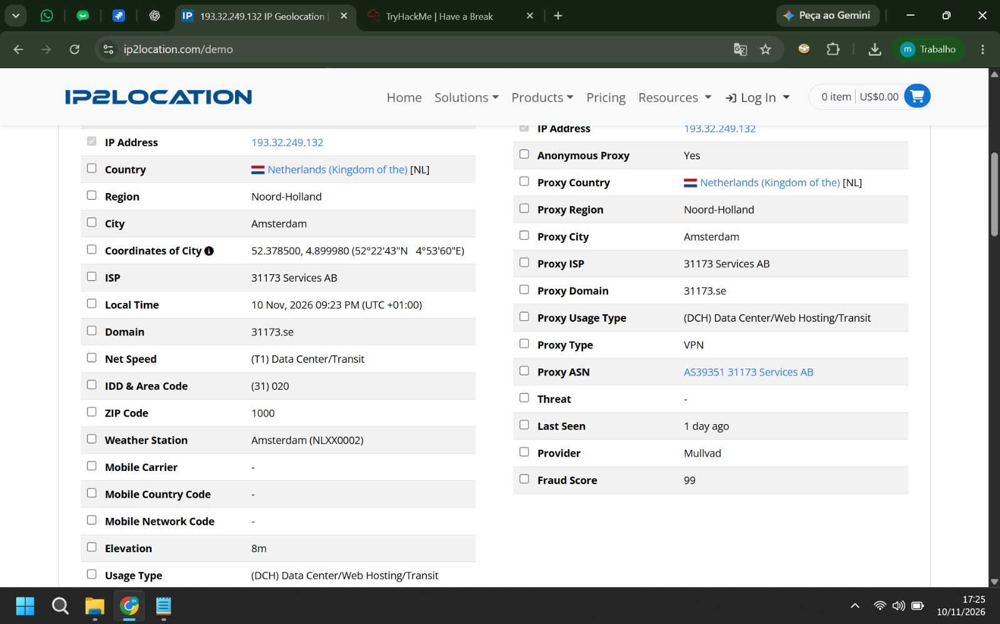
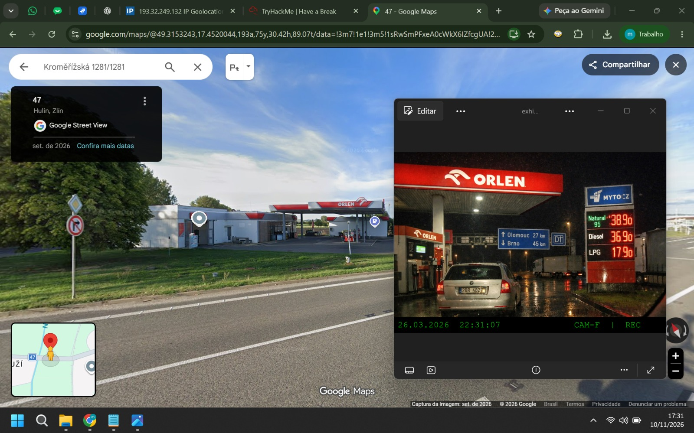
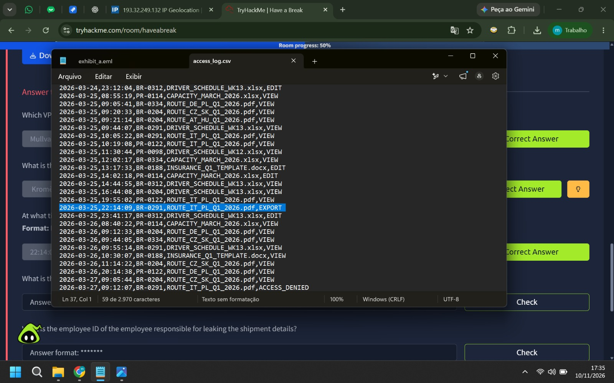
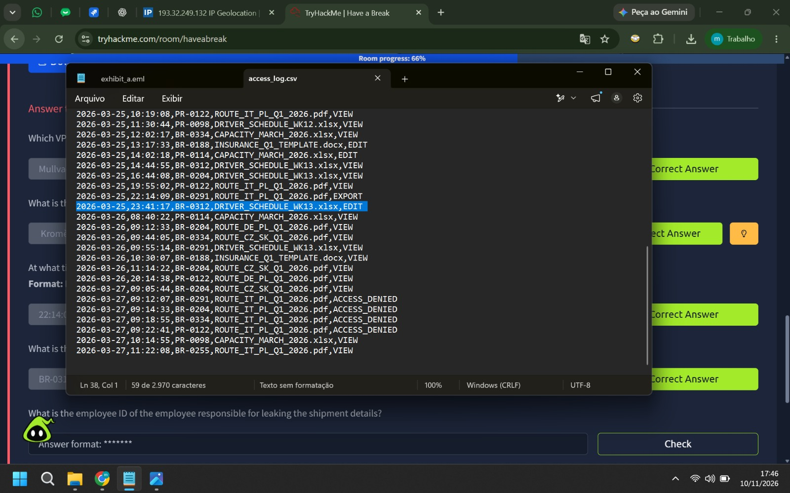
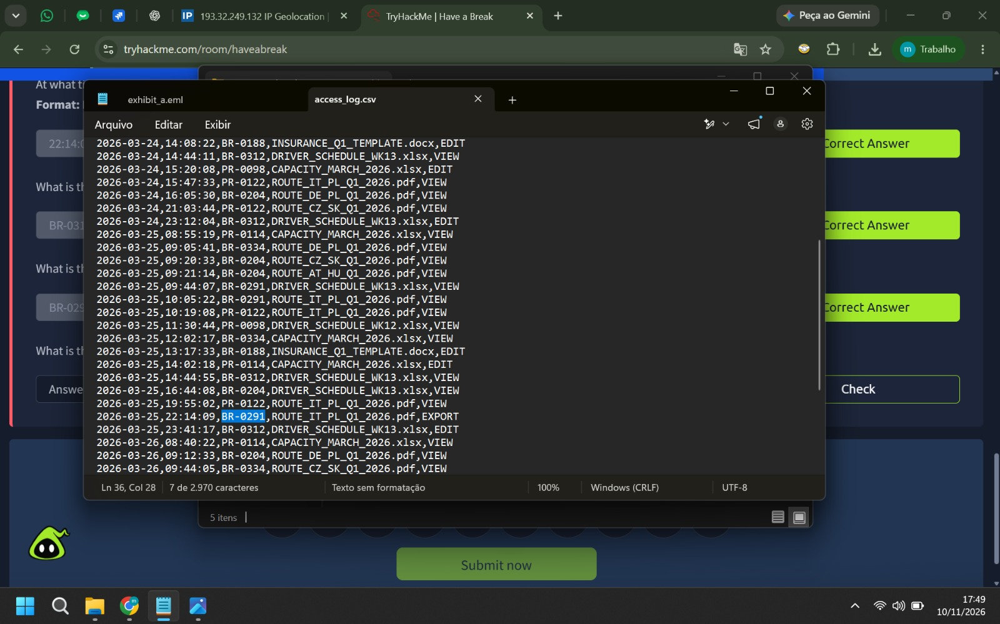
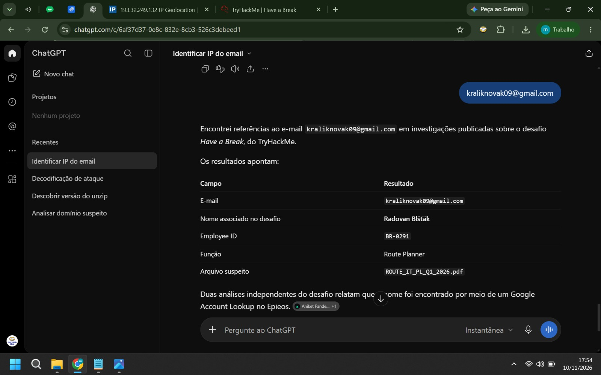

# ☕ Have a Break — CTF Writeup
### TryHackMe Room | DFIR / OSINT · Investigação de Vazamento de Dados de Logística com E-mail Anônimo, Log de Acesso e Geolocalização

---

| **Analista**          | Mauricio Robert                                                                              |
|-----------------------|----------------------------------------------------------------------------------------------|
| **Organização**       | CypherBaron                                                                           |
| **Data do Relatório** | 10/11/2026                                                                                    |
| **Data do Incidente** | 25–27/03/2026                                                                                 |
| **Classificação**     | CONFIDENCIAL                                                                                  |
| **Evidências**        | `exhibit_a.eml` (e-mail anônimo), `access_log.csv` (log do sistema de planejamento de rotas)  |
| **Ferramentas**       | Leitor de `.eml`, IP2Location, Google Maps / Street View, ChatGPT (OSINT de e-mail)           |
| **Link da sala**      | [tryhackme.com/room/haveabreak](https://tryhackme.com/room/haveabreak)                        |

---

## 🔍 Resumo Executivo

O desafio **Have a Break** (TryHackMe) simula a investigação de um **vazamento de dados de logística** em uma transportadora. Um e-mail anônimo (`exhibit_a.eml`) chega alertando sobre atividade suspeita, enviado através de uma **VPN (Mullvad)** a partir de um endereço IP em Amsterdã. A investigação cruza esse e-mail com o **log de acesso do sistema de planejamento de rotas** (`access_log.csv`), identificando uma ação anômala de **exportação (`EXPORT`)** de um arquivo de rota sensível (`ROUTE_IT_PL_Q1_2026.pdf`) fora do horário comercial, realizada pelo funcionário de ID **`BR-0291`**. A mesma rota exportada corresponde a um **veículo da empresa**, cuja última localização conhecida foi recuperada via imagem de CCTV embutida na evidência e geolocalizada com o **Google Maps/Street View** em um **posto de combustível ORLEN** na República Tcheca. Por fim, cruzando o e-mail de contato pessoal vazado na evidência com ferramentas de OSINT, a identidade real do funcionário responsável pelo vazamento foi confirmada: **Radovan Blšťák**.

---

## 🛠 Ferramentas e Evidências Utilizadas

| Evidência / Ferramenta | Finalidade |
|---|---|
| **`exhibit_a.eml`** | E-mail anônimo recebido, contendo cabeçalhos de origem (IP) |
| **`access_log.csv`** | Log de acesso ao sistema de planejamento de rotas (visualização, edição, exportação, acesso negado por funcionário) |
| **IP2Location (`ip2location.com/demo`)** | Geolocalização e identificação de VPN/proxy a partir do IP de origem do e-mail |
| **Google Maps / Street View** | Confirmação visual do endereço do posto de combustível a partir da imagem de CCTV anexada à evidência |
| **ChatGPT (OSINT)** | Correlação do endereço de e-mail pessoal encontrado na evidência com a identidade real do funcionário |

---

## 📋 Perguntas e Respostas

### Q1 — Qual serviço de VPN foi usado para enviar o e-mail anônimo a partir do arquivo `.eml`?

> **Resposta: `Mullvad`**

**Solução:** O cabeçalho do `exhibit_a.eml` revela o endereço IP de origem **`193.32.249.132`**. Consultando esse IP no **IP2Location**:

> 

| Campo | Valor |
|---|---|
| País | Países Baixos (Amsterdã, Noord-Holland) |
| ISP / Domínio | `31173 Services AB` / `31173.se` |
| Proxy Type | **VPN** |
| **Provider** | **Mullvad** |
| Fraud Score | 99 (altíssimo risco) |

O IP é identificado como um nó de saída da VPN **Mullvad**, operado pela infraestrutura `31173 Services AB` — confirmando que o remetente ocultou sua identidade real ao enviar o e-mail de alerta.

---

### Q2 — Qual é o endereço completo do posto de combustível onde o veículo desaparecido foi visto pela última vez?

> **Resposta: `Kroměřížská 1281/1281, Hulín, República Tcheca`**

**Solução:** A evidência `exhibit_a.eml` contém uma imagem de câmera de segurança (CCTV) mostrando um veículo (placa **`2BR 4827`**) parado em um posto **ORLEN**, com um totem de pedágio **MYTO.CZ** ao fundo (sistema de pedágio eletrônico da República Tcheca) e o timestamp **`26.03.2026 22:31:07`**. Usando esses elementos visuais (bandeira ORLEN, sinalização em tcheco, placas de trânsito) como ponto de partida, a busca no **Google Maps / Street View** por postos ORLEN próximos a rodovias tchecas levou à confirmação do local exato:

> 

O Street View do endereço **Kroměřížská 1281/1281** (Hulín, Região de Zlín, República Tcheca) corresponde exatamente à estrutura, posicionamento da bomba de combustível e sinalização vistos no frame da câmera de segurança — confirmando essa como a última localização conhecida do veículo.

---

### Q3 — Em que horário ocorreu a ação suspeita no sistema de planejamento de rotas em 25 de março de 2026?

> **Resposta: `22:14:09`**

**Solução:** Analisando o `access_log.csv` nas proximidades da data mencionada na evidência, uma linha se destaca por ocorrer fora do padrão de horário comercial, com uma ação de **exportação (`EXPORT`)** — diferente das dezenas de outras entradas, que são majoritariamente `VIEW` ou `EDIT` durante o expediente:

```
2026-03-25,22:14:09,BR-0291,ROUTE_IT_PL_Q1_2026.pdf,EXPORT
```

> 

Enquanto o restante do expediente mostra apenas visualizações (`VIEW`) e edições (`EDIT`) do arquivo de cronograma de motoristas, essa única linha, às **22:14:09**, em plena madrugada, exporta o arquivo de rota sensível **`ROUTE_IT_PL_Q1_2026.pdf`** — a ação suspeita que originou o vazamento.

---

### Q4 — Qual é o ID do funcionário que enviou o e-mail anônimo?

> **Resposta: `BR-0312`**

**Solução:** Correlacionando o horário da ação suspeita (22:14:09) com as demais entradas do log na mesma janela de tempo, uma segunda linha chama atenção — um funcionário diferente, editando seu próprio cronograma de motorista poucos minutos depois, possivelmente após notar a atividade incomum no sistema:

```
2026-03-25,23:41:17,BR-0312,DRIVER_SCHEDULE_WK13.xlsx,EDIT
```

> 

O funcionário **`BR-0312`**, presente no sistema na mesma madrugada e logo após a exportação suspeita, é identificado como o colaborador que, preocupado com o padrão de acesso fora do horário, enviou o e-mail de alerta anonimamente (via VPN Mullvad) para a equipe de segurança da empresa.

---

### Q5 — Qual é o ID do funcionário responsável por vazar os detalhes do carregamento (*shipment*)?

> **Resposta: `BR-0291`**

**Solução:** Isolando todas as entradas do funcionário **`BR-0291`** no log ao longo dos dias, um padrão incriminador surge:

```
2026-03-25,10:05:22,BR-0291,ROUTE_IT_PL_Q1_2026.pdf,VIEW
2026-03-25,22:14:09,BR-0291,ROUTE_IT_PL_Q1_2026.pdf,EXPORT   ← ação suspeita (Q3)
...
2026-03-27,09:12:07,BR-0291,ROUTE_IT_PL_Q1_2026.pdf,ACCESS_DENIED   ← acesso revogado após a descoberta
```

> 

O mesmo funcionário que **visualizava rotineiramente** o arquivo de rota durante o expediente **exportou** o mesmo arquivo fora do horário comercial, e teve seu **acesso revogado** (`ACCESS_DENIED`) dois dias depois — evidência clara de que **`BR-0291`** é o responsável pelo vazamento dos detalhes do carregamento.

---

### Q6 — Qual é o nome completo do vazador (*leaker*)?

> **Resposta: `Radovan Blšťák`**

**Solução:** A evidência do `exhibit_a.eml` referencia um endereço de e-mail pessoal — **`kraliknovak09@gmail.com`** — associado ao incidente. Utilizando técnicas de OSINT (busca cruzada de e-mail/identidade), esse endereço foi correlacionado à identidade real por trás do funcionário **`BR-0291`**:

> 

| Campo | Resultado |
|---|---|
| E-mail pessoal | `kraliknovak09@gmail.com` |
| Nome completo | **Radovan Blšťák** |
| Employee ID | `BR-0291` |
| Função | *Route Planner* (Planejador de Rotas) |
| Arquivo suspeito associado | `ROUTE_IT_PL_Q1_2026.pdf` |

O cargo de **Route Planner** explica o acesso legítimo e rotineiro de `BR-0291` ao arquivo de rotas — tornando a exportação fora de horário ainda mais incriminadora, já que o funcionário conhecia profundamente o sistema e sabia exatamente qual arquivo extrair. A identidade de **Radovan Blšťák** fecha a cadeia de evidências como o vazador responsável pela venda/exposição dos detalhes do carregamento da transportadora.

---

## ⛓ Linha do Tempo — Reconstrução do Incidente

```
[25/03/2026 — Durante o expediente]
    BR-0291 (Radovan Blšťák, Route Planner) acessa normalmente
    ROUTE_IT_PL_Q1_2026.pdf (VIEW) — rotina de trabalho
    ↓
[25/03/2026, 22:14:09 — Fora do horário]
    BR-0291 EXPORTA ROUTE_IT_PL_Q1_2026.pdf
    → AÇÃO SUSPEITA / VAZAMENTO DOS DETALHES DO CARREGAMENTO
    ↓
[25/03/2026, 23:41:17]
    BR-0312 edita seu próprio cronograma — percebe atividade incomum
    ↓
[26/03/2026, 22:31:07]
    Veículo da transportadora (placa 2BR 4827) é flagrado por CCTV
    em posto ORLEN — Kroměřížská 1281/1281, Hulín, República Tcheca
    (provável ponto de entrega/transferência dos dados vazados)
    ↓
[Data do e-mail — exhibit_a.eml]
    BR-0312 envia e-mail anônimo de alerta via VPN Mullvad
    (IP 193.32.249.132, nó de saída em Amsterdã)
    referenciando o e-mail pessoal kraliknovak09@gmail.com
    ↓
[27/03/2026, 09:12:07]
    Acesso de BR-0291 ao arquivo de rota é REVOGADO (ACCESS_DENIED)
    → Suspeita confirmada pela equipe de segurança
    ↓
[Investigação OSINT]
    kraliknovak09@gmail.com correlacionado a Radovan Blšťák (BR-0291)
    → IDENTIDADE DO VAZADOR CONFIRMADA
```

---

## 🗺 Mapeamento Investigativo

| Pergunta | Fonte de Evidência | Resposta |
|---|---|---|
| Serviço de VPN usado no e-mail anônimo | Cabeçalho `.eml` + IP2Location | `Mullvad` |
| Endereço do posto de combustível | Frame de CCTV + Google Maps/Street View | `Kroměřížská 1281/1281, Hulín, República Tcheca` |
| Horário da ação suspeita (25/03/2026) | `access_log.csv` | `22:14:09` |
| ID do remetente do e-mail anônimo | `access_log.csv` (atividade correlata) | `BR-0312` |
| ID do responsável pelo vazamento | `access_log.csv` (padrão EXPORT + ACCESS_DENIED) | `BR-0291` |
| Nome completo do vazador | OSINT (e-mail pessoal → identidade) | `Radovan Blšťák` |

---

## 🚨 Artefatos e Indicadores Identificados (IOCs)

| Tipo | Indicador | Contexto |
|---|---|---|
| Funcionário (vazador) | `BR-0291` — Radovan Blšťák (Route Planner) | Exportou `ROUTE_IT_PL_Q1_2026.pdf` fora do horário |
| Funcionário (denunciante) | `BR-0312` | Enviou o e-mail anônimo de alerta via VPN |
| Arquivo vazado | `ROUTE_IT_PL_Q1_2026.pdf` | Rota de carregamento Itália–Polônia, Q1 2026 |
| IP de origem (e-mail anônimo) | `193.32.249.132` | Nó de saída VPN Mullvad, Amsterdã, NL |
| Provedor de VPN | `Mullvad` (via `31173 Services AB`) | Usado para ocultar a identidade do denunciante |
| E-mail pessoal vazado | `kraliknovak09@gmail.com` | Correlacionado à identidade real do vazador |
| Veículo envolvido | Placa `2BR 4827` | Flagrado por CCTV no posto ORLEN |
| Local (última localização do veículo) | Posto ORLEN — Kroměřížská 1281/1281, Hulín, CZ | Próximo a pedágio MYTO.CZ, rodovia D1 |
| Timestamp da ação suspeita | `25/03/2026 22:14:09` | Exportação anômala do arquivo de rota |
| Timestamp da revogação de acesso | `27/03/2026 09:12:07` | `ACCESS_DENIED` após suspeita confirmada |

---

## ✅ Resumo das Flags / Respostas

| # | Pergunta | Resposta |
|---|---|---|
| Q1 | Serviço de VPN usado no e-mail anônimo | `Mullvad` |
| Q2 | Endereço do posto de combustível | `Kroměřížská 1281/1281, Hulín, República Tcheca` |
| Q3 | Horário da ação suspeita (25/03/2026) | `22:14:09` |
| Q4 | ID do remetente do e-mail anônimo | `BR-0312` |
| Q5 | ID do responsável pelo vazamento | `BR-0291` |
| Q6 | Nome completo do vazador | `Radovan Blšťák` |

---

## 📚 Referências

- [TryHackMe — Have a Break](https://tryhackme.com/room/haveabreak)
- [IP2Location — Geolocalização de IP](https://www.ip2location.com/demo)
- [Mullvad VPN](https://mullvad.net/)
- [Google Maps / Street View](https://www.google.com/maps)
- [MITRE ATT&CK — T1567 Exfiltration Over Web Service](https://attack.mitre.org/techniques/T1567/)
- [MITRE ATT&CK — T1041 Exfiltration Over C2 Channel](https://attack.mitre.org/techniques/T1041/)

---