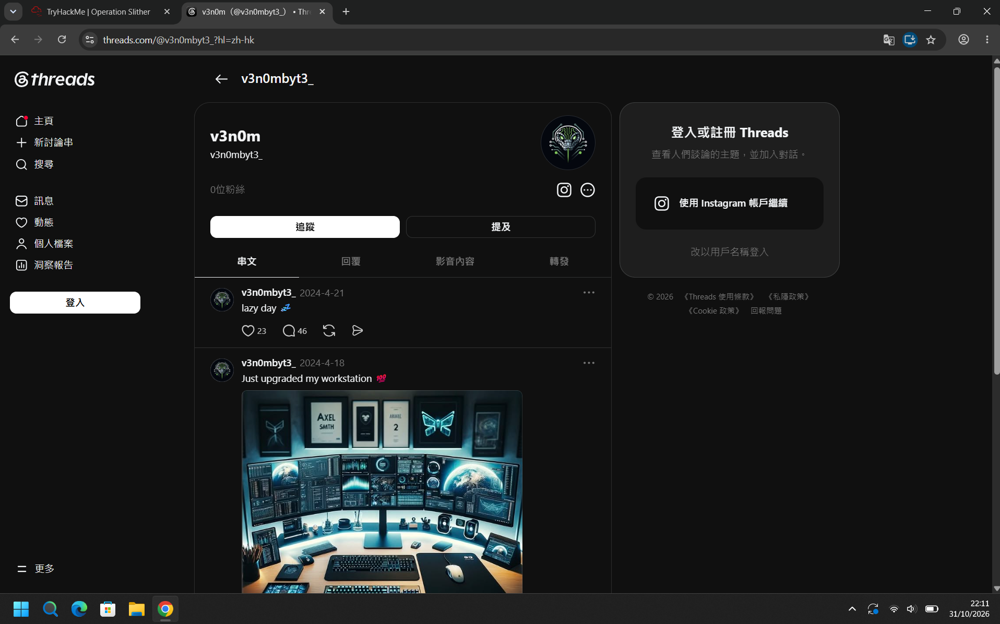
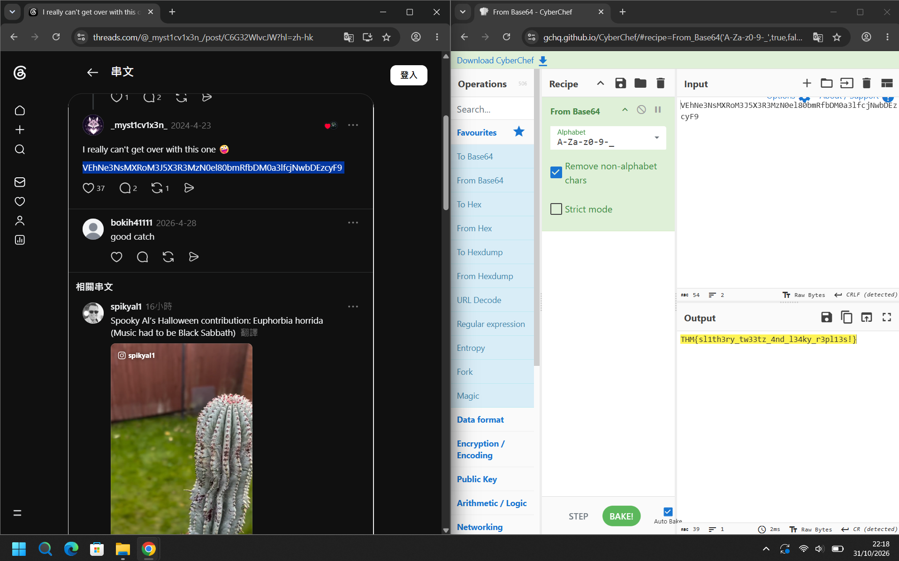
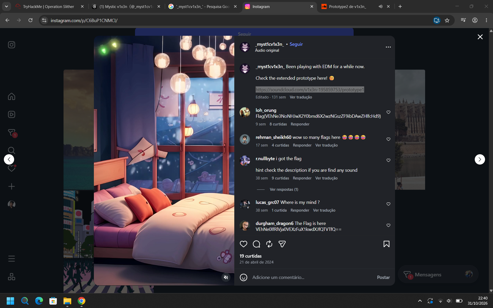
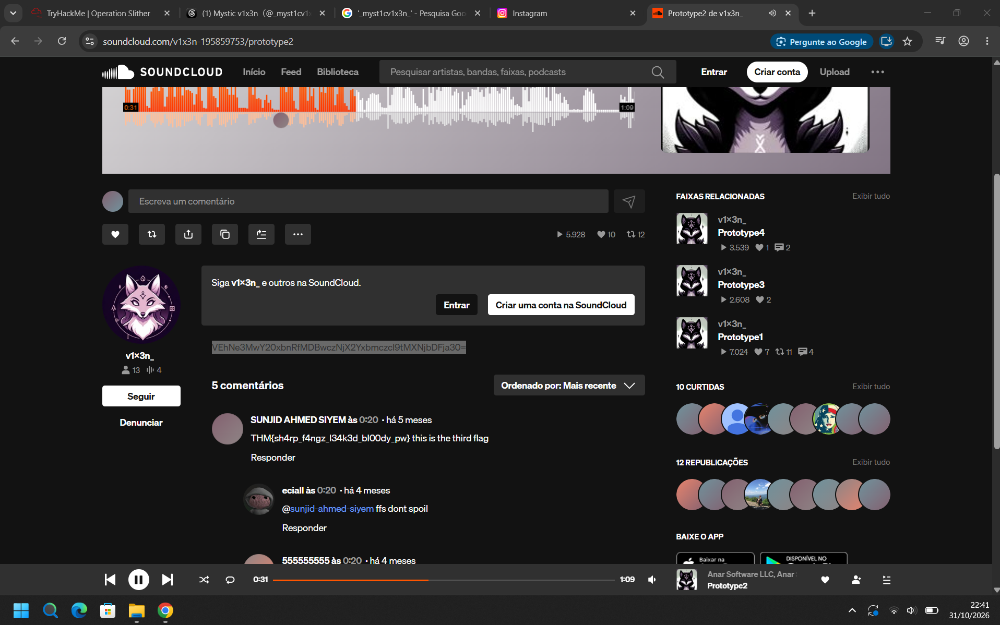
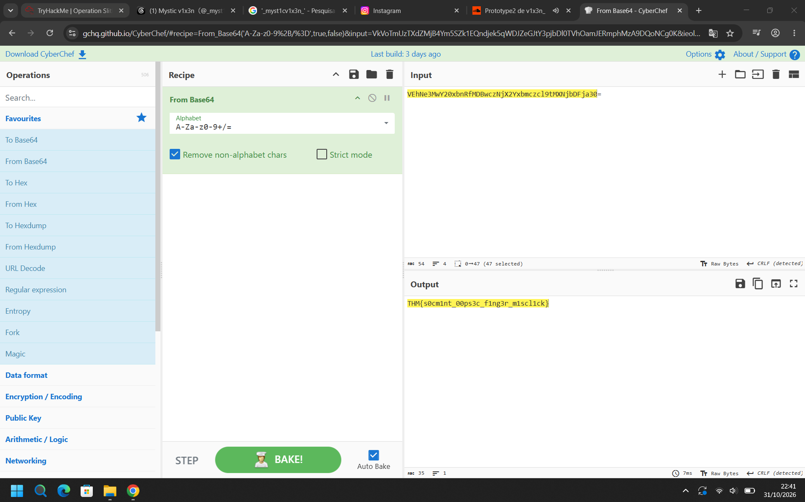
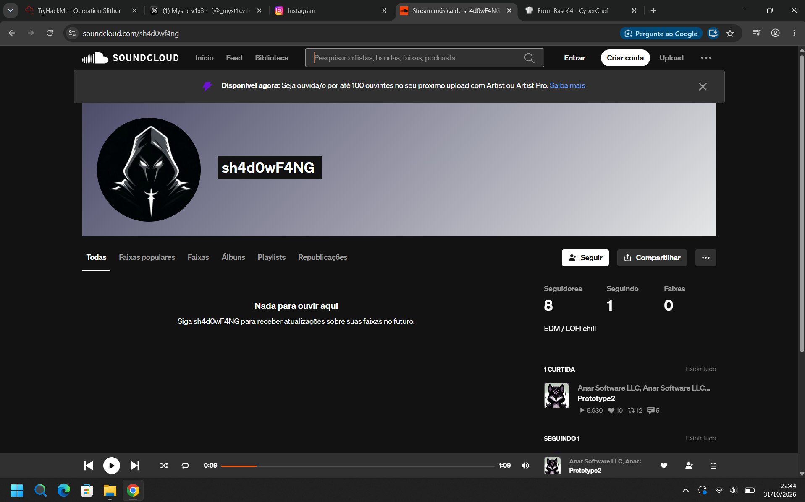
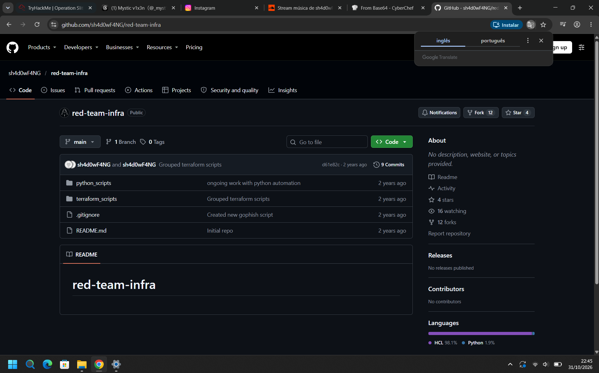
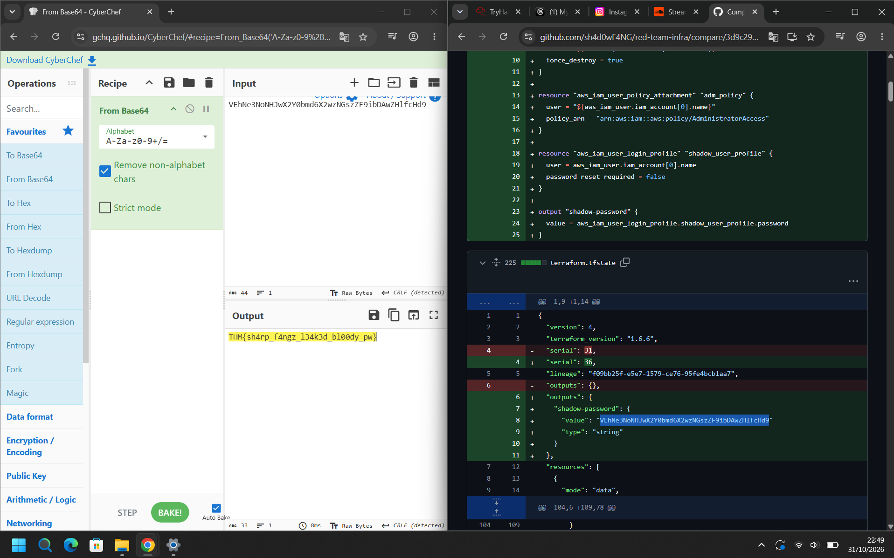

# 🐍 Operation Slither — CTF Writeup
### TryHackMe Room | OSINT · Rastreamento de Operadores de um Grupo de Ransomware/Extorsão em Redes Sociais

---

| **Analista**          | Mauricio Robert                                                                              |
|-----------------------|----------------------------------------------------------------------------------------------|
| **Organização**       | Faculdade Impacta                                                                            |
| **Data do Relatório** | 31/10/2026                                                                                   |
| **Fonte do Incidente**| Post em fórum hacker anunciando venda da base de dados da "TryTelecomMe"                     |
| **Classificação**     | CONFIDENCIAL                                                                                  |
| **Grupo investigado** | **Sneaky Viper** (grupo de extorsão por vazamento de dados — *Operation Slither*)             |
| **Ferramentas**       | OSINT manual (Threads, Instagram, SoundCloud, GitHub) + CyberChef (`From Base64`)             |
| **Link da sala**      | [tryhackme.com/room/operationslither](https://tryhackme.com/room/operationslither)            |

---

## 🔍 Resumo Executivo

O desafio **Operation Slither** (TryHackMe) é uma investigação **OSINT em 3 etapas**, disparada por três postagens sucessivas em um fórum hacker anunciando a venda de dados roubados da empresa fictícia **TryTelecomMe**. Cada postagem é assinada ou associada a um operador diferente do grupo **Sneaky Viper**, e o objetivo é identificar cada um deles cruzando perfis em redes sociais, confirmando autenticidade por correlação de conteúdo, e extraindo *flags* escondidas em formato **Base64** no meio de posts, bios e commits.

A cadeia de investigação revelou três operadores conectados entre si:

1. **`v3n0mbyt3_`** — líder do grupo Sneaky Viper, autor do primeiro vazamento, também ativo no **Threads** sob a persona **`_myst1cv1x3n_`** ("Mystic v1x3n").
2. **`v1x3n_`** — segundo operador, identificado a partir das interações de `_myst1cv1x3n_` no Threads/Instagram, com conta ativa no **SoundCloud**.
3. **`sh4d0wF4NG`** — terceiro operador, identificado via conexão no SoundCloud com `v1x3n_`, responsável pelo desenvolvimento da infraestrutura de ataque (repositório **GitHub** `red-team-infra`, com scripts Terraform, GoPhish e Cobalt Strike).

Cada etapa revelou uma *flag* codificada em Base64, decodificada com o **CyberChef** (`From Base64`).

---

## 🛠 Metodologia

| Etapa | Ação |
|-------|------|
| 1 | Partir do *handle* fornecido no post do fórum (`v3n0mbyt3_`) |
| 2 | Buscar o mesmo *handle*/variações em plataformas comuns (Twitter/X, Threads, Instagram) |
| 3 | Correlacionar perfis encontrados — bio, estilo de escrita, temas (música eletrônica/lofi, estética "caótica") — para confirmar que pertencem à mesma pessoa ou a operadores conectados |
| 4 | Analisar posts, comentários e curtidas em busca de pistas (links, menções, mídia) |
| 5 | Seguir links cruzados (Instagram → SoundCloud → GitHub) para enumerar novos operadores e plataformas |
| 6 | Extrair strings em Base64 encontradas em posts/bios/commits e decodificar no **CyberChef** |

---

## 📋 Task 1 — Identificando o Líder: `v3n0mbyt3_`

> **Pergunta 1: Além de Twitter/X, qual outra plataforma é usada por `v3n0mbyt3_`?**
> **Resposta: `threads`**
>
> **Pergunta 2: Qual é o valor da flag?**
> **Resposta: `THM{sl1th3ry_tw33tz_4nd_l34ky_r3pl13s!}`**

**Solução:** Partindo do *handle* `@v3n0mbyt3_`, assinatura deixada no post de venda da base de dados, a busca em plataformas comuns revela uma conta no **Threads** com o mesmo nome de usuário:

> 

O perfil `v3n0mbyt3_` ("v3n0m") tem poucos seguidores e posts como *"lazy day"* e *"Just upgraded my workstation 💯"* (com foto de um setup multi-monitor). A estética (caótica, ligada a música eletrônica) e o padrão de nomenclatura levam à descoberta de uma persona correlata no mesmo Threads: **`_myst1cv1x3n_`** ("Mystic v1x3n"), confirmada como a mesma pessoa/operador por semelhança de estilo e tema de bio ("*Delightfully Chaotic xo*"):

Em um dos posts dessa conta — *"I really can't get over with this one 🤡"* — há uma string em Base64 destacada no corpo do texto:

```
VEhNe3NsMXRoM3J5X3R3M3MtZaml80bmRfbDM0a3lfcjNwbDEzcyF9
```

Decodificando no **CyberChef** (`From Base64`, alfabeto `A-Za-z0-9-_`):

> 

```
THM{sl1th3ry_tw33tz_4nd_l34ky_r3pl13s!}
```

A flag confirma o tema da sala — **"tweets escorregadios e respostas vazadas"** — e valida que a persona `_myst1cv1x3n_` pertence ao líder do grupo **Sneaky Viper**.

---

## 📋 Task 2 — Identificando o Segundo Operador: `v1x3n_`

> **Pergunta 1: Qual é o nome de usuário do segundo operador que conversa com `v3n0mbyt3` na plataforma anterior?**
> **Resposta: `v1x3n_`**
>
> **Pergunta 2: Qual é o valor da flag?**
> **Resposta: `THM{s0cm1nt_00ps3c_f1ng3r_m1scl1ck}`**

**Solução:** A conta do fórum foi excluída antes da segunda postagem, então a investigação segue as conexões já identificadas no Threads. A persona `_myst1cv1x3n_` cruza posts com o Instagram, onde publica a divulgação de uma faixa musical:

> *"Been playing with EDM for a while now. Check the extended prototype here! 😊"*
> `https://soundcloud.com/v1x3n-195859753/prototype1`

> 

O link revela o segundo operador por trás da conta de música **`v1x3n_`** no **SoundCloud** — nome de usuário quase idêntico ao da persona do líder (`v1x3n` vs. `myst1cv1x3n`), confirmando a conexão direta entre os dois operadores do grupo:

> 

Na descrição da faixa **"Prototype2"**, uma string em Base64 novamente aparece:

```
VEhNe3MwY20xbnRfMDBwczNjZcNoc3byZcl9tMXNjbDBFja30=
```

Decodificada no **CyberChef**:

> 

```
THM{s0cm1nt_00ps3c_f1ng3r_m1scl1ck}
```

A flag — **"erro de OPSEC por um clique errado do dedo"** — reforça que o operador cometeu um deslize de segurança operacional ao deixar a string exposta publicamente na própria plataforma de música.

---

## 📋 Task 3 — Identificando o Terceiro Operador: `sh4d0wF4NG`

> **Pergunta 1: Qual é o handle do terceiro operador?**
> **Resposta: `sh4d0wF4NG`**
>
> **Pergunta 2: Qual outra plataforma o terceiro operador usa? (minúsculas)**
> **Resposta: `soundcloud`**
>
> **Pergunta 3: Qual é o valor da flag?**
> **Resposta: `THM{sh4rp_f4ngz_l34k3d_bl00dy_pw}`**

**Solução:** O terceiro post do fórum anuncia a venda de **infraestrutura de ataque** — scripts de automação de phishing (Terraform, GoPhish, Evilginx, bypass de MFA do Google, *aggressor scripts* do Cobalt Strike e payloads de evasão de EDR). O guia de reconhecimento orienta a buscar contas secundárias através de interações visíveis (curtidas/seguidores). No perfil SoundCloud de `v1x3n_`, a faixa "Prototype2" aparece curtida por outro usuário: **`sh4d0wF4NG`**.

> 

O perfil `sh4d0wF4NG` no SoundCloud (bio *"EDM / LOFI chill"*) não contém faixas próprias, mas confirma a conexão com `v1x3n_` através da curtida. Estendendo a investigação para plataformas técnicas/de desenvolvedor com o mesmo *handle*, localiza-se o perfil **GitHub `sh4d0wF4NG`**, com o repositório público **`red-team-infra`**:

> 

O repositório contém as pastas `python_scripts` e `terraform_scripts` (escrito majoritariamente em **HCL — 98,1%**), com commits como *"Grouped terraform scripts"* e *"Created new gophish script"* — correspondendo exatamente aos itens anunciados no terceiro post do fórum (infraestrutura de phishing resiliente via Terraform + automação GoPhish).

Analisando o **histórico de commits** do arquivo `terraform.tfstate`, é possível observar um *diff* que expõe um recurso `aws_iam_user_login_profile` com uma senha de usuário "sombra" (`shadow_user_profile`) exportada como *output* em texto plano no estado do Terraform — um erro clássico de segurança (*hardcoded secret in state file*):

```hcl
+ resource "aws_iam_user_login_profile" "shadow_user_profile" {
+   user = aws_iam_user.iam_account[0].name
+   password_reset_required = false
+ }
+
+ output "shadow-password" {
+   value = aws_iam_user_login_profile.shadow_user_profile.password
+ }
```

O valor exposto no `terraform.tfstate` é a string Base64:

```
VEhNe3NoNHJwX2Y0bmd6X2wzNGszZF9ibDBvZHlfcHd9
```

Decodificada no **CyberChef**:

> 

```
THM{sh4rp_f4ngz_l34k3d_bl00dy_pw}
```

A flag — **"presas afiadas, senha sangrenta vazada"** — encerra a cadeia de investigação, confirmando `sh4d0wF4NG` como o terceiro operador do Sneaky Viper, responsável pela infraestrutura técnica do ataque, e expondo uma credencial AWS comprometida por má prática de *Infrastructure as Code*.

---

## 🗺 Mapeamento Investigativo — Cadeia de Correlação dos Operadores

```
[FÓRUM HACKER]  "@v3n0mbyt3_"  (post 1 — venda da base TryTelecomMe)
        │
        ▼
[THREADS]  @v3n0mbyt3_  ──(mesma pessoa / persona alternativa)──►  @_myst1cv1x3n_ "Mystic v1x3n"
        │                                                                   │
        │                                                      FLAG 1: sl1th3ry_tw33tz_4nd_l34ky_r3pl13s!
        │
        ▼
[INSTAGRAM]  @_myst1cv1x3n_  ──(divulga link)──►  soundcloud.com/v1x3n_
        │
        ▼
[SOUNDCLOUD]  v1x3n_  (2º operador)
        │                                          FLAG 2: s0cm1nt_00ps3c_f1ng3r_m1scl1ck
        │
        │ (curtida/seguidor cruzado)
        ▼
[SOUNDCLOUD]  sh4d0wF4NG  (3º operador)
        │
        ▼
[GITHUB]  sh4d0wF4NG / red-team-infra
        (Terraform + GoPhish + Cobalt Strike + bypass de EDR)
                                                    FLAG 3: sh4rp_f4ngz_l34k3d_bl00dy_pw
```

---

## 🚨 Perfis e Indicadores Identificados (IOCs)

| Operador | Papel | Plataformas Identificadas | Evidência-chave |
|----------|-------|----------------------------|------------------|
| `v3n0mbyt3_` | Líder do Sneaky Viper | Fórum hacker, Twitter/X, **Threads** | Assinatura no post de venda + perfil Threads |
| `_myst1cv1x3n_` ("Mystic v1x3n") | Persona alternativa do líder | Threads, Instagram | Bio/estilo correlato + flag em post público |
| `v1x3n_` | 2º operador | SoundCloud (via link do Instagram) | Faixas "Prototype1/2" com flag na descrição |
| `sh4d0wF4NG` | 3º operador — infraestrutura técnica | SoundCloud, **GitHub** | Curtida cruzada no SoundCloud + repositório `red-team-infra` |
| Repositório malicioso | `red-team-infra` (GitHub) | — | Scripts Terraform/GoPhish, `terraform.tfstate` com credencial AWS vazada |
| Ferramentas anunciadas | Evilginx v3.0, GoPhish, Cobalt Strike aggressor scripts, bypass de MFA/EDR (SentinelOne, CrowdStrike, Cortex XDR) | — | Post 3 do fórum hacker |

---

## ✅ Resumo das Flags

| Task | Operador | Flag |
|------|----------|------|
| 1 | `v3n0mbyt3_` / `_myst1cv1x3n_` (Threads) | `THM{sl1th3ry_tw33tz_4nd_l34ky_r3pl13s!}` |
| 2 | `v1x3n_` (SoundCloud) | `THM{s0cm1nt_00ps3c_f1ng3r_m1scl1ck}` |
| 3 | `sh4d0wF4NG` (GitHub) | `THM{sh4rp_f4ngz_l34k3d_bl00dy_pw}` |

---

## 📚 Referências

- [TryHackMe — Operation Slither](https://tryhackme.com/room/operationslither)
- [CyberChef — From Base64](https://gchq.github.io/CyberChef/#recipe=From_Base64\('A-Za-z0-9-_',true,false\))
- [OSINT Framework](https://osintframework.com/)
- [Terraform — Sensitive Data in State](https://developer.hashicorp.com/terraform/language/state/sensitive-data)
- [MITRE ATT&CK — T1593 Search Open Websites/Domains](https://attack.mitre.org/techniques/T1593/)

---