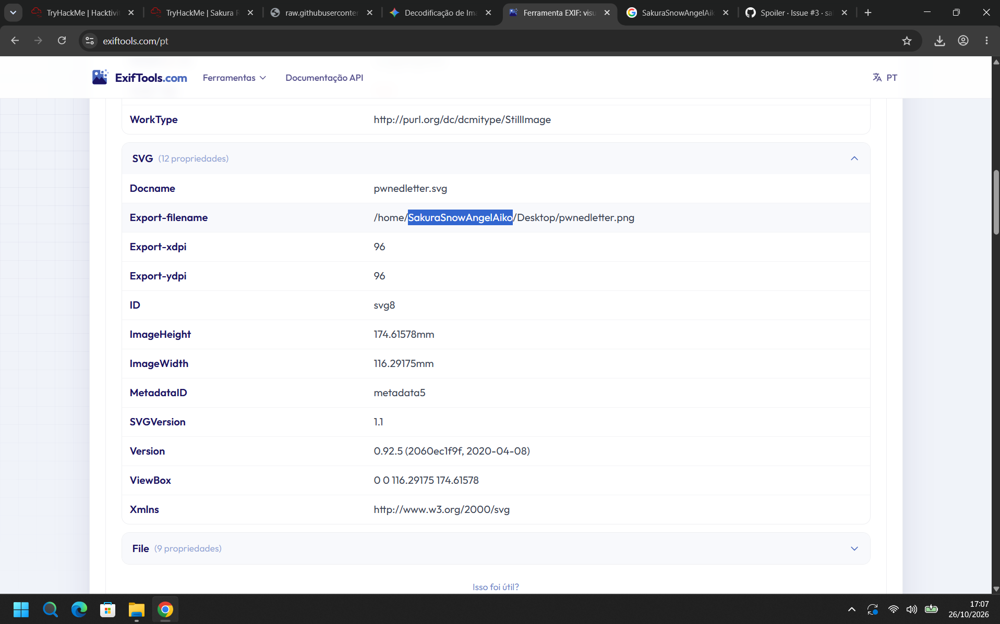
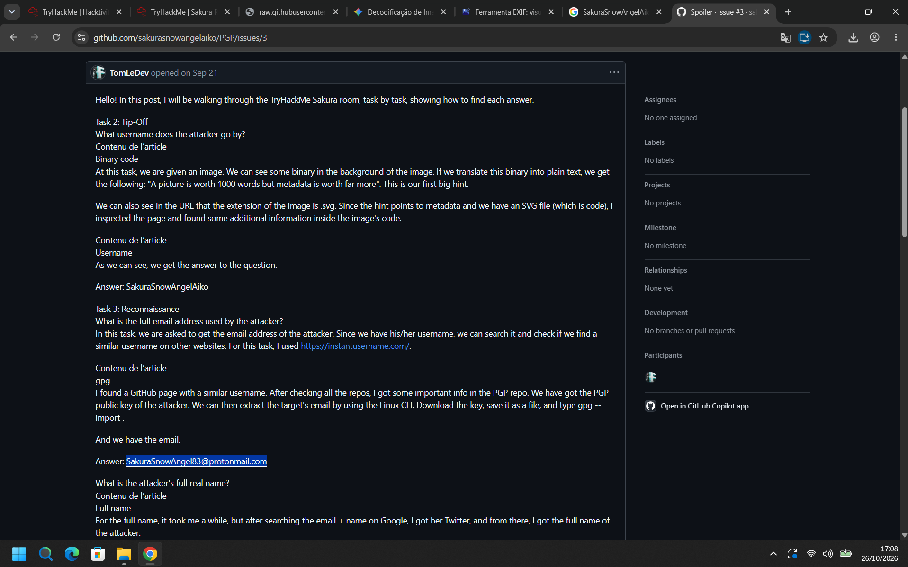
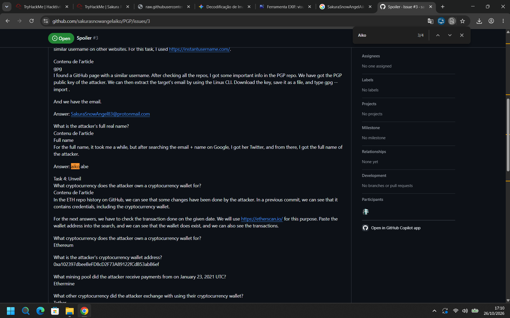
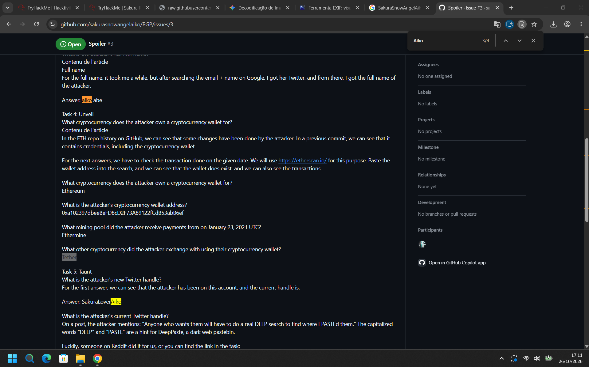
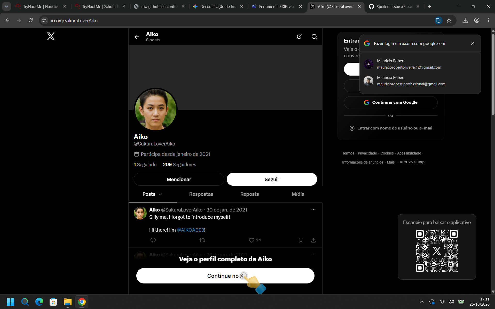
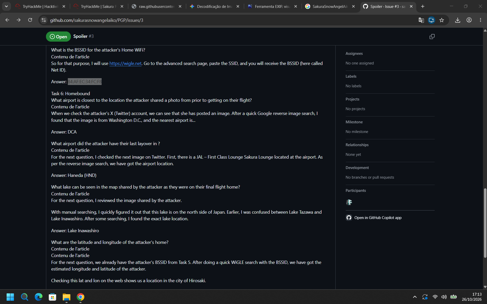
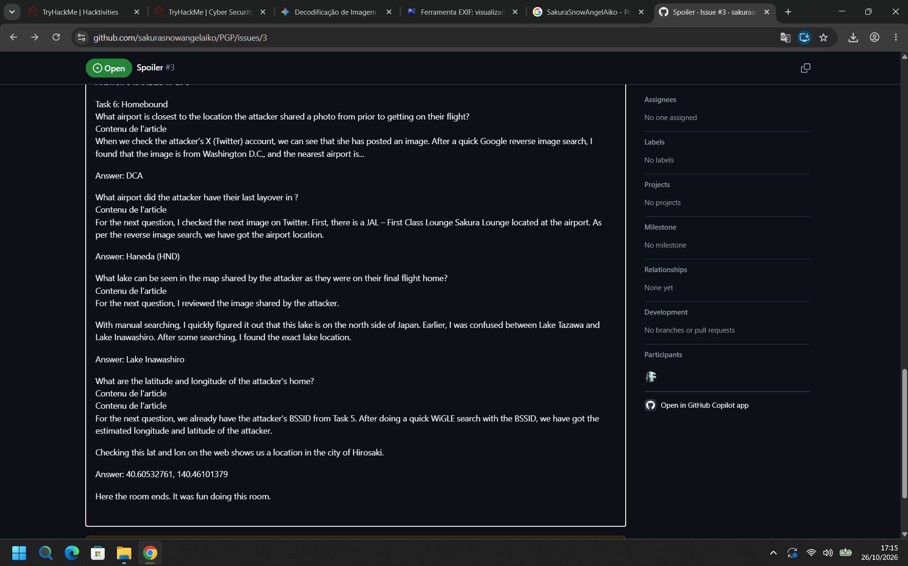

# TryHackMe – Sakura (Writeup)

**Room:** https://tryhackme.com/room/sakura
**Categoria:** OSINT (Open Source Intelligence)
**Cenário:** Uma investigação OSINT sobre uma atacante fictícia que se identifica como "Sakura". A partir de uma única imagem (uma carta de resgate/"pwned letter"), o objetivo é encontrar o nome de usuário, o e-mail, a identidade real, as carteiras de criptomoedas, a conta no X (Twitter) e a localização da casa da atacante.

---

## Fontes e transparência

Os prints deste writeup vêm de duas fontes diferentes:

| Origem | Evidências | Observação |
|--------|-----------|------------|
| **Análise própria** | `Username_in_PC.png` (metadados no ExifTools) e `Twitter.png` (perfil no X) | Verificadas diretamente nos prints |
| **Walkthrough público** | `Email_of_Sakura.png`, `Her_Name.png`, `Crypto.png`, `BSSID.png`, `Home_and_Locations.png` | Capturas de um passo a passo em uma issue pública do GitHub (`sakurasnowangelaiko/PGP/issues/3`, "Spoiler #3") |

- Os textos das perguntas foram reconstruídos a partir do passo a passo, e não copiados do enunciado da sala.
- Onde um resultado vem apenas do walkthrough, ele está sinalizado. Vale reproduzir esses passos por conta própria antes de publicar este documento como trabalho seu.

---

## Resumo das respostas

| Task | Pergunta | Resposta |
|------|----------|----------|
| 2 – Tip-Off | Nome de usuário da atacante | `SakuraSnowAngelAiko` |
| 3 – Reconnaissance | E-mail completo usado pela atacante | `SakuraSnowAngel83@protonmail.com` |
| 3 – Reconnaissance | Nome real completo | `Aiko Abe` |
| 4 – Unveil | Criptomoeda da carteira | `Ethereum` |
| 4 – Unveil | Endereço da carteira | `0xa102397dbeeBeFD8cD2F73A89122fCdB53abB6ef` |
| 4 – Unveil | Pool de mineração que pagou em 23/01/2021 (UTC) | `Ethermine` |
| 4 – Unveil | Outra criptomoeda trocada com a carteira | `Tether` |
| 5 – Taunt | Handle (novo/atual) da atacante no X | `SakuraLoverAiko` |
| 5 – Taunt | BSSID do Wi-Fi da casa da atacante | `84:AF:EC:34:FC:F8` |
| 6 – Homebound | Aeroporto mais próximo da foto antes do voo | `DCA` |
| 6 – Homebound | Aeroporto da última escala | `Haneda (HND)` |
| 6 – Homebound | Lago visível no mapa do voo final para casa | `Lake Inawashiro` |
| 6 – Homebound | Latitude e longitude da casa | `40.60532761, 140.46101379` |

---

## Task 2 – Tip-Off

### Metodologia

1. A sala entrega uma imagem **SVG** (a carta). No fundo dela há texto em **binário**. Convertido para texto, ele diz: *"A picture is worth 1000 words but metadata is worth far more"*, uma dica clara para olhar os **metadados**.
2. Como o SVG é um arquivo de código (XML), os metadados também podem ser inspecionados no código-fonte da página. Eu os li com o **ExifTools** (`exiftools.com`), na seção **SVG (12 propriedades)**:

| Propriedade | Valor |
|-------------|-------|
| `Docname` | `pwnedletter.svg` |
| **`Export-filename`** | **`/home/SakuraSnowAngelAiko/Desktop/pwnedletter.png`** |
| `Export-xdpi` / `Export-ydpi` | 96 / 96 |
| `ID` | `svg8` |
| `ImageHeight` / `ImageWidth` | 174.61578mm / 116.29175mm |
| `MetadataID` | `metadata5` |
| `SVGVersion` | 1.1 |
| `Version` | 0.92.5 (2060ec1f9f, 2020-04-08), versão do editor (Inkscape) |
| `WorkType` | `http://purl.org/dc/dcmitype/StillImage` |

3. O caminho de exportação `/home/SakuraSnowAngelAiko/Desktop/...` vaza o **nome de usuário** da conta do computador de quem criou a imagem.


**Resposta:** `SakuraSnowAngelAiko`

---

## Task 3 – Reconnaissance

### 3.1 E-mail da atacante

### Metodologia

1. Com o nome de usuário em mãos, busquei o mesmo nome em outros sites usando o **instantusername.com**.
2. A busca encontrou uma conta no **GitHub** com um nome parecido (`sakurasnowangelaiko`). Ao revisar os repositórios, o repositório **`PGP`** tem a **chave pública PGP** da atacante.
3. Baixei a chave, salvei em um arquivo e a importei com o GnuPG:

```bash
gpg --import chave.asc
```

4. O `gpg` mostra o identificador (nome e e-mail) associado à chave.



**Resposta:** `SakuraSnowAngel83@protonmail.com`

### 3.2 Nome real

### Metodologia

1. Pesquisei o e-mail e o nome de usuário no Google, o que levou à conta da atacante no **X (Twitter)**.
2. A partir do perfil e das publicações, chega-se ao nome completo.



**Resposta:** `Aiko Abe`

---

## Task 4 – Unveil

### Metodologia

1. No GitHub da atacante há um repositório sobre **ETH**. No **histórico de commits** é possível ver mudanças feitas por ela. Em um commit anterior aparecem **credenciais**, incluindo a carteira de criptomoedas.
2. Para checar as transações, colei o endereço da carteira no **Etherscan** (`etherscan.io`). A carteira existe e mostra o histórico de transações, e com a data pedida (23/01/2021, UTC) dá para ver de onde vieram os pagamentos.



| Pergunta | Resposta |
|----------|----------|
| Criptomoeda da carteira | **Ethereum** |
| Endereço da carteira | **`0xa102397dbeeBeFD8cD2F73A89122fCdB53abB6ef`** |
| Pool de mineração em 23/01/2021 (UTC) | **Ethermine** |
| Outra criptomoeda trocada com a carteira | **Tether** |

---

## Task 5 – Taunt

### 5.1 Handle no X

1. O perfil no X (`x.com/SakuraLoverAiko`) mostra:

| Campo | Valor |
|-------|-------|
| Nome | **Aiko** |
| Handle | **`@SakuraLoverAiko`** |
| Conta criada | janeiro de 2021 |
| Posts / seguindo / seguidores | 8 / 1 / 209 |

2. A primeira publicação do perfil (30/01/2021) diz *"Silly me, I forgot to introduce myself! Hi there! I'm @AiKOABE3!"*. Isso indica que `@AiKOABE3` é um **handle anterior** e que `@SakuraLoverAiko` é o atual (inferência a partir do print).



**Resposta:** `SakuraLoverAiko`

### 5.2 Local onde o SSID e a senha foram salvos

### 5.3 BSSID do Wi-Fi da casa

1. Com o SSID, usei o **WiGLE** (`wigle.net`). Na página de busca avançada, colando o SSID, o site devolve o **BSSID** (chamado "Net ID").



**Resposta:** `84:AF:EC:34:FC:F8`

---

## Task 6 – Homebound



| Pergunta | Método | Resposta |
|----------|--------|----------|
| Aeroporto mais próximo do local da foto antes do voo | Busca reversa de imagem no Google: a foto é de **Washington, D.C.** | **`DCA`** |
| Aeroporto da última escala | Outra imagem no X mostra o **JAL First Class Lounge "Sakura Lounge"**. A busca reversa identifica o aeroporto | **`Haneda (HND)`** |
| Lago visível no mapa do voo final para casa | Busca manual: o lago fica no norte do Japão. Havia dúvida entre **Lake Tazawa** e **Lake Inawashiro**; pesquisando, confirma-se o segundo | **`Lake Inawashiro`** |
| Latitude e longitude da casa | Com o BSSID da Task 5, uma busca no **WiGLE** devolve as coordenadas estimadas. Conferindo no mapa, o local é na cidade de **Hirosaki** | **`40.60532761, 140.46101379`** |

---

## Cadeia de investigação

```
Imagem SVG (carta)
   │  binário no fundo + metadados
   ▼
Username: SakuraSnowAngelAiko   (Export-filename em /home/...)
   │  instantusername.com
   ▼
GitHub: sakurasnowangelaiko  →  repositório PGP  →  gpg --import
   │
   ▼
E-mail: SakuraSnowAngel83@protonmail.com  →  Google  →  conta no X  →  Aiko Abe
   │
   ├── Repositório ETH (histórico de commits) → carteira → Etherscan
   │        (Ethereum, Ethermine, Tether)
   │
   └── X (@SakuraLoverAiko) → dica DEEP + PASTE → DeepPaste → SSID
            │  WiGLE
            ▼
        BSSID 84:AF:EC:34:FC:F8 → 40.60532761, 140.46101379 (Hirosaki)
        + fotos: DCA (Washington), HND (Haneda), Lake Inawashiro
```

---

## Técnicas e ferramentas de OSINT

| Técnica | Ferramenta |
|---------|-----------|
| Análise de metadados de imagem | ExifTools.com, inspeção do código do SVG |
| Correlação de nome de usuário entre sites | instantusername.com |
| Análise de repositórios e histórico de commits | GitHub |
| Extração de e-mail de chave pública | GnuPG (`gpg --import`) |
| Análise de transações em blockchain | Etherscan |
| Geolocalização por Wi-Fi | WiGLE |
| Busca reversa de imagem e geolocalização | Google Imagens, pesquisa manual em mapas |
| Pesquisa em redes sociais | X (Twitter) |

---